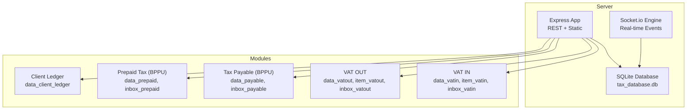
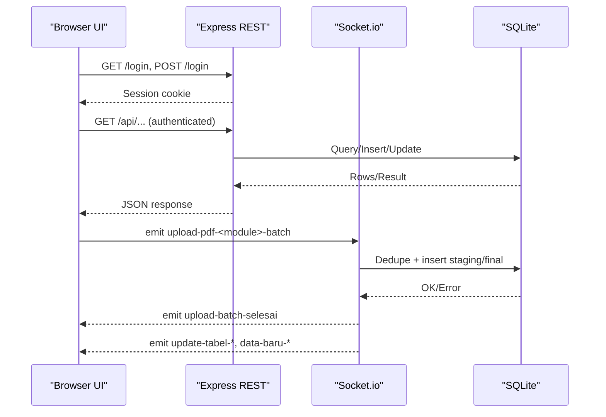
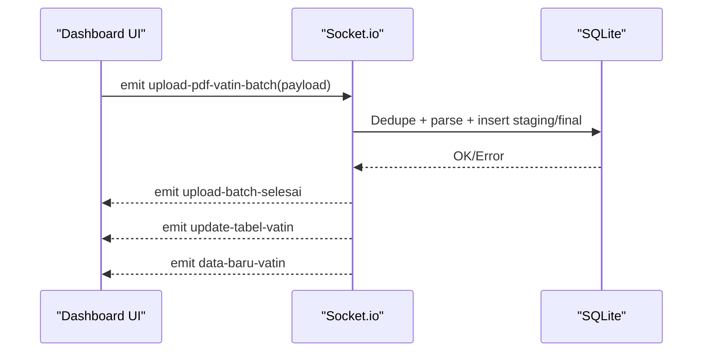
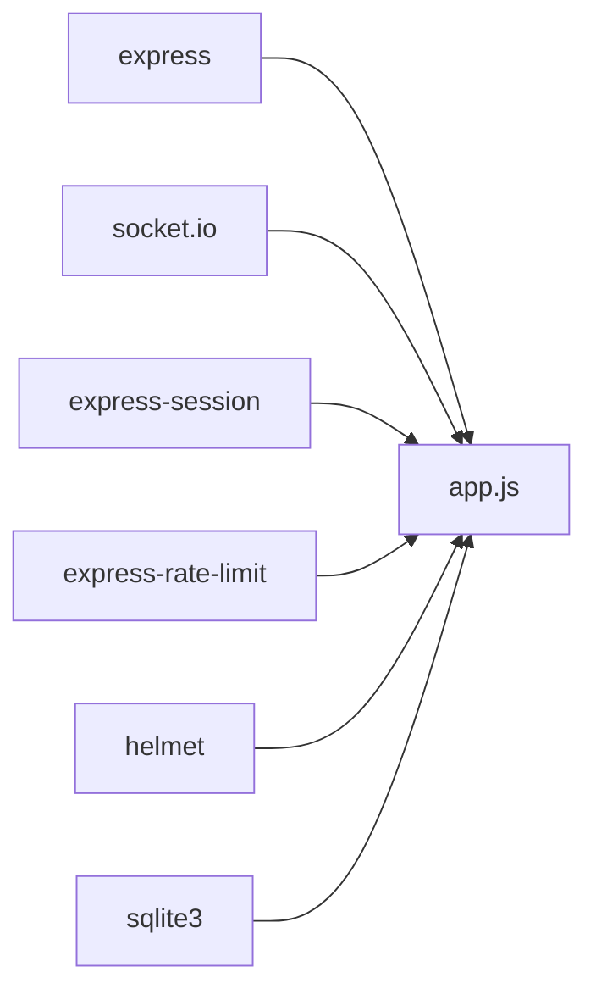

# API Reference

<cite>
**Referenced Files in This Document**
- [app.js](file://app.js)
- [package.json](file://package.json)
- [TDS_Sequence_Diagram.md](file://TDS_Sequence_Diagram.md)
- [export.js](file://export.js)
- [PRD_Tax_Database_System.md](file://PRD_Tax_Database_System.md)
- [vat_in/dashboard_vatin.html](file://vat_in/dashboard_vatin.html)
- [vat_out/inbox_vatout.html](file://vat_out/inbox_vatout.html)
- [prepaidtax_bppu/inbox_prepaid.html](file://prepaidtax_bppu/inbox_prepaid.html)
</cite>

## Table of Contents
1. [Introduction](#introduction)
2. [Project Structure](#project-structure)
3. [Core Components](#core-components)
4. [Architecture Overview](#architecture-overview)
5. [Detailed Component Analysis](#detailed-component-analysis)
6. [Dependency Analysis](#dependency-analysis)
7. [Performance Considerations](#performance-considerations)
8. [Troubleshooting Guide](#troubleshooting-guide)
9. [Conclusion](#conclusion)
10. [Appendices](#appendices)

## Introduction
This document provides comprehensive API documentation for the TDS (Tax Database System). It covers:
- REST API endpoints for authentication, master data, analytics, and administrative tasks
- Real-time communication via Socket.io events for batch ingestion and live UI updates
- Internal system APIs and inter-module communication patterns
- Authentication, authorization, rate limiting, and error handling strategies
- Practical usage examples, client integration patterns, and performance optimization tips

## Project Structure
The backend is implemented as a single-file Express server with integrated Socket.io for real-time features. Key areas:
- REST endpoints under /api for data access and administrative operations
- Socket.io event handlers for batch PDF ingestion and live updates
- Static routes for module dashboards and archives
- Export utilities for CSV/XLSX generation

**Diagram sources**
- [app.js](file://app.js)
- [TDS_Sequence_Diagram.md](file://TDS_Sequence_Diagram.md)

**Section sources**
- [app.js](file://app.js)
- [package.json](file://package.json)

## Core Components
- REST API surface: Authentication, master data, analytics, migrations, and administrative endpoints
- Socket.io real-time pipeline: Batch PDF ingestion, staging/finalization, and live UI updates
- Security middleware: Helmet, session-based auth, rate limiting, and RBAC enforcement
- Export utilities: CSV/XLSX generation for reporting

**Section sources**
- [app.js](file://app.js)
- [export.js](file://export.js)

## Architecture Overview
The system integrates REST and WebSocket communication:
- REST endpoints serve UI pages and structured data
- Socket.io handles asynchronous batch processing and emits live updates
- Role-based access control ensures secure mutation workflows
- Audit logging tracks sensitive actions

**Diagram sources**
- [TDS_Sequence_Diagram.md](file://TDS_Sequence_Diagram.md)
- [app.js](file://app.js)

## Detailed Component Analysis

### Authentication and Authorization
- Endpoint: POST /login
  - Method: POST
  - Body: username, password
  - Behavior: Validates credentials against users table, sets session on success
  - Response: Redirect on success; generic error message on failure
  - Rate limiting: Enforced via loginLimiter (max 20 attempts per 15 minutes)
- Endpoint: GET /logout
  - Behavior: Destroys session and redirects to login
- Session and CSRF protection:
  - express-session with httpOnly and strict SameSite cookies
  - Helmet enabled (with CSP disabled for compatibility)
- RBAC:
  - Middleware cekRoleAPI restricts admin endpoints by role
  - Roles: staff, supervisor, administrator (superadmin also documented)

**Section sources**
- [app.js](file://app.js)
- [PRD_Tax_Database_System.md](file://PRD_Tax_Database_System.md)

### REST API Endpoints

#### Public Pages and Dashboards
- GET /
  - Redirects authenticated users to dashboard
- GET /login
  - Serves login page
- GET /dashboard-utama, /profile, /manage-users, /master-cabang, /master-kontak, /audit-logs, /tax-project-report, /client-ledger
  - Served as static HTML after authentication

**Section sources**
- [app.js](file://app.js)

#### Admin Data Access
- GET /api/master-cabang-all
  - Requires roles: administrator, supervisor, superadmin
  - Response: Array of branches
- GET /api/master-kontak-all
  - Requires roles: administrator, supervisor, superadmin
  - Response: { clients: [...], vendors: [...] }
- GET /api/audit-logs
  - Requires roles: administrator, supervisor, superadmin
  - Response: Array of recent audit logs

**Section sources**
- [app.js](file://app.js)

#### Migration and Verification
- POST /api/migrate-vatin-status
  - Purpose: Backfill status_faktur, masa_pajak, no_faktur_normal for existing VAT IN records
  - Response: { success, message, total, updated, failed }
- GET /api/verify-vatin-migration
  - Purpose: Verify migration completeness and return samples
  - Response: { success, timestamp, statistics, samples }

**Section sources**
- [app.js](file://app.js)

#### Analytics and Reporting
- GET /api/projects
  - Query: entitas (default BBS)
  - Response: Branch list suitable for project selection
- GET /api/vo/:kode_cabang
  - Response: Variation Orders for the branch
- GET /api/project-summary/:id
  - Response: { keluaran: [...], masukan: [...] } aggregated by project
- GET /api/items/:mod/:faktur
  - Response: Line items for the invoice
- GET /api/detail-vatin/:faktur, GET /api/detail-vatout/:faktur
  - Response: Single invoice record
- GET /api/prepaid-comparison/:noBppu
  - Response: { prepaid, vatout: aggregated PPN across related invoices }
- GET /api/summary-prepaid
  - Response: Aggregated prepaid stats
- GET /api/data-client-ledger
  - Response: Client ledger entries
- GET /api/years-vatout
  - Response: Distinct years available for VAT OUT reports

Notes:
- Pagination and debounced SQL logic are used in module dashboards (see UI files below)
- Export endpoints: GET /api/export/... (see Export section)

**Section sources**
- [app.js](file://app.js)

#### User and Request Management
- GET /api/me
  - Response: Current user info from session
- GET /api/branches
  - Query: entitas
  - Response: Branches filtered by entity
- GET /api/users
  - Response: Users list
- GET /api/my-requests
  - Response: Requests submitted by current user
- GET /api/pending-requests
  - Response: Pending requests for supervisors

**Section sources**
- [app.js](file://app.js)

#### Dashboard Summary
- GET /api/dashboard-summary
  - Query: entitas (default BBS)
  - Response: Summary metrics across modules

**Section sources**
- [app.js](file://app.js)

### Socket.io Events and Real-Time Workflows

#### Batch PDF Upload Pipeline
- Event: upload-pdf-vatin-batch
  - Payload: { entitas, username, files: [{ teksPDF, fileBuffer }] }
  - Behavior: Parses PDF text, deduplicates by invoice number, inserts into staging/final tables, updates master vendor/client, emits completion and table update events
  - Emitted events:
    - upload-batch-selesai: { modul, total, sukses, duplikat, gagal }
    - update-tabel-vatin
    - data-baru-vatin
- Event: simpan-final-vatin
  - Payload: { branchInput, noFaktur, namaVendor, link_pdf_lokal, ... }
  - Behavior: Moves PDF to archive, finalizes transaction, emits updates
- Event: hapus-inbox-vatin
  - Payload: id
  - Behavior: Deletes staged record and associated PDF

- Event: upload-pdf-vatout-batch
  - Payload: similar to VAT IN
  - Emitted events:
    - upload-batch-selesai
    - update-tabel-vatout
- Event: simpan-final-vatout
  - Payload: { branchInput, noFaktur, namaPembeli, link_pdf_lokal, ... }
  - Behavior: Finalizes VAT OUT, moves PDF to archive, emits updates

- Event: upload-pdf-payable-batch
  - Payload: { entitas, username, files: [{ teksPDF, fileBuffer }] }
  - Behavior: Stages payable documents, deduplicates by no_bppu
  - Emitted events:
    - upload-batch-selesai
    - update-tabel-payable
    - data-baru-payable
- Event: simpan-final-payable
  - Payload: { branchInput, noBppu, ... }
  - Behavior: Inserts final payable, deletes inbox, emits updates

- Event: upload-pdf-prepaid-batch
  - Payload: { entitas, username, files: [{ teksPDF, fileBuffer }] }
  - Behavior: Stages prepaid documents, deduplicates by no_bppu
  - Emitted events:
    - upload-batch-selesai
    - update-tabel-prepaid
    - data-baru-prepaid
- Event: simpan-final-prepaid
  - Payload: { branchInput, noBppu, ... }
  - Behavior: Inserts final prepaid, deletes inbox, emits updates

- Event: hapus-inbox-payable
  - Payload: id
  - Behavior: Deletes staged payable and associated PDF

- Live Update Events
  - update-tabel-<module>: Refreshes the table view
  - data-baru-<module>: Triggers new row notifications

**Diagram sources**
- [TDS_Sequence_Diagram.md](file://TDS_Sequence_Diagram.md)
- [app.js](file://app.js)

**Section sources**
- [app.js](file://app.js)
- [vat_in/dashboard_vatin.html](file://vat_in/dashboard_vatin.html)
- [vat_out/inbox_vatout.html](file://vat_out/inbox_vatout.html)
- [prepaidtax_bppu/inbox_prepaid.html](file://prepaidtax_bppu/inbox_prepaid.html)

### Export Utilities
- Client-side export helpers:
  - exportTableData(tableId, filename, format, ignoreCols?)
  - exportExcelModern(data, filename)
  - exportExcelLegacy(data, filename)
  - downloadBlob(blob, filename)
  - showExportMenu(event, tableId, filenameBase, ignoreCols?)
- Supported formats: CSV, Excel (.xlsx if available, falls back to .xls)
- Ignore columns: defaults to [0,1,2] for legacy dashboards

**Section sources**
- [export.js](file://export.js)

### Internal Communication Protocols
- Module dashboards:
  - VAT IN: dashboard_vatin.html
  - VAT OUT: dashboard_vatout.html
  - Tax Payable: dashboard_payable.html
  - Prepaid Tax: dashboard_prepaid.html
- Archive folders:
  - /arsip_vatin, /arsip_vatout, /arsip_payable, /arsip_prepaid
- Audit logging:
  - Global insertAuditLog wrapper invoked during mutations

**Section sources**
- [app.js](file://app.js)

## Dependency Analysis
External libraries and their roles:
- express: Web framework
- socket.io: Real-time bidirectional event-based communication
- express-session: Session management
- express-rate-limit: Login brute-force protection
- helmet: Security headers
- sqlite3: Embedded database driver

**Diagram sources**
- [package.json](file://package.json)

**Section sources**
- [package.json](file://package.json)

## Performance Considerations
- Buffer sizing: Socket.io maxHttpBufferSize configured for large PDF batches
- JSON parsing limits: Express JSON/URL-encoded body limits set to 5MB
- Database indexing: Indexes on frequently queried columns (e.g., entitas + tanggal_faktur)
- Bulk processing: Promise wrappers for safe bulk operations
- Pagination and debounce: Implemented in module dashboards to reduce load

[No sources needed since this section provides general guidance]

## Troubleshooting Guide
Common issues and remedies:
- Login failures:
  - Symptom: Generic error message after login attempt
  - Cause: Incorrect credentials or rate-limited
  - Action: Wait for cooldown or retry with correct credentials
- Unauthorized access:
  - Symptom: 401 or 403 responses on protected endpoints
  - Cause: Missing/invalid session or insufficient role
  - Action: Authenticate and verify user role
- Duplicate uploads:
  - Symptom: Duplikat counter increases during batch upload
  - Cause: Existing invoice number detected
  - Action: Review staging/inbox and avoid duplicates
- PDF archival errors:
  - Symptom: Finalization fails or PDF not moved
  - Cause: File path mismatch or permission issues
  - Action: Confirm staging path and permissions; retry finalization
- Migration verification:
  - Symptom: Missing status/masa_pajak after migration
  - Action: Run verify endpoint and review samples

**Section sources**
- [app.js](file://app.js)

## Conclusion
The TDS system combines REST APIs and Socket.io to support batch ingestion, real-time updates, and comprehensive reporting across tax modules. Secure session-based authentication, RBAC, and audit logging protect sensitive operations. The export utilities enable flexible report generation. For production deployments, monitor rate limits, optimize database queries, and ensure proper file permissions for PDF archival.

[No sources needed since this section summarizes without analyzing specific files]

## Appendices

### Authentication and Authorization Summary
- Session cookie: httpOnly, strict SameSite
- Login rate limit: 20 attempts per 15 minutes
- RBAC roles: staff, supervisor, administrator (superadmin)

**Section sources**
- [app.js](file://app.js)
- [PRD_Tax_Database_System.md](file://PRD_Tax_Database_System.md)

### Example Usage Patterns
- Batch upload (VAT IN):
  - UI collects PDFs, chunks them, and emits upload-pdf-vatin-batch
  - On completion, listens for upload-batch-selesai and refreshes tables
- Finalization:
  - After verifying staging, emit simpan-final-<module> with required metadata
- Export:
  - Use exportTableData with CSV or Excel format to produce downloadable reports

**Section sources**
- [vat_in/dashboard_vatin.html](file://vat_in/dashboard_vatin.html)
- [vat_out/inbox_vatout.html](file://vat_out/inbox_vatout.html)
- [prepaidtax_bppu/inbox_prepaid.html](file://prepaidtax_bppu/inbox_prepaid.html)
- [export.js](file://export.js)