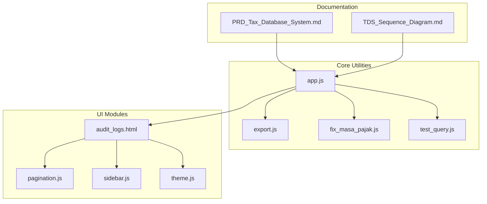
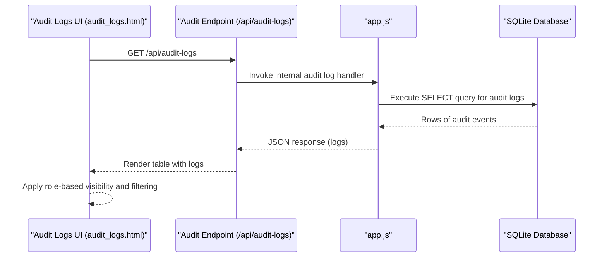
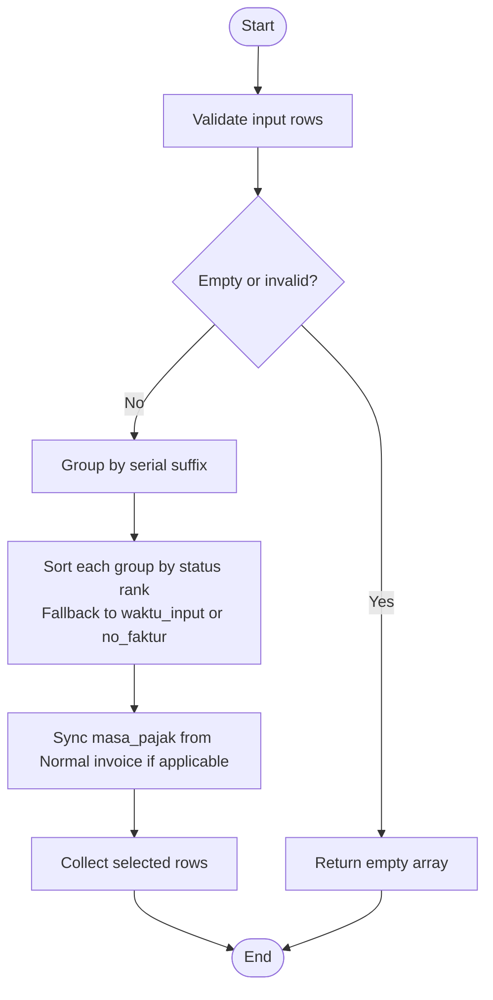
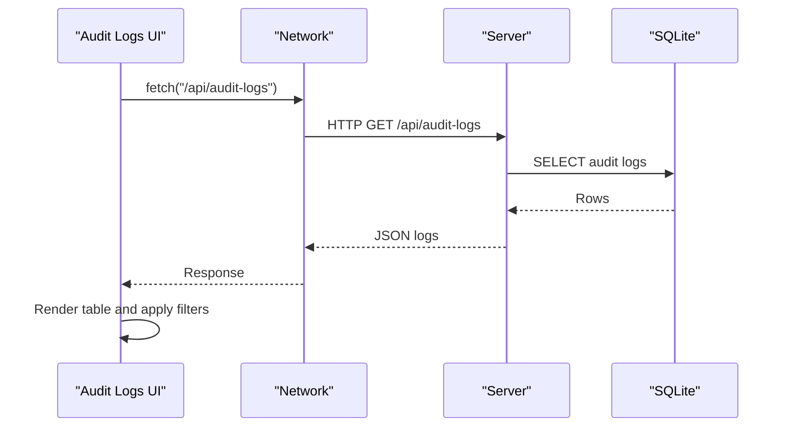
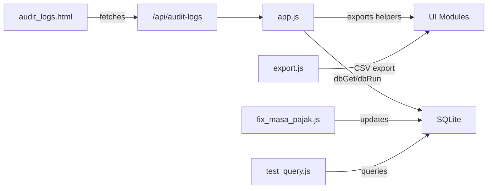

# Internal Communication

<cite>
**Referenced Files in This Document**
- [app.js](file://app.js)
- [export.js](file://export.js)
- [fix_masa_pajak.js](file://fix_masa_pajak.js)
- [test_query.js](file://test_query.js)
- [audit_logs.html](file://audit_logs.html)
- [pagination.js](file://pagination.js)
- [sidebar.js](file://sidebar.js)
- [theme.js](file://theme.js)
- [PRD_Tax_Database_System.md](file://PRD_Tax_Database_System.md)
- [TDS_Sequence_Diagram.md](file://TDS_Sequence_Diagram.md)
</cite>

## Table of Contents
1. [Introduction](#introduction)
2. [Project Structure](#project-structure)
3. [Core Components](#core-components)
4. [Architecture Overview](#architecture-overview)
5. [Detailed Component Analysis](#detailed-component-analysis)
6. [Dependency Analysis](#dependency-analysis)
7. [Performance Considerations](#performance-considerations)
8. [Troubleshooting Guide](#troubleshooting-guide)
9. [Conclusion](#conclusion)
10. [Appendices](#appendices)

## Introduction
This document describes internal system APIs and inter-module communication protocols within the TDS system. It focuses on database wrapper functions (dbGet, dbRun), helper functions for tax calculations and data processing, and internal utility APIs used across modules. It also documents data transformation functions (parseStatusFaktur, extractMasaPajak, deduplicateVatinData), file processing utilities, and audit logging mechanisms. Function signatures, parameter specifications, return values, and integration patterns are outlined, along with security considerations, error handling, and performance optimization techniques used in internal communications.

## Project Structure
The TDS system is primarily a frontend-driven application with embedded JavaScript utilities and backend-like helpers. Key internal APIs and utilities are implemented in JavaScript files, while HTML pages consume these utilities for rendering and data operations. The project includes:
- Central application logic and utilities in app.js
- Export and migration helpers in export.js and fix_masa_pajak.js
- Test and query helpers in test_query.js
- Audit log page and related utilities in audit_logs.html
- Shared UI utilities in pagination.js, sidebar.js, and theme.js
- System documentation in PRD_Tax_Database_System.md and TDS_Sequence_Diagram.md

**Diagram sources**
- [app.js](file://app.js)
- [export.js](file://export.js)
- [fix_masa_pajak.js](file://fix_masa_pajak.js)
- [test_query.js](file://test_query.js)
- [audit_logs.html](file://audit_logs.html)
- [pagination.js](file://pagination.js)
- [sidebar.js](file://sidebar.js)
- [theme.js](file://theme.js)
- [PRD_Tax_Database_System.md](file://PRD_Tax_Database_System.md)
- [TDS_Sequence_Diagram.md](file://TDS_Sequence_Diagram.md)

**Section sources**
- [app.js](file://app.js)
- [export.js](file://export.js)
- [fix_masa_pajak.js](file://fix_masa_pajak.js)
- [test_query.js](file://test_query.js)
- [audit_logs.html](file://audit_logs.html)
- [pagination.js](file://pagination.js)
- [sidebar.js](file://sidebar.js)
- [theme.js](file://theme.js)
- [PRD_Tax_Database_System.md](file://PRD_Tax_Database_System.md)
- [TDS_Sequence_Diagram.md](file://TDS_Sequence_Diagram.md)

## Core Components
This section outlines the internal APIs and utilities used across modules.

- Database Wrapper Functions
  - dbGet: Asynchronous retrieval of rows from the SQLite database with optional parameters and error handling.
  - dbRun: Asynchronous execution of SQL statements with transaction-like behavior and error propagation.
  - Integration pattern: Both functions are used to encapsulate database operations, ensuring consistent error handling and resource management.

- Helper Functions for Tax Calculations and Data Processing
  - parseStatusFaktur: Determines the status of a tax invoice from its serial number.
  - getNoFakturNormal: Converts a replacement invoice number to its normal counterpart.
  - extractMasaPajak: Extracts the tax period (YYYY-MM) from a date string.
  - deduplicateVatinData: Deduplicates VAT IN records by selecting the highest-status invoice per serial group and synchronizing tax periods.

- Data Transformation Functions
  - parseStatusFaktur: Input is an invoice number string; returns a status label string.
  - getNoFakturNormal: Input is an invoice number string; returns a normalized invoice number string.
  - extractMasaPajak: Input is a date string; returns a tax period string or null.
  - deduplicateVatinData: Input is an array of rows; returns an array of deduplicated rows.

- File Processing Utilities
  - export.js: Provides CSV export functionality for dashboard tables, respecting active filters and generating UTF-8 BOM for Excel compatibility.

- Audit Logging Mechanisms
  - audit_logs.html: Fetches audit logs via /api/audit-logs, renders them in a table with role-based access control, and supports filtering.

**Section sources**
- [app.js](file://app.js)
- [export.js](file://export.js)
- [audit_logs.html](file://audit_logs.html)

## Architecture Overview
The internal architecture centers around app.js as the primary orchestrator of database operations and data transformations. UI modules communicate with app.js utilities and external endpoints (/api/audit-logs). Export and migration scripts leverage shared helpers for data consistency and performance.

**Diagram sources**
- [audit_logs.html](file://audit_logs.html)
- [app.js](file://app.js)

**Section sources**
- [audit_logs.html](file://audit_logs.html)
- [app.js](file://app.js)

## Detailed Component Analysis

### Database Wrapper Functions (dbGet, dbRun)
- Purpose: Encapsulate database access with consistent asynchronous behavior and error handling.
- dbGet:
  - Signature: dbGet(sql, params?, callback?)
  - Parameters:
    - sql: String, SQL SELECT statement.
    - params: Array or object, optional parameters for prepared statements.
    - callback: Function, optional callback receiving (err, rows).
  - Returns: Promise resolving to rows or rejects on error.
  - Behavior: Executes query, returns rows or invokes callback; ensures consistent error propagation.
- dbRun:
  - Signature: dbRun(sql, params?, callback?)
  - Parameters:
    - sql: String, SQL INSERT/UPDATE/DELETE statement.
    - params: Array or object, optional parameters for prepared statements.
    - callback: Function, optional callback receiving (err, stmt).
  - Returns: Promise resolving to statement info or rejects on error.
  - Behavior: Executes mutation, returns statement info or invokes callback; suitable for transaction-like operations.

Integration patterns:
- Used across modules to retrieve and update data consistently.
- Combined with index creation for performance optimization.

Security considerations:
- Uses parameterized queries to prevent SQL injection.
- Centralized error handling prevents leakage of sensitive database errors.

Performance characteristics:
- Asynchronous execution avoids blocking the event loop.
- Prepared statements improve query reuse and reduce parsing overhead.

**Section sources**
- [app.js](file://app.js)

### Tax Calculation and Data Processing Helpers
- parseStatusFaktur:
  - Purpose: Derive invoice status from the third and fourth digits of the invoice number.
  - Input: Invoice number string.
  - Output: Status label string ("Normal" or "Replacement N").
  - Edge cases: Handles missing or short strings by defaulting to "Normal".
- getNoFakturNormal:
  - Purpose: Convert a replacement invoice number to its normal counterpart by setting the status digits to "00".
  - Input: Invoice number string.
  - Output: Normalized invoice number string.
- extractMasaPajak:
  - Purpose: Extract tax period in "YYYY-MM" format from a date string.
  - Input: Date string.
  - Output: Tax period string or null.
- deduplicateVatinData:
  - Purpose: Deduplicate VAT IN records by serial group, selecting the highest-status invoice per group and synchronizing tax periods with the normal invoice.
  - Input: Array of rows.
  - Output: Array of deduplicated rows.
  - Tiebreakers: Uses status ranking and, as a fallback, waktu_input or lexicographic comparison of no_faktur.

Integration patterns:
- Applied during ingestion and migration to normalize invoice statuses and tax periods.
- Supports downstream analytics and reporting by ensuring clean, deduplicated datasets.

Security considerations:
- No direct database writes; operates on in-memory arrays.
- Robustness against malformed inputs through guard checks.

Performance characteristics:
- Groups rows by serial suffix; sorting within groups is bounded by group size.
- Synchronization of masa_pajak reduces subsequent joins and improves report accuracy.

**Section sources**
- [app.js](file://app.js)

### Data Transformation Functions
- parseStatusFaktur:
  - Input: noFaktur (string).
  - Output: status_faktur (string).
- getNoFakturNormal:
  - Input: noFaktur (string).
  - Output: no_faktur_normal (string).
- extractMasaPajak:
  - Input: tanggal_faktur (string).
  - Output: masa_pajak (string|null).
- deduplicateVatinData:
  - Input: rows (array).
  - Output: selected (array).

**Diagram sources**
- [app.js](file://app.js)

**Section sources**
- [app.js](file://app.js)

### File Processing Utilities (CSV Export)
- export.js:
  - Purpose: Export visible table data to CSV with UTF-8 BOM for Excel compatibility and auto-generated filename.
  - Integration pattern: Called from dashboard pages to provide export functionality.
  - Security considerations: Operates on client-side DOM data; ensure only authorized users trigger exports.

**Section sources**
- [export.js](file://export.js)

### Audit Logging Mechanisms
- audit_logs.html:
  - Fetches logs via GET /api/audit-logs.
  - Renders logs in a table with role-based access control (Administrator/Super Admin).
  - Supports live filtering by username or activity.
- Integration pattern: UI initiates fetch, receives JSON, and renders badges for actions (add/edit/delete).

**Diagram sources**
- [audit_logs.html](file://audit_logs.html)

**Section sources**
- [audit_logs.html](file://audit_logs.html)

### Migration and Fix Utilities
- fix_masa_pajak.js:
  - Purpose: Migrate and synchronize masa_pajak for VAT IN records, updating status and normal invoice numbers.
  - Integration pattern: Iterates over rows, computes status and masa_pajak, updates database asynchronously, and reports counts.
- test_query.js:
  - Purpose: Demonstrates SQL queries against the tax database for VAT IN, including joins and derived fields.

Security considerations:
- Parameterized UPDATE statements prevent SQL injection.
- Error handling increments failure counters and logs errors.

Performance considerations:
- Batch updates with promises; consider batching for very large datasets.

**Section sources**
- [fix_masa_pajak.js](file://fix_masa_pajak.js)
- [test_query.js](file://test_query.js)

## Dependency Analysis
The internal dependencies among components are primarily functional and procedural, with app.js acting as the central hub for database operations and data transformations. UI modules depend on app.js utilities and server endpoints for data.

**Diagram sources**
- [app.js](file://app.js)
- [export.js](file://export.js)
- [fix_masa_pajak.js](file://fix_masa_pajak.js)
- [test_query.js](file://test_query.js)
- [audit_logs.html](file://audit_logs.html)

**Section sources**
- [app.js](file://app.js)
- [export.js](file://export.js)
- [fix_masa_pajak.js](file://fix_masa_pajak.js)
- [test_query.js](file://test_query.js)
- [audit_logs.html](file://audit_logs.html)

## Performance Considerations
- Database Indexing: Indexes are created on frequently queried columns to speed up SELECT operations.
- Asynchronous Operations: dbGet and dbRun use promises to avoid blocking the event loop.
- Prepared Statements: Parameterized queries improve performance and security.
- Deduplication Efficiency: Grouping by serial suffix limits sorting scope within groups.
- Export Optimization: CSV generation respects active filters to minimize payload size.

[No sources needed since this section provides general guidance]

## Troubleshooting Guide
Common issues and resolutions:
- Database Access Failures:
  - Symptom: Queries fail with errors.
  - Resolution: Verify database connection path and permissions; check index creation status.
- Deduplication Discrepancies:
  - Symptom: Unexpected selection of replacement invoices.
  - Resolution: Confirm status ranking logic and tiebreaker conditions; validate waktu_input presence.
- Audit Log Rendering Issues:
  - Symptom: Empty or stale logs.
  - Resolution: Ensure /api/audit-logs endpoint is reachable and returns JSON; confirm role-based visibility.
- Export Problems:
  - Symptom: Export fails or produces garbled characters.
  - Resolution: Confirm UTF-8 BOM handling and filename sanitization; verify table visibility and filters.

**Section sources**
- [app.js](file://app.js)
- [audit_logs.html](file://audit_logs.html)
- [export.js](file://export.js)

## Conclusion
The TDS system’s internal APIs and utilities provide a cohesive foundation for database access, data transformation, and UI integration. By centralizing database operations in dbGet/dbRun, standardizing tax-related transformations, and offering robust export and audit capabilities, the system maintains consistency and reliability across modules. Adhering to security best practices, error handling, and performance optimizations ensures smooth inter-module communication and scalable operation.

[No sources needed since this section summarizes without analyzing specific files]

## Appendices
- Additional System Documentation:
  - Business Intelligence and project report integration patterns are documented in PRD_Tax_Database_System.md.
  - End-to-end ingestion and staging flows are illustrated in TDS_Sequence_Diagram.md.

**Section sources**
- [PRD_Tax_Database_System.md](file://PRD_Tax_Database_System.md)
- [TDS_Sequence_Diagram.md](file://TDS_Sequence_Diagram.md)