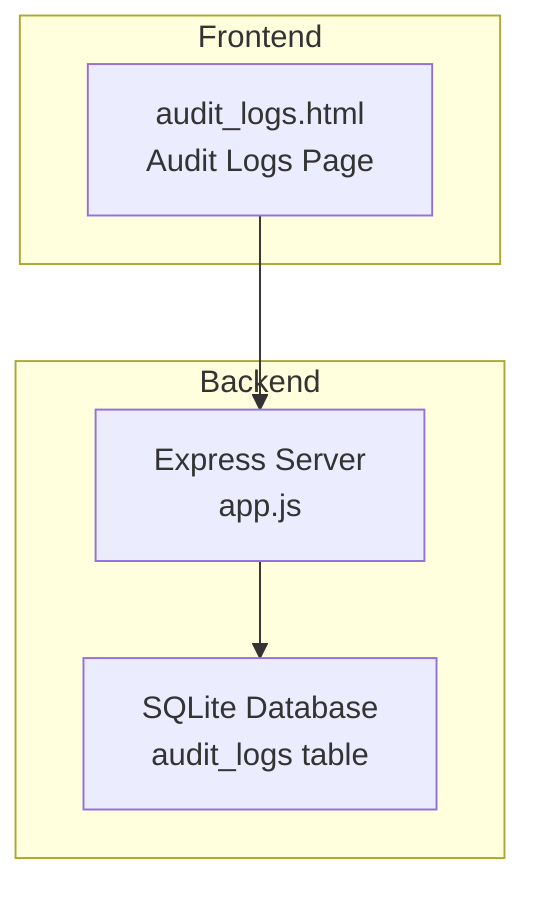
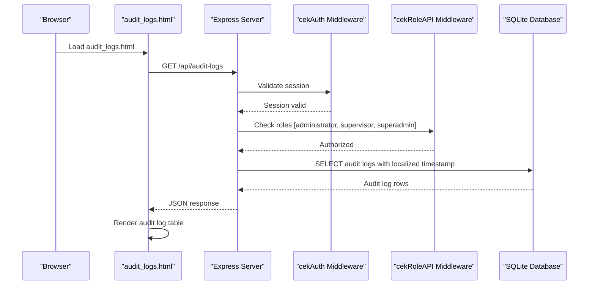
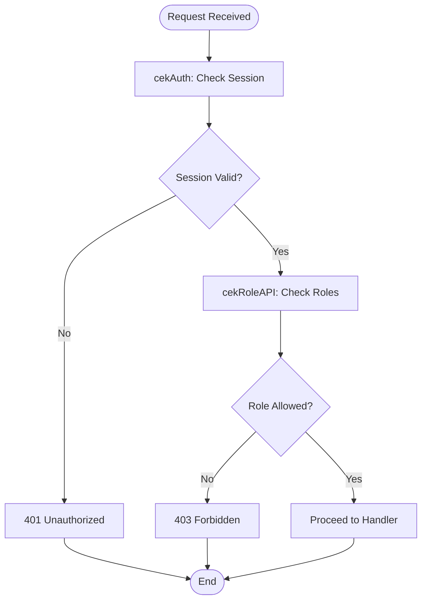
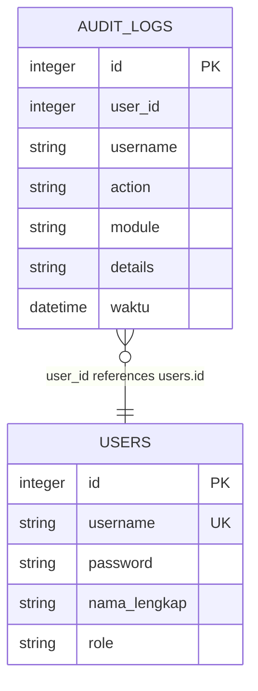
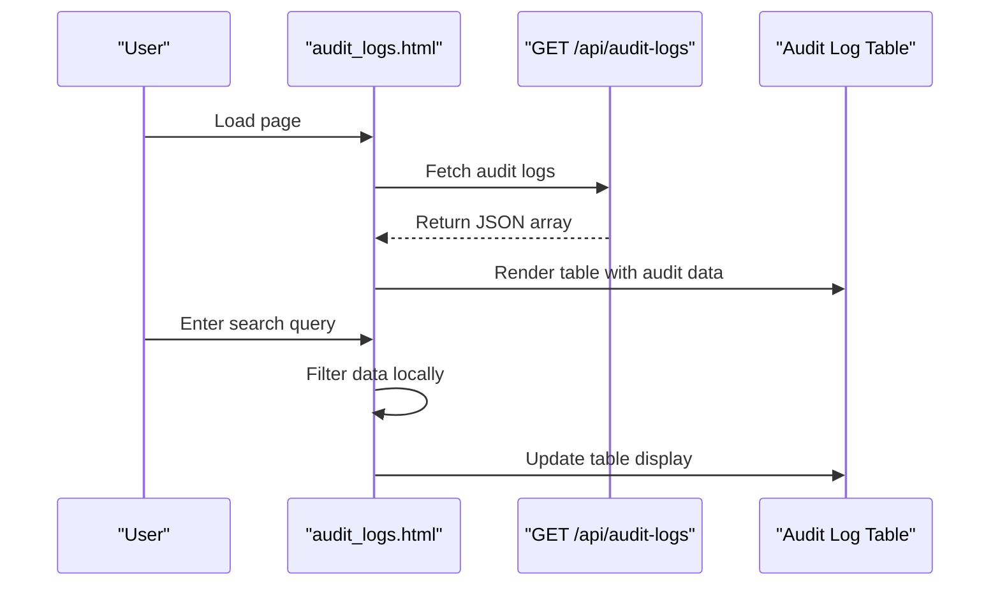
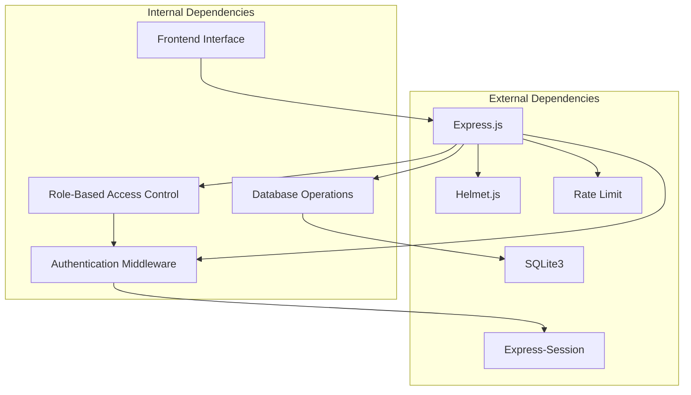

# Audit Logging APIs

<cite>
**Referenced Files in This Document**
- [audit_logs.html](file://audit_logs.html)
- [app.js](file://app.js)
- [PRD_Tax_Database_System.md](file://PRD_Tax_Database_System.md)
- [TDS_Sequence_Diagram.md](file://TDS_Sequence_Diagram.md)
- [login.html](file://login.html)
- [sidebar.html](file://sidebar.html)
</cite>

## Table of Contents
1. [Introduction](#introduction)
2. [Project Structure](#project-structure)
3. [Core Components](#core-components)
4. [Architecture Overview](#architecture-overview)
5. [Detailed Component Analysis](#detailed-component-analysis)
6. [Dependency Analysis](#dependency-analysis)
7. [Performance Considerations](#performance-considerations)
8. [Troubleshooting Guide](#troubleshooting-guide)
9. [Conclusion](#conclusion)

## Introduction
This document provides comprehensive API documentation for the audit logging endpoints, focusing on the GET endpoint that retrieves comprehensive audit trail data. It covers authentication requirements, response format with timestamp conversion, field descriptions for audit log entries, and practical examples of audit data consumption. It also documents the audit log structure, user activity tracking, and integration with the audit logs page functionality.

## Project Structure
The audit logging functionality spans both frontend and backend components:
- Frontend: An HTML page that displays audit logs and consumes the API endpoint.
- Backend: An Express server that exposes the audit logs API endpoint with role-based access control and SQLite database integration.

**Diagram sources**
- [audit_logs.html:1-201](file://audit_logs.html#L1-L201)
- [app.js:554-557](file://app.js#L554-L557)

**Section sources**
- [audit_logs.html:1-201](file://audit_logs.html#L1-L201)
- [app.js:554-557](file://app.js#L554-L557)

## Core Components
- GET /api/audit-logs: Retrieves audit trail data with pagination and filtering capabilities.
- Authentication and Authorization: Session-based authentication and role-based access control (RBAC).
- Database Schema: audit_logs table storing immutable audit trail records.

Key implementation details:
- Endpoint: GET /api/audit-logs
- Authentication: cekAuth middleware for session validation
- Authorization: cekRoleAPI middleware for RBAC checks
- Response: JSON array of audit log entries with localized timestamp

**Section sources**
- [app.js:554-557](file://app.js#L554-L557)
- [app.js:485-494](file://app.js#L485-L494)
- [PRD_Tax_Database_System.md:26](file://PRD_Tax_Database_System.md#L26)

## Architecture Overview
The audit logging API follows a layered architecture with clear separation of concerns:
- Presentation Layer: HTML page rendering audit logs
- Application Layer: Express routes handling requests
- Business Logic Layer: Authentication and authorization middleware
- Data Access Layer: SQLite database operations

**Diagram sources**
- [audit_logs.html:149-157](file://audit_logs.html#L149-L157)
- [app.js:554-557](file://app.js#L554-L557)
- [app.js:485-494](file://app.js#L485-L494)

## Detailed Component Analysis

### API Endpoint: GET /api/audit-logs
The primary endpoint for retrieving audit trail data.

#### Authentication and Authorization
- Session-based authentication using cekAuth middleware
- Role-based access control using cekRoleAPI middleware
- Authorized roles: administrator, supervisor, superadmin
- Session storage: HTTP-only cookies with strict SameSite policy

#### Request Format
- Method: GET
- URL: /api/audit-logs
- Headers: Standard browser request headers
- Query Parameters: None (returns latest 500 entries)

#### Response Format
- Content-Type: application/json
- Body: Array of audit log objects
- Response Size Limit: 500 entries maximum

#### Response Fields
Each audit log entry contains the following fields:

| Field | Type | Description |
|-------|------|-------------|
| id | integer | Unique identifier for the audit log entry |
| user_id | integer | ID of the user who performed the action |
| username | string | Username of the user who performed the action |
| action | string | Type of action performed (ADD, EDIT, DELETE, etc.) |
| module | string | Module or component where the action occurred |
| details | string | Detailed description of the action performed |
| waktu | datetime | Original timestamp from database (UTC) |
| wkt | string | Localized timestamp formatted as DD-MM-YYYY HH:MM:SS |

#### Implementation Details
- Database query: SELECT *, strftime('%d-%m-%Y %H:%M:%S', waktu, 'localtime') as wkt
- Sorting: ORDER BY id DESC (most recent first)
- Limit: 500 entries maximum
- Timestamp conversion: Uses SQLite's strftime function with localtime conversion

#### Practical Usage Examples
- Basic retrieval: fetch('/api/audit-logs')
- Error handling: Check response status and handle network errors
- Filtering: Client-side filtering by username, action, module, or details
- Pagination: Implemented server-side with fixed limit of 500 entries

**Section sources**
- [app.js:554-557](file://app.js#L554-L557)
- [audit_logs.html:149-195](file://audit_logs.html#L149-L195)

### Authentication and Authorization Flow
The system implements a two-layer security model:

**Diagram sources**
- [app.js:485-494](file://app.js#L485-L494)

#### Authentication Mechanism
- Session-based authentication using Express sessions
- Password hashing with bcrypt for secure credential storage
- Rate limiting for login attempts (20 attempts per 15 minutes)
- CSRF protection via SameSite cookies

#### Authorization Roles
- Administrator (superadmin/super admin): Full access to administrative features
- Supervisor: Can process approvals and modify data
- Staff: Basic user with limited permissions

**Section sources**
- [app.js:485-494](file://app.js#L485-L494)
- [app.js:1212-1226](file://app.js#L1212-L1226)
- [PRD_Tax_Database_System.md:56-66](file://PRD_Tax_Database_System.md#L56-L66)

### Database Schema and Audit Trail Structure
The audit logs are stored in a dedicated table with immutable characteristics:

**Diagram sources**
- [PRD_Tax_Database_System.md:26](file://PRD_Tax_Database_System.md#L26)
- [PRD_Tax_Database_System.md:24](file://PRD_Tax_Database_System.md#L24)

#### Audit Log Fields
- id: Auto-incrementing primary key
- user_id: Foreign key reference to users table
- username: Copy of username for audit trail readability
- action: Type of operation performed
- module: Module or component where the action occurred
- details: Descriptive information about the action
- waktu: Timestamp with automatic CURRENT_TIMESTAMP default

#### Immutable Audit Trail
- Audit logs are permanent records of all data mutations
- Created automatically for all approved modifications
- Used for compliance, auditing, and forensic analysis
- Stored separately from operational data for integrity

**Section sources**
- [PRD_Tax_Database_System.md:26](file://PRD_Tax_Database_System.md#L26)
- [TDS_Sequence_Diagram.md:199-201](file://TDS_Sequence_Diagram.md#L199-L201)

### Frontend Integration and User Interface
The audit logs page provides a comprehensive interface for viewing and filtering audit trails:

**Diagram sources**
- [audit_logs.html:149-195](file://audit_logs.html#L149-L195)

#### UI Features
- Real-time loading indicator during data fetch
- Local filtering by username, action, module, or details
- Color-coded action badges (green for additions, blue for edits, red for deletions)
- Responsive table layout with sticky headers
- Role-based visibility (only administrators and supervisors can access)

#### Data Consumption Patterns
- Single API call to retrieve all recent audit logs
- Client-side filtering for quick searches
- Automatic timestamp formatting for user-friendly display
- Graceful error handling for network failures

**Section sources**
- [audit_logs.html:71-98](file://audit_logs.html#L71-L98)
- [audit_logs.html:149-195](file://audit_logs.html#L149-L195)

## Dependency Analysis
The audit logging system has the following key dependencies:

**Diagram sources**
- [app.js:60-90](file://app.js#L60-L90)
- [app.js:485-494](file://app.js#L485-L494)

### Security Dependencies
- HTTPS enforcement via Helmet.js
- CSRF protection through SameSite cookies
- XSS prevention through content security policies
- Rate limiting for brute force protection
- Session security with HTTP-only cookies

### Data Dependencies
- SQLite database for persistent storage
- Prepared statements for SQL injection prevention
- Indexes on frequently queried columns
- Automatic timestamp generation

**Section sources**
- [app.js:60-90](file://app.js#L60-L90)
- [app.js:485-494](file://app.js#L485-L494)

## Performance Considerations
The audit logging API is designed with performance in mind:

### Response Size Management
- Fixed limit of 500 entries to prevent excessive data transfer
- Efficient database query with ORDER BY and LIMIT clauses
- Minimal payload size through selective field selection

### Caching Strategy
- Client-side caching of audit data for improved responsiveness
- Server-side query optimization with proper indexing
- Efficient timestamp conversion using database functions

### Scalability Factors
- SQLite database suitable for moderate data volumes
- Session-based authentication reduces database load
- Client-side filtering prevents server overload
- Modular architecture allows for future optimization

## Troubleshooting Guide

### Common Issues and Solutions

#### Authentication Failures
**Problem**: Users receive 401 Unauthorized responses
**Causes**:
- Session expired or invalid
- User not logged in
- Session storage issues

**Solutions**:
- Redirect users to login page
- Clear browser cache and cookies
- Verify session configuration

#### Authorization Errors
**Problem**: Users receive 403 Forbidden responses
**Causes**:
- Insufficient role privileges
- User role not properly configured
- Session role mismatch

**Solutions**:
- Verify user role in database
- Check cekRoleAPI middleware configuration
- Ensure proper role assignment

#### API Response Issues
**Problem**: Empty or incomplete audit log data
**Causes**:
- Database connection issues
- Query execution errors
- Network timeouts

**Solutions**:
- Check database connectivity
- Verify audit_logs table exists
- Monitor server logs for errors

#### Frontend Display Problems
**Problem**: Audit logs not displaying correctly
**Causes**:
- JavaScript errors
- Network connectivity issues
- Client-side filtering bugs

**Solutions**:
- Check browser console for JavaScript errors
- Verify API endpoint accessibility
- Test with different browsers

**Section sources**
- [app.js:485-494](file://app.js#L485-L494)
- [audit_logs.html:149-157](file://audit_logs.html#L149-L157)

## Conclusion
The audit logging API provides a robust, secure, and efficient mechanism for tracking user activities and maintaining compliance. Its design emphasizes security through role-based access control, data integrity through immutable audit trails, and usability through responsive front-end integration. The system's modular architecture and performance optimizations make it suitable for production environments while maintaining flexibility for future enhancements.

Key strengths of the implementation include:
- Comprehensive audit trail with immutable records
- Strong security measures with session-based authentication
- User-friendly interface with real-time filtering
- Efficient database operations with proper indexing
- Clear separation of concerns between frontend and backend

The API serves as a foundation for regulatory compliance, internal auditing, and forensic analysis while providing valuable insights into system usage patterns and user behavior.