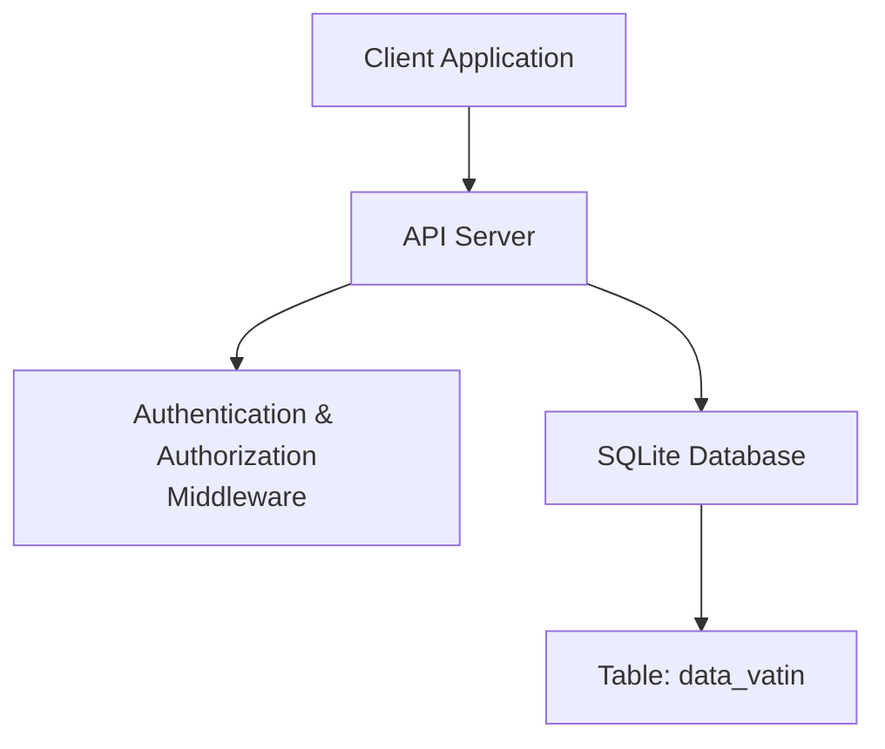
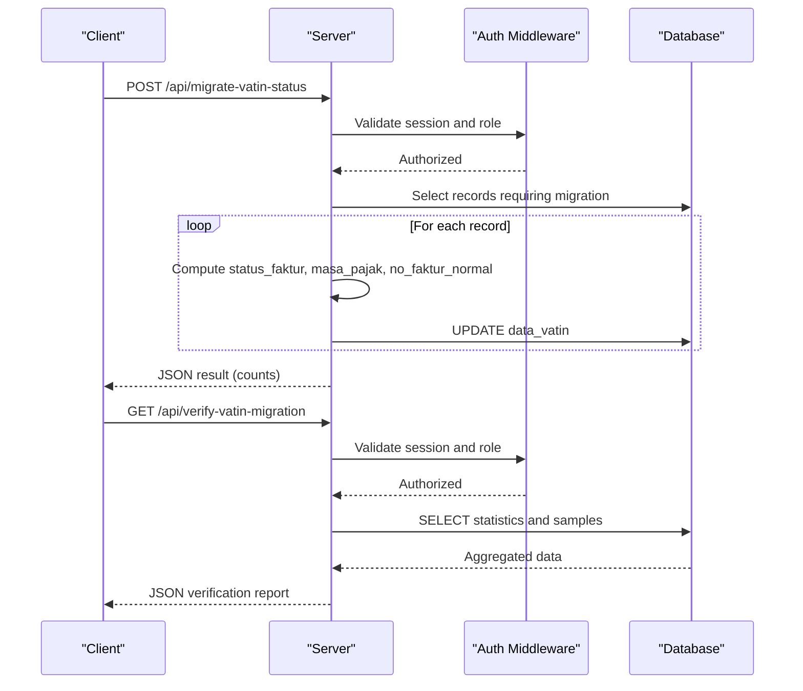
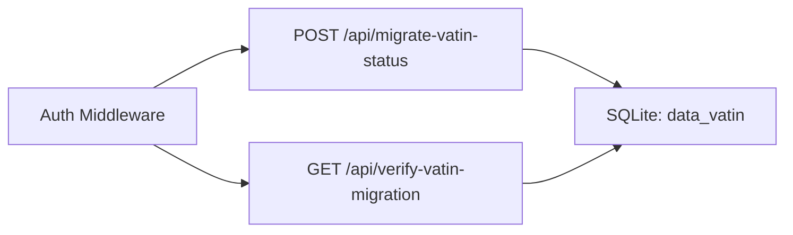

# Data Migration APIs

<cite>
**Referenced Files in This Document**
- [app.js](file://app.js)
- [PRD_Tax_Database_System.md](file://PRD_Tax_Database_System.md)
- [TDS_Sequence_Diagram.md](file://TDS_Sequence_Diagram.md)
- [TODO.md](file://TODO.md)
</cite>

## Table of Contents
1. [Introduction](#introduction)
2. [Project Structure](#project-structure)
3. [Core Components](#core-components)
4. [Architecture Overview](#architecture-overview)
5. [Detailed Component Analysis](#detailed-component-analysis)
6. [Dependency Analysis](#dependency-analysis)
7. [Performance Considerations](#performance-considerations)
8. [Troubleshooting Guide](#troubleshooting-guide)
9. [Conclusion](#conclusion)

## Introduction
This document provides comprehensive API documentation for two data migration endpoints focused on VAT invoice status migration and verification within the system:
- POST /api/migrate-vatin-status: Initiates migration of VAT invoice status data by enriching records with status_faktur, masa_pajak, and no_faktur_normal.
- GET /api/verify-vatin-migration: Verifies migration results by returning statistics and sample data for validation.

The documentation covers request/response schemas, authentication requirements, migration process description, error handling strategies, verification procedures, data transformation logic, batch processing approach, and rollback considerations.

## Project Structure
The migration endpoints are implemented in the backend server module alongside other API routes. The primary implementation resides in the application server file, while supporting documentation outlines the data model and business logic.

**Section sources**
- [app.js:559-639](file://app.js#L559-L639)
- [PRD_Tax_Database_System.md:34-107](file://PRD_Tax_Database_System.md#L34-L107)

## Core Components
- Authentication and Authorization:
  - Both endpoints require a privileged role via middleware that validates session-based authentication and role checks.
  - Roles permitted: administrator, supervisor, superadmin.
- Data Model:
  - Target table: data_vatin.
  - Key columns involved in migration: no_faktur, status_faktur, masa_pajak, no_faktur_normal, tanggal_faktur.
- Migration Logic:
  - Enrichment of status_faktur and masa_pajak for existing records.
  - Derivation of no_faktur_normal for replacement invoices.
- Verification Logic:
  - Aggregated statistics and sample data retrieval for validation.

**Section sources**
- [app.js:486-558](file://app.js#L486-L558)
- [PRD_Tax_Database_System.md:34-107](file://PRD_Tax_Database_System.md#L34-L107)

## Architecture Overview
The migration workflow involves initiating a migration job, updating records in batches, and verifying outcomes.

**Diagram sources**
- [app.js:559-639](file://app.js#L559-L639)
- [app.js:641-700](file://app.js#L641-L700)

## Detailed Component Analysis

### POST /api/migrate-vatin-status
Purpose:
- Migrate VAT invoice status data by computing and persisting status_faktur, masa_pajak, and no_faktur_normal for existing records.

Authentication and Authorization:
- Requires a valid session and role in [administrator, supervisor, superadmin].

Request:
- Method: POST
- Path: /api/migrate-vatin-status
- Headers:
  - Content-Type: application/json
  - Authorization: Bearer <session_token>
- Body: None (no body required)

Response:
- Success:
  - Status: 200 OK
  - Body fields:
    - success: boolean
    - message: string
    - total: number
    - updated: number
    - failed: number
- Failure:
  - Status: 500 Internal Server Error
  - Body fields:
    - error: string
    - details: string

Processing Logic:
- Identify records where status_faktur or masa_pajak is missing.
- For each record:
  - status_faktur derived from digits within no_faktur:
    - If the relevant digits indicate normal invoice → set to Normal.
    - Otherwise → set to "Pengganti <n>".
  - masa_pajak computed from tanggal_faktur by extracting year-month.
  - no_faktur_normal computed for replacement invoices by replacing the status digits with "00".
- Batch update performed with per-record error tracking.

Batch Processing:
- Iterates through candidate records and updates them individually with per-operation success/failure counters.

Error Handling:
- Per-item failures increment failure counter and log errors.
- Overall migration failure returns a 500 response with error details.

Rollback Mechanisms:
- No built-in rollback mechanism exists in the current implementation. To revert changes, restore from backups or re-execute the migration to overwrite values.

Verification Procedure:
- Use GET /api/verify-vatin-migration to confirm counts and sample data after migration.

**Section sources**
- [app.js:559-639](file://app.js#L559-L639)
- [PRD_Tax_Database_System.md:95-107](file://PRD_Tax_Database_System.md#L95-L107)

### GET /api/verify-vatin-migration
Purpose:
- Verify migration results by retrieving statistics and sample data for validation.

Authentication and Authorization:
- Requires a valid session and role in [administrator, supervisor, superadmin].

Request:
- Method: GET
- Path: /api/verify-vatin-migration
- Headers:
  - Authorization: Bearer <session_token>

Response:
- Success:
  - Status: 200 OK
  - Body fields:
    - statistics:
      - total_records: number
      - missing_status: number
      - missing_masa: number
      - count_normal: number
      - count_pengganti: number
    - samples:
      - normal_invoices: array of sample records for normal invoices
      - replacement_invoices: array of sample records for replacement invoices
- Failure:
  - Status: 500 Internal Server Error
  - Body fields:
    - error: string
    - details: string

Processing Logic:
- Aggregates counts for missing status, missing masa_pajak, and counts of Normal vs Replacement invoices.
- Retrieves sample rows for Normal and Replacement invoices to support manual inspection.

Verification Procedure:
- Compare statistics against expectations.
- Inspect samples to confirm correctness of migrated fields.

**Section sources**
- [app.js:641-700](file://app.js#L641-L700)
- [PRD_Tax_Database_System.md:34-107](file://PRD_Tax_Database_System.md#L34-L107)

### Data Transformation Logic
- status_faktur derivation:
  - Extract specific digits from no_faktur.
  - Normal invoice if digits equal "00"; otherwise Replacement with parsed index.
- masa_pajak computation:
  - Construct YYYY-MM from tanggal_faktur.
- no_faktur_normal mapping:
  - Replace status digits in replacement invoice no_faktur with "00" to derive parent invoice number.

**Section sources**
- [app.js:414-447](file://app.js#L414-L447)
- [PRD_Tax_Database_System.md:95-107](file://PRD_Tax_Database_System.md#L95-L107)

### Batch Processing Approach
- Scans for records requiring migration.
- Processes items sequentially with per-item promises for database updates.
- Tracks totals, successes, and failures during iteration.
- Returns consolidated results upon completion.

**Section sources**
- [app.js:596-631](file://app.js#L596-L631)

### Rollback Considerations
- The migration endpoint does not implement automatic rollback.
- Recommended approach:
  - Maintain backups prior to migration.
  - Re-run migration to overwrite values if corrective action is needed.
  - Use verification endpoint to validate post-migration state.

**Section sources**
- [app.js:633-638](file://app.js#L633-L638)

## Dependency Analysis
- Authentication and Authorization:
  - Both endpoints depend on session-based middleware and role validation.
- Database:
  - Reads/writes to data_vatin table.
- Data Model:
  - Relies on presence of no_faktur, tanggal_faktur, status_faktur, masa_pajak, no_faktur_normal.

**Diagram sources**
- [app.js:486-558](file://app.js#L486-L558)
- [app.js:559-700](file://app.js#L559-L700)

**Section sources**
- [app.js:486-558](file://app.js#L486-L558)
- [PRD_Tax_Database_System.md:34-107](file://PRD_Tax_Database_System.md#L34-L107)

## Performance Considerations
- Sequential processing per record may be slow for large datasets.
- Recommendations:
  - Use transactions to wrap updates for improved atomicity and throughput.
  - Implement pagination or chunking to limit concurrent workload.
  - Add indexing on columns frequently queried (e.g., status_faktur, masa_pajak) to speed up verification queries.

## Troubleshooting Guide
Common Issues and Resolutions:
- Unauthorized Access:
  - Symptom: 403 Forbidden.
  - Cause: Missing or invalid session or insufficient role.
  - Resolution: Authenticate and ensure role is administrator, supervisor, or superadmin.
- Migration Failures:
  - Symptom: 500 Internal Server Error with error details.
  - Causes: Database errors during updates, malformed no_faktur/tanggal_faktur.
  - Resolution: Inspect logs, validate input data integrity, retry after fixing anomalies.
- Partial Updates:
  - Symptom: Non-zero failed count in migration response.
  - Causes: Individual record errors during update.
  - Resolution: Review failed records, correct data inconsistencies, and rerun migration.
- Verification Discrepancies:
  - Symptom: Unexpected statistics or sample data.
  - Resolution: Confirm data model alignment, re-run verification, and cross-check sample rows.

**Section sources**
- [app.js:633-638](file://app.js#L633-L638)
- [app.js:641-700](file://app.js#L641-L700)

## Conclusion
The migration endpoints provide a structured approach to enrich VAT invoice data and verify outcomes. While the current implementation focuses on straightforward transformations and verification, enhancements such as transactional batching, rollback capabilities, and indexing can improve reliability and performance. Always maintain backups and use the verification endpoint to validate results post-migration.