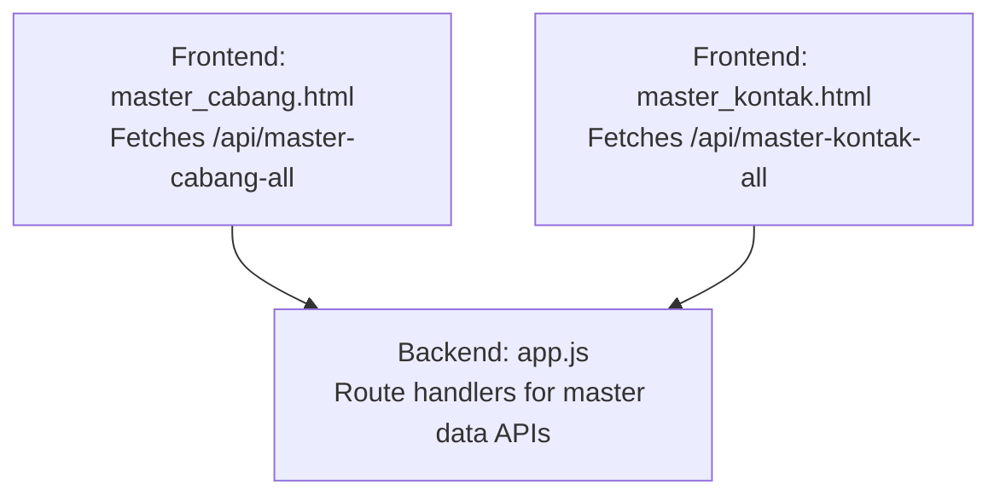
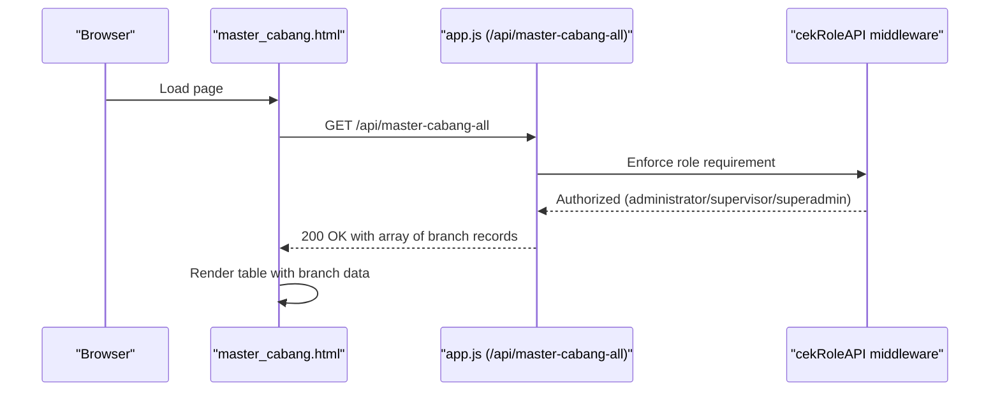
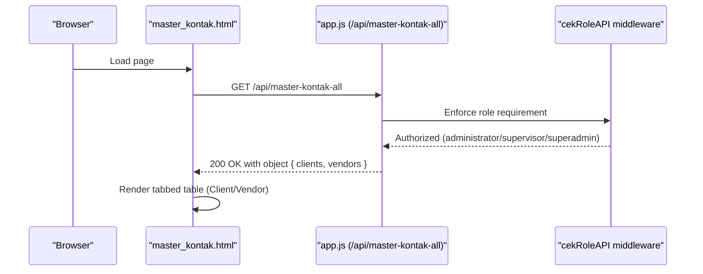
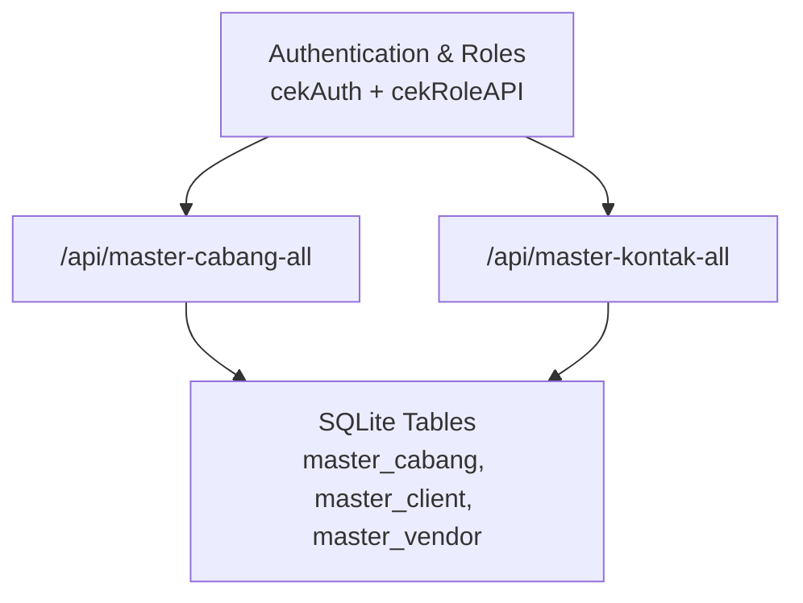

# Master Data APIs

<cite>
**Referenced Files in This Document**
- [app.js](file://app.js)
- [master_cabang.html](file://master_cabang.html)
- [master_kontak.html](file://master_kontak.html)
- [PRD_Tax_Database_System.md](file://PRD_Tax_Database_System.md)
</cite>

## Table of Contents
1. [Introduction](#introduction)
2. [Project Structure](#project-structure)
3. [Core Components](#core-components)
4. [Architecture Overview](#architecture-overview)
5. [Detailed Component Analysis](#detailed-component-analysis)
6. [Dependency Analysis](#dependency-analysis)
7. [Performance Considerations](#performance-considerations)
8. [Troubleshooting Guide](#troubleshooting-guide)
9. [Conclusion](#conclusion)

## Introduction
This document provides comprehensive API documentation for two master data endpoints in the TDS system:
- GET /api/master-cabang-all: retrieves all branch data for administrative use.
- GET /api/master-kontak-all: retrieves combined client and vendor contact data for administrative use.

It covers authentication requirements, request parameters, response schemas, error handling, and practical usage examples. It also explains filtering capabilities and integration patterns with the frontend master data management pages.

## Project Structure
The relevant backend routes and frontend pages are implemented as follows:
- Backend API routes are defined in the server application file.
- Frontend pages for master data management issue fetch requests to these endpoints.

**Diagram sources**
- [master_cabang.html:204](file://master_cabang.html#L204)
- [master_kontak.html:167](file://master_kontak.html#L167)
- [app.js:539](file://app.js#L539)
- [app.js:546](file://app.js#L546)

**Section sources**
- [master_cabang.html:204](file://master_cabang.html#L204)
- [master_kontak.html:167](file://master_kontak.html#L167)
- [app.js:539](file://app.js#L539)
- [app.js:546](file://app.js#L546)

## Core Components
- Authentication and authorization:
  - Both endpoints require an authenticated session.
  - Authorization requires administrator, supervisor, or superadmin roles via a dedicated middleware.
- Request handling:
  - GET endpoints with no required query parameters.
  - Responses are JSON arrays or objects depending on the endpoint.
- Filtering:
  - Frontend pages implement client-side filtering on retrieved data.

**Section sources**
- [app.js:539](file://app.js#L539)
- [app.js:546](file://app.js#L546)
- [PRD_Tax_Database_System.md:54](file://PRD_Tax_Database_System.md#L54)

## Architecture Overview
The following sequence diagrams illustrate how the frontend interacts with the backend for each endpoint.

### GET /api/master-cabang-all

**Diagram sources**
- [master_cabang.html:204](file://master_cabang.html#L204)
- [app.js:539](file://app.js#L539)

### GET /api/master-kontak-all

**Diagram sources**
- [master_kontak.html:167](file://master_kontak.html#L167)
- [app.js:546](file://app.js#L546)

## Detailed Component Analysis

### Endpoint: GET /api/master-cabang-all
- Purpose: Retrieve all branch records for administrative management.
- Authentication: Required.
- Authorization: administrator, supervisor, or superadmin.
- Method: GET.
- Path: /api/master-cabang-all.
- Query parameters: None.
- Response:
  - Status 200: Array of branch records.
  - Status 500: Error object containing an error message.
- Filtering: Not supported server-side; client-side filtering is performed by the frontend page.

Response record structure (branch):
- Fields:
  - kode_cabang: string identifier for the branch.
  - nama_cabang: branch name.
  - entitas: entity classification.
  - contract_income: numeric contract income value.
- Notes:
  - Additional fields may exist in the underlying table; only the documented fields are guaranteed by this API.

Usage example (frontend integration):
- The page initiates a fetch to the endpoint, parses the JSON, and renders the data in a table.

Practical usage example (curl):
- curl -H "Cookie: connect.sid=<session>" http://localhost:3000/api/master-cabang-all

Error handling:
- On database errors, the endpoint returns HTTP 500 with an error message.

**Section sources**
- [app.js:539](file://app.js#L539)
- [master_cabang.html:204](file://master_cabang.html#L204)

### Endpoint: GET /api/master-kontak-all
- Purpose: Retrieve combined client and vendor contact data for administrative management.
- Authentication: Required.
- Authorization: administrator, supervisor, or superadmin.
- Method: GET.
- Path: /api/master-kontak-all.
- Query parameters: None.
- Response:
  - Status 200: Object with two arrays:
    - clients: array of client contact records.
    - vendors: array of vendor contact records.
  - Status 500: Error object containing an error message.
- Filtering: Not supported server-side; client-side filtering is performed by the frontend page.

Response record structure (client/vendor contact):
- Fields:
  - npwp: string taxpayer identification number (primary key in underlying tables).
  - nama: full name or company name.
  - alamat: address.
  - format_tipe: optional formatting type indicator.
  - tanggal_terakhir: optional last updated date.
- Notes:
  - Additional fields may exist in the underlying tables; only the documented fields are guaranteed by this API.

Usage example (frontend integration):
- The page initiates a fetch to the endpoint, splits the response into separate arrays, and renders a tabbed table for Clients and Vendors.

Practical usage example (curl):
- curl -H "Cookie: connect.sid=<session>" http://localhost:3000/api/master-kontak-all

Error handling:
- On database errors, the endpoint returns HTTP 500 with an error message.

**Section sources**
- [app.js:546](file://app.js#L546)
- [master_kontak.html:167](file://master_kontak.html#L167)

### Frontend Integration Patterns
- master_cabang.html:
  - Fetches /api/master-cabang-all and renders branch data.
  - Implements client-side filtering on kode_cabang and nama_cabang.
- master_kontak.html:
  - Fetches /api/master-kontak-all and separates clients and vendors.
  - Implements client-side filtering on npwp and nama.

Filtering logic highlights:
- Branch page filters by kode_cabang and nama_cabang.
- Contact page filters by npwp and nama across both clients and vendors.

**Section sources**
- [master_cabang.html:204](file://master_cabang.html#L204)
- [master_kontak.html:167](file://master_kontak.html#L167)
- [master_kontak.html:178](file://master_kontak.html#L178)

## Dependency Analysis
- Authentication and authorization:
  - Both endpoints rely on a session-based authentication middleware and a role-checking middleware.
  - The role middleware enforces that only administrator, supervisor, or superadmin users can access these endpoints.
- Data access:
  - The branch endpoint queries the master_cabang table.
  - The contact endpoint returns data derived from master_client and master_vendor tables.

**Diagram sources**
- [app.js:539](file://app.js#L539)
- [app.js:546](file://app.js#L546)

**Section sources**
- [PRD_Tax_Database_System.md:54](file://PRD_Tax_Database_System.md#L54)
- [PRD_Tax_Database_System.md:23](file://PRD_Tax_Database_System.md#L23)

## Performance Considerations
- Both endpoints return potentially large datasets:
  - master-cabang-all: returns all branches.
  - master-kontak-all: returns both clients and vendors.
- Filtering is performed client-side in the browser, which can be inefficient for very large datasets.
- Recommendations:
  - Implement server-side pagination and filtering for production use.
  - Consider adding query parameters for limiting results and filtering by specific fields.
  - Add indexing on frequently filtered columns (e.g., nama, npwp) in the database.

## Troubleshooting Guide
Common issues and resolutions:
- 401 Unauthorized:
  - Cause: Missing or invalid session cookie.
  - Resolution: Ensure the user is logged in and the session cookie is present in the request.
- 403 Forbidden:
  - Cause: Insufficient role (must be administrator, supervisor, or superadmin).
  - Resolution: Verify the user’s role in the session and ensure proper authorization.
- 500 Internal Server Error:
  - Cause: Database query failure.
  - Resolution: Check server logs for the specific error message and verify database connectivity and table schemas.

**Section sources**
- [PRD_Tax_Database_System.md:54](file://PRD_Tax_Database_System.md#L54)
- [app.js:539](file://app.js#L539)
- [app.js:546](file://app.js#L546)

## Conclusion
The master data APIs provide essential administrative access to branch and contact data. They enforce session-based authentication and role-based authorization, returning JSON responses suitable for frontend consumption. While client-side filtering offers convenience, server-side enhancements would improve scalability and responsiveness for large datasets.