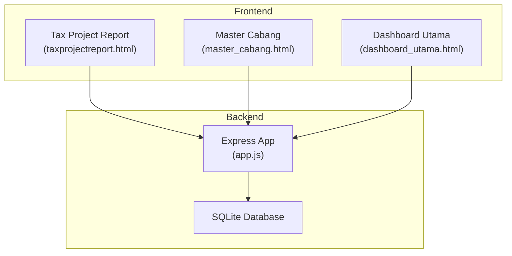
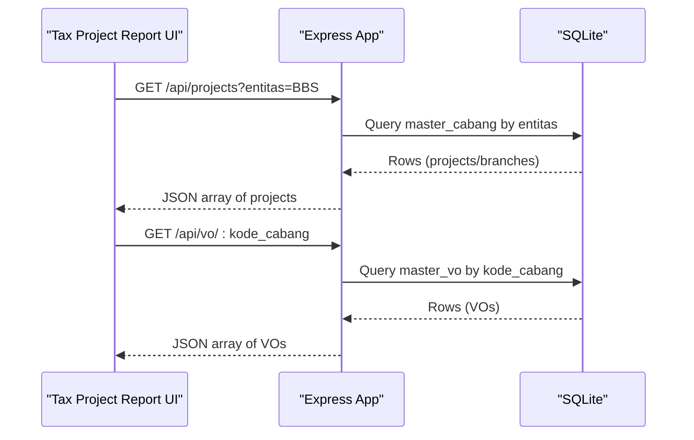
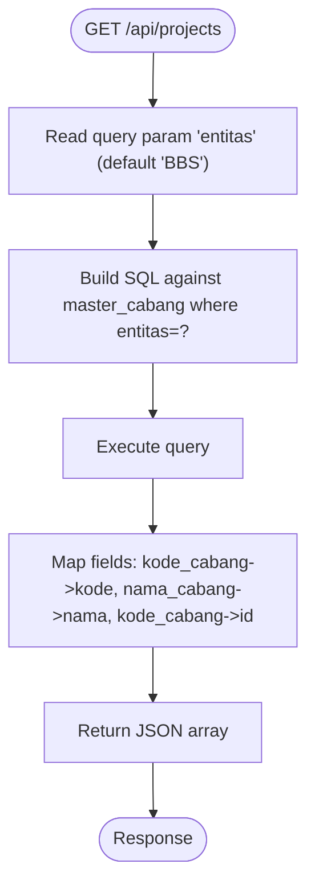
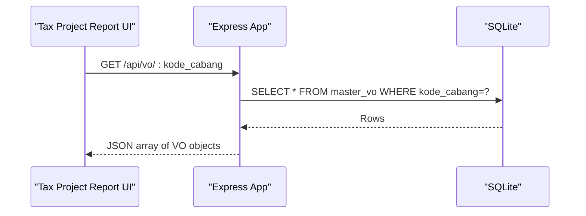
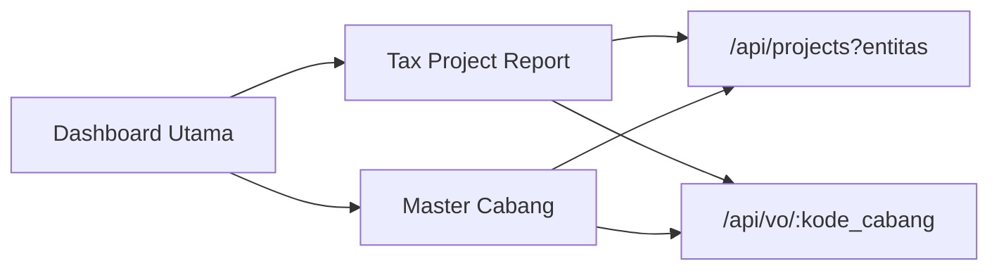
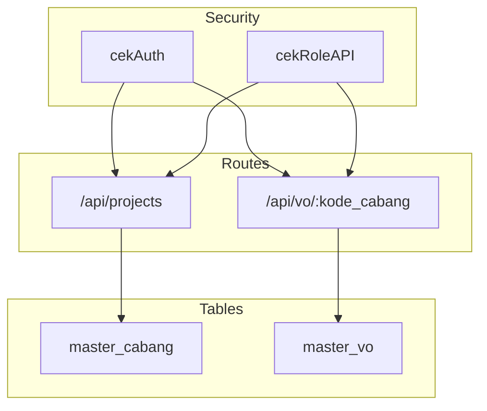

# Project Management APIs

<cite>
**Referenced Files in This Document**
- [app.js](file://app.js)
- [taxprojectreport.html](file://taxprojectreport.html)
- [master_cabang.html](file://master_cabang.html)
- [dashboard_utama.html](file://dashboard_utama.html)
</cite>

## Table of Contents
1. [Introduction](#introduction)
2. [Project Structure](#project-structure)
3. [Core Components](#core-components)
4. [Architecture Overview](#architecture-overview)
5. [Detailed Component Analysis](#detailed-component-analysis)
6. [Dependency Analysis](#dependency-analysis)
7. [Performance Considerations](#performance-considerations)
8. [Troubleshooting Guide](#troubleshooting-guide)
9. [Conclusion](#conclusion)

## Introduction
This document provides comprehensive API documentation for project management endpoints used by the Tax Database System. It focuses on:
- Retrieving project data filtered by entity via GET /api/projects
- Fetching variation order (VO) data for a given branch/project via GET /api/vo/:kode_cabang
- Understanding the underlying data models, branch-to-project mapping, and integration with project management dashboards

The documentation covers request parameters, response schemas, authentication requirements, and practical usage examples derived from the frontend dashboards that consume these endpoints.

## Project Structure
The project is a single-page application with a Node.js/Express backend serving static HTML pages and REST-style JSON APIs. The relevant components for project management are:
- Backend routes for project and VO data
- Frontend dashboards that call these APIs to render project summaries and VO tabs
- Master data management pages that also integrate with the VO APIs

**Diagram sources**
- [app.js:716-731](file://app.js#L716-L731)
- [taxprojectreport.html:667-729](file://taxprojectreport.html#L667-L729)
- [master_cabang.html:202-359](file://master_cabang.html#L202-L359)
- [dashboard_utama.html:612-800](file://dashboard_utama.html#L612-L800)

**Section sources**
- [app.js:716-731](file://app.js#L716-L731)
- [taxprojectreport.html:667-729](file://taxprojectreport.html#L667-L729)
- [master_cabang.html:202-359](file://master_cabang.html#L202-L359)
- [dashboard_utama.html:612-800](file://dashboard_utama.html#L612-L800)

## Core Components
This section documents the two primary project management endpoints.

### Endpoint: GET /api/projects
- Purpose: Retrieve branch/project data filtered by entity for selection in dashboards.
- Authentication: Required (session-based)
- Request
  - Method: GET
  - Path: /api/projects
  - Query parameters:
    - entitas (optional): Entity filter (default: BBS)
- Response: Array of project/branch objects
  - Schema:
    - id: string or number (identifier used by dashboards)
    - kode: string (branch/project code)
    - nama: string (branch/project name)
    - contract_income: number (contract income value)
- Example usage
  - From Tax Project Report: loads available branches for the selected entity and year filters.
  - From Master Cabang: lists all branches for administrative management.

**Section sources**
- [app.js:716-723](file://app.js#L716-L723)
- [taxprojectreport.html:667-682](file://taxprojectreport.html#L667-L682)
- [master_cabang.html:202-211](file://master_cabang.html#L202-L211)

### Endpoint: GET /api/vo/:kode_cabang
- Purpose: Retrieve variation orders (VO) associated with a branch/project code.
- Authentication: Required (session-based)
- Request
  - Method: GET
  - Path: /api/vo/:kode_cabang
  - Path parameters:
    - kode_cabang: Branch/project identifier (used as path param)
  - Query parameters: None
- Response: Array of VO objects
  - Schema:
    - id: number (unique VO identifier)
    - kode_cabang: string (branch code)
    - nama_vo: string (VO name)
    - contract_income: number (VO-specific contract income)
- Example usage
  - From Tax Project Report: renders VO tabs for the selected project and filters transaction tables by VO.

**Section sources**
- [app.js:725-731](file://app.js#L725-L731)
- [taxprojectreport.html:711-716](file://taxprojectreport.html#L711-L716)
- [master_cabang.html:351-359](file://master_cabang.html#L351-L359)

## Architecture Overview
The project management APIs are integrated into dashboards that:
- Load branch/project options from /api/projects
- Load VO definitions from /api/vo/:kode_cabang
- Aggregate transaction data via /api/project-summary/:id (not covered here)

**Diagram sources**
- [app.js:716-731](file://app.js#L716-L731)
- [taxprojectreport.html:667-729](file://taxprojectreport.html#L667-L729)

## Detailed Component Analysis

### GET /api/projects
- Route definition and behavior
  - Filters branches by entity and returns a normalized list suitable for dropdowns and cards.
  - Returns fields: id, kode, nama, contract_income.
- Data model mapping
  - Underlying table: master_cabang
  - Fields mapped: kode_cabang (as kode), nama_cabang (as nama), contract_income, kode_cabang (as id).
- Practical usage
  - Used by Tax Project Report to populate the project selection dropdown.
  - Used by Master Cabang to list all branches for admin views.

**Diagram sources**
- [app.js:716-723](file://app.js#L716-L723)

**Section sources**
- [app.js:716-723](file://app.js#L716-L723)
- [taxprojectreport.html:667-682](file://taxprojectreport.html#L667-L682)
- [master_cabang.html:202-211](file://master_cabang.html#L202-L211)

### GET /api/vo/:kode_cabang
- Route definition and behavior
  - Retrieves VO records linked to a branch/project code.
  - Returns fields: id, kode_cabang, nama_vo, contract_income.
- Data model mapping
  - Underlying table: master_vo
  - Fields mapped: id, kode_cabang, nama_vo, contract_income.
- Practical usage
  - Used by Tax Project Report to render VO tabs and filter transaction tables by VO.
  - Used by Master Cabang to manage VO entries per branch.

**Diagram sources**
- [app.js:725-731](file://app.js#L725-L731)
- [taxprojectreport.html:711-716](file://taxprojectreport.html#L711-L716)

**Section sources**
- [app.js:725-731](file://app.js#L725-L731)
- [taxprojectreport.html:711-716](file://taxprojectreport.html#L711-L716)
- [master_cabang.html:351-359](file://master_cabang.html#L351-L359)

### Integration with Dashboards
- Tax Project Report
  - Loads projects via /api/projects
  - Loads VOs via /api/vo/:kode_cabang
  - Uses VO data to build tabs and filter transaction tables
- Master Cabang
  - Lists all branches for admin management
  - Loads VOs per branch for VO administration
- Dashboard Utama
  - Provides module cards and navigation; project management dashboards are accessed from here

**Diagram sources**
- [taxprojectreport.html:667-729](file://taxprojectreport.html#L667-L729)
- [master_cabang.html:202-359](file://master_cabang.html#L202-L359)
- [dashboard_utama.html:612-800](file://dashboard_utama.html#L612-L800)

**Section sources**
- [taxprojectreport.html:667-729](file://taxprojectreport.html#L667-L729)
- [master_cabang.html:202-359](file://master_cabang.html#L202-L359)
- [dashboard_utama.html:612-800](file://dashboard_utama.html#L612-L800)

## Dependency Analysis
- Authentication and authorization
  - Both endpoints use session-based authentication middleware:
    - cekAuth: redirects unauthenticated requests to login
    - cekRoleAPI: role-based access control for sensitive endpoints
- Data sources
  - /api/projects: reads from master_cabang
  - /api/vo/:kode_cabang: reads from master_vo
- Frontend integration
  - Tax Project Report and Master Cabang pages call these endpoints to populate UI controls and tables

**Diagram sources**
- [app.js:486-494](file://app.js#L486-L494)
- [app.js:716-731](file://app.js#L716-L731)

**Section sources**
- [app.js:486-494](file://app.js#L486-L494)
- [app.js:716-731](file://app.js#L716-L731)

## Performance Considerations
- Database queries for these endpoints are simple and rely on straightforward table scans and ordering.
- Consider adding indexes on frequently filtered columns if datasets grow large.
- The frontend paginates and filters data client-side after fetching, minimizing repeated backend calls.

## Troubleshooting Guide
- 401 Unauthorized
  - Cause: Missing or invalid session
  - Resolution: Ensure user is logged in and session is active
- 403 Forbidden
  - Cause: Insufficient role for protected endpoints
  - Resolution: Verify user role meets required permissions
- Empty or unexpected results
  - Verify the entitas parameter for /api/projects
  - Confirm kode_cabang exists in master_cabang for /api/vo/:kode_cabang
- CORS or static file issues
  - Ensure static assets are served and HTML routes are properly handled

**Section sources**
- [app.js:486-494](file://app.js#L486-L494)
- [app.js:716-731](file://app.js#L716-L731)

## Conclusion
The project management APIs provide essential building blocks for dashboards:
- /api/projects enables branch/project selection filtered by entity
- /api/vo/:kode_cabang powers VO administration and filtering in reports

These endpoints are straightforward, session-authenticated, and well-integrated into the frontend dashboards for seamless project management workflows.