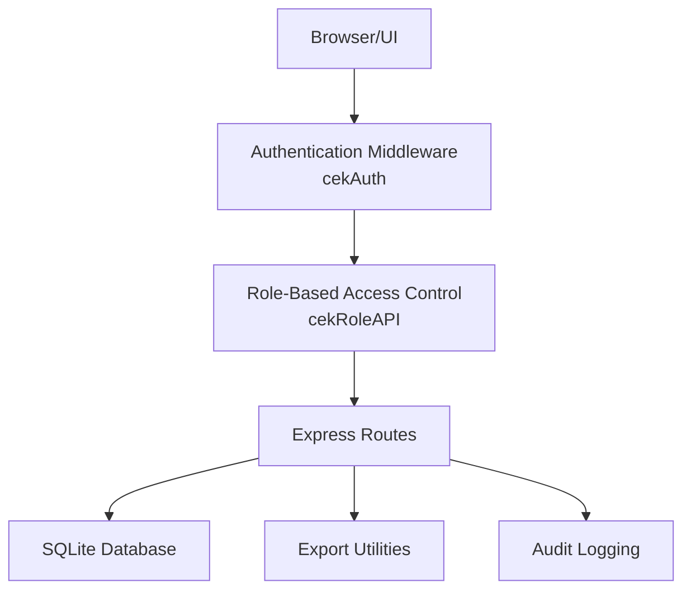
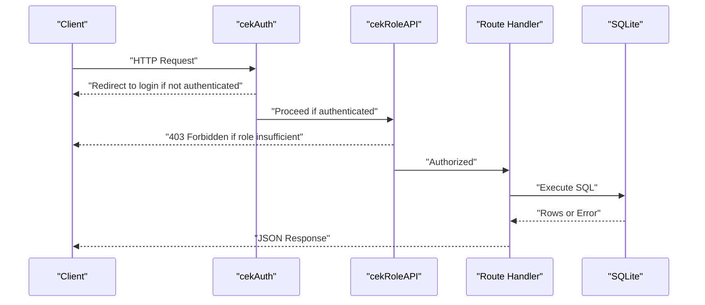
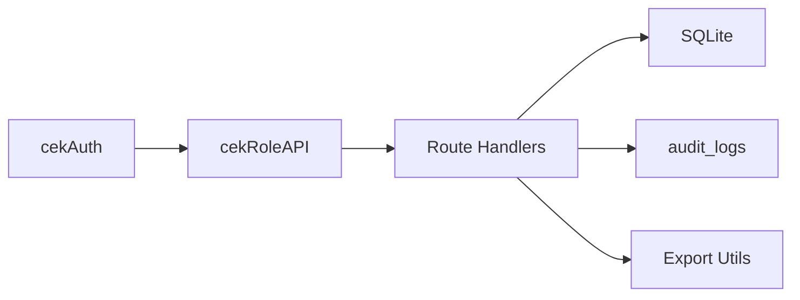

# REST API Endpoints

<cite>
**Referenced Files in This Document**
- [app.js](file://app.js)
- [TDS_Sequence_Diagram.md](file://TDS_Sequence_Diagram.md)
</cite>

## Table of Contents
1. [Introduction](#introduction)
2. [Project Structure](#project-structure)
3. [Core Components](#core-components)
4. [Architecture Overview](#architecture-overview)
5. [Detailed Component Analysis](#detailed-component-analysis)
6. [Dependency Analysis](#dependency-analysis)
7. [Performance Considerations](#performance-considerations)
8. [Troubleshooting Guide](#troubleshooting-guide)
9. [Conclusion](#conclusion)

## Introduction
This document provides comprehensive REST API documentation for the TDS system. It covers HTTP endpoints for master data, audit logs, migrations, project management, and item/detail retrieval. For each endpoint, we specify method, URL pattern, authentication and authorization requirements, parameters, request/response formats, and practical usage notes. The backend is implemented using Express.js with SQLite storage and session-based authentication.

## Project Structure
The API surface is primarily defined in the server entry file. Key areas:
- Authentication and session middleware
- Role-based access control (RBAC) enforcement
- Static routing for HTML pages
- API routes grouped by functional domains (master data, audit logs, migrations, projects, items, details, exports, and auxiliary endpoints)

**Diagram sources**
- [app.js:486-494](file://app.js#L486-L494)
- [app.js:528-536](file://app.js#L528-L536)
- [app.js:539-544](file://app.js#L539-L544)

**Section sources**
- [app.js:486-494](file://app.js#L486-L494)
- [app.js:528-536](file://app.js#L528-L536)
- [app.js:539-544](file://app.js#L539-L544)

## Core Components
- Authentication middleware ensures only logged-in users can access protected routes.
- RBAC middleware enforces role-based permissions for sensitive endpoints.
- Database helpers wrap SQLite operations for queries and transactions.
- Export endpoints support filtered reporting across modules.

Key implementation references:
- Authentication and RBAC: [app.js:486-494](file://app.js#L486-L494)
- Static protection for HTML routes: [app.js:528-536](file://app.js#L528-L536)
- Database initialization and helpers: [app.js:341-347](file://app.js#L341-L347), [app.js:57-58](file://app.js#L57-L58)

**Section sources**
- [app.js:486-494](file://app.js#L486-L494)
- [app.js:528-536](file://app.js#L528-L536)
- [app.js:341-347](file://app.js#L341-L347)
- [app.js:57-58](file://app.js#L57-L58)

## Architecture Overview
The API follows a layered architecture:
- Presentation: HTML pages served via Express static routing
- Application: Route handlers implementing REST endpoints
- Persistence: SQLite tables for master data, audit logs, and module-specific data
- Security: Session cookies, CSRF protection, and rate limiting for login

**Diagram sources**
- [app.js:486-494](file://app.js#L486-L494)
- [app.js:528-536](file://app.js#L528-L536)
- [app.js:539-544](file://app.js#L539-L544)

## Detailed Component Analysis

### Authentication and Authorization
- Endpoint: GET /api/me
  - Method: GET
  - URL: /api/me
  - Auth: cekAuth (session required)
  - Response: JSON user object { id, username, nama, role }
  - Notes: Returns current session user; useful for UI hydration

- Endpoint: POST /login
  - Method: POST
  - URL: /login
  - Auth: None (login form submission)
  - Request: Form fields username, password
  - Response: Redirect to dashboard or login with error message
  - Security: Rate-limited to prevent brute force

- Endpoint: GET /logout
  - Method: GET
  - URL: /logout
  - Auth: None
  - Behavior: Destroys session and redirects to login

**Section sources**
- [app.js:1212-1225](file://app.js#L1212-L1225)
- [app.js:1226-1227](file://app.js#L1226-L1227)
- [app.js:486-494](file://app.js#L486-L494)

### Master Data APIs
- Endpoint: GET /api/master-cabang-all
  - Method: GET
  - URL: /api/master-cabang-all
  - Auth: cekRoleAPI(['administrator', 'supervisor', 'superadmin'])
  - Response: Array of branch records ordered by entity and branch code
  - Notes: Full list for administrative views

- Endpoint: GET /api/master-kontak-all
  - Method: GET
  - URL: /api/master-kontak-all
  - Auth: cekRoleAPI(['administrator', 'supervisor', 'superadmin'])
  - Response: Array of contact records
  - Notes: Administrative contact listing

- Endpoint: GET /api/branches
  - Method: GET
  - URL: /api/branches
  - Auth: cekAuth
  - Query: entitas (optional; defaults to 'BBS')
  - Response: Array of branches filtered by entity

- Endpoint: GET /api/users
  - Method: GET
  - URL: /api/users
  - Auth: cekAuth
  - Response: Array of users with id, username, nama_lengkap, role

**Section sources**
- [app.js:539-544](file://app.js#L539-L544)
- [app.js:546-553](file://app.js#L546-L553)
- [app.js:1227-1228](file://app.js#L1227-L1228)
- [app.js:1229-1230](file://app.js#L1229-L1230)

### Audit Logs API
- Endpoint: GET /api/audit-logs
  - Method: GET
  - URL: /api/audit-logs
  - Auth: cekRoleAPI(['administrator', 'supervisor', 'superadmin'])
  - Response: Array of audit log entries
  - Notes: Administrative audit trail

**Section sources**
- [app.js:554-558](file://app.js#L554-L558)

### Migration APIs
- Endpoint: POST /api/migrate-vatin-status
  - Method: POST
  - URL: /api/migrate-vatin-status
  - Auth: cekRoleAPI(['administrator', 'supervisor', 'superadmin'])
  - Request: JSON payload (schema not defined in code; consult UI or migration scripts)
  - Response: Operation result (success/failure)
  - Notes: Used to migrate VATIN statuses

- Endpoint: GET /api/verify-vatin-migration
  - Method: GET
  - URL: /api/verify-vatin-migration
  - Auth: cekRoleAPI(['administrator', 'supervisor', 'superadmin'])
  - Response: Verification result
  - Notes: Validates migration outcomes

**Section sources**
- [app.js:559-568](file://app.js#L559-L568)
- [app.js:641-645](file://app.js#L641-L645)

### Project Management APIs
- Endpoint: GET /api/projects
  - Method: GET
  - URL: /api/projects
  - Auth: cekAuth
  - Response: List of projects derived from master branch data
  - Notes: Used by project profitability report

- Endpoint: GET /api/vo/:kode_cabang
  - Method: GET
  - URL: /api/vo/:kode_cabang
  - Auth: cekAuth
  - Path: kode_cabang (required)
  - Response: VO details for the given branch code

- Endpoint: GET /api/project-summary/:id
  - Method: GET
  - URL: /api/project-summary/:id
  - Auth: cekAuth
  - Path: id (required)
  - Response: Aggregated financial summary across related modules
  - Notes: Cross-module aggregation for reporting

**Section sources**
- [app.js:716-718](file://app.js#L716-L718)
- [app.js:725-727](file://app.js#L725-L727)
- [app.js:733-735](file://app.js#L733-L735)

### Item APIs
- Endpoint: GET /api/items/:mod/:faktur
  - Method: GET
  - URL: /api/items/:mod/:faktur
  - Auth: cekAuth
  - Path: mod (module id), faktur (invoice number)
  - Response: Items associated with the invoice in the specified module
  - Notes: Supports module-specific item retrieval

**Section sources**
- [app.js:758-760](file://app.js#L758-L760)

### Detail APIs
- Endpoint: GET /api/detail-vatin/:faktur
  - Method: GET
  - URL: /api/detail-vatin/:faktur
  - Auth: cekAuth
  - Path: faktur (required)
  - Response: VATIN record details
  - Notes: Retrieves detailed invoice data for VATIN

- Endpoint: GET /api/detail-vatout/:faktur
  - Method: GET
  - URL: /api/detail-vatout/:faktur
  - Auth: cekAuth
  - Path: faktur (required)
  - Response: VATOUT record details
  - Notes: Retrieves detailed invoice data for VATOUT

**Section sources**
- [app.js:763-765](file://app.js#L763-L765)
- [app.js:767-769](file://app.js#L767-L769)

### Additional Reporting and Utility APIs
- Endpoint: GET /api/prepaid-comparison/:noBppu
  - Method: GET
  - URL: /api/prepaid-comparison/:noBppu
  - Auth: cekAuth
  - Path: noBppu (required)
  - Response: Comparison data for prepaid entries
  - Notes: Supports reconciliation workflows

- Endpoint: GET /api/summary-prepaid
  - Method: GET
  - URL: /api/summary-prepaid
  - Auth: cekAuth
  - Response: Summary statistics for prepaid module
  - Notes: Aggregated metrics for prepaid taxes

- Endpoint: GET /api/data-client-ledger
  - Method: GET
  - URL: /api/data-client-ledger
  - Auth: cekAuth
  - Response: Client ledger records
  - Notes: Accounting/ledger integration

- Endpoint: GET /api/years-vatout
  - Method: GET
  - URL: /api/years-vatout
  - Auth: cekAuth
  - Response: Distinct years extracted from VATOUT data
  - Notes: Used for filtering and reporting

- Endpoint: GET /api/dashboard-summary
  - Method: GET
  - URL: /api/dashboard-summary
  - Auth: cekAuth
  - Query: entitas (optional)
  - Response: Dashboard metrics aggregated by entity
  - Notes: High-level overview for dashboards

- Endpoint: GET /api/summary
  - Method: GET
  - URL: /api/summary
  - Auth: cekAuth
  - Response: General system summary
  - Notes: Multi-module overview

**Section sources**
- [app.js:772-774](file://app.js#L772-L774)
- [app.js:818-820](file://app.js#L818-L820)
- [app.js:827-829](file://app.js#L827-L829)
- [app.js:1191-1210](file://app.js#L1191-L1210)
- [app.js:1235-1285](file://app.js#L1235-L1285)
- [app.js:1286-1288](file://app.js#L1286-L1288)

### Requests and Approvals
- Endpoint: GET /api/my-requests
  - Method: GET
  - URL: /api/my-requests
  - Auth: cekAuth
  - Response: User’s pending/approved requests
  - Notes: Self-service request history

- Endpoint: GET /api/pending-requests
  - Method: GET
  - URL: /api/pending-requests
  - Auth: cekAuth
  - Response: Pending approval requests for supervisors
  - Notes: Supervisor dashboard for approvals

**Section sources**
- [app.js:1229-1231](file://app.js#L1229-L1231)
- [app.js:1231-1233](file://app.js#L1231-L1233)

### Export APIs
- Endpoint: GET /api/export/vatout
  - Method: GET
  - URL: /api/export/vatout
  - Auth: cekAuth
  - Query: date range, entity, branch filters
  - Response: CSV/Excel stream
  - Notes: Batch export for VATOUT

- Endpoint: GET /api/export/payable
  - Method: GET
  - URL: /api/export/payable
  - Auth: cekAuth
  - Query: date range, entity, branch filters
  - Response: CSV/Excel stream
  - Notes: Batch export for payable taxes

- Endpoint: GET /api/export/prepaid
  - Method: GET
  - URL: /api/export/prepaid
  - Auth: cekAuth
  - Query: date range, entity, branch filters
  - Response: CSV/Excel stream
  - Notes: Batch export for prepaid taxes

- Endpoint: GET /api/export/client-ledger
  - Method: GET
  - URL: /api/export/client-ledger
  - Auth: cekAuth
  - Query: date range, entity, filters
  - Response: CSV/Excel stream
  - Notes: Export client ledger data

**Section sources**
- [app.js:917-930](file://app.js#L917-L930)
- [app.js:1103-1115](file://app.js#L1103-L1115)
- [app.js:1164-1176](file://app.js#L1164-L1176)
- [app.js:1191-1210](file://app.js#L1191-L1210)

## Dependency Analysis
- Authentication and RBAC are enforced at route level via middleware.
- Database operations are centralized with helper wrappers for queries and runs.
- Export endpoints depend on filtered queries and workbook generation utilities.
- Audit logging is integrated into mutation workflows.

**Diagram sources**
- [app.js:486-494](file://app.js#L486-L494)
- [app.js:539-544](file://app.js#L539-L544)
- [app.js:364-366](file://app.js#L364-L366)

**Section sources**
- [app.js:486-494](file://app.js#L486-L494)
- [app.js:539-544](file://app.js#L539-L544)
- [app.js:364-366](file://app.js#L364-L366)

## Performance Considerations
- Pagination and debounced SQL logic are used for data-vatin listings to reduce load.
- Indexes are created on frequently queried columns to improve query performance.
- Rate limiting is applied to login attempts to mitigate brute-force attacks.

Practical tips:
- Prefer filtered queries with appropriate LIMIT/OFFSET for large datasets.
- Use entity and branch filters to minimize result sets.
- Leverage export endpoints for bulk operations instead of repeated GET calls.

**Section sources**
- [TDS_Sequence_Diagram.md:107-108](file://TDS_Sequence_Diagram.md#L107-L108)
- [app.js:477-481](file://app.js#L477-L481)
- [app.js:80-87](file://app.js#L80-L87)

## Troubleshooting Guide
Common errors and resolutions:
- 401 Unauthorized: Occurs when accessing protected endpoints without a valid session. Ensure the user is logged in and the session cookie is present.
- 403 Forbidden: Occurs when the user’s role lacks permission for the endpoint. Verify the user role and required roles for the endpoint.
- 500 Internal Server Error: Indicates database or server-side issues. Check server logs and ensure database connectivity and table integrity.

Operational checks:
- Confirm authentication middleware is invoked before RBAC for all protected endpoints.
- Validate that static HTML protection prevents direct access to .html files.
- Review audit logs for mutation events and approval trails.

**Section sources**
- [app.js:486-494](file://app.js#L486-L494)
- [app.js:528-536](file://app.js#L528-L536)
- [app.js:364-366](file://app.js#L364-L366)

## Conclusion
The TDS REST API provides comprehensive coverage for master data, audit logs, migrations, project management, items, and details, along with robust authentication and export capabilities. Adhering to the documented authentication and authorization requirements ensures secure and reliable access to system resources. For production usage, follow the parameter specifications and response formats outlined above, and leverage the export endpoints for efficient reporting workflows.