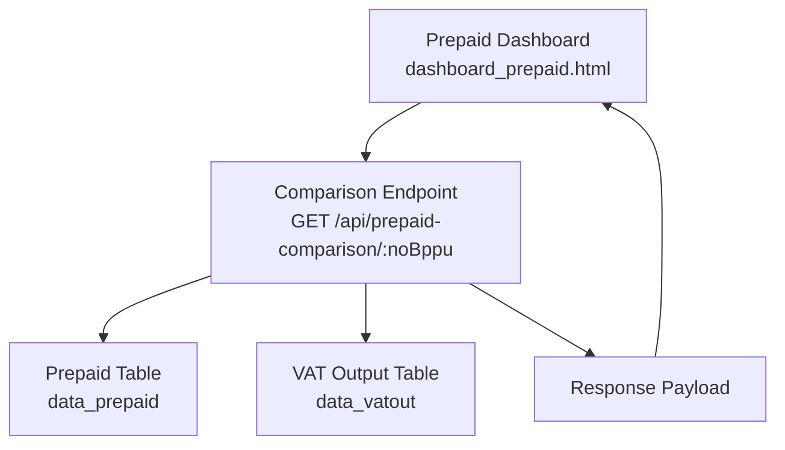
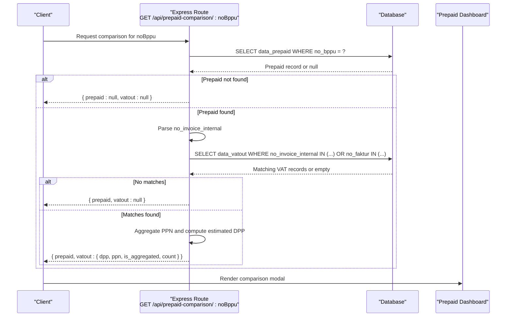
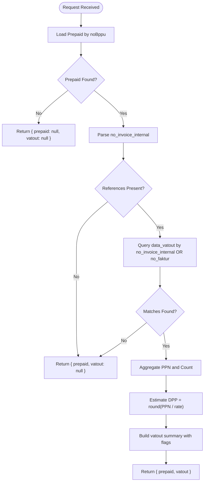
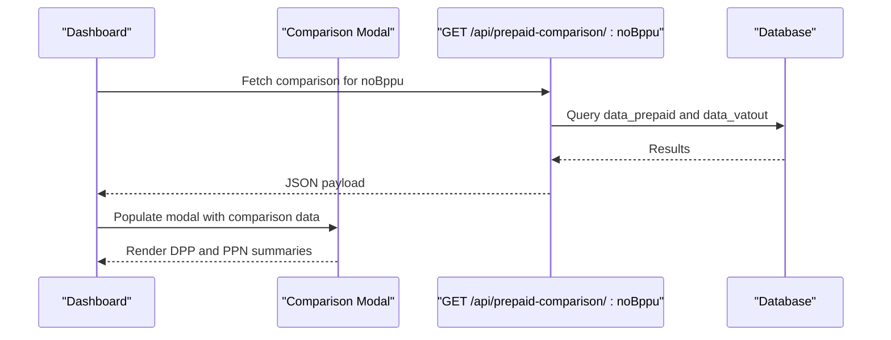
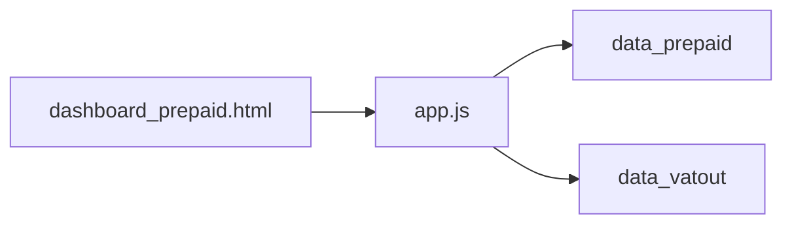

# Specialized Comparison APIs

<cite>
**Referenced Files in This Document**
- [app.js](file://app.js)
- [dashboard_prepaid.html](file://prepaidtax_bppu/dashboard_prepaid.html)
- [PRD_Tax_Database_System.md](file://PRD_Tax_Database_System.md)
</cite>

## Table of Contents
1. [Introduction](#introduction)
2. [Project Structure](#project-structure)
3. [Core Components](#core-components)
4. [Architecture Overview](#architecture-overview)
5. [Detailed Component Analysis](#detailed-component-analysis)
6. [Dependency Analysis](#dependency-analysis)
7. [Performance Considerations](#performance-considerations)
8. [Troubleshooting Guide](#troubleshooting-guide)
9. [Conclusion](#conclusion)

## Introduction
This document provides comprehensive API documentation for the specialized comparison endpoint designed to reconcile prepaid tax data against VAT output invoices. It focuses on the GET endpoint `/api/prepaid-comparison/:noBppu`, detailing parameter specifications, response schema, business logic for invoice matching, error handling for unmatched records, and practical usage examples. It also explains the tax reconciliation process and integration with TDS prepaid management workflows.

## Project Structure
The comparison functionality spans the backend API implementation and the frontend UI that triggers and renders the comparison results:
- Backend: Express route handler in the main application file handles the comparison logic and database queries.
- Frontend: The prepaid dashboard page invokes the comparison endpoint and displays aggregated PPN calculations alongside the original prepaid record.

**Diagram sources**
- [app.js:772-816](file://app.js#L772-L816)
- [dashboard_prepaid.html:413-431](file://prepaidtax_bppu/dashboard_prepaid.html#L413-L431)

**Section sources**
- [app.js:772-816](file://app.js#L772-L816)
- [dashboard_prepaid.html:413-431](file://prepaidtax_bppu/dashboard_prepaid.html#L413-L431)

## Core Components
- Endpoint: GET /api/prepaid-comparison/:noBppu
- Purpose: Retrieve a specific prepaid record and match it against VAT output invoices to compute aggregated PPN and derived DPP.
- Authentication: Requires a valid session via middleware.
- Parameters:
  - Path parameter:
    - noBppu (string): Unique identifier for the prepaid record.
- Response schema:
  - prepaid: Full prepaid record if found; otherwise null.
  - vatout: Aggregated VAT output summary if matching invoices exist; otherwise null.
    - dpp: Estimated actual DPP computed from aggregated PPN (rounded).
    - ppn: Sum of PPN from matched invoices.
    - is_aggregated: Boolean indicating whether multiple invoices were matched.
    - count: Number of matched invoices.

**Section sources**
- [app.js:772-816](file://app.js#L772-L816)

## Architecture Overview
The comparison process follows a deterministic flow:
1. Fetch the prepaid record by noBppu.
2. Extract the internal invoice reference(s) from the prepaid record.
3. Query VAT output records matching either the internal invoice number or the VAT invoice number.
4. Aggregate PPN from matched records.
5. Compute estimated DPP by dividing aggregated PPN by the standard rate and rounding.
6. Return a unified response containing the prepaid record and the aggregated VAT summary.

**Diagram sources**
- [app.js:772-816](file://app.js#L772-L816)
- [dashboard_prepaid.html:413-431](file://prepaidtax_bppu/dashboard_prepaid.html#L413-L431)

## Detailed Component Analysis

### API Endpoint: GET /api/prepaid-comparison/:noBppu
- Route registration and authentication:
  - The route is registered with an authentication middleware to ensure secure access.
- Parameter handling:
  - Extracts noBppu from the path parameter.
- Data retrieval and matching:
  - Loads the prepaid record by noBppu.
  - Validates the presence of internal invoice references; returns null for vatout if missing.
  - Splits comma-separated internal invoice references and queries VAT output records by:
    - no_invoice_internal equality (exact match).
    - no_faktur equality (VAT invoice number).
  - Uses a single query with two sets of placeholders to cover both columns efficiently.
- Aggregation and estimation:
  - Sums PPN across matched records.
  - Computes estimated DPP by dividing aggregated PPN by the standard tax rate and rounding to the nearest integer.
- Response construction:
  - Returns a unified payload combining the prepaid record and the aggregated VAT summary.
  - Includes flags indicating aggregation and the number of matched invoices.

**Diagram sources**
- [app.js:772-816](file://app.js#L772-L816)

**Section sources**
- [app.js:772-816](file://app.js#L772-L816)

### Frontend Integration: Prepaid Dashboard Modal
- Invocation:
  - The dashboard triggers the comparison endpoint for each row’s noBppu during rendering and when opening the comparison modal.
- Rendering logic:
  - Displays the original prepaid DPP alongside the estimated VAT output DPP.
  - Computes and visually highlights the difference between the two values.
  - Handles absence of matching VAT records gracefully by displaying a neutral message.

**Diagram sources**
- [dashboard_prepaid.html:413-431](file://prepaidtax_bppu/dashboard_prepaid.html#L413-L431)
- [app.js:772-816](file://app.js#L772-L816)

**Section sources**
- [dashboard_prepaid.html:413-431](file://prepaidtax_bppu/dashboard_prepaid.html#L413-L431)

### Database Schema Context
- Prepaid table (data_prepaid):
  - Contains the prepaid record with fields including no_bppu, masa_pajak, entitas, kode_cabang, dpp, nilai_pph, tanggal_dokumen, nomor_dokumen, no_invoice_internal, and link_pdf_lokal.
- VAT output table (data_vatout):
  - Contains VAT output records with fields including no_faktur, no_invoice_internal, dpp, ppn, entitas, tanggal_faktur, and related metadata.
- Indexing:
  - Indexes exist on entitas and tanggal_faktur for performance on data_vatout.
  - Indexes exist on entitas and tanggal_dokumen for performance on data_prepaid.
  - Additional indexes on no_invoice_internal facilitate fast lookups.

**Section sources**
- [PRD_Tax_Database_System.md:41-53](file://PRD_Tax_Database_System.md#L41-L53)
- [app.js:346-477](file://app.js#L346-L477)

## Dependency Analysis
- Internal dependencies:
  - The comparison endpoint depends on:
    - data_prepaid for retrieving the prepaid record.
    - data_vatout for finding matching invoices and aggregating PPN.
- External dependencies:
  - Express router and SQLite database access.
- Coupling and cohesion:
  - The endpoint encapsulates the matching and aggregation logic, maintaining high cohesion around the comparison operation.
  - Minimal coupling to UI; the UI consumes the standardized JSON response.

**Diagram sources**
- [app.js:772-816](file://app.js#L772-L816)
- [dashboard_prepaid.html:413-431](file://prepaidtax_bppu/dashboard_prepaid.html#L413-L431)

**Section sources**
- [app.js:772-816](file://app.js#L772-L816)
- [dashboard_prepaid.html:413-431](file://prepaidtax_bppu/dashboard_prepaid.html#L413-L431)

## Performance Considerations
- Query efficiency:
  - Single-pass aggregation of PPN avoids multiple round trips.
  - IN clauses with prepared placeholders reduce SQL injection risk while enabling flexible matching.
- Index utilization:
  - Existing indexes on entitas and date columns improve lookup performance for both tables.
- Scalability:
  - For very large datasets, consider partitioning or materialized summaries to accelerate comparisons.
  - Batch processing of multiple noBppu values could be introduced if bulk reconciliation is required.

[No sources needed since this section provides general guidance]

## Troubleshooting Guide
- No matching VAT output records:
  - Symptom: Response includes vatout as null or an object with zero totals.
  - Cause: no_invoice_internal is missing, empty, or does not match any VAT output records.
  - Resolution: Verify the internal invoice reference in the prepaid record and ensure corresponding VAT output entries exist.
- Partial or no DPP estimate:
  - Symptom: Estimated DPP appears as zero or unexpected.
  - Cause: Aggregated PPN is zero or no matches were found.
  - Resolution: Confirm PPN values in matched VAT output records and re-run the comparison.
- Authentication failures:
  - Symptom: Unauthorized or session errors when invoking the endpoint.
  - Cause: Missing or invalid authentication middleware validation.
  - Resolution: Ensure the client includes proper credentials and the session is active.
- UI rendering anomalies:
  - Symptom: Modal shows “Data not found” or mismatched DPP values.
  - Cause: Absence of a matching prepaid record or inconsistent internal invoice references.
  - Resolution: Cross-check the noBppu value and internal invoice linkage in the backend logs.

**Section sources**
- [app.js:772-816](file://app.js#L772-L816)
- [dashboard_prepaid.html:413-431](file://prepaidtax_bppu/dashboard_prepaid.html#L413-L431)

## Conclusion
The GET /api/prepaid-comparison/:noBppu endpoint provides a streamlined mechanism to reconcile prepaid tax records against VAT output invoices. By leveraging internal invoice references and aggregating PPN to estimate DPP, it supports accurate tax reconciliation and integrates seamlessly with TDS prepaid management workflows. Proper indexing, robust error handling, and clear UI feedback ensure reliable operation across typical workloads.