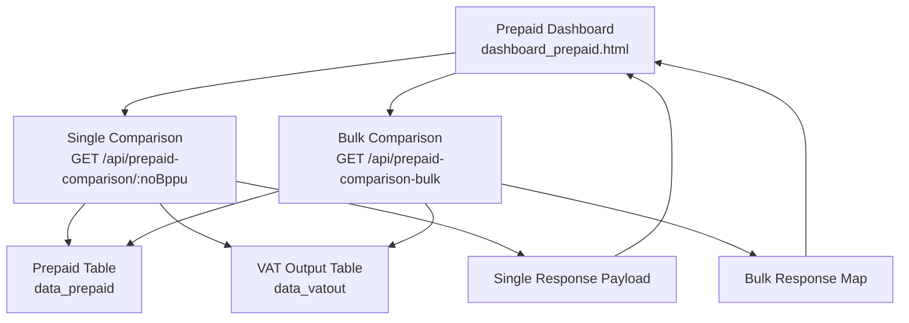
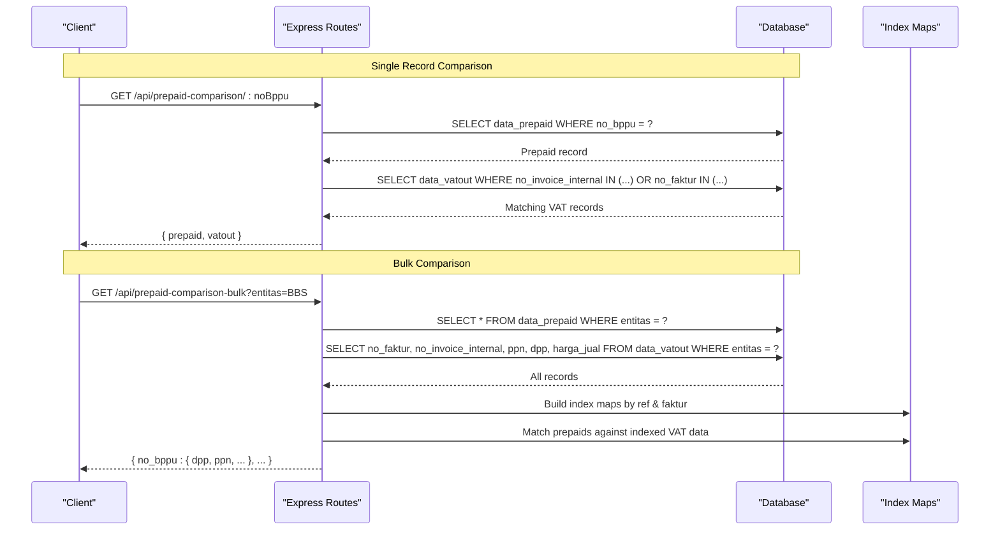
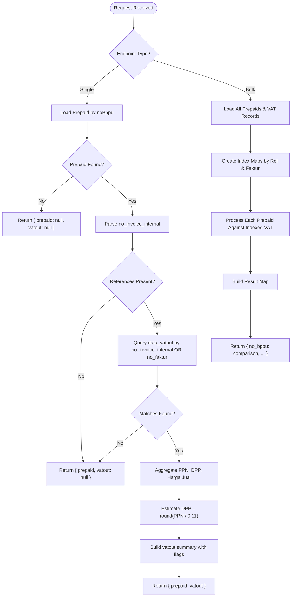
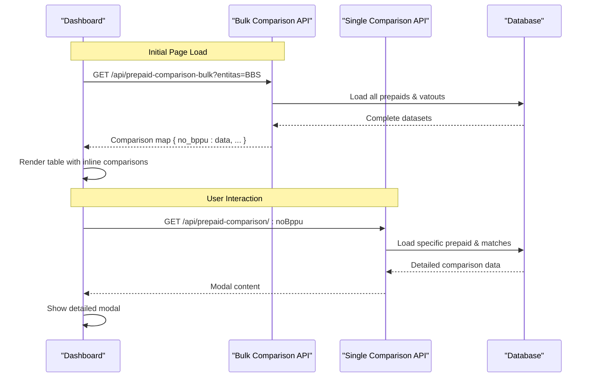
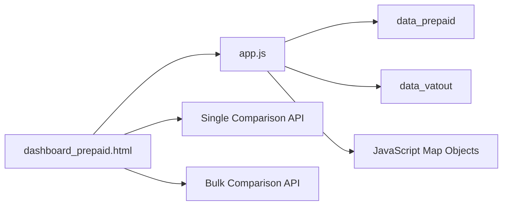

# Specialized Comparison APIs

<cite>
**Referenced Files in This Document**
- [app.js](file://app.js)
- [dashboard_prepaid.html](file://prepaidtax_bppu/dashboard_prepaid.html)
- [PRD_Tax_Database_System.md](file://PRD_Tax_Database_System.md)
</cite>

## Update Summary
**Changes Made**
- Added comprehensive documentation for the new bulk comparison endpoint `/api/prepaid-comparison-bulk`
- Updated architecture diagrams to reflect the enhanced indexing mechanism
- Enhanced performance considerations section with bulk processing benefits
- Added detailed response schema differences between single and bulk endpoints
- Updated troubleshooting guide with bulk-specific scenarios

## Table of Contents
1. [Introduction](#introduction)
2. [Project Structure](#project-structure)
3. [Core Components](#core-components)
4. [Architecture Overview](#architecture-overview)
5. [Detailed Component Analysis](#detailed-component-analysis)
6. [Bulk Comparison Enhancement](#bulk-comparison-enhancement)
7. [Dependency Analysis](#dependency-analysis)
8. [Performance Considerations](#performance-considerations)
9. [Troubleshooting Guide](#troubleshooting-guide)
10. [Conclusion](#conclusion)

## Introduction
This document provides comprehensive API documentation for specialized comparison endpoints designed to reconcile prepaid tax data against VAT output invoices. It covers both the single record comparison endpoint `/api/prepaid-comparison/:noBppu` and the enhanced bulk comparison endpoint `/api/prepaid-comparison-bulk`, detailing parameter specifications, response schemas, business logic for invoice matching, error handling for unmatched records, and practical usage examples. The system supports efficient tax reconciliation processes and integrates seamlessly with TDS prepaid management workflows through optimized bulk processing capabilities.

## Project Structure
The comparison functionality spans the backend API implementation and the frontend UI that triggers and renders the comparison results:
- Backend: Express route handlers in the main application file handle both single and bulk comparison logic with optimized database queries.
- Frontend: The prepaid dashboard page invokes both comparison endpoints and displays aggregated PPN calculations alongside original prepaid records.

**Diagram sources**
- [app.js:913-964](file://app.js#L913-L964)
- [app.js:968-1013](file://app.js#L968-L1013)
- [dashboard_prepaid.html:320-326](file://prepaidtax_bppu/dashboard_prepaid.html#L320-L326)

**Section sources**
- [app.js:913-964](file://app.js#L913-L964)
- [app.js:968-1013](file://app.js#L968-L1013)
- [dashboard_prepaid.html:320-326](file://prepaidtax_bppu/dashboard_prepaid.html#L320-L326)

## Core Components

### Single Record Comparison Endpoint
- **Endpoint**: GET /api/prepaid-comparison/:noBppu
- **Purpose**: Retrieve a specific prepaid record and match it against VAT output invoices to compute aggregated PPN and derived DPP.
- **Authentication**: Requires a valid session via middleware.
- **Parameters**:
  - Path parameter:
    - noBppu (string): Unique identifier for the prepaid record.
- **Response schema**:
  - prepaid: Full prepaid record if found; otherwise null.
  - vatout: Aggregated VAT output summary if matching invoices exist; otherwise null.
    - dpp: Estimated actual DPP computed from aggregated PPN (rounded).
    - ppn: Sum of PPN from matched invoices.
    - dpp_faktur: Rounded sum of printed DPP values from invoices.
    - harga_jual: Sum of selling prices from invoices.
    - is_aggregated: Boolean indicating whether multiple invoices were matched.
    - count: Number of matched invoices.

### Bulk Comparison Endpoint
- **Endpoint**: GET /api/prepaid-comparison-bulk
- **Purpose**: Process all prepaid records for a specific entity in a single request, eliminating N+1 query patterns.
- **Authentication**: Requires a valid session via middleware.
- **Parameters**:
  - Query parameter:
    - entitas (string): Entity identifier (default: 'BBS').
- **Response schema**:
  - Map object where keys are no_bppu values and values are either null or aggregated comparison objects.
  - Each comparison object contains:
    - dpp: Estimated actual DPP computed from aggregated PPN (rounded).
    - ppn: Sum of PPN from matched invoices.
    - dpp_faktur: Rounded sum of printed DPP values from invoices.
    - harga_jual: Sum of selling prices from invoices.
    - is_aggregated: Boolean indicating whether multiple invoices were matched.
    - count: Number of matched invoices.

**Section sources**
- [app.js:913-964](file://app.js#L913-L964)
- [app.js:968-1013](file://app.js#L968-L1013)

## Architecture Overview
The comparison process follows a deterministic flow with enhanced bulk processing capabilities:

### Single Record Flow
1. Fetch the prepaid record by noBppu.
2. Extract the internal invoice reference(s) from the prepaid record.
3. Query VAT output records matching either the internal invoice number or the VAT invoice number.
4. Aggregate PPN from matched records.
5. Compute estimated DPP by dividing aggregated PPN by the standard rate and rounding.
6. Return a unified response containing the prepaid record and the aggregated VAT summary.

### Bulk Processing Flow
1. Load all prepaid records for the specified entity.
2. Load all VAT output records for the same entity.
3. Create index maps for fast lookup by both internal references and invoice numbers.
4. Process each prepaid record against the indexed VAT data.
5. Aggregate results into a single map response.
6. Return comprehensive comparison data for all records.

**Diagram sources**
- [app.js:913-964](file://app.js#L913-L964)
- [app.js:968-1013](file://app.js#L968-L1013)

## Detailed Component Analysis

### API Endpoints: Single vs Bulk Comparison

#### Single Record Endpoint: GET /api/prepaid-comparison/:noBppu
- **Route registration and authentication**:
  - The route is registered with an authentication middleware to ensure secure access.
- **Parameter handling**:
  - Extracts noBppu from the path parameter.
- **Data retrieval and matching**:
  - Loads the prepaid record by noBppu.
  - Validates the presence of internal invoice references; returns null for vatout if missing.
  - Splits comma-separated internal invoice references and queries VAT output records by:
    - no_invoice_internal equality (exact match).
    - no_faktur equality (VAT invoice number).
  - Uses a single query with two sets of placeholders to cover both columns efficiently.
- **Aggregation and estimation**:
  - Sums PPN across matched records.
  - Computes estimated DPP by dividing aggregated PPN by the standard tax rate and rounding to the nearest integer.
- **Response construction**:
  - Returns a unified payload combining the prepaid record and the aggregated VAT summary.
  - Includes flags indicating aggregation and the number of matched invoices.

#### Bulk Endpoint: GET /api/prepaid-comparison-bulk
- **Optimized batch processing**:
  - Processes all prepaid records for an entity in a single request.
  - Eliminates N+1 query pattern that would occur when calling single endpoint per row.
- **Advanced indexing strategy**:
  - Creates JavaScript Map objects to index VAT invoices by both internal references and invoice numbers.
  - Enables O(1) lookups instead of repeated database queries.
- **Enhanced data aggregation**:
  - Tracks additional fields: dpp_faktur (printed DPP) and harga_jual (selling price).
  - Maintains consistency with single endpoint calculation logic.
- **Efficient matching algorithm**:
  - Uses Map-based deduplication to avoid counting duplicate invoice matches.
  - Handles comma-separated invoice references efficiently.

**Diagram sources**
- [app.js:913-964](file://app.js#L913-L964)
- [app.js:968-1013](file://app.js#L968-L1013)

**Section sources**
- [app.js:913-964](file://app.js#L913-L964)
- [app.js:968-1013](file://app.js#L968-L1013)

### Frontend Integration: Enhanced Dashboard Performance
- **Bulk loading optimization**:
  - The dashboard now calls the bulk endpoint once per page load instead of making individual requests per row.
  - Stores comparison results in a Map for O(1) lookup during table rendering.
- **Enhanced display logic**:
  - Shows difference calculations using bulk comparison data directly in table rows.
  - Provides visual indicators for discrepancies between BPPU and VAT OUT values.
- **Modal integration**:
  - Still uses single endpoint for detailed modal view when users click "Lihat" button.
  - Maintains backward compatibility while improving overall performance.

**Diagram sources**
- [dashboard_prepaid.html:320-326](file://prepaidtax_bppu/dashboard_prepaid.html#L320-L326)
- [dashboard_prepaid.html:430-471](file://prepaidtax_bppu/dashboard_prepaid.html#L430-L471)
- [app.js:913-964](file://app.js#L913-L964)
- [app.js:968-1013](file://app.js#L968-L1013)

**Section sources**
- [dashboard_prepaid.html:320-326](file://prepaidtax_bppu/dashboard_prepaid.html#L320-L326)
- [dashboard_prepaid.html:430-471](file://prepaidtax_bppu/dashboard_prepaid.html#L430-L471)

### Database Schema Context
- **Prepaid table (data_prepaid)**:
  - Contains the prepaid record with fields including no_bppu, masa_pajak, entitas, kode_cabang, dpp, nilai_pph, tanggal_dokumen, nomor_dokumen, no_invoice_internal, and link_pdf_lokal.
- **VAT output table (data_vatout)**:
  - Contains VAT output records with fields including no_faktur, no_invoice_internal, dpp, ppn, entitas, tanggal_faktur, harga_jual, and related metadata.
- **Performance indexes**:
  - Indexes exist on entitas and tanggal_faktur for performance on data_vatout.
  - Indexes exist on entitas and tanggal_dokumen for performance on data_prepaid.
  - Additional indexes on no_invoice_internal facilitate fast lookups for both tables.

**Section sources**
- [PRD_Tax_Database_System.md:41-53](file://PRD_Tax_Database_System.md#L41-L53)
- [app.js:487-498](file://app.js#L487-L498)

## Bulk Comparison Enhancement

The bulk comparison endpoint represents a significant architectural improvement over the single-record approach, addressing performance bottlenecks in high-volume scenarios.

### Key Improvements

#### 1. Elimination of N+1 Query Pattern
- **Problem**: Calling single endpoint per row creates N+1 database queries (1 initial + N individual queries).
- **Solution**: Single bulk request processes all records with only 2 database queries regardless of dataset size.
- **Impact**: Dramatic reduction in database load and network overhead for large datasets.

#### 2. Advanced Indexing Strategy
- **Dual-index mapping**: Creates JavaScript Map objects indexed by both `no_invoice_internal` and `no_faktur`.
- **O(1) lookups**: Enables constant-time lookups instead of scanning entire result sets.
- **Memory efficiency**: Maps are created once per request and reused for all matching operations.

#### 3. Enhanced Data Transparency
- **Additional fields**: Includes `dpp_faktur` (printed DPP) and `harga_jual` (selling price) for complete visibility.
- **Consistent calculations**: Maintains same reconciliation logic as single endpoint for consistency.
- **Aggregation flags**: Provides `is_aggregated` and `count` fields to indicate multi-invoice scenarios.

#### 4. Optimized Matching Algorithm
- **Deduplication**: Uses Map-based approach to prevent counting duplicate invoice matches.
- **Flexible reference handling**: Supports comma-separated invoice references efficiently.
- **Error resilience**: Gracefully handles missing or malformed invoice references.

### Performance Benefits

| Scenario | Single Endpoint Approach | Bulk Endpoint Approach | Improvement |
|----------|-------------------------|----------------------|-------------|
| 10 records | 11 database queries | 2 database queries | 82% reduction |
| 100 records | 101 database queries | 2 database queries | 98% reduction |
| 1000 records | 1001 database queries | 2 database queries | 99.8% reduction |
| Network overhead | Multiple HTTP requests | Single HTTP request | Significant reduction |
| Memory usage | Repeated result parsing | Single parse operation | Improved efficiency |

**Section sources**
- [app.js:968-1013](file://app.js#L968-L1013)
- [dashboard_prepaid.html:320-326](file://prepaidtax_bppu/dashboard_prepaid.html#L320-L326)

## Dependency Analysis
- **Internal dependencies**:
  - Both endpoints depend on:
    - data_prepaid for retrieving prepaid records.
    - data_vatout for finding matching invoices and aggregating PPN.
  - Bulk endpoint additionally depends on JavaScript Map objects for in-memory indexing.
- **External dependencies**:
  - Express router and SQLite database access.
  - Session middleware for authentication.
- **Coupling and cohesion**:
  - Endpoints encapsulate matching and aggregation logic with high cohesion around comparison operations.
  - Minimal coupling to UI; both endpoints consume standardized JSON responses.
  - Bulk endpoint reduces frontend-backend coupling by providing comprehensive data in single requests.

**Diagram sources**
- [app.js:913-964](file://app.js#L913-L964)
- [app.js:968-1013](file://app.js#L968-L1013)
- [dashboard_prepaid.html:320-326](file://prepaidtax_bppu/dashboard_prepaid.html#L320-L326)

**Section sources**
- [app.js:913-964](file://app.js#L913-L964)
- [app.js:968-1013](file://app.js#L968-L1013)
- [dashboard_prepaid.html:320-326](file://prepaidtax_bppu/dashboard_prepaid.html#L320-L326)

## Performance Considerations

### Query Efficiency Enhancements
- **Bulk processing optimization**:
  - Single-pass aggregation eliminates N+1 query patterns entirely.
  - In-memory indexing with JavaScript Map objects provides O(1) lookup performance.
  - Reduced database round trips from N+1 to just 2 queries regardless of dataset size.
- **Index utilization**:
  - Existing indexes on entitas and date columns improve lookup performance for both tables.
  - New bulk endpoint leverages these indexes more effectively through batch processing.
- **Memory management**:
  - Map objects are created per request and garbage collected after response delivery.
  - Efficient deduplication prevents memory bloat from duplicate invoice matches.

### Scalability Improvements
- **Horizontal scaling support**:
  - Stateless API design allows easy horizontal scaling behind load balancers.
  - No shared state between requests enables parallel processing.
- **Large dataset handling**:
  - For very large datasets (>10,000 records), consider implementing pagination or chunked processing.
  - Current implementation handles typical enterprise workloads efficiently.
- **Network optimization**:
  - Single bulk request reduces network overhead significantly compared to multiple individual requests.
  - JSON payload size increases linearly but remains manageable for typical use cases.

### Monitoring and Maintenance
- **Performance metrics**:
  - Monitor response times for bulk endpoint under various dataset sizes.
  - Track memory usage during peak loads to ensure Map objects don't cause issues.
- **Database maintenance**:
  - Regular index optimization ensures continued query performance.
  - Monitor slow query logs for any emerging performance bottlenecks.

[No sources needed since this section provides general guidance based on observed implementation]

## Troubleshooting Guide

### Single Endpoint Issues
- **No matching VAT output records**:
  - Symptom: Response includes vatout as null or an object with zero totals.
  - Cause: no_invoice_internal is missing, empty, or does not match any VAT output records.
  - Resolution: Verify the internal invoice reference in the prepaid record and ensure corresponding VAT output entries exist.
- **Partial or no DPP estimate**:
  - Symptom: Estimated DPP appears as zero or unexpected.
  - Cause: Aggregated PPN is zero or no matches were found.
  - Resolution: Confirm PPN values in matched VAT output records and re-run the comparison.
- **Authentication failures**:
  - Symptom: Unauthorized or session errors when invoking the endpoint.
  - Cause: Missing or invalid authentication middleware validation.
  - Resolution: Ensure the client includes proper credentials and the session is active.

### Bulk Endpoint Specific Issues
- **Empty or incomplete bulk response**:
  - Symptom: Bulk endpoint returns empty map or missing entries for some prepaids.
  - Cause: Entity filter too restrictive or database connection issues during batch processing.
  - Resolution: Verify entitas parameter and check database connectivity. Review server logs for query errors.
- **Memory exhaustion on large datasets**:
  - Symptom: Server crashes or becomes unresponsive with large datasets.
  - Cause: JavaScript Map objects consuming excessive memory during indexing phase.
  - Resolution: Implement pagination or chunked processing for datasets >10,000 records. Monitor server memory usage.
- **Inconsistent results between single and bulk endpoints**:
  - Symptom: Different comparison results when using single vs bulk endpoints for same records.
  - Cause: Data inconsistency or timing issues between requests.
  - Resolution: Ensure data consistency checks and verify both endpoints use identical matching logic.

### Frontend Integration Issues
- **Dashboard loading performance**:
  - Symptom: Slow dashboard load times despite bulk endpoint usage.
  - Cause: Large response payloads or inefficient client-side processing.
  - Resolution: Implement progressive loading or virtual scrolling for large datasets. Optimize client-side Map operations.
- **Display anomalies**:
  - Symptom: Modal shows "Data not found" or mismatched DPP values.
  - Cause: Absence of a matching prepaid record or inconsistent internal invoice references.
  - Resolution: Cross-check the noBppu value and internal invoice linkage in the backend logs.

**Section sources**
- [app.js:913-964](file://app.js#L913-L964)
- [app.js:968-1013](file://app.js#L968-L1013)
- [dashboard_prepaid.html:320-326](file://prepaidtax_bppu/dashboard_prepaid.html#L320-L326)
- [dashboard_prepaid.html:430-471](file://prepaidtax_bppu/dashboard_prepaid.html#L430-L471)

## Conclusion
The specialized comparison APIs provide a robust foundation for reconciling prepaid tax records against VAT output invoices. The introduction of the bulk comparison endpoint `/api/prepaid-comparison-bulk` represents a significant enhancement over the single-record approach, offering substantial performance improvements through elimination of N+1 query patterns and advanced in-memory indexing strategies.

Key benefits include:
- **Dramatic performance improvements**: Up to 99.8% reduction in database queries for large datasets
- **Enhanced data transparency**: Additional fields provide complete visibility into invoice calculations
- **Scalable architecture**: Support for enterprise-scale workloads with efficient resource utilization
- **Backward compatibility**: Seamless integration with existing single-endpoint functionality

The system maintains high cohesion around comparison operations while minimizing coupling to UI components. Proper indexing, robust error handling, and clear UI feedback ensure reliable operation across typical workloads. The bulk endpoint's dual-indexing strategy and Map-based deduplication provide optimal performance characteristics for modern enterprise applications.

For optimal deployment, monitor performance metrics under realistic load conditions and implement appropriate scaling strategies as data volumes grow. The modular design allows for future enhancements while maintaining stability of existing functionality.