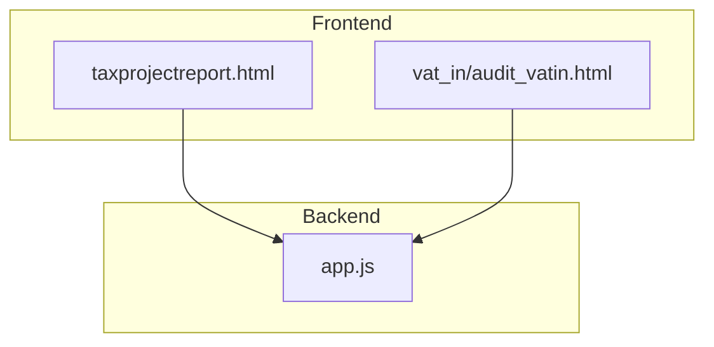
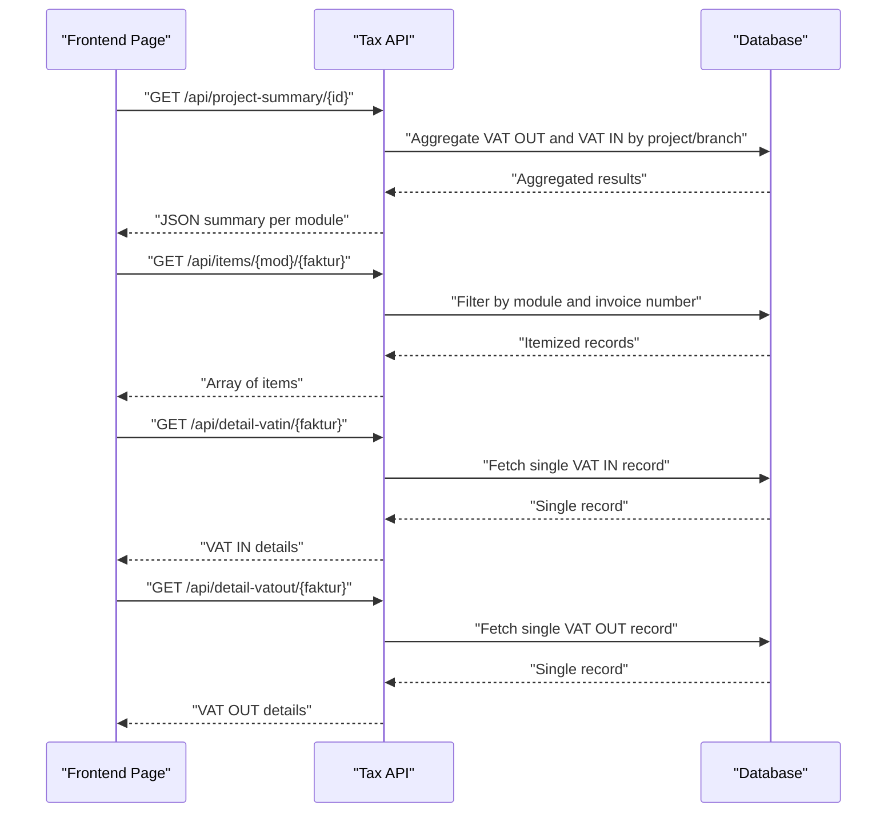
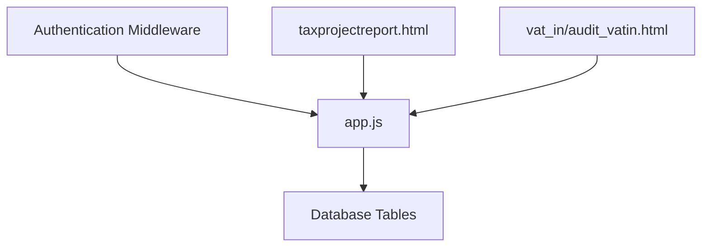

# Tax Data APIs

<cite>
**Referenced Files in This Document**
- [app.js](file://app.js)
- [PRD_Tax_Database_System.md](file://PRD_Tax_Database_System.md)
- [taxprojectreport.html](file://taxprojectreport.html)
- [vat_in/audit_vatin.html](file://vat_in/audit_vatin.html)
</cite>

## Table of Contents
1. [Introduction](#introduction)
2. [Project Structure](#project-structure)
3. [Core Components](#core-components)
4. [Architecture Overview](#architecture-overview)
5. [Detailed Component Analysis](#detailed-component-analysis)
6. [Dependency Analysis](#dependency-analysis)
7. [Performance Considerations](#performance-considerations)
8. [Troubleshooting Guide](#troubleshooting-guide)
9. [Conclusion](#conclusion)

## Introduction
This document provides comprehensive API documentation for tax data endpoints focused on retrieving project tax summaries, itemized tax data, and individual invoice details. It covers:
- GET endpoint for project tax summaries
- GET endpoint for itemized tax data
- Detail endpoints for individual invoice records
It also documents parameter specifications, response schemas, authentication requirements, and practical examples. The data aggregation logic, tax comparison functionality, and integration with tax management modules are explained to support accurate interpretation and usage of the APIs.

## Project Structure
The tax data APIs are implemented in the backend application script and integrated with frontend pages that consume these endpoints. The primary backend file defines the routes and database queries, while the frontend pages reference the endpoints for rendering dashboards and reports.

**Diagram sources**
- [app.js](file://app.js)
- [taxprojectreport.html](file://taxprojectreport.html)
- [vat_in/audit_vatin.html](file://vat_in/audit_vatin.html)

**Section sources**
- [app.js](file://app.js)
- [taxprojectreport.html](file://taxprojectreport.html)
- [vat_in/audit_vatin.html](file://vat_in/audit_vatin.html)

## Core Components
This section documents the tax data endpoints and their behavior based on the backend implementation and project documentation.

- GET /api/project-summary/{id}
  - Purpose: Retrieve a cross-module tax summary for a given project identifier.
  - Path Parameters:
    - id: string or numeric identifier representing the project or branch.
  - Authentication: Required (route protected by middleware).
  - Behavior:
    - Aggregates VAT OUT and VAT IN data for the specified project/branch.
    - Uses conditions filtering by project ID or branch code.
    - Returns totals for counts, DPP, and VAT amounts across modules.
  - Response Schema:
    - vatout: { jml, dpp, ppn, pending }
    - vatin: { jml, dpp, ppn, pending }
    - payable: { jml, dpp, pph, pending }
    - prepaid: { jml, dpp, pph, pending }
    - ledger: { jml, income, receipt, debtor }
    - recent_vatout: array
    - recent_vatin: array
    - pending_requests: number
  - Practical Example:
    - Request: GET /api/project-summary/BRANCH-001
    - Response: JSON object containing aggregated tax metrics per module and recent items.

- GET /api/items/{mod}/{faktur}
  - Purpose: Retrieve itemized tax data for a specific module and invoice/faktur.
  - Path Parameters:
    - mod: string indicating the module (e.g., VAT OUT, VAT IN).
    - faktur: string representing the invoice number or identifier.
  - Authentication: Required (route protected by middleware).
  - Behavior:
    - Filters records by module and invoice number.
    - Returns detailed line items or records associated with the invoice.
  - Response Schema:
    - Array of items with fields such as invoice number, buyer/client name, sale amount, DPP, VAT, internal invoice number, and formatted date.
  - Practical Example:
    - Request: GET /api/items/vatout/INV-2023-00123
    - Response: Array of line items for the specified invoice.

- GET /api/detail-vatin/{faktur}
  - Purpose: Retrieve detailed record for a specific VAT IN invoice.
  - Path Parameters:
    - faktur: string representing the VAT IN invoice number or identifier.
  - Authentication: Required (route protected by middleware).
  - Behavior:
    - Fetches a single VAT IN record by invoice number.
    - Returns the complete invoice details for auditing or reconciliation.
  - Response Schema:
    - Object representing the VAT IN invoice record with fields such as invoice number, normalized invoice number, status, exchange date, invoice date, VAT amount, input timestamp, and tax period.
  - Practical Example:
    - Request: GET /api/detail-vatin/VATIN-2023-00456
    - Response: Single VAT IN record object.

- GET /api/detail-vatout/{faktur}
  - Purpose: Retrieve detailed record for a specific VAT OUT invoice.
  - Path Parameters:
    - faktur: string representing the VAT OUT invoice number or identifier.
  - Authentication: Required (route protected by middleware).
  - Behavior:
    - Fetches a single VAT OUT record by invoice number.
    - Returns the complete invoice details for reporting or reconciliation.
  - Response Schema:
    - Object representing the VAT OUT invoice record with fields such as invoice number, buyer/client name, sale amount, DPP, VAT, internal invoice number, and formatted invoice date.
  - Practical Example:
    - Request: GET /api/detail-vatout/VATOUT-2023-00789
    - Response: Single VAT OUT record object.

**Section sources**
- [PRD_Tax_Database_System.md:121-140](file://PRD_Tax_Database_System.md#L121-L140)
- [app.js](file://app.js)

## Architecture Overview
The tax data APIs integrate with the backend server and database to provide summarized and detailed tax information. The frontend dashboards and reports call these endpoints to render insights and facilitate tax management tasks.

**Diagram sources**
- [app.js](file://app.js)
- [PRD_Tax_Database_System.md](file://PRD_Tax_Database_System.md)

## Detailed Component Analysis

### GET /api/project-summary/{id}
- Authentication: Required via middleware.
- Data Aggregation Logic:
  - Retrieves totals for VAT OUT, VAT IN, payable taxes, prepaid taxes, and ledger entries.
  - Computes recent invoices for both VAT OUT and VAT IN.
  - Counts pending requests.
- Tax Comparison Functionality:
  - Supports comparative analysis between VAT OUT and VAT IN DPP totals for margin calculations.
- Integration with Tax Management Modules:
  - Pulls data from VAT OUT and VAT IN tables filtered by project/branch identifiers.
- Response Schema:
  - Includes structured fields for each module’s counts, DPP, and VAT/PPH totals, plus recent items and pending counts.

Practical Example:
- Request: GET /api/project-summary/BRANCH-001
- Response: JSON object with aggregated metrics per module and recent items.

**Section sources**
- [PRD_Tax_Database_System.md:121-140](file://PRD_Tax_Database_System.md#L121-L140)
- [app.js](file://app.js)

### GET /api/items/{mod}/{faktur}
- Authentication: Required via middleware.
- Filtering Logic:
  - Filters records by module and invoice number.
  - Returns line items or records associated with the invoice for detailed review.
- Response Schema:
  - Array of items with fields such as invoice number, buyer/client name, sale amount, DPP, VAT, internal invoice number, and formatted invoice date.
- Practical Example:
  - Request: GET /api/items/vatout/INV-2023-00123
  - Response: Array of line items for the specified invoice.

**Section sources**
- [app.js](file://app.js)

### GET /api/detail-vatin/{faktur}
- Authentication: Required via middleware.
- Retrieval Logic:
  - Fetches a single VAT IN record by invoice number.
  - Returns comprehensive details for auditing or reconciliation.
- Response Schema:
  - Object with fields such as invoice number, normalized invoice number, status, exchange date, invoice date, VAT amount, input timestamp, and tax period.
- Practical Example:
  - Request: GET /api/detail-vatin/VATIN-2023-00456
  - Response: Single VAT IN record object.

**Section sources**
- [app.js](file://app.js)

### GET /api/detail-vatout/{faktur}
- Authentication: Required via middleware.
- Retrieval Logic:
  - Fetches a single VAT OUT record by invoice number.
  - Returns comprehensive details for reporting or reconciliation.
- Response Schema:
  - Object with fields such as invoice number, buyer/client name, sale amount, DPP, VAT, internal invoice number, and formatted invoice date.
- Practical Example:
  - Request: GET /api/detail-vatout/VATOUT-2023-00789
  - Response: Single VAT OUT record object.

**Section sources**
- [app.js](file://app.js)

## Dependency Analysis
The tax data endpoints depend on:
- Authentication middleware to protect routes.
- Database queries that filter by project/branch and invoice numbers.
- Frontend pages that call these endpoints to render dashboards and reports.

**Diagram sources**
- [app.js](file://app.js)
- [taxprojectreport.html](file://taxprojectreport.html)
- [vat_in/audit_vatin.html](file://vat_in/audit_vatin.html)

**Section sources**
- [app.js](file://app.js)
- [taxprojectreport.html](file://taxprojectreport.html)
- [vat_in/audit_vatin.html](file://vat_in/audit_vatin.html)

## Performance Considerations
- Use appropriate filters by project/branch and invoice numbers to minimize dataset size.
- Aggregate queries should leverage indexed columns for efficient grouping and totals.
- Batch retrieval of recent items helps avoid large payloads.
- Consider pagination for itemized lists when datasets grow large.

## Troubleshooting Guide
- Authentication failures:
  - Ensure the request includes valid authentication credentials required by the middleware.
- Empty or missing data:
  - Verify the project/branch ID and invoice number parameters match existing records.
  - Confirm database connectivity and table availability.
- Unexpected aggregation results:
  - Review filtering conditions and ensure correct module selection.
- Endpoint not found:
  - Confirm the exact route path and method (GET) matches the backend definition.

## Conclusion
The tax data APIs provide essential capabilities for retrieving project tax summaries, itemized tax data, and detailed invoice records. They support data aggregation, tax comparisons, and integration with tax management modules. Proper use of authentication, correct parameterization, and understanding of response schemas enable effective utilization of these endpoints for dashboards and reporting.