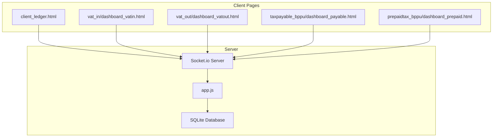
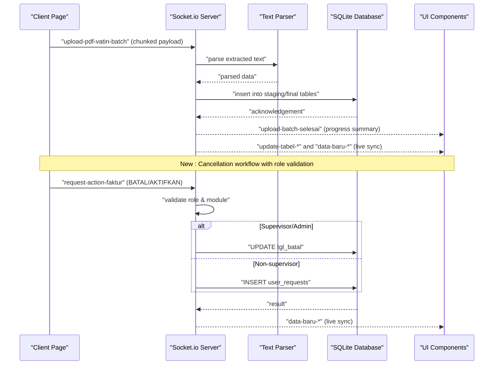
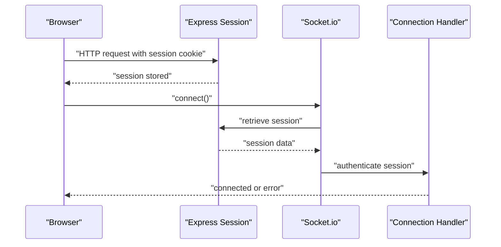
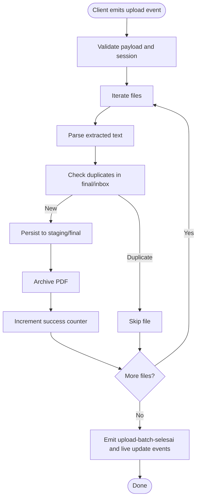
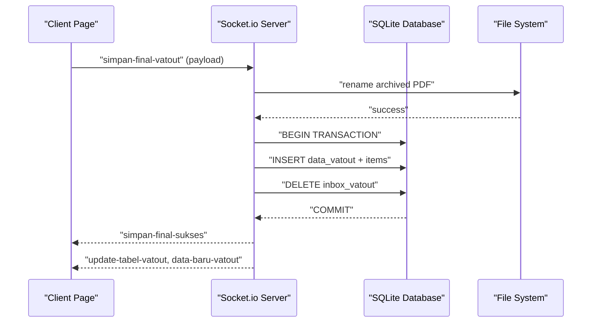
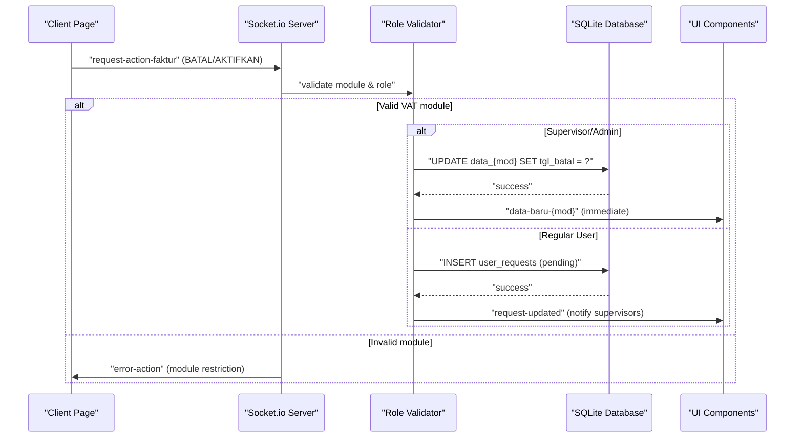
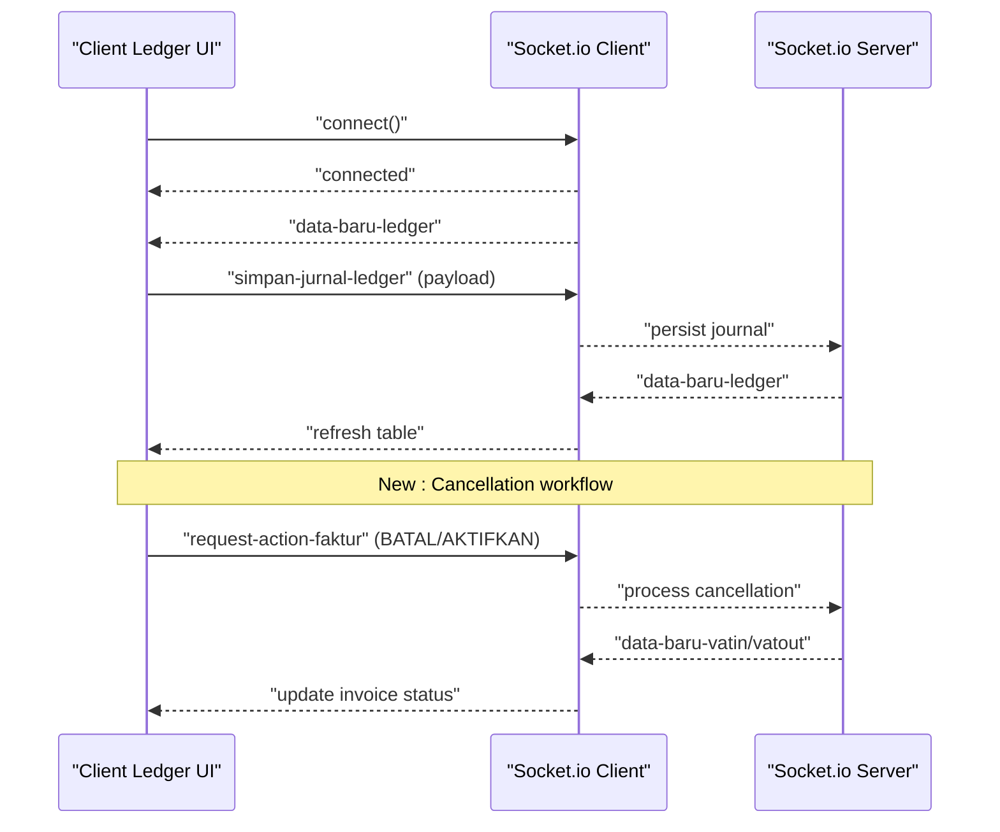
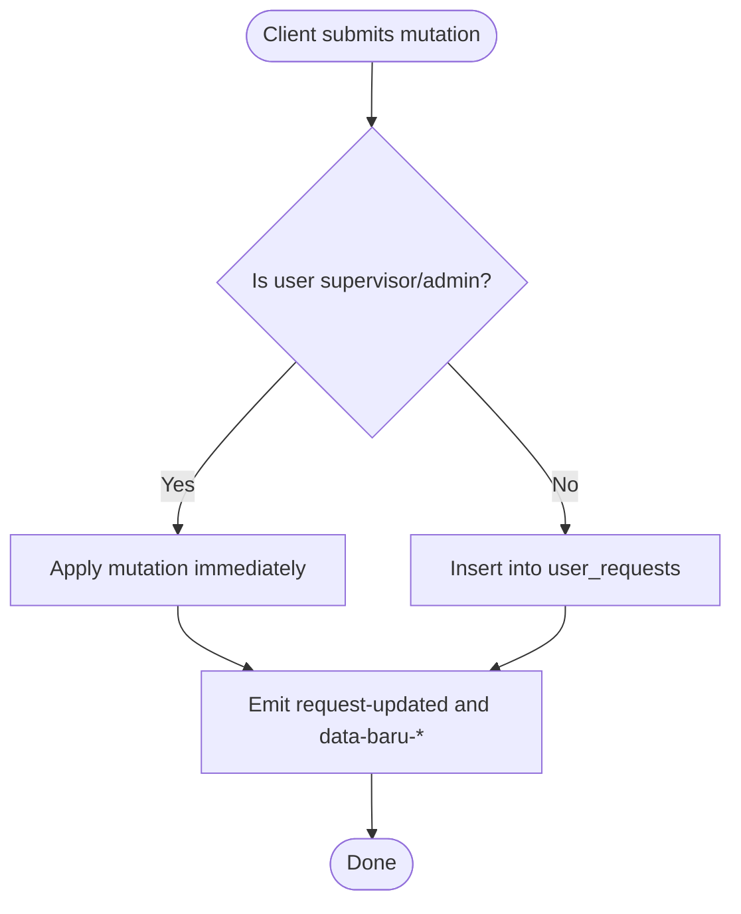
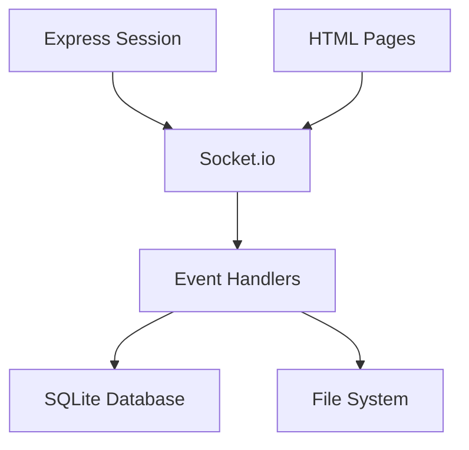

# Socket.io Events

<cite>
**Referenced Files in This Document**
- [app.js](file://app.js)
- [client_ledger.html](file://accounting/client_ledger.html)
- [dashboard_vatin.html](file://vat_in/dashboard_vatin.html)
- [dashboard_vatout.html](file://vat_out/dashboard_vatout.html)
- [TDS_Sequence_Diagram.md](file://TDS_Sequence_Diagram.md)
- [PRD_Tax_Database_System.md](file://PRD_Tax_Database_System.md)
</cite>

## Update Summary
**Changes Made**
- Added comprehensive documentation for invoice cancellation events (BATAL/AKTIFKAN actions)
- Updated approval workflow section to include enhanced validation for supervisor-only operations
- Added new event type documentation for request-action-faktur with cancellation capabilities
- Enhanced error handling documentation for module-specific restrictions
- Updated client-side interaction patterns to reflect new cancellation workflows

## Table of Contents
1. [Introduction](#introduction)
2. [Project Structure](#project-structure)
3. [Core Components](#core-components)
4. [Architecture Overview](#architecture-overview)
5. [Detailed Component Analysis](#detailed-component-analysis)
6. [Dependency Analysis](#dependency-analysis)
7. [Performance Considerations](#performance-considerations)
8. [Troubleshooting Guide](#troubleshooting-guide)
9. [Conclusion](#conclusion)

## Introduction
This document provides comprehensive Socket.io API documentation for real-time communication in the TDS system. It covers WebSocket connection handling, event types, message formats, and real-time interaction patterns for batch PDF processing and live updates. The focus areas include:
- Connection establishment and authentication via sessions
- Event emission patterns for batch uploads and verification
- Data streaming protocols using chunked transfers
- Real-time notifications and UI synchronization
- Practical workflows for batch upload, progress tracking, and approvals
- **New**: Invoice cancellation and reactivation workflows with role-based validation
- Error handling, reconnection strategies, and performance considerations for high-volume batch processing

## Project Structure
The TDS system integrates Socket.io with Express.js and SQLite to enable real-time batch processing and live UI updates. The server initializes Socket.io with a large HTTP buffer to support high-volume PDF uploads. Client pages embed the Socket.io client library and listen for server-sent events to keep the UI synchronized.

**Diagram sources**
- [app.js:1-10](file://app.js#L1-L10)
- [client_ledger.html:14](file://accounting/client_ledger.html#L14)

**Section sources**
- [app.js:1-10](file://app.js#L1-L10)
- [client_ledger.html:14](file://accounting/client_ledger.html#L14)

## Core Components
- Socket.io server initialization with session sharing and large HTTP buffer for batch uploads
- Authentication middleware ensuring only logged-in users can establish connections
- Event handlers for batch PDF ingestion across VAT IN, VAT OUT, Tax Payable, and Prepaid Tax modules
- **Enhanced**: Invoice cancellation and reactivation handlers with role-based validation
- Real-time notifications for data updates and UI refresh triggers
- Approval workflow events for role-based mutations requiring supervisor/admin approval

Key implementation references:
- Server initialization and session sharing: [app.js:5-90](file://app.js#L5-L90)
- Authentication middleware: [app.js:1625-1632](file://app.js#L1625-L1632)
- Batch upload handlers: [app.js:1720-2258](file://app.js#L1720-L2258)
- **New**: Invoice cancellation handlers: [app.js:2016-2035](file://app.js#L2016-L2035)
- Real-time update emissions: [app.js:1671,1682,1692,1846-1848,2038-2040,2140-2142,2221-2223,2277-2279,2294-2296,2314](file://app.js#L1671,L1682,L1692,L1846-L1848,L2038-L2040,L2140-L2142,L2221-L2223,L2277-L2279,L2294-L2296,L2314)

**Section sources**
- [app.js:5-90](file://app.js#L5-L90)
- [app.js:1625-1632](file://app.js#L1625-L1632)
- [app.js:1720-2258](file://app.js#L1720-L2258)
- [app.js:2016-2035](file://app.js#L2016-L2035)

## Architecture Overview
The real-time architecture centers on authenticated Socket.io connections that stream batch PDF data from clients to the server. The server parses and validates extracted text, persists data to staging or final tables, and emits real-time events to synchronize UIs across modules. **Updated**: The architecture now includes enhanced invoice cancellation workflows with role-based validation and module-specific restrictions.

**Diagram sources**
- [app.js:1720-1848](file://app.js#L1720-L1848)
- [app.js:2016-2035](file://app.js#L2016-L2035)
- [TDS_Sequence_Diagram.md:39-58](file://TDS_Sequence_Diagram.md#L39-L58)

**Section sources**
- [app.js:1720-1848](file://app.js#L1720-L1848)
- [app.js:2016-2035](file://app.js#L2016-L2035)
- [TDS_Sequence_Diagram.md:39-58](file://TDS_Sequence_Diagram.md#L39-L58)

## Detailed Component Analysis

### Connection Establishment and Authentication
- The server attaches the Express session middleware to Socket.io engine to enforce session-based authentication.
- On connection, the server validates the presence of a valid session and attaches user info to the socket for authorization checks.
- Unauthorized connections receive an explicit error.

**Diagram sources**
- [app.js:89-90](file://app.js#L89-L90)
- [app.js:1625-1632](file://app.js#L1625-L1632)

**Section sources**
- [app.js:89-90](file://app.js#L89-L90)
- [app.js:1625-1632](file://app.js#L1625-L1632)

### Batch Upload Workflows
The system supports batch PDF uploads for VAT IN, VAT OUT, Tax Payable, and Prepaid Tax modules. Clients stream extracted text and binary buffers in chunks to prevent UI freezing and excessive memory usage.

- Event: upload-pdf-vatin-batch
  - Payload: { entitas, username, files[] }
  - files[]: { teksPDF, fileBuffer }
  - Behavior: Parses text, detects duplicates, inserts into staging/final tables, archives PDFs, and emits progress and live update events.
  - Emitted events: upload-batch-selesai, update-tabel-vatin, data-baru-vatin

- Event: upload-pdf-vatout-batch
  - Payload: { entitas, username, files[] }
  - Behavior: Similar to VAT IN but targets inbox_vatout for later verification and final insertion.
  - Emitted events: upload-batch-selesai, update-tabel-vatout

- Event: upload-pdf-payable-batch
  - Payload: { entitas, username, files[] }
  - Behavior: Inserts into inbox_payable for later verification and final insertion.
  - Emitted events: upload-batch-selesai, update-tabel-payable

- Event: upload-pdf-prepaid-batch
  - Payload: { entitas, username, files[] }
  - Behavior: Inserts into inbox_prepaid for later verification and final insertion.
  - Emitted events: upload-batch-selesai, update-tabel-prepaid

**Diagram sources**
- [app.js:1720-1848](file://app.js#L1720-L1848)
- [app.js:1920-2040](file://app.js#L1920-L2040)
- [app.js:2101-2142](file://app.js#L2101-L2142)
- [app.js:2182-2223](file://app.js#L2182-L2223)

**Section sources**
- [app.js:1720-1848](file://app.js#L1720-L1848)
- [app.js:1920-2040](file://app.js#L1920-L2040)
- [app.js:2101-2142](file://app.js#L2101-L2142)
- [app.js:2182-2223](file://app.js#L2182-L2223)

### Verification and Finalization
After batch uploads, certain modules require verification before moving data to final tables. The system supports finalization events and transactional persistence.

- Event: simpan-final-vatin
  - Payload: { branchInput, invoiceInput, tanggal, ... }
  - Behavior: Renames archived PDF, inserts into data_vatin, deletes from inbox_vatin, and emits live update events.

- Event: simpan-final-vatout
  - Payload: { branchInput, invoiceInput, voInput, ... }
  - Behavior: Renames archived PDF, inserts into data_vatout, deletes from inbox_vatout, and emits live update events.

- Event: simpan-final-payable
  - Payload: { branchInput, invoiceInput, ... }
  - Behavior: Inserts into data_payable, deletes from inbox_payable, and emits live update events.

- Event: simpan-final-prepaid
  - Payload: { branchInput, invoiceInput, ... }
  - Behavior: Inserts into data_prepaid, deletes from inbox_prepaid, and emits live update events.

**Diagram sources**
- [app.js:2042-2087](file://app.js#L2042-L2087)
- [app.js:2144-2168](file://app.js#L2144-L2168)
- [app.js:2225-2249](file://app.js#L2225-L2249)

**Section sources**
- [app.js:2042-2087](file://app.js#L2042-L2087)
- [app.js:2144-2168](file://app.js#L2144-L2168)
- [app.js:2225-2249](file://app.js#L2225-L2249)

### Invoice Cancellation and Reactivation Workflows
**New Feature**: The system now supports invoice cancellation and reactivation through the `request-action-faktur` event with specialized BATAL and AKTIFKAN actions.

#### Event: request-action-faktur (Cancellation/Reactivation)
- **Actions**: BATAL (cancel), AKTIFKAN (reactivate)
- **Payload**: { action, mod, faktur, id_user, username, role, newData }
- **Module Restrictions**: Only available for VAT IN (vatin) and VAT OUT (vatout) modules
- **Validation Rules**:
  - BATAL action requires mandatory `tanggalBatal` field
  - AKTIFKAN action clears the cancellation date
  - Non-VAT modules return error: "Pembatalan faktur hanya berlaku untuk modul VAT IN / VAT OUT."

#### Role-Based Processing:
- **Supervisor/Administrator**: Directly executes cancellation/reactivation
  - Updates `tgl_batal` field in database
  - Logs audit trail with action details
  - Emits immediate `data-baru-{mod}` event for live UI updates

- **Regular Users**: Submits requests for approval
  - Stores request in `user_requests` table with pending status
  - Emits `request-updated` event to notify supervisors
  - Request processed through approval workflow

**Diagram sources**
- [app.js:2016-2035](file://app.js#L2016-L2035)
- [app.js:2962-2982](file://app.js#L2962-L2982)

**Section sources**
- [app.js:2016-2035](file://app.js#L2016-L2035)
- [app.js:2962-2982](file://app.js#L2962-L2982)

### Real-Time Notifications and Live Updates
The server emits targeted events to notify connected clients of data changes, enabling live UI updates without polling.

- update-tabel-vatin, data-baru-vatin
- update-tabel-vatout, data-baru-vatout
- update-tabel-payable, data-baru-payable
- update-tabel-prepaid, data-baru-prepaid
- data-baru-ledger
- **New**: request-updated (for cancellation/reaction requests)

Clients listen for these events to refresh tables and counters immediately.

**Section sources**
- [app.js:1671,1682,1692,1846-1848,2038-2040,2140-2142,2221-2223,2277-2279,2294-2296,2314](file://app.js#L1671,L1682,L1692,L1846-L1848,L2038-L2040,L2140-L2142,L2221-L2223,L2277-L2279,L2294-L2296,L2314)

### Client-Side Interaction Patterns
Client pages initialize Socket.io and subscribe to real-time events. For example, the Client Ledger page:
- Establishes a socket connection
- Listens for data-baru-ledger to refresh the ledger table
- Emits simpan-jurnal-ledger and update-jurnal-ledger for CRUD operations

**Updated**: VAT IN and VAT OUT dashboards now include cancellation/reaction functionality:
- VAT IN Dashboard: Handles BATAL and AKTIFKAN actions with modal dialogs
- VAT OUT Dashboard: Implements same cancellation workflow for outgoing invoices

**Diagram sources**
- [client_ledger.html:337,359,698,764](file://accounting/client_ledger.html#L337,L359,L698,L764)
- [dashboard_vatin.html:530-554](file://vat_in/dashboard_vatin.html#L530-L554)
- [dashboard_vatout.html:560-582](file://vat_out/dashboard_vatout.html#L560-L582)

**Section sources**
- [client_ledger.html:337,359,698,764](file://accounting/client_ledger.html#L337,L359,L698,L764)
- [dashboard_vatin.html:530-554](file://vat_in/dashboard_vatin.html#L530-L554)
- [dashboard_vatout.html:560-582](file://vat_out/dashboard_vatout.html#L560-L582)

### Approval Workflow and Role-Based Mutations
The system enforces RBAC for sensitive operations. Non-supervisor roles submit requests that supervisors must approve or reject.

- Event: request-action-faktur
  - Payload: { mod, action, faktur, newData, id_user, username }
  - Behavior: For DELETE/EDIT actions, either executes immediately (supervisor/admin) or stores in user_requests for approval.
  - **Enhanced**: Now supports BATAL/AKTIFKAN actions with module-specific validation

- Event: proses-request
  - Payload: { req_id, action }
  - Behavior: Approves or rejects pending requests, applying changes to data tables and emitting live update events.
  - **Enhanced**: Includes validation for cancellation requests and module restrictions

**Diagram sources**
- [app.js:1650-1718](file://app.js#L1650-L1718)
- [app.js:2589-2678](file://app.js#L2589-2678)

**Section sources**
- [app.js:1650-1718](file://app.js#L1650-L1718)
- [app.js:2589-2678](file://app.js#L2589-2678)

## Dependency Analysis
The Socket.io implementation depends on:
- Express session middleware for authentication
- SQLite database for transactional persistence
- Client-side HTML pages embedding the Socket.io client library

**Diagram sources**
- [app.js:89-90](file://app.js#L89-L90)
- [app.js:1634-2680](file://app.js#L1634-L2680)

**Section sources**
- [app.js:89-90](file://app.js#L89-L90)
- [app.js:1634-2680](file://app.js#L1634-L2680)

## Performance Considerations
- Large HTTP buffer: The server sets a large maxHttpBufferSize to accommodate high-volume PDF uploads without truncation.
- Chunked uploads: Clients stream extracted text and binary buffers in chunks to prevent UI freezing and memory spikes.
- Transactional writes: Finalization operations wrap inserts and deletions in transactions to ensure atomicity and reduce partial states.
- Real-time batching: Multiple updates are emitted after batch operations to minimize redundant UI refresh cycles.
- **New**: Efficient cancellation processing with immediate supervisor actions and queued requests for regular users.

Practical guidance:
- Use chunk sizes appropriate for network conditions to balance throughput and latency.
- Monitor database write performance during peak batch periods.
- Consider client-side debouncing for frequent UI interactions to reduce unnecessary event traffic.
- **New**: Implement proper error handling for module-restricted cancellation attempts to avoid unnecessary database calls.

**Section sources**
- [app.js:5-6](file://app.js#L5-L6)
- [TDS_Sequence_Diagram.md:186-187](file://TDS_Sequence_Diagram.md#L186-L187)

## Troubleshooting Guide
Common issues and resolutions:
- Unauthorized connection attempts: Ensure the client includes a valid session cookie and authenticates via the Express login route before connecting.
- Duplicate uploads: The server checks duplicates against final and staging tables; verify that duplicate detection logic is functioning as expected.
- Transaction failures: Finalization events wrap operations in transactions; inspect server logs for rollback messages and correct data inconsistencies.
- Client not receiving updates: Verify that the client listens for the correct event names and that the server emits them after successful operations.
- **New**: Cancellation errors for non-VAT modules: Ensure cancellation requests are only sent to VAT IN or VAT OUT modules.
- **New**: Missing cancellation dates: BATAL action requires mandatory tanggalBatal field; validate client-side before sending requests.

Operational tips:
- Enable server-side logging around batch upload and finalization handlers to track errors and progress.
- Test with small batches first to validate parsing and persistence logic before scaling up.
- Confirm that file archival paths exist and are writable to prevent PDF rename failures.
- **New**: Monitor user_requests table for pending cancellation requests and ensure approval workflow is functioning properly.

**Section sources**
- [app.js:1625-1632](file://app.js#L1625-L1632)
- [app.js:1720-1848](file://app.js#L1720-L1848)
- [app.js:2042-2087](file://app.js#L2042-L2087)
- [app.js:2016-2035](file://app.js#L2016-L2035)

## Conclusion
The TDS system leverages Socket.io to deliver robust, real-time capabilities for batch PDF processing and live UI updates. By combining authenticated connections, chunked data streaming, and targeted event emissions, it ensures responsive user experiences even under high-volume workloads. **Enhanced**: The addition of invoice cancellation and reactivation workflows with role-based validation further strengthens operational governance, providing secure and controlled modification of invoice statuses while maintaining data integrity throughout the lifecycle of uploaded documents. The approval workflow and role-based controls ensure that sensitive operations like cancellations are properly authorized and audited.