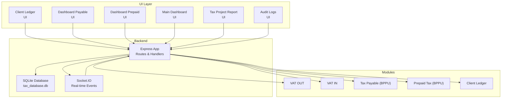
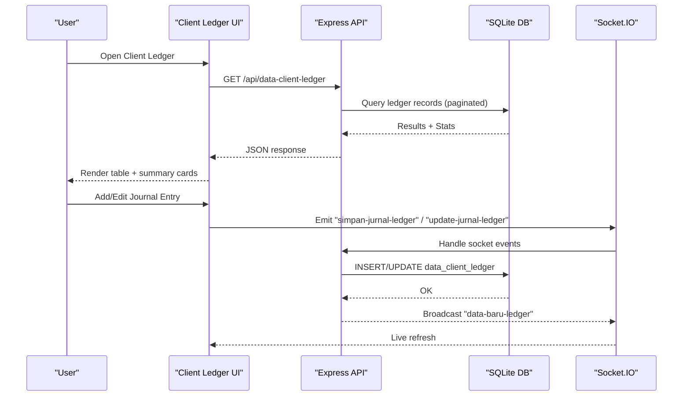
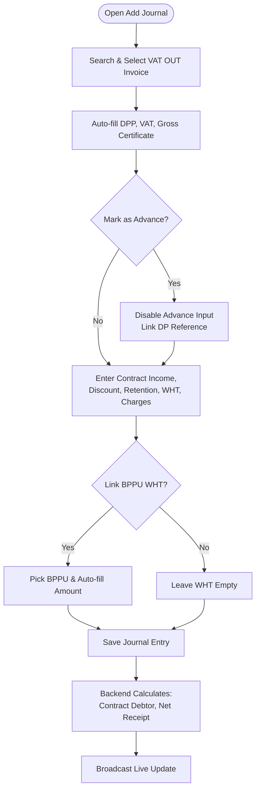
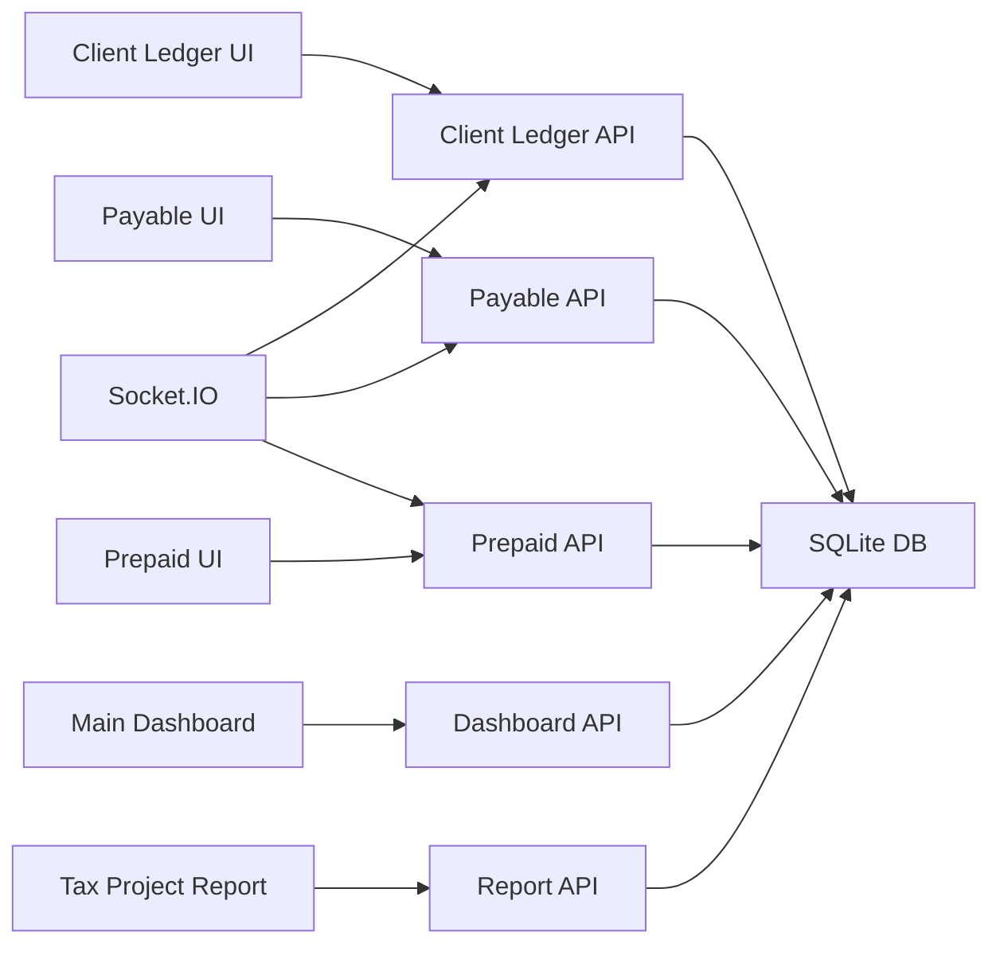

# Accounting & Financial Management

<cite>
**Referenced Files in This Document**
- [client_ledger.html](file://accounting/client_ledger.html)
- [dashboard_utama.html](file://dashboard_utama.html)
- [app.js](file://app.js)
- [PRD_Tax_Database_System.md](file://PRD_Tax_Database_System.md)
- [dashboard_payable.html](file://taxpayable_bppu/dashboard_payable.html)
- [dashboard_prepaid.html](file://prepaidtax_bppu/dashboard_prepaid.html)
- [audit_logs.html](file://audit_logs.html)
- [taxprojectreport.html](file://taxprojectreport.html)
</cite>

## Table of Contents
1. [Introduction](#introduction)
2. [Project Structure](#project-structure)
3. [Core Components](#core-components)
4. [Architecture Overview](#architecture-overview)
5. [Detailed Component Analysis](#detailed-component-analysis)
6. [Dependency Analysis](#dependency-analysis)
7. [Performance Considerations](#performance-considerations)
8. [Troubleshooting Guide](#troubleshooting-guide)
9. [Conclusion](#conclusion)

## Introduction
This document describes the accounting and financial management module focused on client ledger management within the Tax Database System (TDS). It covers financial transaction recording, account reconciliation processes, client billing systems, ledger maintenance, financial reporting, and integration with tax modules. It also documents user interfaces for ledger viewing, transaction posting, and financial statement generation, along with the underlying accounting principles, chart of accounts structure, and financial data organization. Audit trail integration, financial report generation, and compliance reporting features are explained, alongside guidance for financial data management and troubleshooting.

## Project Structure
The accounting and financial management functionality is centered around:
- Client Ledger UI for project billing and receivable tracking
- Real-time synchronization via WebSocket for live updates
- Integration with VAT OUT, VAT IN, Prepaid Tax (BPPU), and Tax Payable modules
- Audit logging for compliance and traceability
- Tax Project Report for cross-module analytics

**Diagram sources**
- [client_ledger.html](file://accounting/client_ledger.html)
- [dashboard_payable.html](file://taxpayable_bppu/dashboard_payable.html)
- [dashboard_prepaid.html](file://prepaidtax_bppu/dashboard_prepaid.html)
- [dashboard_utama.html](file://dashboard_utama.html)
- [taxprojectreport.html](file://taxprojectreport.html)
- [audit_logs.html](file://audit_logs.html)
- [app.js](file://app.js)

**Section sources**
- [client_ledger.html](file://accounting/client_ledger.html)
- [dashboard_utama.html](file://dashboard_utama.html)
- [app.js](file://app.js)

## Core Components
- Client Ledger: Tracks project billing, invoicing, receipts, withholdings, and reconciliations per client and project.
- VAT OUT: Records issued invoices and links to project billing via invoice numbers.
- VAT IN: Records purchase invoices and supports verification and alignment to projects.
- Prepaid Tax (BPPU): Manages withholding tax certificates collected from clients.
- Tax Payable (BPPU): Manages withholding tax certificates issued to vendors.
- Audit Logs: Immutable record of all data mutations for compliance.
- Tax Project Report: Cross-module analytics aggregating revenue, costs, and profitability.

**Section sources**
- [PRD_Tax_Database_System.md](file://PRD_Tax_Database_System.md)
- [app.js](file://app.js)

## Architecture Overview
The system uses a single-page application architecture with:
- Frontend: Vanilla HTML, CSS, and JavaScript with Socket.IO for real-time updates.
- Backend: Express.js serving routes, handling uploads, and managing database operations.
- Database: SQLite for local storage with indexes and migrations for performance and integrity.
- Modules: Interconnected via shared identifiers (entity, branch/project code, invoice numbers).

**Diagram sources**
- [client_ledger.html](file://accounting/client_ledger.html)
- [app.js](file://app.js)

## Detailed Component Analysis

### Client Ledger: Financial Transaction Recording and Reconciliation
- Purpose: Centralized tracking of project billing, receipts, withholdings, and outstanding receivables.
- Key Fields: Contract Income, Discount, Advance, Retention, Net Certificate (DPP), VAT (PPN), Gross Certificate, Payments Received, Contract Debtor, Withholding Tax, Bank Charges, Net Receipt, References (BPPU, Advance), Remarks, Is Advance, Timestamps, and Author.
- Posting Workflow:
  - Search and select VAT OUT invoice (auto-fill Net Certificate, VAT, Gross Certificate).
  - Optional: Mark as Advance, allocate pre-collected Advance, link to prior DP invoice.
  - Optional: Link Prepaid Tax BPPU for Withholding Tax.
  - Save journal entry; backend calculates derived fields (e.g., Contract Debtor, Net Receipt).
  - Edit mode allows updating payments received, taxes, charges, and remarks; recalculates derived fields.
- Reconciliation:
  - Contract Debtor reflects remaining balance after payments.
  - Net Receipt equals Payments Received minus Withholding Tax and Bank Charges.
  - Advance allocation tracked via reference to prior DP invoice.

**Diagram sources**
- [client_ledger.html](file://accounting/client_ledger.html)
- [app.js](file://app.js)

**Section sources**
- [client_ledger.html](file://accounting/client_ledger.html)
- [app.js](file://app.js)

### Chart of Accounts and Financial Data Organization
- Client Ledger table organizes financial data per invoice and client, enabling:
  - Revenue recognition (Contract Income, Net Certificate, Gross Certificate)
  - Expense and liability tracking (Withholding Tax, Bank Charges)
  - Asset and liability classification (Advance, Retention, Contract Debtor)
  - Cash flow impact (Net Receipt)
- Supporting relationships:
  - Invoice numbers link to VAT OUT entries.
  - References to Prepaid Tax BPPU for WHT.
  - References to prior Advance invoices for DP reconciliation.

**Section sources**
- [PRD_Tax_Database_System.md](file://PRD_Tax_Database_System.md)
- [app.js](file://app.js)

### Integration with Tax Modules
- VAT OUT:
  - Provides invoice metadata (DPP, PPN, invoice numbers) used for auto-filling ledger entries.
  - Project alignment via internal invoice numbers and branch codes.
- Prepaid Tax (BPPU):
  - Supplies Withholding Tax amounts and references for client invoices.
  - Supports multi-invoice matching and proportional allocation guidance.
- Tax Payable (BPPU):
  - Tracks issued WHT certificates to vendors; complements client-side ledger entries.
- Cross-Module Analytics:
  - Tax Project Report aggregates VAT OUT and VAT IN per project/branch to compute margins and progress against contract income.

**Section sources**
- [dashboard_prepaid.html](file://prepaidtax_bppu/dashboard_prepaid.html)
- [dashboard_payable.html](file://taxpayable_bppu/dashboard_payable.html)
- [taxprojectreport.html](file://taxprojectreport.html)
- [PRD_Tax_Database_System.md](file://PRD_Tax_Database_System.md)

### User Interfaces for Ledger Viewing, Transaction Posting, and Financial Reporting
- Client Ledger UI:
  - Summary cards for total Contract Income, Net Receipt, Contract Debtor, Transactions, and Outstanding Advance.
  - Paginated table with server-side filtering and debounce search.
  - Actions: Add Journal, Edit Payment, Export, Print, Advance Summary.
- Dashboard Payable/Prepaid:
  - Register views for BPPU records with branch alignment and invoice linking.
  - Comparison features (Prepaid vs VAT OUT) and MoM indicators.
- Main Dashboard:
  - Module cards for Client Ledger with quick access and summary metrics.
- Tax Project Report:
  - Project selection, VO tabs, and analytics cards for budget, revenue, cost, and margin.
  - Detailed tables for VAT OUT and VAT IN with year filters.

**Section sources**
- [client_ledger.html](file://accounting/client_ledger.html)
- [dashboard_utama.html](file://dashboard_utama.html)
- [dashboard_payable.html](file://taxpayable_bppu/dashboard_payable.html)
- [dashboard_prepaid.html](file://prepaidtax_bppu/dashboard_prepaid.html)
- [taxprojectreport.html](file://taxprojectreport.html)

### Financial Reporting and Compliance Features
- Financial Reports:
  - Client Ledger export/print for reconciliation and external reporting.
  - Dashboard-level MoM comparisons for Payable/Prepaid.
  - Tax Project Report for management decision-making.
- Audit Trail:
  - Immutable audit logs capturing user actions, modules, and details.
  - Access restricted to administrators and super administrators.
- Compliance:
  - Deduplication logic for VAT IN replacement invoices.
  - Migration routines to populate status and period fields.
  - RBAC-driven approval workflow for sensitive edits/deletes.

**Section sources**
- [audit_logs.html](file://audit_logs.html)
- [app.js](file://app.js)
- [PRD_Tax_Database_System.md](file://PRD_Tax_Database_System.md)

## Dependency Analysis
- UI depends on:
  - Express routes for paginated data, filters, and exports.
  - Socket.IO for live updates upon ledger changes.
- Backend depends on:
  - SQLite for persistence and indexing for performance.
  - Shared identifiers (entity, branch/project code, invoice numbers) across modules.
- Modules depend on each other:
  - Client Ledger references VAT OUT and Prepaid Tax.
  - Tax Project Report consumes data from VAT OUT and VAT IN.

**Diagram sources**
- [client_ledger.html](file://accounting/client_ledger.html)
- [dashboard_payable.html](file://taxpayable_bppu/dashboard_payable.html)
- [dashboard_prepaid.html](file://prepaidtax_bppu/dashboard_prepaid.html)
- [dashboard_utama.html](file://dashboard_utama.html)
- [taxprojectreport.html](file://taxprojectreport.html)
- [app.js](file://app.js)

**Section sources**
- [app.js](file://app.js)

## Performance Considerations
- Server-side pagination and debounced filtering reduce client load and API spam.
- Database indexes on frequently queried columns improve query performance.
- Real-time updates via Socket.IO minimize polling overhead.
- Efficient number formatting and locale-aware currency display enhance UX without heavy computation.

[No sources needed since this section provides general guidance]

## Troubleshooting Guide
Common issues and resolutions:
- Ledger not updating after posting:
  - Verify WebSocket connection and that the server emits “data-baru-ledger”.
  - Confirm user role and permissions for saving/editing entries.
- Missing invoice in search:
  - Ensure invoice internal number is aligned in VAT OUT and that filters are not overly restrictive.
- Discrepancy in WHT amount:
  - Use the Prepaid comparison feature to verify matched VAT OUT totals and adjust manually if multi-invoice linkage exists.
- Audit trail not visible:
  - Access is restricted; ensure logged-in user has administrator or super administrator role.
- Export/print issues:
  - Confirm filters and page limits; exported data respects active filters.

**Section sources**
- [client_ledger.html](file://accounting/client_ledger.html)
- [dashboard_prepaid.html](file://prepaidtax_bppu/dashboard_prepaid.html)
- [audit_logs.html](file://audit_logs.html)
- [app.js](file://app.js)

## Conclusion
The accounting and financial management module provides a robust, integrated solution for client ledger management, transaction recording, reconciliation, and financial reporting. Its real-time architecture, strong audit trail, and cross-module analytics enable accurate financial tracking, compliance, and informed decision-making. Proper use of invoice references, advance allocations, and BPPU links ensures reliable financial data organization and reconciliation across tax modules.