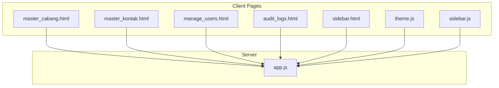
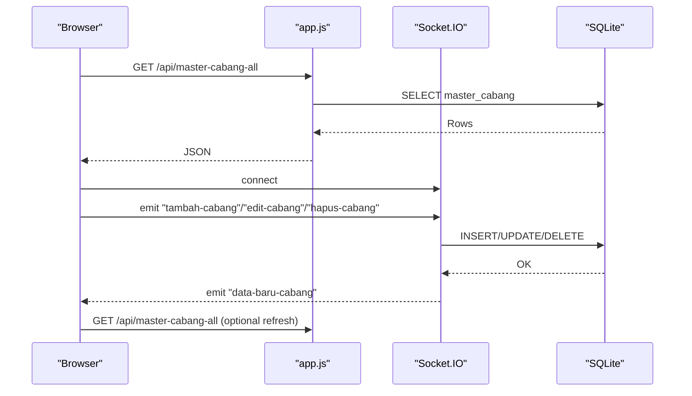
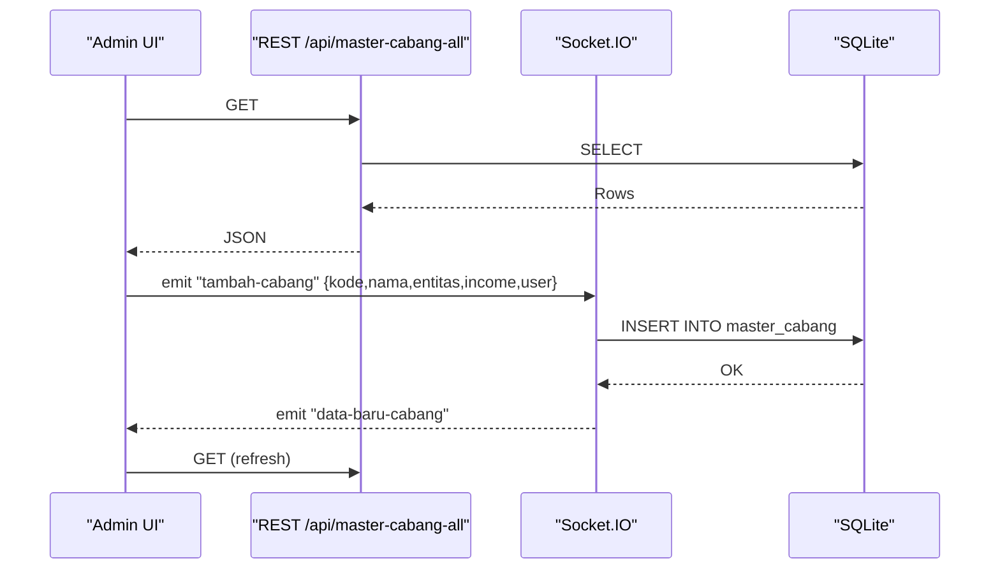
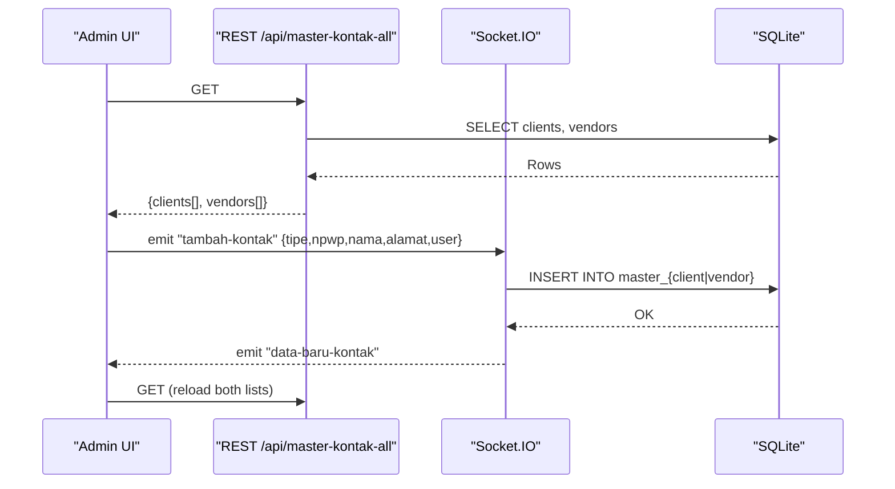
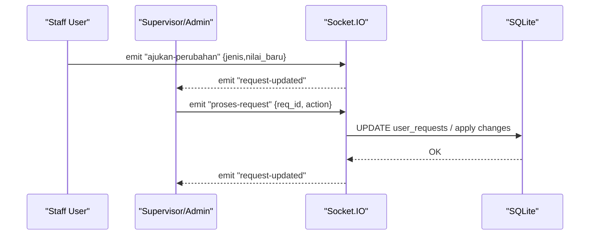
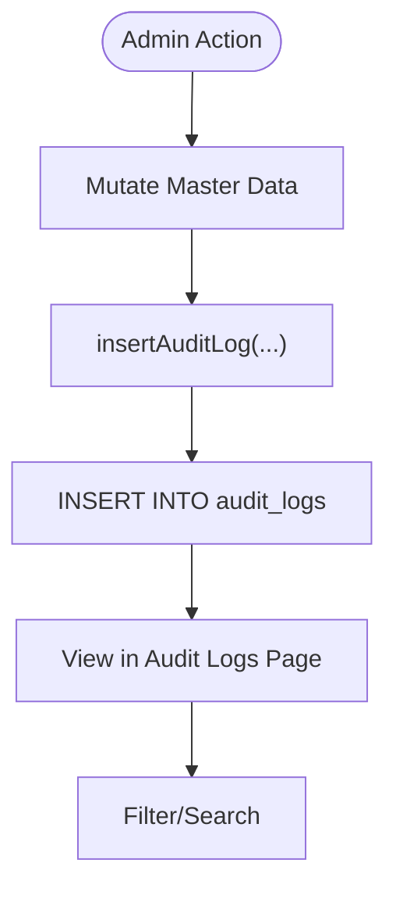
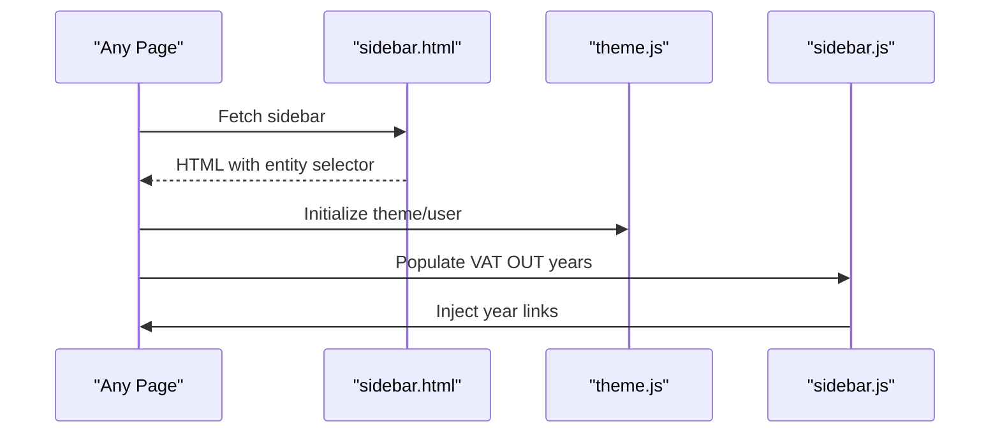
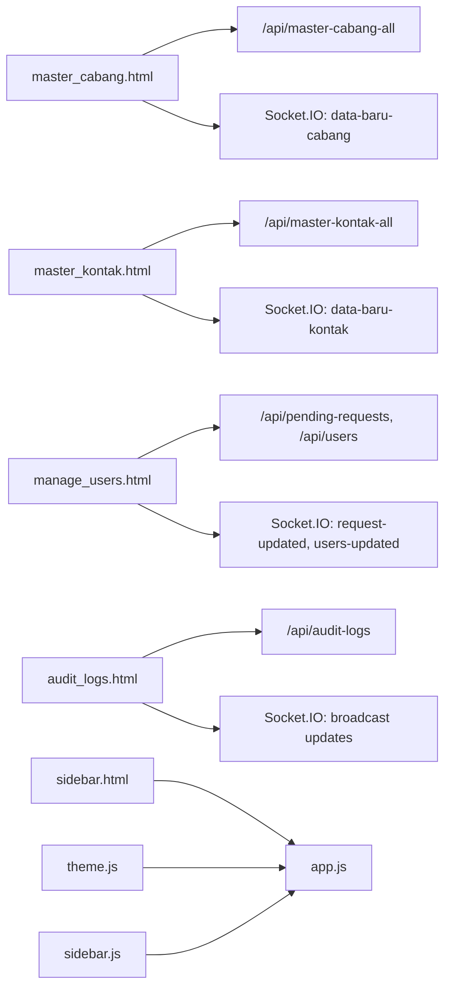

# Administrative Features

<cite>
**Referenced Files in This Document**
- [master_cabang.html](file://master_cabang.html)
- [master_kontak.html](file://master_kontak.html)
- [manage_users.html](file://manage_users.html)
- [sidebar.html](file://sidebar.html)
- [sidebar.js](file://sidebar.js)
- [theme.js](file://theme.js)
- [app.js](file://app.js)
- [audit_logs.html](file://audit_logs.html)
</cite>

## Table of Contents
1. [Introduction](#introduction)
2. [Project Structure](#project-structure)
3. [Core Components](#core-components)
4. [Architecture Overview](#architecture-overview)
5. [Detailed Component Analysis](#detailed-component-analysis)
6. [Dependency Analysis](#dependency-analysis)
7. [Performance Considerations](#performance-considerations)
8. [Troubleshooting Guide](#troubleshooting-guide)
9. [Conclusion](#conclusion)
10. [Appendices](#appendices)

## Introduction
This document describes the administrative features for managing branches and contacts within the Tax Database System. It covers multi-location business structure support, branch configuration, geographic organization, vendor and client relationship management, contact information storage, and master data maintenance. It also documents user interfaces for branch administration, contact management, and organizational structure configuration, along with data validation rules, master data synchronization, administrative workflows, integrations with user management and tax processing modules, and guidance for administrative data setup and maintenance.

## Project Structure
The administrative features are implemented as client-side Single Page Applications (SPAs) served by a Node.js/Express server with Socket.IO real-time updates. The key pages are:
- Branch master data: master_cabang.html
- Contact master data (clients/vendors): master_kontak.html
- User management and approvals: manage_users.html
- Audit logs: audit_logs.html
- Shared UI scaffolding: sidebar.html, theme.js, sidebar.js

These pages communicate with the backend via:
- REST endpoints for initial loads and metadata
- Socket.IO events for real-time CRUD operations and notifications

**Diagram sources**
- [master_cabang.html](file://master_cabang.html)
- [master_kontak.html](file://master_kontak.html)
- [manage_users.html](file://manage_users.html)
- [audit_logs.html](file://audit_logs.html)
- [sidebar.html](file://sidebar.html)
- [theme.js](file://theme.js)
- [sidebar.js](file://sidebar.js)
- [app.js](file://app.js)

**Section sources**
- [master_cabang.html](file://master_cabang.html)
- [master_kontak.html](file://master_kontak.html)
- [manage_users.html](file://manage_users.html)
- [audit_logs.html](file://audit_logs.html)
- [sidebar.html](file://sidebar.html)
- [theme.js](file://theme.js)
- [sidebar.js](file://sidebar.js)
- [app.js](file://app.js)

## Core Components
- Branch Master (Projects/Branches)
  - Full CRUD for branches with contract income tracking and VO management per branch
  - Real-time synchronization via Socket.IO
  - Role-based access restricted to administrators/supervisors
- Contact Master (Clients and Vendors)
  - Separate tabs for clients and vendors
  - CRUD with NPWP uniqueness enforcement
  - Real-time synchronization and audit logging
- User Management and Approvals
  - Role-based visibility of administrative menus
  - Pending change requests requiring supervisor/admin approval
  - Password reset workflow with role checks
- Audit Logs
  - Centralized immutable audit trail for master data mutations
  - Searchable by user/module/action/detail

**Section sources**
- [master_cabang.html](file://master_cabang.html)
- [master_kontak.html](file://master_kontak.html)
- [manage_users.html](file://manage_users.html)
- [audit_logs.html](file://audit_logs.html)
- [app.js](file://app.js)

## Architecture Overview
The system uses a thin server with Express serving static HTML and Socket.IO for real-time updates. Client pages fetch initial data via REST endpoints and then subscribe to Socket.IO events for live updates.

**Diagram sources**
- [app.js](file://app.js)
- [master_cabang.html](file://master_cabang.html)

## Detailed Component Analysis

### Branch Administration (Projects/Branches)
- Purpose
  - Maintain branch/project reference data with entity ownership and optional contract income
  - Manage Variation Orders (VO) per branch for billing segmentation
- UI and UX
  - Admin form with validation for required fields
  - Search/filter across branch code/name
  - VO modal per branch with add/edit/delete
  - Entity selector synchronized with sidebar
- Data Model
  - master_cabang: branch code (PK), name, entity, contract_income
  - master_vo: VO records linked to a branch
- Validation Rules
  - Required: branch code, name, entity
  - Duplicate branch code blocked at client and enforced by DB PK
  - Contract income sanitized numeric input
- Real-time Sync
  - Socket.IO emits “data-baru-cabang” after successful mutation
  - Client reloads table on event
- Security
  - Only administrators/supervisors can mutate
  - Audit logs recorded for each operation

**Diagram sources**
- [master_cabang.html](file://master_cabang.html)
- [app.js](file://app.js)

**Section sources**
- [master_cabang.html](file://master_cabang.html)
- [app.js](file://app.js)

### Contact Management (Clients and Vendors)
- Purpose
  - Maintain vendor and client reference data (NPWP, name, address)
- UI and UX
  - Tabbed interface for Clients and Vendors
  - Search/filter by NPWP/name
  - Editable form with NPWP as immutable identifier
- Data Model
  - master_client and master_vendor: NPWP (PK), name, address, format_tipe, tanggal_terakhir
- Validation Rules
  - Required: NPWP, name
  - NPWP uniqueness enforced at client and DB level
  - Protected records (placeholders) cannot be deleted
- Real-time Sync
  - Socket.IO emits “data-baru-kontak”
  - Client reloads both client and vendor lists
- Security
  - Only administrators can mutate
  - Audit logs recorded for add/edit/delete

**Diagram sources**
- [master_kontak.html](file://master_kontak.html)
- [app.js](file://app.js)

**Section sources**
- [master_kontak.html](file://master_kontak.html)
- [app.js](file://app.js)

### User Management and Approvals
- Purpose
  - Manage user accounts and approve changes requested by lower roles
- UI and UX
  - Pending requests panel with approve/reject actions
  - Add user form with role selection
  - Password reset with validation
- Workflows
  - Non-admin users submit change requests; supervisors/admins review
  - Admins can reset passwords for others
- Security
  - Role gates for viewing and mutating users
  - Audit logs for user management actions

**Diagram sources**
- [manage_users.html](file://manage_users.html)
- [app.js](file://app.js)

**Section sources**
- [manage_users.html](file://manage_users.html)
- [app.js](file://app.js)

### Audit Logs
- Purpose
  - Immutable record of all master data mutations
- UI and UX
  - Filterable table by user/module/action/detail
- Data Model
  - audit_logs: id, user_id, username, action, module, details, waktu

**Diagram sources**
- [audit_logs.html](file://audit_logs.html)
- [app.js](file://app.js)

**Section sources**
- [audit_logs.html](file://audit_logs.html)
- [app.js](file://app.js)

### Sidebar and Navigation Integration
- Purpose
  - Unified navigation with entity switching and dynamic year menus
- Features
  - Entity selector persists in localStorage and synchronizes across pages
  - Dynamic VAT OUT year menu populated from server
  - Active state highlighting based on current URL

**Diagram sources**
- [sidebar.html](file://sidebar.html)
- [theme.js](file://theme.js)
- [sidebar.js](file://sidebar.js)

**Section sources**
- [sidebar.html](file://sidebar.html)
- [theme.js](file://theme.js)
- [sidebar.js](file://sidebar.js)

## Dependency Analysis
- Client-to-Server
  - master_cabang.html and master_kontak.html depend on REST endpoints for initial loads and Socket.IO for real-time updates
  - manage_users.html depends on REST endpoints for pending requests and user lists, and Socket.IO for approvals
  - audit_logs.html depends on REST endpoint for audit logs and Socket.IO for live updates
- Server-to-DB
  - app.js defines SQLite tables, indexes, and migration logic
  - Socket.IO handlers enforce role checks and perform CRUD operations
- Cross-page Dependencies
  - sidebar.html controls visibility of administrative menus based on user role
  - theme.js and sidebar.js coordinate UI state and active navigation

**Diagram sources**
- [master_cabang.html](file://master_cabang.html)
- [master_kontak.html](file://master_kontak.html)
- [manage_users.html](file://manage_users.html)
- [audit_logs.html](file://audit_logs.html)
- [sidebar.html](file://sidebar.html)
- [theme.js](file://theme.js)
- [sidebar.js](file://sidebar.js)
- [app.js](file://app.js)

**Section sources**
- [app.js](file://app.js)

## Performance Considerations
- Real-time updates reduce polling overhead; ensure clients handle frequent updates gracefully
- Client-side filtering is efficient for small to medium datasets; consider server-side pagination for very large master lists
- Indexes on frequently queried columns (entity/date combinations) improve dashboard and report performance
- Minimize payload sizes by sending only changed records on Socket.IO events

## Troubleshooting Guide
- Authentication and Authorization
  - Ensure the user has a valid session and appropriate role; otherwise routes redirect to login or restrict access
- Real-time Updates Not Reflecting
  - Verify Socket.IO connection and that the server emits “data-baru-*” events after successful mutations
- Duplicate Entries
  - Branch code and NPWP must be unique; client-side checks prevent duplicates; server enforces PK uniqueness
- Audit Logs Missing
  - Confirm insertAuditLog is invoked on successful mutations and that the audit_logs table exists and is initialized

**Section sources**
- [app.js](file://app.js)
- [master_cabang.html](file://master_cabang.html)
- [master_kontak.html](file://master_kontak.html)
- [manage_users.html](file://manage_users.html)
- [audit_logs.html](file://audit_logs.html)

## Conclusion
The administrative features provide a cohesive, role-aware system for managing branches, contacts, and users, with real-time synchronization and comprehensive audit logging. The modular design allows administrators to maintain master data efficiently while ensuring data integrity and traceability across the tax processing modules.

## Appendices

### Data Validation Rules Summary
- Branches
  - Required: branch code, name, entity
  - Unique: branch code
  - Numeric: contract income (sanitized)
- Contacts
  - Required: NPWP, name
  - Unique: NPWP
  - Protected: certain placeholder records cannot be deleted
- Users
  - Password reset requires minimum length
  - Self-change vs. admin-reset rules apply

**Section sources**
- [master_cabang.html](file://master_cabang.html)
- [master_kontak.html](file://master_kontak.html)
- [manage_users.html](file://manage_users.html)

### Administrative Workflow Processes
- Branch Creation/Edit/Delete
  - Admin fills form → validation → Socket.IO mutation → server audit → client refresh
- Contact Creation/Edit/Delete
  - Admin selects tab → fills form → validation → Socket.IO mutation → server audit → client refresh
- User Management
  - Admin adds user → sets role/password → resets passwords → approves change requests

**Section sources**
- [master_cabang.html](file://master_cabang.html)
- [master_kontak.html](file://master_kontak.html)
- [manage_users.html](file://manage_users.html)
- [app.js](file://app.js)

### Integration Notes
- Branch and VO data integrate with tax modules via foreign keys (project_id, kode_vo) to support project billing and reporting
- Audit logs capture all administrative mutations for compliance and traceability

**Section sources**
- [app.js](file://app.js)