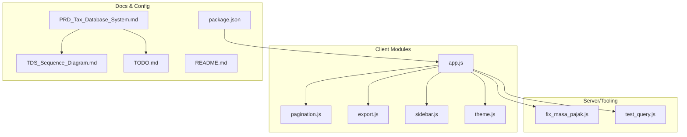
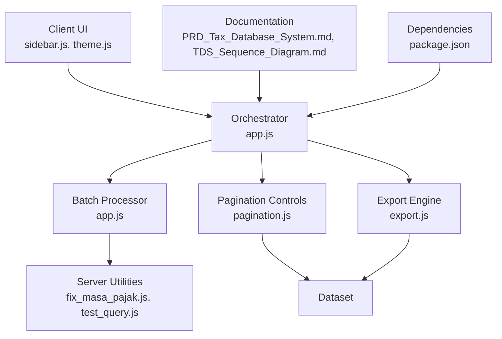
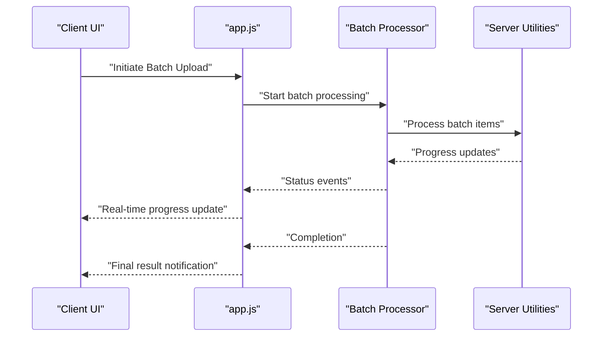
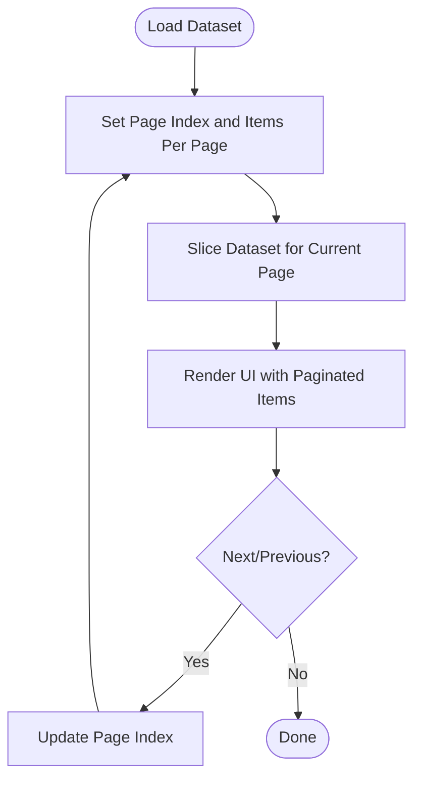
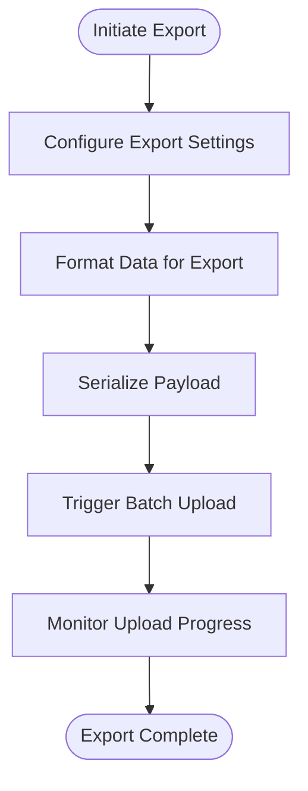
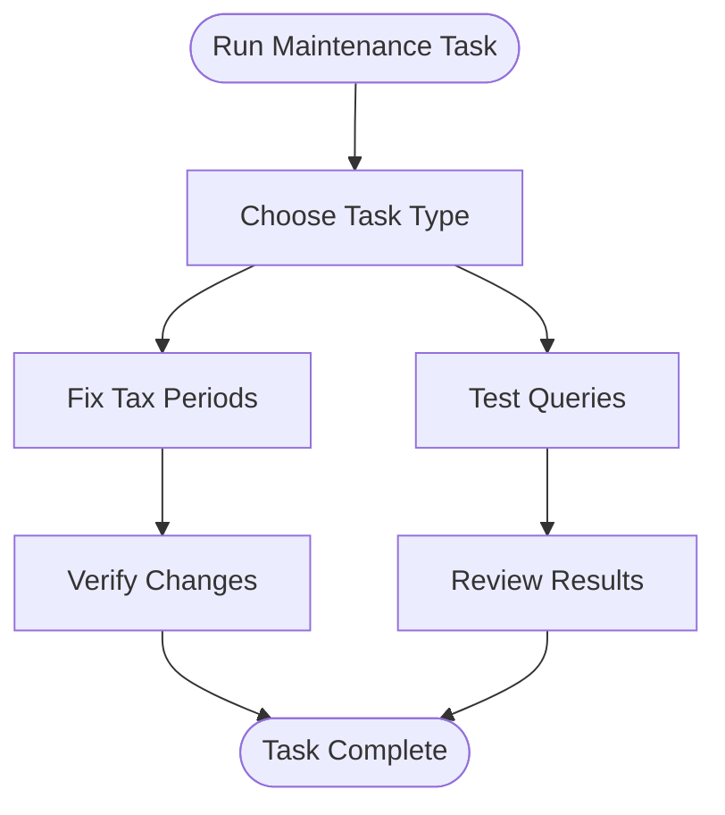
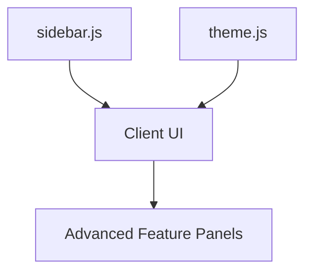
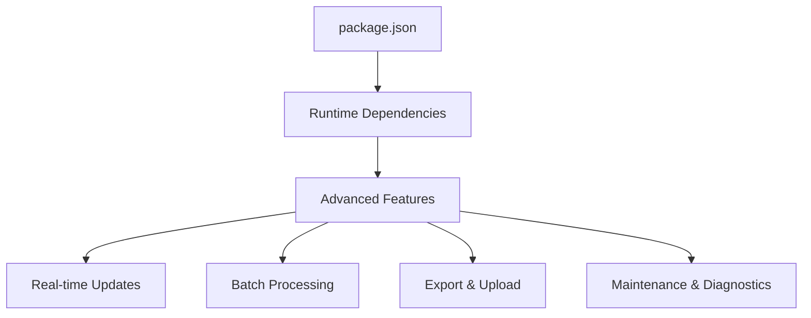

# Advanced Features

<cite>
**Referenced Files in This Document**
- [app.js](file://app.js)
- [pagination.js](file://pagination.js)
- [export.js](file://export.js)
- [fix_masa_pajak.js](file://fix_masa_pajak.js)
- [test_query.js](file://test_query.js)
- [sidebar.js](file://sidebar.js)
- [theme.js](file://theme.js)
- [package.json](file://package.json)
- [PRD_Tax_Database_System.md](file://PRD_Tax_Database_System.md)
- [README.md](file://README.md)
- [TDS_Sequence_Diagram.md](file://TDS_Sequence_Diagram.md)
- [TODO.md](file://TODO.md)
</cite>

## Table of Contents
1. [Introduction](#introduction)
2. [Project Structure](#project-structure)
3. [Core Components](#core-components)
4. [Architecture Overview](#architecture-overview)
5. [Detailed Component Analysis](#detailed-component-analysis)
6. [Dependency Analysis](#dependency-analysis)
7. [Performance Considerations](#performance-considerations)
8. [Troubleshooting Guide](#troubleshooting-guide)
9. [Conclusion](#conclusion)
10. [Appendices](#appendices)

## Introduction
This document focuses on advanced system features centered around real-time processing, batch PDF upload workflows, and performance optimization. It synthesizes the current repository’s frontend and backend capabilities, outlines practical integration patterns for real-time updates, and provides guidance for extending functionality with external systems. Where applicable, implementation details are mapped to actual source files in the repository.

## Project Structure
The repository combines client-side JavaScript modules with server-side scripts and documentation. Key areas relevant to advanced features:
- Real-time and batch processing orchestration via client-side modules
- Pagination and export utilities for large datasets
- Maintenance and diagnostic scripts for operational tasks
- Documentation artifacts that define scope and sequence of operations

**Diagram sources**
- [app.js](file://app.js)
- [pagination.js](file://pagination.js)
- [export.js](file://export.js)
- [sidebar.js](file://sidebar.js)
- [theme.js](file://theme.js)
- [fix_masa_pajak.js](file://fix_masa_pajak.js)
- [test_query.js](file://test_query.js)
- [package.json](file://package.json)
- [PRD_Tax_Database_System.md](file://PRD_Tax_Database_System.md)
- [TDS_Sequence_Diagram.md](file://TDS_Sequence_Diagram.md)
- [TODO.md](file://TODO.md)
- [README.md](file://README.md)

**Section sources**
- [app.js](file://app.js)
- [pagination.js](file://pagination.js)
- [export.js](file://export.js)
- [fix_masa_pajak.js](file://fix_masa_pajak.js)
- [test_query.js](file://test_query.js)
- [sidebar.js](file://sidebar.js)
- [theme.js](file://theme.js)
- [package.json](file://package.json)
- [PRD_Tax_Database_System.md](file://PRD_Tax_Database_System.md)
- [README.md](file://README.md)
- [TDS_Sequence_Diagram.md](file://TDS_Sequence_Diagram.md)
- [TODO.md](file://TODO.md)

## Core Components
- Real-time orchestration and batch processing: Centralized in the application module, coordinating UI updates and asynchronous operations.
- Pagination controls: Provides navigation and dataset slicing for large collections.
- Export utilities: Handles bulk data extraction and formatting.
- Maintenance and diagnostics: Scripts for fixing periods and testing queries.
- Sidebar and theming: UI scaffolding supporting advanced workflows.
- Package configuration: Declares runtime dependencies and scripts.

Key implementation anchors:
- Real-time and batch coordination: [app.js](file://app.js)
- Pagination: [pagination.js](file://pagination.js)
- Export: [export.js](file://export.js)
- Maintenance: [fix_masa_pajak.js](file://fix_masa_pajak.js), [test_query.js](file://test_query.js)
- UI scaffolding: [sidebar.js](file://sidebar.js), [theme.js](file://theme.js)
- Dependencies: [package.json](file://package.json)

**Section sources**
- [app.js](file://app.js)
- [pagination.js](file://pagination.js)
- [export.js](file://export.js)
- [fix_masa_pajak.js](file://fix_masa_pajak.js)
- [test_query.js](file://test_query.js)
- [sidebar.js](file://sidebar.js)
- [theme.js](file://theme.js)
- [package.json](file://package.json)

## Architecture Overview
The advanced feature set integrates client-side orchestration with server-side utilities and documentation-defined workflows. The architecture supports:
- Real-time updates through event-driven flows
- Batch processing with progress reporting
- Scalable pagination and export
- Operational maintenance and diagnostics

**Diagram sources**
- [app.js](file://app.js)
- [pagination.js](file://pagination.js)
- [export.js](file://export.js)
- [fix_masa_pajak.js](file://fix_masa_pajak.js)
- [test_query.js](file://test_query.js)
- [sidebar.js](file://sidebar.js)
- [theme.js](file://theme.js)
- [PRD_Tax_Database_System.md](file://PRD_Tax_Database_System.md)
- [TDS_Sequence_Diagram.md](file://TDS_Sequence_Diagram.md)
- [package.json](file://package.json)

## Detailed Component Analysis

### Real-Time Processing and Batch Upload Workflows
This component orchestrates real-time updates during batch operations, ensuring the UI reflects progress and outcomes instantly. It coordinates:
- Event-driven triggers for batch initiation
- Progress reporting and completion notifications
- UI state updates for visibility

**Diagram sources**
- [app.js](file://app.js)
- [fix_masa_pajak.js](file://fix_masa_pajak.js)
- [test_query.js](file://test_query.js)

**Section sources**
- [app.js](file://app.js)

### Data Pagination Controls
The pagination module provides efficient navigation across large datasets:
- Page index management
- Item count per page
- Navigation controls and dataset slicing

**Diagram sources**
- [pagination.js](file://pagination.js)

**Section sources**
- [pagination.js](file://pagination.js)

### Export and Batch PDF Upload Pipeline
The export module handles bulk data extraction and prepares payloads for batch PDF uploads:
- Bulk export configuration
- Data formatting and serialization
- Integration hooks for batch upload workflows

**Diagram sources**
- [export.js](file://export.js)
- [app.js](file://app.js)

**Section sources**
- [export.js](file://export.js)
- [app.js](file://app.js)

### Maintenance and Diagnostics
Operational scripts support system health and correctness:
- Period fixing utility for tax periods
- Diagnostic query testing

**Diagram sources**
- [fix_masa_pajak.js](file://fix_masa_pajak.js)
- [test_query.js](file://test_query.js)

**Section sources**
- [fix_masa_pajak.js](file://fix_masa_pajak.js)
- [test_query.js](file://test_query.js)

### UI Scaffolding for Advanced Workflows
The sidebar and theme modules provide foundational UI elements that support advanced features:
- Navigation and contextual menus
- Theme-aware rendering for real-time indicators

**Diagram sources**
- [sidebar.js](file://sidebar.js)
- [theme.js](file://theme.js)

**Section sources**
- [sidebar.js](file://sidebar.js)
- [theme.js](file://theme.js)

## Dependency Analysis
Runtime dependencies and scripts are declared in the package manifest. These enable the advanced features by providing:
- Event-driven communication channels
- Utility libraries for data manipulation and transport
- Script entry points for maintenance and diagnostics

**Diagram sources**
- [package.json](file://package.json)

**Section sources**
- [package.json](file://package.json)

## Performance Considerations
- Minimize DOM updates during real-time processing by batching UI refreshes.
- Use pagination to limit payload sizes and improve responsiveness.
- Offload heavy computations to server utilities and stream results.
- Employ lazy loading for large datasets and defer non-critical UI rendering.
- Monitor resource usage during batch operations and scale worker threads accordingly.

[No sources needed since this section provides general guidance]

## Troubleshooting Guide
Common issues and resolutions:
- Real-time updates not appearing:
  - Verify event handlers and channel subscriptions in the orchestrator module.
  - Confirm server utilities are emitting progress events.
- Batch upload stalls:
  - Check network connectivity and server logs for errors.
  - Validate payload formatting in the export module.
- Pagination anomalies:
  - Re-check item counts and page indices in the pagination module.
- Maintenance script failures:
  - Review diagnostic outputs and fix period logic in the maintenance utility.

**Section sources**
- [app.js](file://app.js)
- [export.js](file://export.js)
- [pagination.js](file://pagination.js)
- [fix_masa_pajak.js](file://fix_masa_pajak.js)
- [test_query.js](file://test_query.js)

## Conclusion
The advanced feature set leverages a modular architecture combining real-time orchestration, scalable pagination, robust export pipelines, and operational maintenance utilities. By aligning client-side event flows with server-side processing and maintaining clear documentation, the system supports extensibility and reliable operation under load.

[No sources needed since this section summarizes without analyzing specific files]

## Appendices
- Reference documentation for feature scope and sequence: [PRD_Tax_Database_System.md](file://PRD_Tax_Database_System.md), [TDS_Sequence_Diagram.md](file://TDS_Sequence_Diagram.md)
- Additional planning and notes: [TODO.md](file://TODO.md), [README.md](file://README.md)

**Section sources**
- [PRD_Tax_Database_System.md](file://PRD_Tax_Database_System.md)
- [TDS_Sequence_Diagram.md](file://TDS_Sequence_Diagram.md)
- [TODO.md](file://TODO.md)
- [README.md](file://README.md)