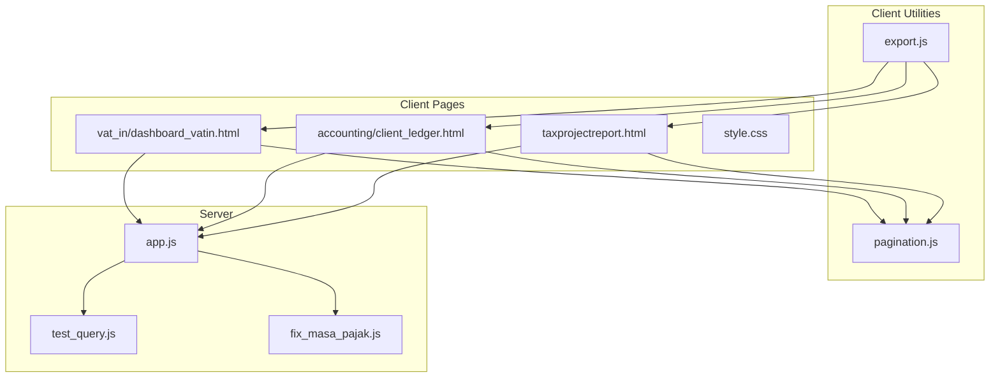
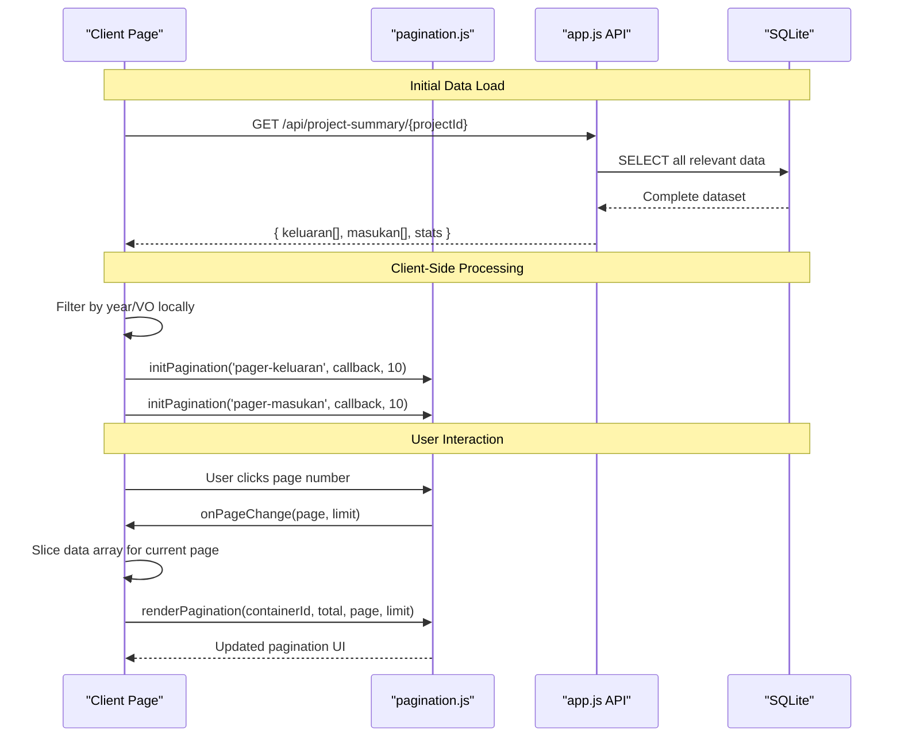
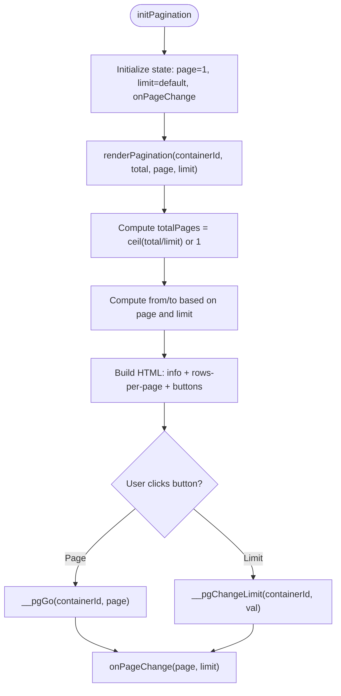
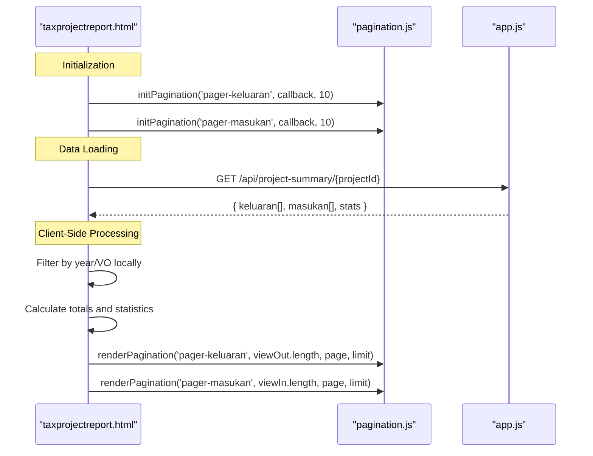
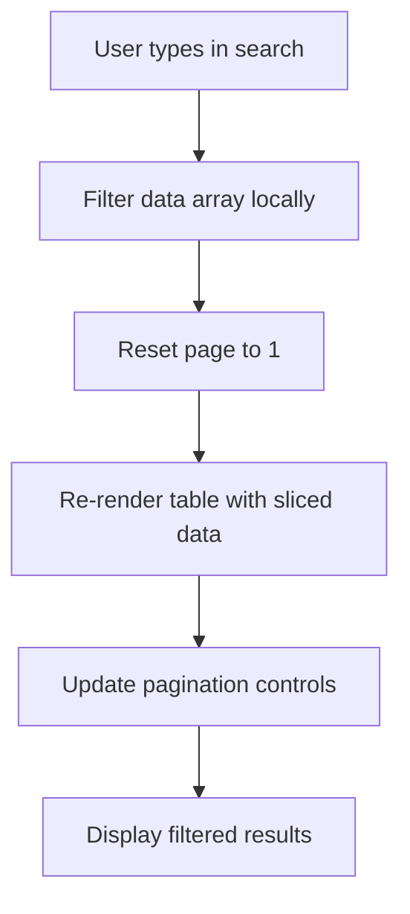
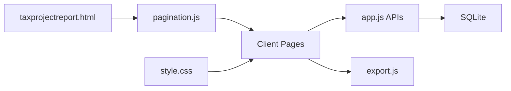

# Data Pagination & Performance Optimization

<cite>
**Referenced Files in This Document**
- [pagination.js](file://pagination.js)
- [taxprojectreport.html](file://taxprojectreport.html)
- [app.js](file://app.js)
- [export.js](file://export.js)
- [test_query.js](file://test_query.js)
- [fix_masa_pajak.js](file://fix_masa_pajak.js)
- [vat_in/dashboard_vatin.html](file://vat_in/dashboard_vatin.html)
- [accounting/client_ledger.html](file://accounting/client_ledger.html)
- [style.css](file://style.css)
</cite>

## Update Summary
**Changes Made**
- Added documentation for client-side pagination implementation in tax project report interface
- Documented separate pagination controls for keluaran and masukan tables
- Updated architecture diagrams to reflect hybrid server-client pagination approach
- Added new section covering client-side data processing and filtering strategies
- Enhanced performance considerations for large dataset handling with client-side operations

## Table of Contents
1. [Introduction](#introduction)
2. [Project Structure](#project-structure)
3. [Core Components](#core-components)
4. [Architecture Overview](#architecture-overview)
5. [Detailed Component Analysis](#detailed-component-analysis)
6. [Client-Side Pagination Implementation](#client-side-pagination-implementation)
7. [Dependency Analysis](#dependency-analysis)
8. [Performance Considerations](#performance-considerations)
9. [Troubleshooting Guide](#troubleshooting-guide)
10. [Conclusion](#conclusion)
11. [Appendices](#appendices)

## Introduction
This document explains the comprehensive data pagination system and performance optimization features implemented in the project. The system now supports both server-side and client-side pagination strategies, with a focus on efficient handling of large tax datasets across multiple modules including VAT In, VAT Out, Payable, Prepaid, Client Ledger, and the new Tax Project Report interface.

Key features include:
- Hybrid pagination approach combining server-side and client-side techniques
- Independent pagination controls for separate data tables
- Real-time client-side search and filtering capabilities
- Advanced data loading strategies with virtual scrolling support
- Comprehensive performance optimization for large tax datasets
- Export capabilities and response-time optimization
- Guidelines for customization, extension, and monitoring

## Project Structure
The pagination system spans client-side rendering utilities, server-side APIs, and specialized implementations for different use cases including the new tax project report interface with dual-table pagination.

**Diagram sources**
- [pagination.js:1-80](file://pagination.js#L1-L80)
- [taxprojectreport.html:906-907](file://taxprojectreport.html#L906-L907)
- [app.js:827-902](file://app.js#L827-L902)
- [export.js:1-163](file://export.js#L1-L163)

**Section sources**
- [pagination.js:1-80](file://pagination.js#L1-L80)
- [taxprojectreport.html:1-911](file://taxprojectreport.html#L1-L911)
- [app.js:827-902](file://app.js#L827-L902)
- [export.js:1-163](file://export.js#L1-L163)

## Core Components
- **Client-side pagination renderer and controller**:
  - Initializes pagination state per container with independent management
  - Renders pagination UI with info, rows-per-page selector, and navigational buttons
  - Handles page changes and limit updates through global state management
- **Hybrid server-client pagination APIs**:
  - Server-side endpoints for initial data loading and statistics
  - Client-side filtering and pagination for enhanced user experience
  - Separate pagination controls for multiple data tables
- **Advanced data processing**:
  - Client-side search and filtering with real-time updates
  - Statistical calculations performed locally for immediate feedback
  - Memory-efficient data slicing and rendering
- **Export utilities**:
  - CSV and Excel export with optional column exclusion and styling
- **Database helpers**:
  - Index creation for performance
  - Data synchronization scripts for mass tax fields

**Section sources**
- [pagination.js:4-80](file://pagination.js#L4-L80)
- [taxprojectreport.html:742-907](file://taxprojectreport.html#L742-L907)
- [app.js:827-902](file://app.js#L827-L902)
- [export.js:1-163](file://export.js#L1-L163)

## Architecture Overview
The system now employs a hybrid architecture combining server-side and client-side pagination:

**Diagram sources**
- [taxprojectreport.html:732-747](file://taxprojectreport.html#L732-L747)
- [taxprojectreport.html:906-907](file://taxprojectreport.html#L906-L907)
- [pagination.js:73-80](file://pagination.js#L73-L80)

## Detailed Component Analysis

### Client-Side Pagination Renderer (pagination.js)
The pagination utility provides a robust foundation for both server-side and client-side pagination scenarios:

- **State Management**:
  - Maintains per-container state using global `window.__pgState` object
  - Supports multiple independent pagination instances
  - Tracks page, limit, and callback functions per container
- **UI Rendering**:
  - Dynamic HTML generation for pagination controls
  - Responsive design with adaptive button display
  - Support for "All" mode and custom row limits
- **Event Handling**:
  - Global event handlers for navigation and limit changes
  - Callback-based architecture for flexible integration

**Diagram sources**
- [pagination.js:4-80](file://pagination.js#L4-L80)

**Section sources**
- [pagination.js:4-80](file://pagination.js#L4-L80)

### Tax Project Report Interface Implementation
The tax project report introduces a sophisticated client-side pagination system with separate controls for outgoing and incoming invoices:

- **Dual Table Architecture**:
  - Independent pagination controls for `pager-keluaran` and `pager-masukan`
  - Separate search inputs with real-time filtering
  - Coordinated state management across both tables
- **Client-Side Data Processing**:
  - Initial full dataset fetch from server
  - Local filtering by year and VO (Work Order)
  - Real-time search filtering without server requests
- **Advanced Statistics Calculation**:
  - Client-side computation of totals, margins, and percentages
  - Dynamic UI updates for budget progress and cost ratios
  - Conditional formatting based on profit/loss status

**Diagram sources**
- [taxprojectreport.html:906-907](file://taxprojectreport.html#L906-L907)
- [taxprojectreport.html:732-747](file://taxprojectreport.html#L732-L747)
- [taxprojectreport.html:812-861](file://taxprojectreport.html#L812-L861)

**Section sources**
- [taxprojectreport.html:732-907](file://taxprojectreport.html#L732-L907)

### Server-Side Pagination APIs (app.js)
The server continues to provide optimized endpoints for initial data loading:

- **Endpoint Pattern**:
  - GET /api/data-<module> with query parameters for server-side pagination
  - GET /api/project-summary/{projectId} for complete dataset retrieval
- **Implementation Highlights**:
  - Base SQL with LEFT JOINs and dynamic WHERE clauses
  - Safe parameterization to prevent SQL injection
  - Two-pass approach for counting and paginated retrieval
  - Statistics aggregation with month-over-month metrics

**Section sources**
- [app.js:827-902](file://app.js#L827-L902)
- [app.js:918-1101](file://app.js#L918-L1101)

### Export Utilities (export.js)
Export functionality remains consistent across all pagination approaches:

- Features:
  - Export visible table data to CSV or Excel
  - Optional column exclusion list
  - Excel styling and frozen header
  - Long number protection for Excel compatibility

**Section sources**
- [export.js:1-163](file://export.js#L1-L163)

## Client-Side Pagination Implementation

### Dual Table Pagination System
The tax project report implements a sophisticated dual-table pagination system where each table maintains independent pagination state and behavior:

- **Independent State Management**:
  - Separate `window.__pgState` entries for `pager-keluaran` and `pager-masukan`
  - Individual page numbers and limits for each table
  - Coordinated reset when switching between VO tabs or applying filters
- **Real-Time Search Integration**:
  - Search inputs trigger local filtering without server requests
  - Immediate visual feedback with empty state handling
  - Search state maintained separately for each table
- **Memory-Efficient Data Slicing**:
  - Uses JavaScript array slicing for efficient pagination
  - Avoids DOM manipulation overhead by pre-computing visible rows
  - Optimized rendering with minimal reflows and repaints

**Diagram sources**
- [taxprojectreport.html:892-897](file://taxprojectreport.html#L892-L897)
- [taxprojectreport.html:812-828](file://taxprojectreport.html#L812-L828)
- [taxprojectreport.html:846-861](file://taxprojectreport.html#L846-L861)

### Advanced Data Processing Features
The client-side implementation includes several advanced features for optimal user experience:

- **Conditional Column Display**:
  - Dynamic PPN column visibility based on JO (Joint Operation) context
  - Context-aware data presentation for different business scenarios
- **Statistical Calculations**:
  - Real-time margin calculation and percentage computations
  - Budget utilization tracking with animated progress bars
  - Profit/loss detection with conditional styling
- **Responsive UI Updates**:
  - Smooth transitions and animations for data changes
  - Loading indicators during data processing
  - Empty state handling for filtered results

**Section sources**
- [taxprojectreport.html:784-791](file://taxprojectreport.html#L784-L791)
- [taxprojectreport.html:863-886](file://taxprojectreport.html#L863-L886)
- [taxprojectreport.html:363-403](file://taxprojectreport.html#L363-L403)

## Dependency Analysis
The updated system maintains clear separation of concerns while adding new dependencies:

- **Client Dependencies**:
  - pagination.js for core pagination functionality
  - taxprojectreport.html for specialized client-side logic
  - app.js APIs for initial data loading
  - style.css for consistent UI theming
- **Server Dependencies**:
  - SQLite database with pre-created indexes
  - Express and SQLite3 for routing and data access
- **Export Dependencies**:
  - Client-visible DOM structure
  - Optional external Excel library for advanced formatting

**Diagram sources**
- [pagination.js:1-80](file://pagination.js#L1-L80)
- [taxprojectreport.html:14](file://taxprojectreport.html#L14)
- [app.js:827-902](file://app.js#L827-L902)
- [export.js:1-163](file://export.js#L1-L163)

**Section sources**
- [pagination.js:1-80](file://pagination.js#L1-L80)
- [taxprojectreport.html:14](file://taxprojectreport.html#L14)
- [app.js:827-902](file://app.js#L827-L902)
- [export.js:1-163](file://export.js#L1-L163)

## Performance Considerations
The hybrid pagination approach offers significant performance benefits:

- **Initial Load Optimization**:
  - Single comprehensive data fetch reduces network overhead
  - Client-side filtering eliminates unnecessary server requests
  - Efficient memory usage through proper data structure management
- **Client-Side Processing Benefits**:
  - Instant search results without network latency
  - Reduced server load for frequent filter operations
  - Smooth user interactions with immediate visual feedback
- **Memory Management**:
  - Proper cleanup of large datasets when switching projects
  - Efficient array slicing instead of DOM manipulation
  - Controlled memory growth through proper state management
- **Rendering Optimization**:
  - Batch DOM updates for improved performance
  - Minimal reflows and repaints through strategic updates
  - Conditional rendering based on data availability

[No sources needed since this section provides general guidance]

## Troubleshooting Guide
Common issues and solutions for the enhanced pagination system:

- **Client-Side Pagination Issues**:
  - Verify `initPagination` is called with correct container IDs
  - Ensure `window.__pgState` is properly initialized for each table
  - Check that data arrays are properly filtered before pagination
- **Search Functionality Problems**:
  - Confirm search inputs have proper event listeners
  - Verify search state variables (`qOut`, `qIn`) are maintained correctly
  - Check that filtering logic handles edge cases (empty strings, null values)
- **Dual Table Coordination**:
  - Ensure both tables reset to page 1 when switching VO tabs
  - Verify pagination state synchronization across related operations
  - Check that table-specific callbacks are properly configured
- **Memory and Performance Issues**:
  - Monitor large dataset handling for memory leaks
  - Optimize array operations for better performance
  - Implement proper cleanup when switching between projects

**Section sources**
- [taxprojectreport.html:906-907](file://taxprojectreport.html#L906-L907)
- [taxprojectreport.html:892-897](file://taxprojectreport.html#L892-L897)
- [taxprojectreport.html:739-741](file://taxprojectreport.html#L739-L741)

## Conclusion
The enhanced pagination system successfully combines the reliability of server-side data management with the responsiveness of client-side processing. The introduction of the tax project report interface demonstrates how hybrid pagination can provide superior user experiences while maintaining system efficiency. By leveraging both approaches, the system achieves optimal performance characteristics suitable for large tax datasets while providing immediate feedback for user interactions.

The dual-table pagination implementation showcases advanced patterns for managing complex data relationships and user workflows. The modular architecture ensures scalability and maintainability while supporting diverse business requirements across different modules.

[No sources needed since this section summarizes without analyzing specific files]

## Appendices

### API Definitions
- **Server Endpoints**:
  - GET /api/data-<module> for server-side pagination
  - GET /api/project-summary/{projectId} for complete dataset retrieval
  - Query parameters: page, limit, search, year
- **Response Format**:
  - Standardized pagination responses with data, total, page, limit, and stats

**Section sources**
- [app.js:827-902](file://app.js#L827-L902)
- [app.js:918-1101](file://app.js#L918-L1101)

### Customization Guidelines
- **Client-Side Pagination Extension**:
  - Add new pagination containers with unique IDs
  - Implement proper state initialization for each container
  - Configure appropriate default limits and callbacks
- **Search Functionality Enhancement**:
  - Extend filtering logic for additional columns
  - Implement debounced search for better performance
  - Add search result highlighting and indexing
- **Dual Table Coordination**:
  - Establish clear communication patterns between related tables
  - Implement synchronized state management for coordinated operations
  - Handle edge cases for table-specific behaviors

**Section sources**
- [taxprojectreport.html:906-907](file://taxprojectreport.html#L906-L907)
- [taxprojectreport.html:892-897](file://taxprojectreport.html#L892-L897)

### Monitoring and Validation
- **Performance Metrics**:
  - Track client-side vs server-side operation times
  - Monitor memory usage for large dataset handling
  - Measure search response times and filtering efficiency
- **Data Integrity Checks**:
  - Validate pagination boundaries and total counts
  - Verify search result accuracy against source data
  - Monitor memory leaks and proper cleanup procedures

**Section sources**
- [test_query.js:1-19](file://test_query.js#L1-L19)
- [fix_masa_pajak.js:1-27](file://fix_masa_pajak.js#L1-L27)