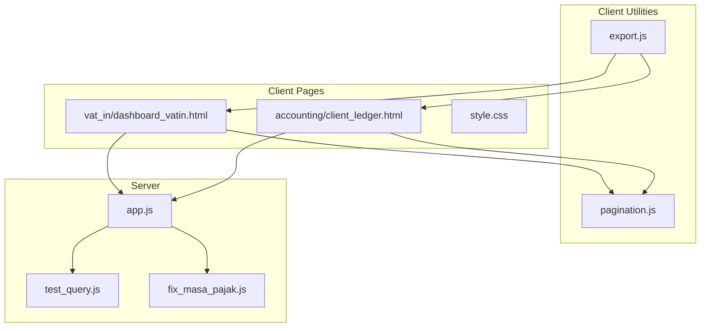
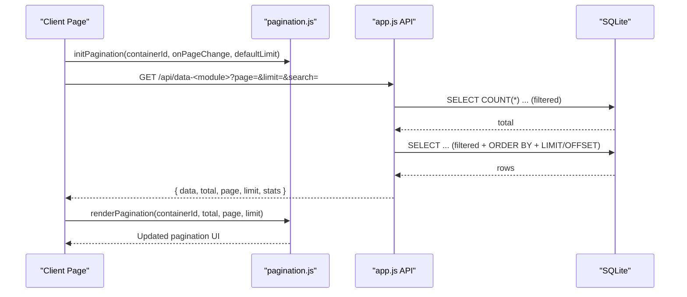
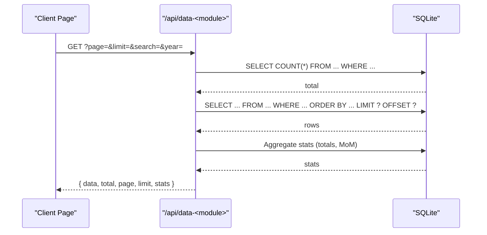
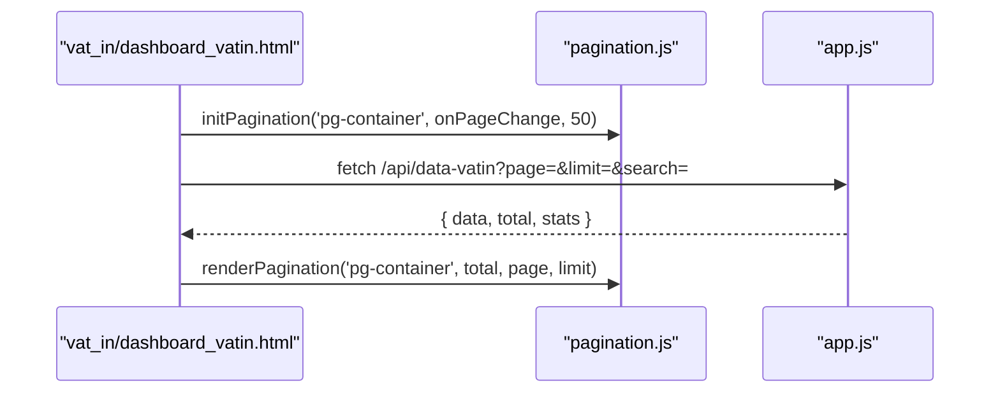
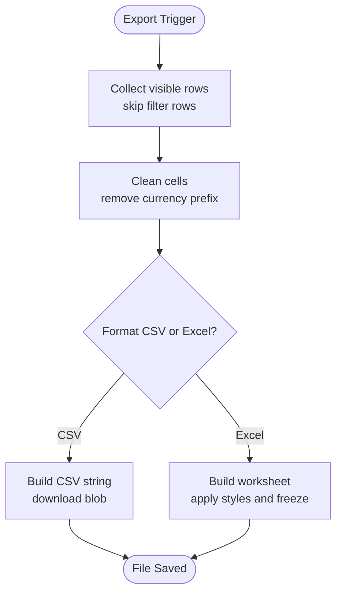
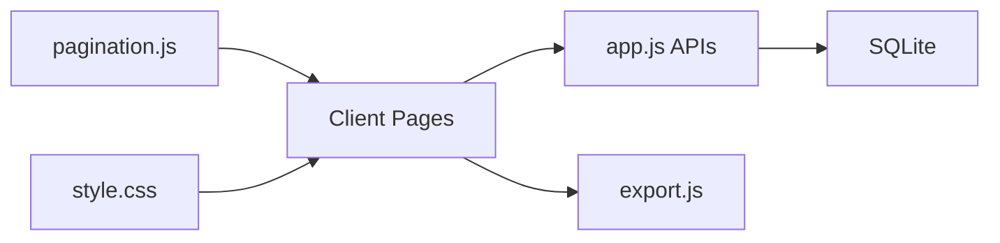

# Data Pagination & Performance Optimization

<cite>
**Referenced Files in This Document**
- [pagination.js](file://pagination.js)
- [app.js](file://app.js)
- [export.js](file://export.js)
- [test_query.js](file://test_query.js)
- [fix_masa_pajak.js](file://fix_masa_pajak.js)
- [vat_in/dashboard_vatin.html](file://vat_in/dashboard_vatin.html)
- [accounting/client_ledger.html](file://accounting/client_ledger.html)
- [style.css](file://style.css)
</cite>

## Table of Contents
1. [Introduction](#introduction)
2. [Project Structure](#project-structure)
3. [Core Components](#core-components)
4. [Architecture Overview](#architecture-overview)
5. [Detailed Component Analysis](#detailed-component-analysis)
6. [Dependency Analysis](#dependency-analysis)
7. [Performance Considerations](#performance-considerations)
8. [Troubleshooting Guide](#troubleshooting-guide)
9. [Conclusion](#conclusion)
10. [Appendices](#appendices)

## Introduction
This document explains the data pagination system and performance optimization features implemented in the project. It focuses on:
- Server-side pagination and rendering utilities
- Data loading strategies, filtering, and statistics aggregation
- Page size management and navigation patterns
- Performance techniques for large tax datasets, including indexing, query optimization, and memory management
- Export capabilities and response-time optimization
- Guidelines for customization, extension, and monitoring

## Project Structure
The pagination system spans client-side rendering utilities and server-side APIs that implement robust pagination and filtering for large tax datasets across modules (VAT In, VAT Out, Payable, Prepaid, and Client Ledger).

**Diagram sources**
- [pagination.js:1-80](file://pagination.js#L1-L80)
- [app.js:827-902](file://app.js#L827-L902)
- [export.js:1-163](file://export.js#L1-L163)
- [test_query.js:1-19](file://test_query.js#L1-L19)
- [fix_masa_pajak.js:1-27](file://fix_masa_pajak.js#L1-L27)
- [vat_in/dashboard_vatin.html:248-356](file://vat_in/dashboard_vatin.html#L248-L356)
- [accounting/client_ledger.html:429-525](file://accounting/client_ledger.html#L429-L525)
- [style.css:1-200](file://style.css#L1-L200)

**Section sources**
- [pagination.js:1-80](file://pagination.js#L1-L80)
- [app.js:827-902](file://app.js#L827-L902)
- [export.js:1-163](file://export.js#L1-L163)
- [test_query.js:1-19](file://test_query.js#L1-L19)
- [fix_masa_pajak.js:1-27](file://fix_masa_pajak.js#L1-L27)
- [vat_in/dashboard_vatin.html:248-356](file://vat_in/dashboard_vatin.html#L248-L356)
- [accounting/client_ledger.html:429-525](file://accounting/client_ledger.html#L429-L525)
- [style.css:1-200](file://style.css#L1-L200)

## Core Components
- Client-side pagination renderer and controller:
  - Initializes pagination state per container
  - Renders pagination UI with info, rows-per-page selector, and navigational buttons
  - Handles page changes and limit updates
- Server-side pagination APIs:
  - Implements server-side filtering, counting, and paginated retrieval
  - Aggregates statistics and month-over-month metrics
  - Supports “Show All” mode and safe parameterization to prevent injection
- Export utilities:
  - CSV and Excel export with optional column exclusion and styling
- Database helpers:
  - Index creation for performance
  - Data synchronization scripts for mass tax fields

**Section sources**
- [pagination.js:4-80](file://pagination.js#L4-L80)
- [app.js:827-902](file://app.js#L827-L902)
- [app.js:918-1101](file://app.js#L918-L1101)
- [export.js:1-163](file://export.js#L1-L163)
- [app.js:474-481](file://app.js#L474-L481)
- [fix_masa_pajak.js:1-27](file://fix_masa_pajak.js#L1-L27)

## Architecture Overview
The system follows a client-server pattern:
- Client pages initialize pagination and trigger data loads via fetch requests
- Server responds with paginated data, total count, and computed statistics
- Client renders the table and pagination UI
- Optional export transforms visible table data into downloadable formats

**Diagram sources**
- [pagination.js:73-80](file://pagination.js#L73-L80)
- [app.js:918-1101](file://app.js#L918-L1101)
- [vat_in/dashboard_vatin.html:252-356](file://vat_in/dashboard_vatin.html#L252-L356)
- [accounting/client_ledger.html:455-525](file://accounting/client_ledger.html#L455-L525)

## Detailed Component Analysis

### Client-Side Pagination Renderer (pagination.js)
- Responsibilities:
  - Maintain per-container state (page, limit, callback)
  - Render pagination bar with:
    - Record range info
    - Rows-per-page selector with predefined options and “All”
    - Navigation buttons (first, previous, page numbers, next, last)
  - Trigger page change and limit change callbacks
- Behavior:
  - Calculates total pages from total and limit
  - Computes visible range (from-to) based on page and limit
  - Supports “All” mode by setting limit to total
  - Disables navigation buttons when at extremes

**Diagram sources**
- [pagination.js:4-80](file://pagination.js#L4-L80)

**Section sources**
- [pagination.js:4-80](file://pagination.js#L4-L80)

### Server-Side Pagination APIs (app.js)
- Endpoint pattern:
  - GET /api/data-<module> with query parameters:
    - page (default 1)
    - limit (default 50; supports “all”)
    - search (JSON-encoded filters)
    - year (optional for certain modules)
- Implementation highlights:
  - Base SQL with LEFT JOINs and dynamic WHERE clauses
  - Safe parameterization to prevent SQL injection
  - Two-pass approach:
    - First query counts total filtered records
    - Second query selects paginated rows with ORDER BY and LIMIT/OFFSET
  - Statistics aggregation:
    - Summarized totals and month-over-month metrics
    - Special handling for VAT In deduplication prior to aggregation
  - “Show All” mode:
    - Returns total rows without LIMIT/OFFSET

**Diagram sources**
- [app.js:918-1101](file://app.js#L918-L1101)
- [app.js:1011-1059](file://app.js#L1011-L1059)

**Section sources**
- [app.js:918-1101](file://app.js#L918-L1101)
- [app.js:1011-1059](file://app.js#L1011-L1059)

### Client Integration Examples
- VAT In Dashboard:
  - Initializes pagination with default limit 50
  - Loads data on page change and renders table rows
  - Uses server-provided stats for totals and month-over-month comparisons
- Client Ledger:
  - Similar pattern with pagination and statistics
  - Renders advanced financial metrics and highlights special rows

**Diagram sources**
- [vat_in/dashboard_vatin.html:248-356](file://vat_in/dashboard_vatin.html#L248-L356)
- [pagination.js:73-80](file://pagination.js#L73-L80)
- [app.js:918-1101](file://app.js#L918-L1101)

**Section sources**
- [vat_in/dashboard_vatin.html:248-356](file://vat_in/dashboard_vatin.html#L248-L356)
- [accounting/client_ledger.html:429-525](file://accounting/client_ledger.html#L429-L525)

### Export Utilities (export.js)
- Features:
  - Export visible table data to CSV or Excel
  - Optional column exclusion list
  - Excel styling and frozen header
  - Long number protection for Excel compatibility
- Usage:
  - Triggered from UI actions to download formatted files

**Diagram sources**
- [export.js:1-163](file://export.js#L1-L163)

**Section sources**
- [export.js:1-163](file://export.js#L1-L163)

### Database Indexing and Synchronization Scripts
- Indexing:
  - Performance indexes on frequently filtered/sorted columns
- Mass synchronization:
  - Script to align masa_pajak for replacement invoices with their normal invoice counterpart

**Section sources**
- [app.js:474-481](file://app.js#L474-L481)
- [fix_masa_pajak.js:1-27](file://fix_masa_pajak.js#L1-L27)

## Dependency Analysis
- Client depends on:
  - pagination.js for UI and state management
  - app.js APIs for paginated data and statistics
  - style.css for consistent UI themes and responsive layout
- Server depends on:
  - SQLite database with pre-created indexes
  - Express and SQLite3 for routing and data access
- Export utilities depend on:
  - Client-visible DOM and optional external Excel library

**Diagram sources**
- [pagination.js:1-80](file://pagination.js#L1-L80)
- [app.js:827-902](file://app.js#L827-L902)
- [export.js:1-163](file://export.js#L1-L163)
- [style.css:1-200](file://style.css#L1-L200)

**Section sources**
- [pagination.js:1-80](file://pagination.js#L1-L80)
- [app.js:827-902](file://app.js#L827-L902)
- [export.js:1-163](file://export.js#L1-L163)
- [style.css:1-200](file://style.css#L1-L200)

## Performance Considerations
- Server-side pagination:
  - Count query and paginated query separate to avoid redundant scans
  - LIMIT/OFFSET applied after sorting to maintain deterministic ordering
- Filtering and search:
  - Parameterized queries with explicit column validation to prevent injection
  - Support for date ranges and “IS NULL” filters
- Statistics aggregation:
  - Dedicated stats queries to compute totals and month-over-month metrics
  - VAT In deduplication performed before aggregation to ensure accurate totals
- Database optimization:
  - Strategic indexes on join and filter columns
- Memory management:
  - “Show All” mode returns total rows; use with caution on very large datasets
- Frontend rendering:
  - Efficient row building and minimal DOM manipulation
  - Export utility processes only visible rows and excludes specified columns

[No sources needed since this section provides general guidance]

## Troubleshooting Guide
- Pagination does not update:
  - Verify initPagination is called with correct containerId and onPageChange
  - Ensure renderPagination is invoked after receiving total/page/limit from API
- Incorrect totals or statistics:
  - Confirm server-side stats computation and MoM logic
  - For VAT In, ensure deduplication occurs before aggregation
- Slow performance on large datasets:
  - Confirm database indexes exist and are effective
  - Prefer server-side pagination over “Show All”
- Export issues:
  - Check column exclusion list and ensure table visibility
  - For Excel, confirm external library availability or fall back to legacy format

**Section sources**
- [pagination.js:73-80](file://pagination.js#L73-L80)
- [app.js:918-1101](file://app.js#L918-L1101)
- [app.js:1011-1059](file://app.js#L1011-L1059)
- [app.js:474-481](file://app.js#L474-L481)
- [export.js:1-163](file://export.js#L1-L163)

## Conclusion
The system combines a lightweight client-side pagination renderer with robust server-side APIs to efficiently handle large tax datasets. By leveraging server-side pagination, parameterized filtering, and targeted database indexes, it achieves responsive user experiences and accurate analytics. Export utilities further enhance usability by enabling quick data downloads. Following the customization and monitoring guidelines ensures continued performance and scalability.

[No sources needed since this section summarizes without analyzing specific files]

## Appendices

### API Definitions
- Endpoint: GET /api/data-<module>
  - Query parameters:
    - page: integer (default 1)
    - limit: integer or "all" (default 50)
    - search: JSON-encoded filters
    - year: optional for certain modules
  - Response:
    - data: array of records
    - total: integer count of filtered rows
    - page: current page
    - limit: effective limit
    - stats: aggregated metrics (module-specific)

**Section sources**
- [app.js:918-1101](file://app.js#L918-L1101)

### Customization Guidelines
- Customize rows-per-page defaults:
  - Adjust defaultLimit in initPagination
- Extend filters:
  - Add supported columns in server-side search parsing
  - Ensure column names pass validation to prevent injection
- Modify pagination UI:
  - Update renderPagination to reflect brand or layout preferences
- Add new modules:
  - Follow the existing API pattern for base SQL, filtering, counting, and pagination

**Section sources**
- [pagination.js:73-80](file://pagination.js#L73-L80)
- [app.js:918-1101](file://app.js#L918-L1101)

### Monitoring and Validation
- Validate pagination correctness:
  - Compare total against COUNT query and rendered page range
- Monitor response times:
  - Use client-side timing around fetch calls and render calls
- Database health:
  - Run test queries to verify index effectiveness
  - Periodically synchronize mass fields using provided scripts

**Section sources**
- [test_query.js:1-19](file://test_query.js#L1-L19)
- [fix_masa_pajak.js:1-27](file://fix_masa_pajak.js#L1-L27)