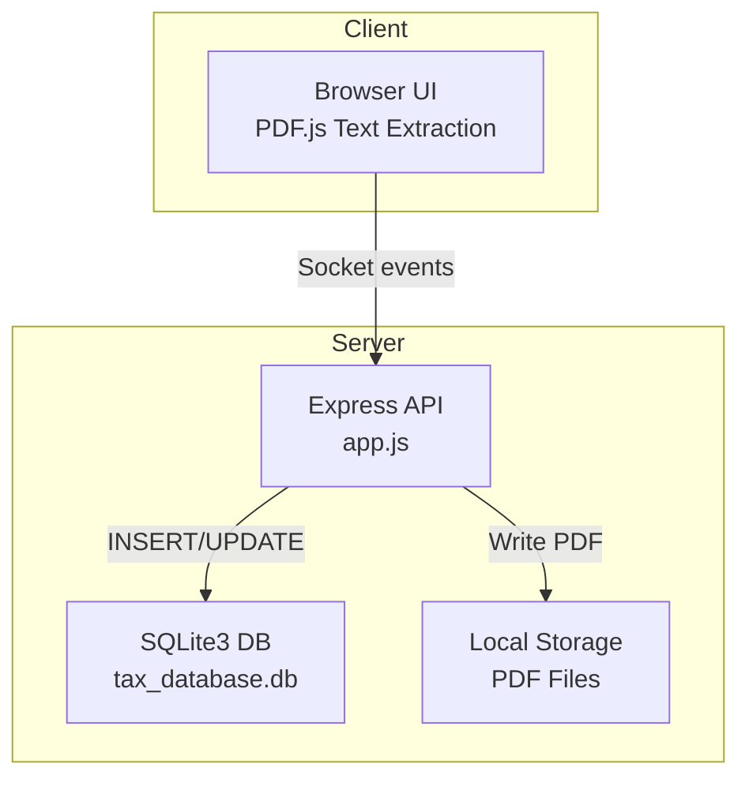
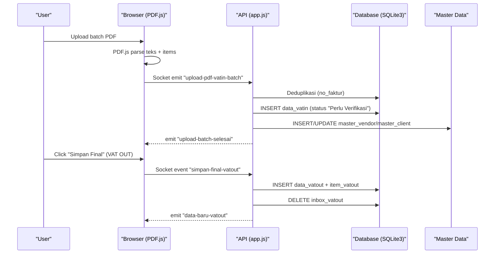
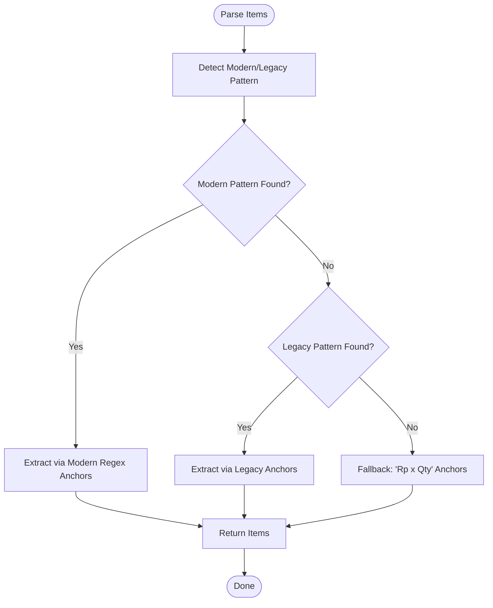
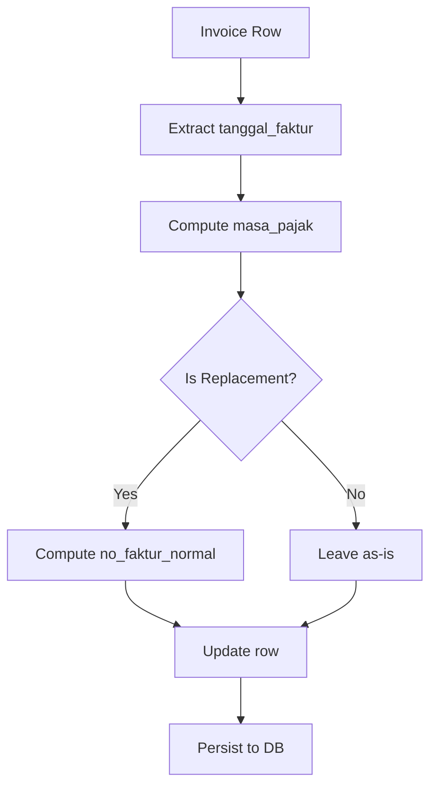
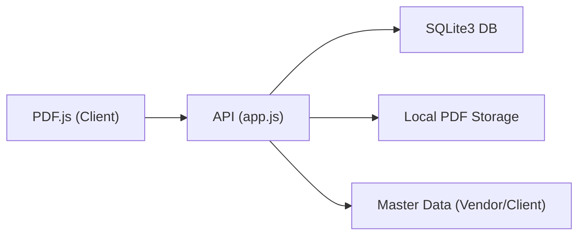

# PDF Processing & Invoice Extraction

<cite>
**Referenced Files in This Document**
- [app.js](file://app.js)
- [fix_masa_pajak.js](file://fix_masa_pajak.js)
- [PRD_Tax_Database_System.md](file://PRD_Tax_Database_System.md)
- [TDS_Sequence_Diagram.md](file://TDS_Sequence_Diagram.md)
- [vat_out/inbox_vatout.html](file://vat_out/inbox_vatout.html)
</cite>

## Table of Contents
1. [Introduction](#introduction)
2. [Project Structure](#project-structure)
3. [Core Components](#core-components)
4. [Architecture Overview](#architecture-overview)
5. [Detailed Component Analysis](#detailed-component-analysis)
6. [Dependency Analysis](#dependency-analysis)
7. [Performance Considerations](#performance-considerations)
8. [Troubleshooting Guide](#troubleshooting-guide)
9. [Conclusion](#conclusion)
10. [Appendices](#appendices)

## Introduction
This document explains the PDF processing and invoice extraction capabilities of the Tax Database System (TDS). It covers the PDF.js integration for extracting text from Indonesian tax invoices, the parsing algorithms used to identify invoice metadata and line items, and the validation and deduplication mechanisms. It also documents the masa pajak fixing workflow, the invoice data processing pipeline, and automated tax calculation features. The document outlines supported PDF formats, extraction accuracy techniques, error handling for malformed documents, technical specifications for PDF parsing, data mapping to database schemas, quality assurance processes, troubleshooting procedures, performance optimization for large batches, and integration examples with the broader tax management system.

## Project Structure
The repository implements a web-based tax management system with server-side APIs and client-side UIs. PDF processing is primarily handled client-side using PDF.js for text extraction and server-side logic for parsing, deduplication, and persistence.

Key areas:
- Server-side API and parsing logic: [app.js](file://app.js)
- Masa pajak fixing workflow: [fix_masa_pajak.js](file://fix_masa_pajak.js)
- System documentation and workflow: [PRD_Tax_Database_System.md](file://PRD_Tax_Database_System.md), [TDS_Sequence_Diagram.md](file://TDS_Sequence_Diagram.md)
- Client-side PDF.js integration for VAT OUT inbox: [vat_out/inbox_vatout.html](file://vat_out/inbox_vatout.html)

**Diagram sources**
- [TDS_Sequence_Diagram.md:1-177](file://TDS_Sequence_Diagram.md#L1-L177)
- [PRD_Tax_Database_System.md:75-98](file://PRD_Tax_Database_System.md#L75-L98)

**Section sources**
- [PRD_Tax_Database_System.md:3-20](file://PRD_Tax_Database_System.md#L3-L20)
- [PRD_Tax_Database_System.md:75-98](file://PRD_Tax_Database_System.md#L75-L98)
- [TDS_Sequence_Diagram.md:1-177](file://TDS_Sequence_Diagram.md#L1-L177)

## Core Components
- PDF.js client-side text extraction for VAT IN and VAT OUT uploads.
- Server-side parsing functions for invoice metadata and line items.
- Deduplication and staging logic for incoming invoices.
- Masa pajak derivation and correction workflow.
- Automated tax calculation fields (DPP, PPN) and master data updates.
- Quality assurance via verification and maker-checker approvals.

**Section sources**
- [PRD_Tax_Database_System.md:75-98](file://PRD_Tax_Database_System.md#L75-L98)
- [TDS_Sequence_Diagram.md:38-98](file://TDS_Sequence_Diagram.md#L38-L98)
- [app.js:219-300](file://app.js#L219-L300)
- [app.js:1168-1186](file://app.js#L1168-L1186)

## Architecture Overview
The system follows a batch ingestion model with client-side PDF.js parsing and server-side processing. The sequence diagram illustrates the end-to-end flow for VAT IN, VAT OUT, and BPPU modules.

**Diagram sources**
- [TDS_Sequence_Diagram.md:38-98](file://TDS_Sequence_Diagram.md#L38-L98)
- [PRD_Tax_Database_System.md:75-98](file://PRD_Tax_Database_System.md#L75-L98)

## Detailed Component Analysis

### PDF.js Integration and Text Extraction
- Client-side PDF.js is used to parse text from uploaded PDFs for VAT IN and VAT OUT.
- The client iterates pages, extracts raw text, and sends structured payloads via socket events.
- For VAT OUT, the UI demonstrates chunked processing and PDF.js document loading prior to upload.

Implementation references:
- Client-side PDF.js usage during VAT OUT upload: [vat_out/inbox_vatout.html:308-324](file://vat_out/inbox_vatout.html#L308-L324)
- Client-side PDF.js usage during VAT OUT verification preview: [vat_out/inbox_vatout.html:358-372](file://vat_out/inbox_vatout.html#L358-L372)

**Section sources**
- [PRD_Tax_Database_System.md:75-98](file://PRD_Tax_Database_System.md#L75-L98)
- [TDS_Sequence_Diagram.md:38-98](file://TDS_Sequence_Diagram.md#L38-L98)
- [vat_out/inbox_vatout.html:308-324](file://vat_out/inbox_vatout.html#L308-L324)
- [vat_out/inbox_vatout.html:358-372](file://vat_out/inbox_vatout.html#L358-L372)

### Document Parsing Algorithms
The server-side parser extracts invoice metadata and line items from extracted text. It supports modern and legacy invoice formats and applies robust fallback strategies.

Key parsing logic:
- Metadata extraction (vendor/buyer info, dates, signatures, totals).
- Line items parsing using modern and legacy anchored patterns.
- Fallback strategies when anchors are missing.

References:
- Modern and legacy parsing for line items: [app.js:219-300](file://app.js#L219-L300)
- VAT OUT metadata extraction and insertion into inbox: [app.js:1998-2034](file://app.js#L1998-L2034)
- VAT IN metadata extraction and insertion into staging: [app.js:1778-1796](file://app.js#L1778-L1796)
- Items retrieval endpoint fallback to re-parse from stored text: [app.js:1168-1186](file://app.js#L1168-L1186)

**Diagram sources**
- [app.js:219-300](file://app.js#L219-L300)

**Section sources**
- [app.js:219-300](file://app.js#L219-L300)
- [app.js:1168-1186](file://app.js#L1168-L1186)

### Data Validation and Deduplication
- VAT IN: Deduplication checks existing records and staging; inserts pending records with “Perlu Verifikasi” status.
- VAT OUT: Deduplication checks existing records; inserts into inbox for later finalization.
- Replacement invoice logic: computes normalized invoice number and status based on digits in the invoice number.

References:
- Deduplication and staging for VAT IN: [PRD_Tax_Database_System.md:82-86](file://PRD_Tax_Database_System.md#L82-L86)
- Deduplication and staging for VAT OUT: [TDS_Sequence_Diagram.md:64-72](file://TDS_Sequence_Diagram.md#L64-L72)
- Replacement invoice migration: [app.js:434-625](file://app.js#L434-L625)

**Section sources**
- [PRD_Tax_Database_System.md:82-86](file://PRD_Tax_Database_System.md#L82-L86)
- [TDS_Sequence_Diagram.md:64-72](file://TDS_Sequence_Diagram.md#L64-L72)
- [app.js:434-625](file://app.js#L434-L625)

### Masa Pajak Fixing Workflow
The masa pajak fixing workflow updates the tax period derived from invoice dates and normalizes replacement invoices.

References:
- Masa pajak extraction and update: [app.js:1788-1796](file://app.js#L1788-L1796)
- Replacement invoice normalization: [app.js:434-625](file://app.js#L434-L625)
- Dedicated fixing script: [fix_masa_pajak.js](file://fix_masa_pajak.js)

**Diagram sources**
- [app.js:1788-1796](file://app.js#L1788-L1796)
- [app.js:434-625](file://app.js#L434-L625)

**Section sources**
- [app.js:1788-1796](file://app.js#L1788-L1796)
- [app.js:434-625](file://app.js#L434-L625)
- [fix_masa_pajak.js](file://fix_masa_pajak.js)

### Invoice Data Processing Pipeline
The pipeline stages include:
- Client-side PDF.js parsing and chunked upload.
- Server-side deduplication and staging.
- Verification and finalization with maker-checker approvals.
- Master data updates and audit logging.

References:
- Batch upload and parsing: [PRD_Tax_Database_System.md:75-98](file://PRD_Tax_Database_System.md#L75-L98)
- Sequence of operations: [TDS_Sequence_Diagram.md:38-98](file://TDS_Sequence_Diagram.md#L38-L98)

**Section sources**
- [PRD_Tax_Database_System.md:75-98](file://PRD_Tax_Database_System.md#L75-L98)
- [TDS_Sequence_Diagram.md:38-98](file://TDS_Sequence_Diagram.md#L38-L98)

### Automated Tax Calculation Features
- DPP and PPN are extracted and cleaned as numeric values.
- Line items include computed totals and unit pricing.
- VAT OUT metadata includes optional discount and advance fields.

References:
- VAT OUT data composition: [app.js:2009-2025](file://app.js#L2009-L2025)
- VAT IN data composition: [app.js:1778-1786](file://app.js#L1778-L1786)

**Section sources**
- [app.js:2009-2025](file://app.js#L2009-L2025)
- [app.js:1778-1786](file://app.js#L1778-L1786)

### Supported PDF Formats and Extraction Accuracy
- Modern and legacy invoice formats are supported with dedicated parsing strategies.
- Fallback mechanisms ensure extraction remains resilient when primary anchors are absent.
- Client-side PDF.js flattening of text is leveraged to normalize whitespace and enable pattern matching.

References:
- Modern vs legacy parsing: [app.js:219-300](file://app.js#L219-L300)
- Client-side PDF.js usage: [vat_out/inbox_vatout.html:308-324](file://vat_out/inbox_vatout.html#L308-L324)

**Section sources**
- [app.js:219-300](file://app.js#L219-L300)
- [vat_out/inbox_vatout.html:308-324](file://vat_out/inbox_vatout.html#L308-L324)

### Error Handling for Malformed Documents
- Graceful fallbacks: if stored text exists, items are re-parsed; otherwise, empty items are returned.
- Deduplication guards prevent duplicate insertions.
- Staging tables isolate unverified data until manual verification.

References:
- Items retrieval fallback: [app.js:1168-1186](file://app.js#L1168-L1186)
- VAT OUT staging and deduplication: [TDS_Sequence_Diagram.md:64-72](file://TDS_Sequence_Diagram.md#L64-L72)

**Section sources**
- [app.js:1168-1186](file://app.js#L1168-L1186)
- [TDS_Sequence_Diagram.md:64-72](file://TDS_Sequence_Diagram.md#L64-L72)

### Technical Specifications for PDF Parsing
- Client-side: PDF.js document load and page iteration; text concatenation across pages.
- Server-side: Regex-based extraction for metadata and items; anchored parsing with fallbacks.

References:
- Client-side parsing loop: [vat_out/inbox_vatout.html:322-324](file://vat_out/inbox_vatout.html#L322-L324)
- Server-side parsing: [app.js:219-300](file://app.js#L219-L300)

**Section sources**
- [vat_out/inbox_vatout.html:322-324](file://vat_out/inbox_vatout.html#L322-L324)
- [app.js:219-300](file://app.js#L219-L300)

### Data Mapping to Database Schemas
- VAT IN: data_vatin with fields for invoice number, entity, branch, buyer/vendor details, totals, reference, signature, masa pajak, and links.
- VAT OUT: data_vatout and item_vatout; staging via inbox_vatout.
- Master data: master_vendor and master_client populated from successful extractions.
- Audit trail: audit_logs for verification/approval actions.

References:
- Field coverage and keys: [PRD_Tax_Database_System.md:20-43](file://PRD_Tax_Database_System.md#L20-L43)
- Staging and finalization: [PRD_Tax_Database_System.md:82-91](file://PRD_Tax_Database_System.md#L82-L91)
- Audit logs: [TDS_Sequence_Diagram.md:110-115](file://TDS_Sequence_Diagram.md#L110-L115)

**Section sources**
- [PRD_Tax_Database_System.md:20-43](file://PRD_Tax_Database_System.md#L20-L43)
- [PRD_Tax_Database_System.md:82-91](file://PRD_Tax_Database_System.md#L82-L91)
- [TDS_Sequence_Diagram.md:110-115](file://TDS_Sequence_Diagram.md#L110-L115)

### Quality Assurance Processes
- Verification phase: “Perlu Verifikasi” status requiring manual assignment of branch and internal invoice number.
- Maker-checker approvals: non-supervisor actions route to user_requests for supervisor approval.
- Cross-module analytics: reporting aggregates across modules for profitability and tax reconciliation.

References:
- Verification workflow: [PRD_Tax_Database_System.md:82-91](file://PRD_Tax_Database_System.md#L82-L91)
- RBAC approvals: [TDS_Sequence_Diagram.md:145-162](file://TDS_Sequence_Diagram.md#L145-L162)
- Reporting: [TDS_Sequence_Diagram.md:120-138](file://TDS_Sequence_Diagram.md#L120-L138)

**Section sources**
- [PRD_Tax_Database_System.md:82-91](file://PRD_Tax_Database_System.md#L82-L91)
- [TDS_Sequence_Diagram.md:145-162](file://TDS_Sequence_Diagram.md#L145-L162)
- [TDS_Sequence_Diagram.md:120-138](file://TDS_Sequence_Diagram.md#L120-L138)

## Dependency Analysis
The system integrates client-side PDF.js parsing with server-side APIs for ingestion, deduplication, and persistence. The sequence diagram highlights the major dependencies and control flows.

**Diagram sources**
- [TDS_Sequence_Diagram.md:38-98](file://TDS_Sequence_Diagram.md#L38-L98)
- [PRD_Tax_Database_System.md:75-98](file://PRD_Tax_Database_System.md#L75-L98)

**Section sources**
- [TDS_Sequence_Diagram.md:38-98](file://TDS_Sequence_Diagram.md#L38-L98)
- [PRD_Tax_Database_System.md:75-98](file://PRD_Tax_Database_System.md#L75-L98)

## Performance Considerations
- Client-side chunked uploads: the UI demonstrates chunked processing to avoid blocking the interface during batch PDF parsing.
- Asynchronous processing: client-side PDF.js operations are awaited per chunk to maintain responsiveness.
- Database indexing: ensure indices on frequently queried fields (invoice numbers, masa pajak, entity) to optimize deduplication and reporting queries.

References:
- Chunked upload UI: [vat_out/inbox_vatout.html:312-314](file://vat_out/inbox_vatout.html#L312-L314)
- Client-side PDF.js iteration: [vat_out/inbox_vatout.html:322-324](file://vat_out/inbox_vatout.html#L322-L324)

**Section sources**
- [vat_out/inbox_vatout.html:312-314](file://vat_out/inbox_vatout.html#L312-L314)
- [vat_out/inbox_vatout.html:322-324](file://vat_out/inbox_vatout.html#L322-L324)

## Troubleshooting Guide
Common issues and resolutions:
- Empty or missing items after parsing:
  - Verify that stored text exists; the system attempts to re-parse items from stored text.
  - Confirm invoice format matches modern or legacy patterns.
  - References: [app.js:1168-1186](file://app.js#L1168-L1186), [app.js:219-300](file://app.js#L219-L300)
- Duplicate invoice entries:
  - Deduplication checks prevent insertion; review existing records and staging tables.
  - References: [PRD_Tax_Database_System.md:82-86](file://PRD_Tax_Database_System.md#L82-L86), [TDS_Sequence_Diagram.md:64-72](file://TDS_Sequence_Diagram.md#L64-L72)
- Masa pajak mismatch:
  - Recompute masa pajak from tanggal_faktur and verify replacement invoice normalization.
  - References: [app.js:1788-1796](file://app.js#L1788-L1796), [app.js:434-625](file://app.js#L434-L625)
- Signature or reference parsing anomalies:
  - Legacy vs modern signature patterns differ; confirm format detection.
  - References: [app.js:1998-2004](file://app.js#L1998-L2004), [app.js:2014-2017](file://app.js#L2014-L2017)
- PDF.js parsing failures:
  - Ensure PDF.js is loaded and document promises resolve; iterate pages safely.
  - References: [vat_out/inbox_vatout.html:320-324](file://vat_out/inbox_vatout.html#L320-L324)

**Section sources**
- [app.js:1168-1186](file://app.js#L1168-L1186)
- [app.js:219-300](file://app.js#L219-L300)
- [PRD_Tax_Database_System.md:82-86](file://PRD_Tax_Database_System.md#L82-L86)
- [TDS_Sequence_Diagram.md:64-72](file://TDS_Sequence_Diagram.md#L64-L72)
- [app.js:1788-1796](file://app.js#L1788-L1796)
- [app.js:434-625](file://app.js#L434-L625)
- [app.js:1998-2004](file://app.js#L1998-L2004)
- [app.js:2014-2017](file://app.js#L2014-L2017)
- [vat_out/inbox_vatout.html:320-324](file://vat_out/inbox_vatout.html#L320-L324)

## Conclusion
The TDS system integrates client-side PDF.js parsing with robust server-side extraction, deduplication, and verification workflows. It supports both modern and legacy invoice formats, derives masa pajak automatically, and maintains master data and audit trails. The masa pajak fixing workflow and maker-checker approvals ensure compliance and data integrity. With chunked processing and fallback strategies, the system is resilient to malformed documents and scalable for large batches.

## Appendices
- Additional roadmap items include OCR, automated journal exports, SSO, real-time notifications, and performance enhancements for batch processing.
- References: [PRD_Tax_Database_System.md:141-174](file://PRD_Tax_Database_System.md#L141-L174)