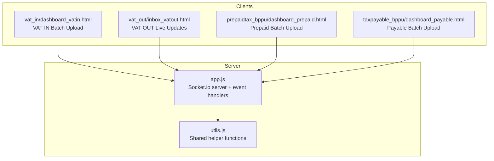
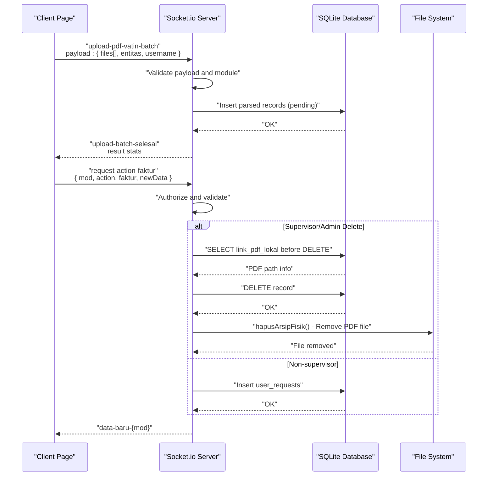
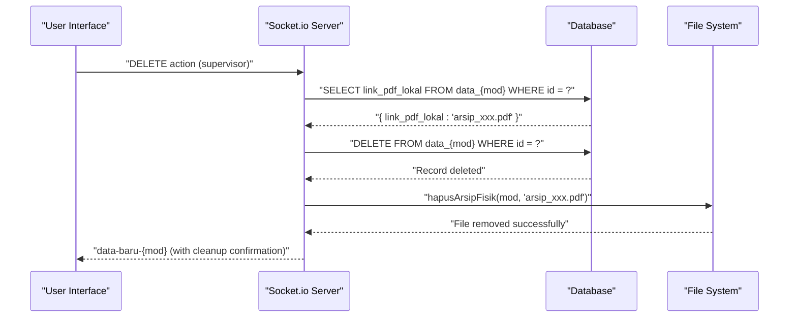
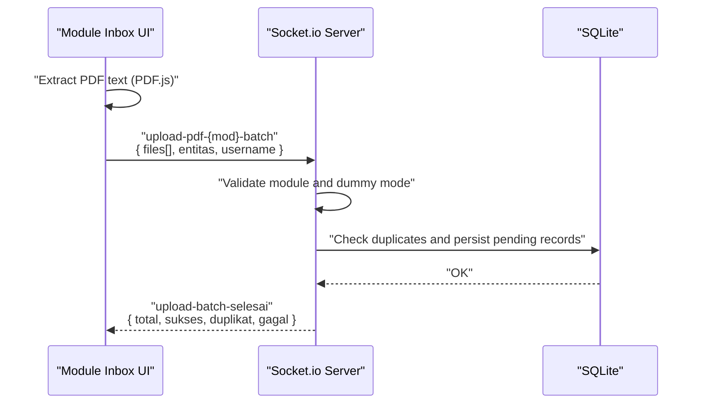
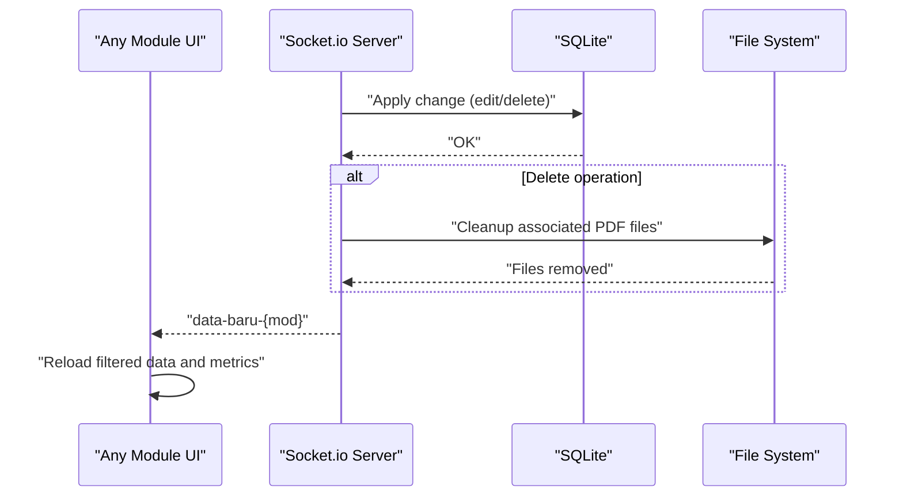
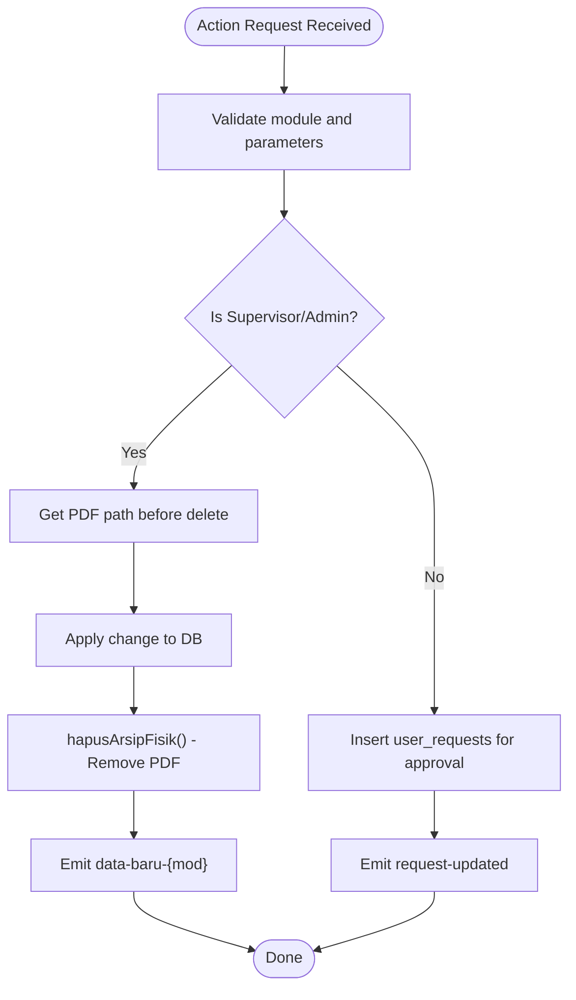
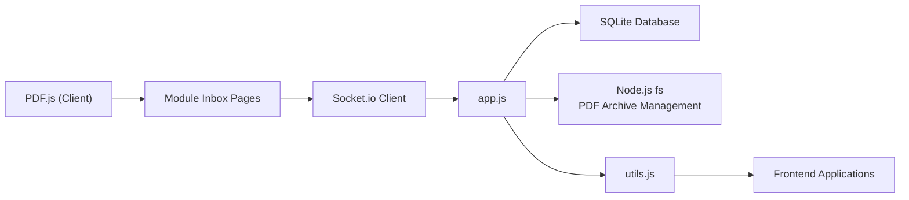

# Real-time Processing & Socket.io Integration

<cite>
**Referenced Files in This Document**
- [app.js](file://app.js)
- [utils.js](file://utils.js)
- [pagination.js](file://pagination.js)
- [vat_out/inbox_vatout.html](file://vat_out/inbox_vatout.html)
</cite>

## Update Summary
**Changes Made**
- Updated Socket.IO implementation with streamlined role-based access control and enhanced validation
- **NEW**: Enhanced PDF archive cleanup system ensuring proper removal of physical PDF files when records are deleted
- Consolidated helper functions for improved security and maintainability
- Enhanced security measures including session validation and role-based authorization
- Streamlined batch upload workflows while maintaining real-time update capabilities
- Improved error handling and audit logging throughout the system

## Table of Contents
1. [Introduction](#introduction)
2. [Project Structure](#project-structure)
3. [Core Components](#core-components)
4. [Architecture Overview](#architecture-overview)
5. [Detailed Component Analysis](#detailed-component-analysis)
6. [Dependency Analysis](#dependency-analysis)
7. [Performance Considerations](#performance-considerations)
8. [Troubleshooting Guide](#troubleshooting-guide)
9. [Conclusion](#conclusion)
10. [Appendices](#appendices)

## Introduction
This document explains the real-time processing system built on Socket.io, focusing on batch PDF upload workflows, live data updates, and real-time synchronization between clients and the server. The system has been streamlined with improved role-based access control, enhanced security measures, and consolidated helper functions while maintaining robust real-time update capabilities for document processing workflows across multiple tax modules (VAT IN, VAT OUT, Prepaid Tax, Tax Payable). **The system now includes comprehensive PDF archive cleanup functionality to prevent orphaned files when records are deleted.**

## Project Structure
The real-time features are implemented primarily in the server-side application with module-specific client pages:
- Server: Socket.io server initialization and event handlers in [app.js](file://app.js)
- Utilities: Shared utility functions in [utils.js](file://utils.js), pagination logic in [pagination.js](file://pagination.js)
- Clients: Module-specific HTML pages with Socket.io clients for batch uploads and live updates
- Documentation: Functional workflow and roadmap in project documentation

**Diagram sources**
- [app.js](file://app.js)
- [utils.js](file://utils.js)
- [vat_out/inbox_vatout.html](file://vat_out/inbox_vatout.html)

**Section sources**
- [app.js](file://app.js)
- [utils.js](file://utils.js)

## Core Components
- Socket.io server initialization with enhanced buffer sizing for large PDF payloads
- **Enhanced PDF archive cleanup system** that systematically removes physical PDF files when database records are deleted
- Streamlined batch upload handlers for all tax modules with improved validation
- Real-time notifications for upload completion and module-wide data changes
- Action request pipeline with enhanced supervisor checks and comprehensive audit logging
- Security controls: dummy mode simulation, role-based access control, and module whitelisting
- Consolidated helper functions for number formatting and data processing

Key implementation anchors:
- Server initialization and enhanced buffer size: [app.js](file://app.js)
- **PDF archive cleanup function**: [hapusArsipFisik:1882-1887](file://app.js#L1882-L1887)
- Streamlined batch upload events and completion notifications: [app.js](file://app.js)
- Client-side batch upload triggers and progress handling: [vat_out/inbox_vatout.html](file://vat_out/inbox_vatout.html)
- Action request handling and real-time emits: [app.js](file://app.js)
- Shared utility functions: [utils.js](file://utils.js)

**Section sources**
- [app.js](file://app.js)
- [utils.js](file://utils.js)

## Architecture Overview
The real-time architecture centers on Socket.io for bidirectional communication with enhanced security and validation. Clients emit batch upload requests and action commands; the server validates, processes, persists data, broadcasts live updates, and **ensures proper cleanup of associated PDF archives**. Security and audit are enforced server-side with improved role-based access control.

**Diagram sources**
- [app.js](file://app.js)

## Detailed Component Analysis

### Socket.io Server Initialization and Connection Management
- Initializes Socket.io on the HTTP server with enhanced buffer sizing to support large PDF uploads
- Maintains per-connection user context (role) for authorization decisions with improved validation
- Emits real-time events to connected clients upon data changes with enhanced error handling

Operational highlights:
- Enhanced buffer sizing for large payloads: [app.js](file://app.js)
- Per-connection user context and dummy mode simulation: [app.js](file://app.js)
- Real-time emits after DB operations with improved error handling: [app.js](file://app.js)

**Section sources**
- [app.js](file://app.js)

### Enhanced PDF Archive Cleanup System
**Updated** The system now includes comprehensive PDF archive cleanup functionality to prevent orphaned files when database records are deleted.

The cleanup process works as follows:
- Before deleting any database record, the system retrieves the associated PDF file path from the `link_pdf_lokal` column
- The `hapusArsipFisik()` function safely removes the physical PDF file from storage using secure path construction
- File deletion uses `path.basename()` to prevent path traversal attacks
- Cleanup occurs both for direct supervisor deletions and approved deletion requests

**Diagram sources**
- [app.js](file://app.js)

**Section sources**
- [app.js](file://app.js)

### Streamlined Batch PDF Upload Workflow
End-to-end flow with enhanced validation:
- Client extracts text from PDFs using PDF.js and chunks files for upload
- Client emits a batch upload event with extracted text and buffers
- Server validates module, performs enhanced duplicate checking, inserts pending records, and reports completion statistics

**Diagram sources**
- [app.js](file://app.js)
- [vat_out/inbox_vatout.html](file://vat_out/inbox_vatout.html)

**Section sources**
- [app.js](file://app.js)
- [vat_out/inbox_vatout.html](file://vat_out/inbox_vatout.html)

### Enhanced Real-time Data Updates and Synchronization
- After successful edits/deletes or bulk actions, the server emits module-specific real-time events to synchronize client views
- **With integrated PDF archive cleanup**, deletions now ensure both database records and physical files are removed
- Clients listen for these events and refresh their UI accordingly with improved error handling

**Diagram sources**
- [app.js](file://app.js)

**Section sources**
- [app.js](file://app.js)

### Improved Action Request Pipeline (Maker-Checker)
- Clients can request edits/deletes via a dedicated action event with enhanced validation
- Supervisor/admin roles bypass direct changes; others trigger approval workflows
- **Deletion requests now include automatic PDF archive cleanup** after approval
- Audit logs are inserted for transparency with comprehensive tracking

**Diagram sources**
- [app.js](file://app.js)

**Section sources**
- [app.js](file://app.js)

### Consolidated Helper Functions
- Centralized utility functions for number formatting and data processing
- **Enhanced with PDF archive cleanup utilities** for safe file deletion
- Improved consistency across frontend and backend operations
- Enhanced error handling and validation

**Section sources**
- [utils.js](file://utils.js)

### Enhanced Real-time Data Validation and Deduplication
- During batch uploads, the server performs comprehensive duplicate checking against existing records and staging areas
- Pending state ensures manual reconciliation before finalization with improved validation

**Section sources**
- [app.js](file://app.js)

## Dependency Analysis
The real-time system relies on:
- Socket.io for bidirectional messaging with enhanced security
- SQLite for persistence with improved indexing
- **Node.js fs module for PDF archive management and cleanup**
- PDF.js on the client for text extraction
- Shared UI components and navigation logic with consolidated utilities

**Diagram sources**
- [app.js](file://app.js)
- [utils.js](file://utils.js)
- [vat_out/inbox_vatout.html](file://vat_out/inbox_vatout.html)

**Section sources**
- [app.js](file://app.js)
- [utils.js](file://utils.js)

## Performance Considerations
- Large payload handling: Server buffer sizing accommodates substantial PDFs with improved memory management
- **Efficient PDF cleanup**: File deletion is performed asynchronously to avoid blocking database operations
- Chunked uploads: Client splits files into manageable chunks to reduce memory pressure and improve reliability
- Debounced filtering and server-side pagination minimize UI lag and database load
- Real-time emits are scoped to module-specific channels to avoid unnecessary broadcasts
- Consolidated helper functions reduce code duplication and improve performance

Recommendations:
- Monitor upload throughput and adjust chunk sizes dynamically
- Use server-side pagination parameters (page, limit) to cap result sets
- Implement rate limiting for repeated action requests
- Leverage consolidated utility functions for consistent performance
- **Monitor file system operations for cleanup efficiency**

**Section sources**
- [app.js](file://app.js)
- [pagination.js](file://pagination.js)
- [utils.js](file://utils.js)

## Troubleshooting Guide
Common issues and resolutions:
- Upload fails silently
  - Verify client emits the correct event and payload shape
  - Check server logs for validation errors and dummy mode behavior
  - Confirm module whitelist and role-based access
  - References: [app.js](file://app.js)

- No real-time updates
  - Ensure the server emits the correct channel (e.g., data-baru-{mod})
  - Confirm clients listen for the appropriate event
  - Check connection authentication and session validation
  - References: [app.js](file://app.js), [vat_out/inbox_vatout.html](file://vat_out/inbox_vatout.html)

- **Orphaned PDF files after deletion**
  - Verify the `hapusArsipFisik()` function is being called after database deletions
  - Check that `link_pdf_lokal` values are properly retrieved before deletion
  - Ensure file paths are correctly constructed using `path.join()` and `path.basename()`
  - References: [app.js](file://app.js)

- Duplicate uploads or missing deduplication
  - Review server-side duplicate guards and staging checks
  - Verify enhanced validation logic is working correctly
  - References: [app.js](file://app.js)

- Slow UI or lag
  - Enable server-side pagination and debounce filters
  - Check consolidated utility function usage
  - References: [pagination.js](file://pagination.js), [utils.js](file://utils.js)

**Section sources**
- [app.js](file://app.js)
- [pagination.js](file://pagination.js)
- [utils.js](file://utils.js)
- [vat_out/inbox_vatout.html](file://vat_out/inbox_vatout.html)

## Conclusion
The real-time processing system leverages Socket.io to deliver responsive batch PDF ingestion, live synchronization, and secure action workflows across tax modules. **The enhanced PDF archive cleanup system ensures data integrity by preventing orphaned files when records are deleted.** The streamlined implementation with improved role-based access control, enhanced security measures, and consolidated helper functions ensures maintainability. With proper monitoring and scaling strategies, the system can handle increased loads while maintaining responsiveness and security.

## Appendices

### Event Types and Message Protocols
- Client to Server
  - upload-pdf-vatin-batch: { files[], entitas, username }
  - upload-pdf-vatout-batch: { files[], entitas, username }
  - upload-pdf-prepaid-batch: { files[], entitas, username }
  - upload-pdf-payable-batch: { files[], entitas, username }
  - request-action-faktur: { mod, action, faktur, newData?, id_user?, username? }
  - tambah-cabang, edit-cabang, hapus-cabang, tambah-kontak, edit-kontak, hapus-kontak (admin-only)

- Server to Client
  - upload-batch-selesai: { modul, total, sukses, duplikat, gagal }
  - data-baru-{mod}: broadcast for UI refresh
  - request-updated: feedback for non-supervisor requests
  - error-action, error-cabang, error-kontak: error responses

Security and validation:
- Dummy mode simulation for safe testing
- Role-based access checks with enhanced validation
- Module whitelist enforcement
- **Automatic PDF archive cleanup on record deletion**
- Audit log insertion for all sensitive actions
- Session validation and authentication

**Section sources**
- [app.js](file://app.js)

### Scalability and Load Balancing Considerations
- Stateless Socket.io deployments: Use sticky sessions or external state stores if scaling horizontally
- Broadcast scope: Limit emits to module-specific channels to reduce overhead
- Database contention: Use transactions and batch writes for uploads; consider read replicas for reporting
- **File system scalability**: Consider distributed file storage solutions for large-scale PDF archive management
- Horizontal scaling: Distribute clients across nodes and route Socket.io connections via a load balancer supporting WebSocket passthrough
- Consolidated utilities: Reduce code duplication and improve maintainability across scaled instances

[No sources needed since this section provides general guidance]