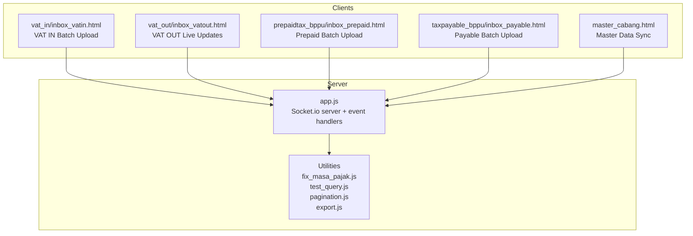
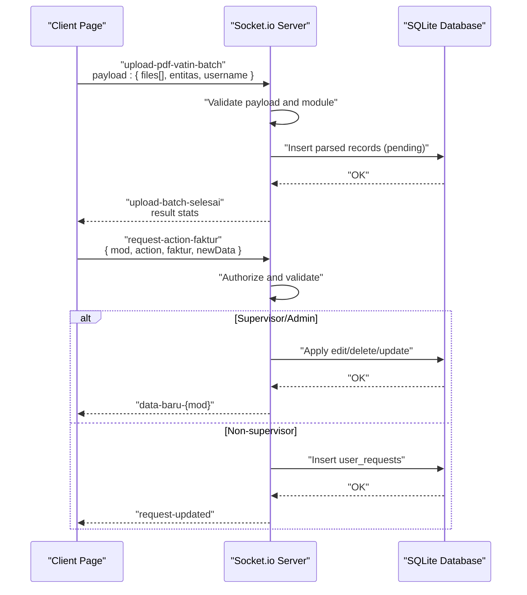
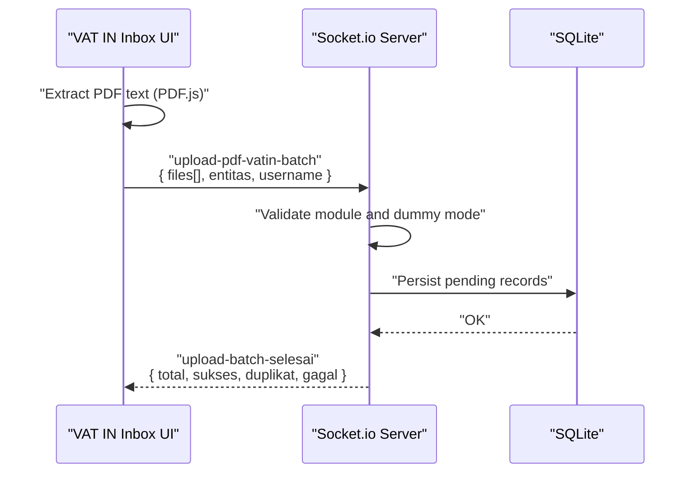
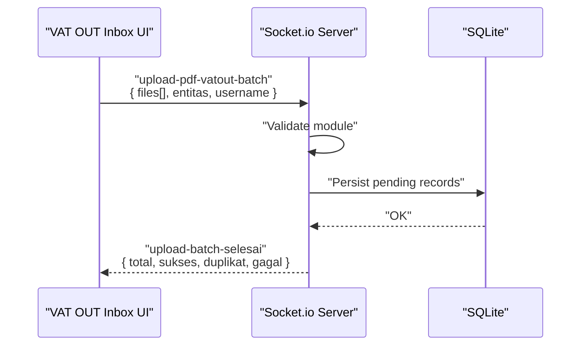
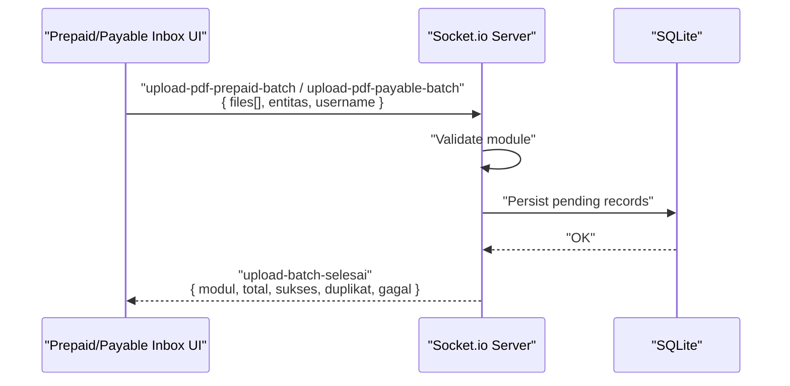
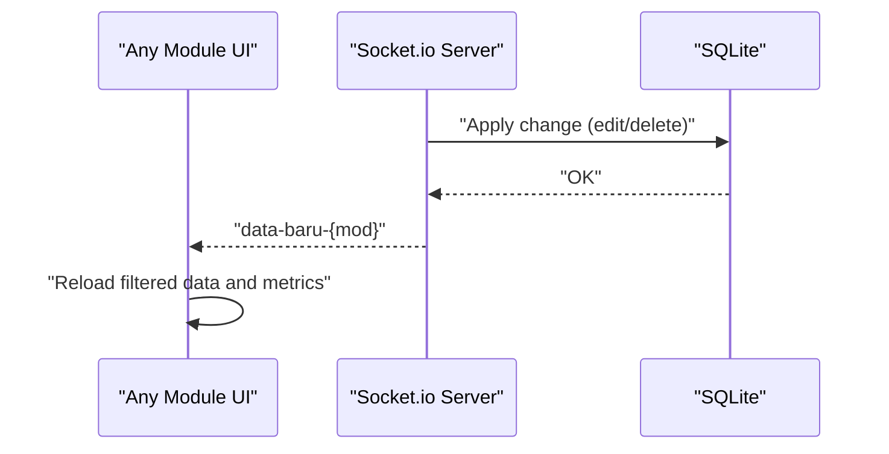
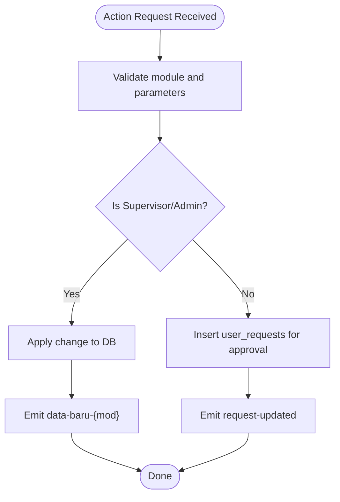
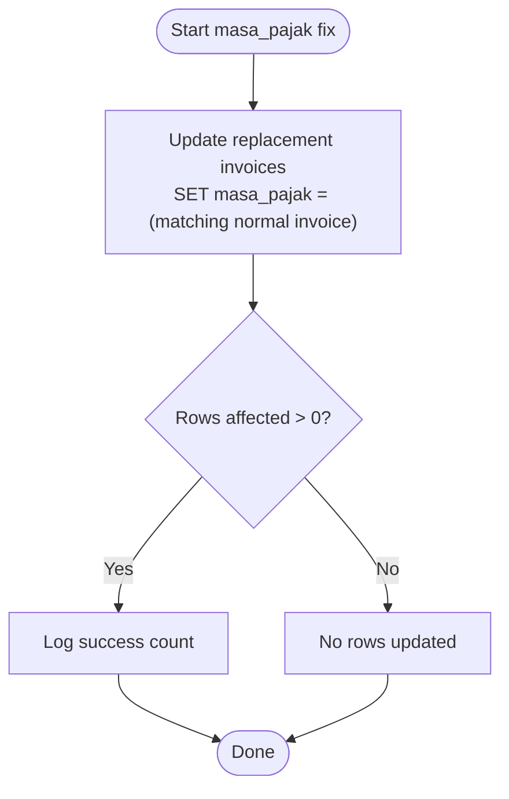
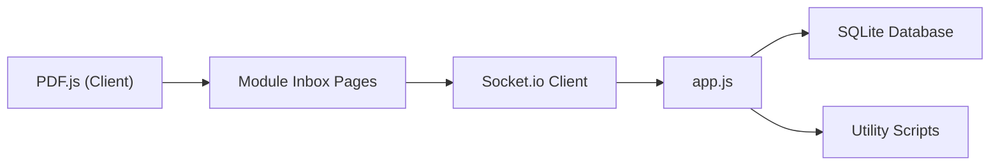

# Real-time Processing & Socket.io Integration

<cite>
**Referenced Files in This Document**
- [app.js](file://app.js)
- [fix_masa_pajak.js](file://fix_masa_pajak.js)
- [test_query.js](file://test_query.js)
- [pagination.js](file://pagination.js)
- [export.js](file://export.js)
- [sidebar.js](file://sidebar.js)
- [master_cabang.html](file://master_cabang.html)
- [vat_in/inbox_vatin.html](file://vat_in/inbox_vatin.html)
- [vat_out/inbox_vatout.html](file://vat_out/inbox_vatout.html)
- [prepaidtax_bppu/inbox_prepaid.html](file://prepaidtax_bppu/inbox_prepaid.html)
- [taxpayable_bppu/inbox_payable.html](file://taxpayable_bppu/inbox_payable.html)
- [PRD_Tax_Database_System.md](file://PRD_Tax_Database_System.md)
</cite>

## Table of Contents
1. [Introduction](#introduction)
2. [Project Structure](#project-structure)
3. [Core Components](#core-components)
4. [Architecture Overview](#architecture-overview)
5. [Detailed Component Analysis](#detailed-component-analysis)
6. [Dependency Analysis](#dependency-analysis)
7. [Performance Considerations](#performance-considerations)
8. [Troubleshooting Guide](#troubleshooting-guide)
9. [Conclusion](#conclusion)
10. [Appendices](#appendices)

## Introduction
This document explains the real-time processing system built on Socket.io, focusing on batch PDF upload workflows, live data updates, and real-time synchronization between clients and the server. It documents event handling, message protocols, connection management, and operational procedures such as masa pajak fixing, query testing, and real-time validation. The system supports multiple tax modules (VAT IN, VAT OUT, Prepaid Tax, Tax Payable) with robust security, deduplication, and audit logging.

## Project Structure
The real-time features are implemented primarily in the server-side application and module-specific client pages:
- Server: Socket.io server initialization and event handlers in [app.js](file://app.js)
- Clients: Module-specific HTML pages with Socket.io clients for batch uploads and live updates
- Utilities: masa pajak fixing script [fix_masa_pajak.js](file://fix_masa_pajak.js), query testing [test_query.js](file://test_query.js), pagination [pagination.js](file://pagination.js), export [export.js](file://export.js), and shared UI helpers [sidebar.js](file://sidebar.js)
- Documentation: Functional workflow and roadmap in [PRD_Tax_Database_System.md](file://PRD_Tax_Database_System.md)

**Diagram sources**
- [app.js](file://app.js)
- [fix_masa_pajak.js](file://fix_masa_pajak.js)
- [test_query.js](file://test_query.js)
- [pagination.js](file://pagination.js)
- [export.js](file://export.js)
- [master_cabang.html](file://master_cabang.html)
- [vat_in/inbox_vatin.html](file://vat_in/inbox_vatin.html)
- [vat_out/inbox_vatout.html](file://vat_out/inbox_vatout.html)
- [prepaidtax_bppu/inbox_prepaid.html](file://prepaidtax_bppu/inbox_prepaid.html)
- [taxpayable_bppu/inbox_payable.html](file://taxpayable_bppu/inbox_payable.html)

**Section sources**
- [app.js](file://app.js)
- [PRD_Tax_Database_System.md](file://PRD_Tax_Database_System.md)

## Core Components
- Socket.io server initialization with buffer sizing for large PDF payloads
- Batch upload handlers for VAT IN, VAT OUT, Prepaid Tax, and Tax Payable
- Real-time notifications for upload completion and module-wide data changes
- Action request pipeline with supervisor checks and audit logging
- Security controls: dummy mode simulation, role-based access, and module whitelisting
- Utility scripts for masa pajak fixing and query testing

Key implementation anchors:
- Server initialization and buffer size: [app.js](file://app.js)
- Batch upload events and completion notifications: [app.js](file://app.js)
- Client-side batch upload triggers and progress handling: [vat_in/inbox_vatin.html](file://vat_in/inbox_vatin.html), [vat_out/inbox_vatout.html](file://vat_out/inbox_vatout.html), [prepaidtax_bppu/inbox_prepaid.html](file://prepaidtax_bppu/inbox_prepaid.html), [taxpayable_bppu/inbox_payable.html](file://taxpayable_bppu/inbox_payable.html)
- Action request handling and real-time emits: [app.js](file://app.js)
- Masa pajak fixing script: [fix_masa_pajak.js](file://fix_masa_pajak.js)
- Query testing utilities: [test_query.js](file://test_query.js)

**Section sources**
- [app.js](file://app.js)
- [fix_masa_pajak.js](file://fix_masa_pajak.js)
- [test_query.js](file://test_query.js)
- [PRD_Tax_Database_System.md](file://PRD_Tax_Database_System.md)

## Architecture Overview
The real-time architecture centers on Socket.io for bidirectional communication. Clients emit batch upload requests and action commands; the server validates, processes, persists data, and broadcasts live updates. Security and audit are enforced server-side.

**Diagram sources**
- [app.js](file://app.js)
- [vat_in/inbox_vatin.html](file://vat_in/inbox_vatin.html)

## Detailed Component Analysis

### Socket.io Server Initialization and Connection Management
- Initializes Socket.io on the HTTP server with a large HTTP buffer to support large PDF uploads.
- Maintains per-connection user context (role) for authorization decisions.
- Emits real-time events to connected clients upon data changes.

Operational highlights:
- Buffer sizing for large payloads: [app.js](file://app.js)
- Per-connection user context and dummy mode simulation: [app.js](file://app.js)
- Real-time emits after DB operations: [app.js](file://app.js)

**Section sources**
- [app.js](file://app.js)

### Batch PDF Upload Workflow (VAT IN)
End-to-end flow:
- Client extracts text from PDFs using PDF.js and chunks files for upload.
- Client emits a batch upload event with extracted text and buffers.
- Server validates module, inserts pending records, and reports completion statistics.

**Diagram sources**
- [app.js](file://app.js)
- [vat_in/inbox_vatin.html](file://vat_in/inbox_vatin.html)

**Section sources**
- [app.js](file://app.js)
- [vat_in/inbox_vatin.html](file://vat_in/inbox_vatout.html)

### Batch PDF Upload Workflow (VAT OUT)
- Client emits a batch upload event for VAT OUT.
- Server performs similar validation and persistence, then emits completion stats.

**Diagram sources**
- [app.js](file://app.js)
- [vat_out/inbox_vatout.html](file://vat_out/inbox_vatout.html)

**Section sources**
- [app.js](file://app.js)
- [vat_out/inbox_vatout.html](file://vat_out/inbox_vatout.html)

### Batch PDF Upload Workflow (Prepaid Tax and Tax Payable)
- Similar patterns apply to Prepaid Tax and Tax Payable modules.
- Client prepares payloads with extracted text and buffers.
- Server validates, persists, and emits completion summaries.

**Diagram sources**
- [app.js](file://app.js)
- [prepaidtax_bppu/inbox_prepaid.html](file://prepaidtax_bppu/inbox_prepaid.html)
- [taxpayable_bppu/inbox_payable.html](file://taxpayable_bppu/inbox_payable.html)

**Section sources**
- [app.js](file://app.js)
- [prepaidtax_bppu/inbox_prepaid.html](file://prepaidtax_bppu/inbox_prepaid.html)
- [taxpayable_bppu/inbox_payable.html](file://taxpayable_bppu/inbox_payable.html)

### Real-time Data Updates and Synchronization
- After successful edits/deletes or bulk actions, the server emits module-specific real-time events to synchronize client views.
- Clients listen for these events and refresh their UI accordingly.

**Diagram sources**
- [app.js](file://app.js)

**Section sources**
- [app.js](file://app.js)

### Action Request Pipeline (Maker-Checker)
- Clients can request edits/deletes via a dedicated action event.
- Supervisor/admin roles bypass direct changes; others trigger approval workflows.
- Audit logs are inserted for transparency.

**Diagram sources**
- [app.js](file://app.js)

**Section sources**
- [app.js](file://app.js)

### Masa Pajak Fixing Process
- Dedicated script synchronizes masa_pajak for replacement invoices to match their normal invoice counterparts.
- Uses SQL joins to propagate masa_pajak consistently.

**Diagram sources**
- [fix_masa_pajak.js](file://fix_masa_pajak.js)

**Section sources**
- [fix_masa_pajak.js](file://fix_masa_pajak.js)

### Query Testing Mechanisms
- Test utilities assist in validating queries and data transformations during development and maintenance.
- Supports iterative verification of aggregation and deduplication logic.

**Section sources**
- [test_query.js](file://test_query.js)

### Real-time Data Validation and Deduplication
- During batch uploads, the server checks for duplicates against existing records and staging areas.
- Pending state ensures manual reconciliation before finalization.

**Section sources**
- [PRD_Tax_Database_System.md](file://PRD_Tax_Database_System.md)
- [app.js](file://app.js)

## Dependency Analysis
The real-time system relies on:
- Socket.io for bidirectional messaging
- SQLite for persistence
- PDF.js on the client for text extraction
- Shared UI components and navigation logic

**Diagram sources**
- [app.js](file://app.js)
- [vat_in/inbox_vatin.html](file://vat_in/inbox_vatin.html)
- [vat_out/inbox_vatout.html](file://vat_out/inbox_vatout.html)
- [prepaidtax_bppu/inbox_prepaid.html](file://prepaidtax_bppu/inbox_prepaid.html)
- [taxpayable_bppu/inbox_payable.html](file://taxpayable_bppu/inbox_payable.html)

**Section sources**
- [app.js](file://app.js)
- [PRD_Tax_Database_System.md](file://PRD_Tax_Database_System.md)

## Performance Considerations
- Large payload handling: Server buffer sizing accommodates substantial PDFs.
- Chunked uploads: Client splits files into manageable chunks to reduce memory pressure and improve reliability.
- Debounced filtering and server-side pagination minimize UI lag and database load.
- Real-time emits are scoped to module-specific channels to avoid unnecessary broadcasts.

Recommendations:
- Monitor upload throughput and adjust chunk sizes dynamically.
- Use server-side pagination parameters (page, limit) to cap result sets.
- Implement rate limiting for repeated action requests.

**Section sources**
- [app.js](file://app.js)
- [pagination.js](file://pagination.js)
- [PRD_Tax_Database_System.md](file://PRD_Tax_Database_System.md)

## Troubleshooting Guide
Common issues and resolutions:
- Upload fails silently
  - Verify client emits the correct event and payload shape.
  - Check server logs for validation errors and dummy mode behavior.
  - Confirm module whitelist and role-based access.
  - References: [app.js](file://app.js)

- No real-time updates
  - Ensure the server emits the correct channel (e.g., data-baru-{mod}).
  - Confirm clients listen for the appropriate event.
  - References: [app.js](file://app.js), [vat_out/inbox_vatout.html](file://vat_out/inbox_vatout.html)

- Duplicate uploads or missing deduplication
  - Review server-side duplicate guards and staging checks.
  - References: [PRD_Tax_Database_System.md](file://PRD_Tax_Database_System.md), [app.js](file://app.js)

- Masa pajak inconsistencies
  - Run the masa pajak fixing script to align replacement invoices with normal invoices.
  - References: [fix_masa_pajak.js](file://fix_masa_pajak.js)

- Slow UI or lag
  - Enable server-side pagination and debounce filters.
  - References: [pagination.js](file://pagination.js), [PRD_Tax_Database_System.md](file://PRD_Tax_Database_System.md)

**Section sources**
- [app.js](file://app.js)
- [fix_masa_pajak.js](file://fix_masa_pajak.js)
- [pagination.js](file://pagination.js)
- [PRD_Tax_Database_System.md](file://PRD_Tax_Database_System.md)

## Conclusion
The real-time processing system leverages Socket.io to deliver responsive batch PDF ingestion, live synchronization, and secure action workflows across tax modules. Robust validation, deduplication, and audit logging ensure data integrity. Utilities like masa pajak fixing and query testing streamline maintenance and correctness. With proper monitoring and scaling strategies, the system can handle increased loads while maintaining responsiveness.

## Appendices

### Event Types and Message Protocols
- Client to Server
  - upload-pdf-vatin-batch: { files[], entitas, username }
  - upload-pdf-vatout-batch: { files[], entitas, username }
  - upload-pdf-prepaid-batch: { files[], entitas, username }
  - upload-pdf-payable-batch: { files[], entitas, username }
  - request-action-faktur: { mod, action, faktur, newData?, id_user?, username? }
  - tambah-cabang, edit-cabang, hapus-cabang, tambah-kontak, edit-kontak, hapus-kontak (admin-only)

- Server to Client
  - upload-batch-selesai: { modul, total, sukses, duplikat, gagal }
  - data-baru-{mod}: broadcast for UI refresh
  - request-updated: feedback for non-supervisor requests
  - error-action, error-cabang, error-kontak: error responses

Security and validation:
- Dummy mode simulation for safe testing
- Role-based access checks
- Module whitelist enforcement
- Audit log insertion for all sensitive actions

**Section sources**
- [app.js](file://app.js)
- [master_cabang.html](file://master_cabang.html)

### Scalability and Load Balancing Considerations
- Stateless Socket.io deployments: Use sticky sessions or external state stores if scaling horizontally.
- Broadcast scope: Limit emits to module-specific channels to reduce overhead.
- Database contention: Use transactions and batch writes for uploads; consider read replicas for reporting.
- Horizontal scaling: Distribute clients across nodes and route Socket.io connections via a load balancer supporting WebSocket passthrough.

[No sources needed since this section provides general guidance]