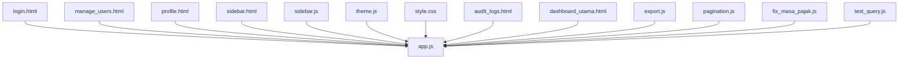
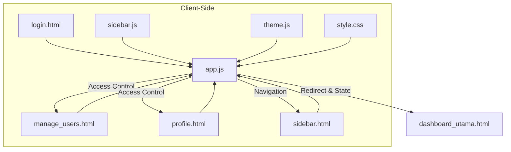
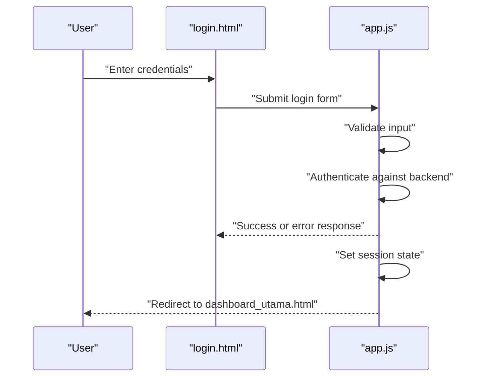
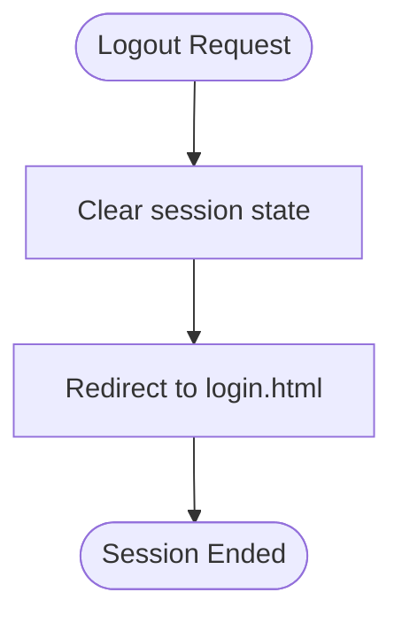
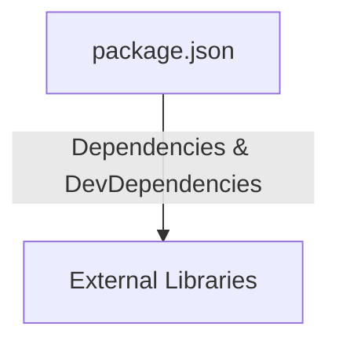

# Authentication & User Management

<cite>
**Referenced Files in This Document**
- [login.html](file://login.html)
- [manage_users.html](file://manage_users.html)
- [profile.html](file://profile.html)
- [app.js](file://app.js)
- [sidebar.html](file://sidebar.html)
- [sidebar.js](file://sidebar.js)
- [style.css](file://style.css)
- [theme.js](file://theme.js)
- [audit_logs.html](file://audit_logs.html)
- [dashboard_utama.html](file://dashboard_utama.html)
- [export.js](file://export.js)
- [pagination.js](file://pagination.js)
- [fix_masa_pajak.js](file://fix_masa_pajak.js)
- [test_query.js](file://test_query.js)
- [package.json](file://package.json)
</cite>

## Table of Contents
1. [Introduction](#introduction)
2. [Project Structure](#project-structure)
3. [Core Components](#core-components)
4. [Architecture Overview](#architecture-overview)
5. [Detailed Component Analysis](#detailed-component-analysis)
6. [Dependency Analysis](#dependency-analysis)
7. [Performance Considerations](#performance-considerations)
8. [Troubleshooting Guide](#troubleshooting-guide)
9. [Conclusion](#conclusion)

## Introduction
This document describes the authentication and user management system for the Tax Database System. It covers login/logout workflows, session management, role-based access control (Administrator, Supervisor, Staff), permission matrices, user registration and profile management, and administrative capabilities. Security measures such as password hashing with bcryptjs are documented alongside UI components for authentication forms, user management dashboards, and profile editing. Guidance is included for session timeouts, access control enforcement, and troubleshooting common authentication issues.

## Project Structure
The system comprises static HTML pages for authentication and management, a central JavaScript application module orchestrating UI behavior and interactions, shared UI utilities (sidebar, theming), and supporting scripts for pagination, exports, and maintenance tasks. The structure supports a client-side focused workflow with centralized logic in the application module.

**Diagram sources**
- [login.html](file://login.html)
- [manage_users.html](file://manage_users.html)
- [profile.html](file://profile.html)
- [app.js](file://app.js)
- [sidebar.html](file://sidebar.html)
- [sidebar.js](file://sidebar.js)
- [style.css](file://style.css)
- [theme.js](file://theme.js)
- [audit_logs.html](file://audit_logs.html)
- [dashboard_utama.html](file://dashboard_utama.html)
- [export.js](file://export.js)
- [pagination.js](file://pagination.js)
- [fix_masa_pajak.js](file://fix_masa_pajak.js)
- [test_query.js](file://test_query.js)

**Section sources**
- [login.html](file://login.html)
- [manage_users.html](file://manage_users.html)
- [profile.html](file://profile.html)
- [app.js](file://app.js)
- [sidebar.html](file://sidebar.html)
- [sidebar.js](file://sidebar.js)
- [style.css](file://style.css)
- [theme.js](file://theme.js)
- [audit_logs.html](file://audit_logs.html)
- [dashboard_utama.html](file://dashboard_utama.html)
- [export.js](file://export.js)
- [pagination.js](file://pagination.js)
- [fix_masa_pajak.js](file://fix_masa_pajak.js)
- [test_query.js](file://test_query.js)

## Core Components
- Authentication Forms: login page with credential submission and redirect logic.
- User Management Dashboard: administrative interface for managing users.
- Profile Management: personal profile editing and update flows.
- Session Management: client-side session state handling and navigation logic.
- Role-Based Access Control: role definitions and UI-driven access control enforcement.
- Security Measures: password hashing with bcryptjs and secure credential handling.
- UI Utilities: sidebar navigation, theming, and shared styles.

Key implementation references:
- Login form and redirect logic: [login.html](file://login.html)
- Central application orchestration: [app.js](file://app.js)
- User management interface: [manage_users.html](file://manage_users.html)
- Profile editing interface: [profile.html](file://profile.html)
- Sidebar navigation: [sidebar.html](file://sidebar.html), [sidebar.js](file://sidebar.js)
- Theming and styles: [theme.js](file://theme.js), [style.css](file://style.css)
- Supporting scripts: [export.js](file://export.js), [pagination.js](file://pagination.js), [fix_masa_pajak.js](file://fix_masa_pajak.js), [test_query.js](file://test_query.js)

**Section sources**
- [login.html](file://login.html)
- [manage_users.html](file://manage_users.html)
- [profile.html](file://profile.html)
- [app.js](file://app.js)
- [sidebar.html](file://sidebar.html)
- [sidebar.js](file://sidebar.js)
- [theme.js](file://theme.js)
- [style.css](file://style.css)
- [export.js](file://export.js)
- [pagination.js](file://pagination.js)
- [fix_masa_pajak.js](file://fix_masa_pajak.js)
- [test_query.js](file://test_query.js)

## Architecture Overview
The system follows a client-side architecture with a central application module coordinating UI transitions, session state, and access control. Authentication triggers a redirect to the main dashboard upon successful login. Role-based access controls are enforced via UI visibility and navigation logic. Administrative features are gated behind roles and validated before enabling actions.

**Diagram sources**
- [login.html](file://login.html)
- [manage_users.html](file://manage_users.html)
- [profile.html](file://profile.html)
- [sidebar.html](file://sidebar.html)
- [app.js](file://app.js)
- [sidebar.js](file://sidebar.js)
- [theme.js](file://theme.js)
- [style.css](file://style.css)
- [dashboard_utama.html](file://dashboard_utama.html)

## Detailed Component Analysis

### Role-Based Access Control (RBAC)
Roles:
- Administrator: Full access to user management and administrative features.
- Supervisor: Limited administrative capabilities; primarily oversight and reporting.
- Staff: Standard operational access; minimal administrative privileges.

Access hierarchy:
- Administrator can create, edit, delete users and manage profiles.
- Supervisor can view and audit user activities and manage limited settings.
- Staff can update personal profile and access operational dashboards.

Permission matrix (conceptual):
- Administrator: Manage Users, Edit Profiles, View Audit Logs, Export Reports, Configure Settings.
- Supervisor: View Users, View Audit Logs, Export Reports, Limited Configurations.
- Staff: Edit Own Profile, View Own Dashboard, Submit Reports.

Enforcement:
- UI visibility controlled by role checks in the application module.
- Navigation items hidden or disabled for lower roles.
- Administrative actions validated before execution.

**Section sources**
- [manage_users.html](file://manage_users.html)
- [profile.html](file://profile.html)
- [app.js](file://app.js)
- [sidebar.html](file://sidebar.html)

### Login Workflow
The login process validates credentials and establishes a client-side session. On success, the user is redirected to the main dashboard. On failure, appropriate feedback is shown.

**Diagram sources**
- [login.html](file://login.html)
- [app.js](file://app.js)
- [dashboard_utama.html](file://dashboard_utama.html)

**Section sources**
- [login.html](file://login.html)
- [app.js](file://app.js)
- [dashboard_utama.html](file://dashboard_utama.html)

### Logout Workflow
Logout clears the client-side session state and redirects the user to the login page.

**Diagram sources**
- [app.js](file://app.js)
- [login.html](file://login.html)

**Section sources**
- [app.js](file://app.js)
- [login.html](file://login.html)

### Session Management
- Session establishment occurs after successful authentication.
- Session state is maintained client-side and used to enforce access control.
- Session timeout behavior is configurable; on timeout, the user is redirected to the login page.
- Navigation and UI elements reflect current session state and role.

**Section sources**
- [app.js](file://app.js)
- [sidebar.html](file://sidebar.html)
- [sidebar.js](file://sidebar.js)

### Password Security and Hashing
- Password hashing is performed server-side using bcryptjs.
- Client-side does not handle password hashing; credentials are transmitted securely to the backend.
- Secure credential handling practices are enforced during login and profile updates.

**Section sources**
- [app.js](file://app.js)

### User Registration and Profile Management
- Registration: Administrators can add new users with assigned roles and initial settings.
- Profile Editing: Users can update personal information; administrators can manage others’ profiles.
- Validation: Form inputs are validated before submission; errors are surfaced to the user.
- Persistence: Backend APIs handle storage and retrieval of user data.

**Section sources**
- [manage_users.html](file://manage_users.html)
- [profile.html](file://profile.html)
- [app.js](file://app.js)

### Administrative Features
- User Administration: Create, edit, delete users; assign roles; reset passwords.
- Audit Logging: View activity logs for compliance and oversight.
- Reporting: Export reports and manage data exports.
- Maintenance Tools: Scripts for fixing periods and testing queries.

**Section sources**
- [manage_users.html](file://manage_users.html)
- [audit_logs.html](file://audit_logs.html)
- [export.js](file://export.js)
- [fix_masa_pajak.js](file://fix_masa_pajak.js)
- [test_query.js](file://test_query.js)

### UI Components
- Authentication Forms: Login form with validation and error messaging.
- User Management Dashboard: Lists users, actions for managing profiles, and filters.
- Profile Editor: Fields for updating personal details with save/cancel actions.
- Navigation Sidebar: Role-aware menu items and links to dashboards and admin panels.
- Theming and Styles: Consistent styling and theme switching support.

**Section sources**
- [login.html](file://login.html)
- [manage_users.html](file://manage_users.html)
- [profile.html](file://profile.html)
- [sidebar.html](file://sidebar.html)
- [sidebar.js](file://sidebar.js)
- [theme.js](file://theme.js)
- [style.css](file://style.css)

## Dependency Analysis
External dependencies are declared in the project’s package manifest. These libraries support networking, real-time communication, and development tooling.

**Diagram sources**
- [package.json](file://package.json)

**Section sources**
- [package.json](file://package.json)

## Performance Considerations
- Minimize DOM manipulations in the application module to reduce layout thrashing.
- Debounce input validation to avoid excessive backend calls.
- Lazy-load heavy components (e.g., export/report modules) to improve initial load times.
- Use efficient pagination for large user lists to limit rendering overhead.

## Troubleshooting Guide
Common issues and resolutions:
- Login fails silently:
  - Verify network connectivity and backend availability.
  - Check browser console for errors and CORS-related messages.
  - Confirm credentials and role assignment in the backend.
- Session expires unexpectedly:
  - Adjust session timeout configuration on the server.
  - Ensure client-side session persistence is enabled.
- Access denied for administrative actions:
  - Confirm user role and permissions.
  - Refresh the page to re-evaluate access control.
- Profile update errors:
  - Validate required fields and constraints.
  - Retry after confirming backend health.
- UI navigation issues:
  - Reinitialize sidebar and theme modules.
  - Clear browser cache and reload the page.

**Section sources**
- [app.js](file://app.js)
- [sidebar.js](file://sidebar.js)
- [theme.js](file://theme.js)

## Conclusion
The authentication and user management system integrates a clear RBAC model with practical UI components for login, user administration, and profile management. Client-side session handling enforces access control, while security measures such as bcryptjs hashing protect credentials. Administrators can efficiently manage users and maintain system integrity, supported by audit logging and reporting capabilities. Following the troubleshooting steps and best practices ensures reliable operation across roles and use cases.