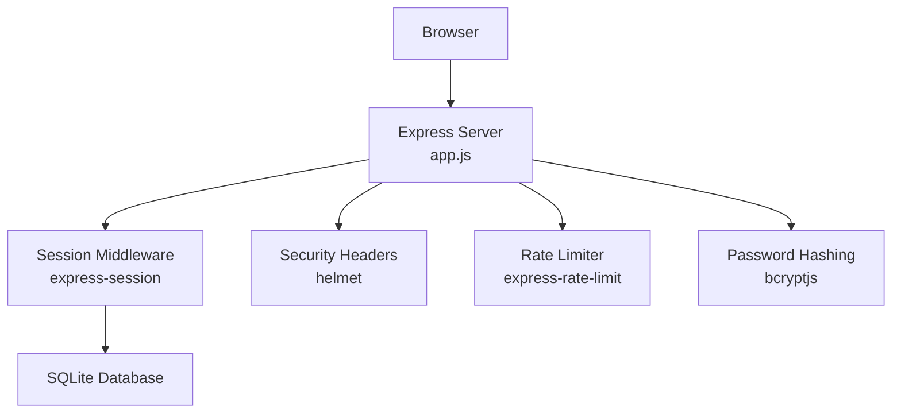
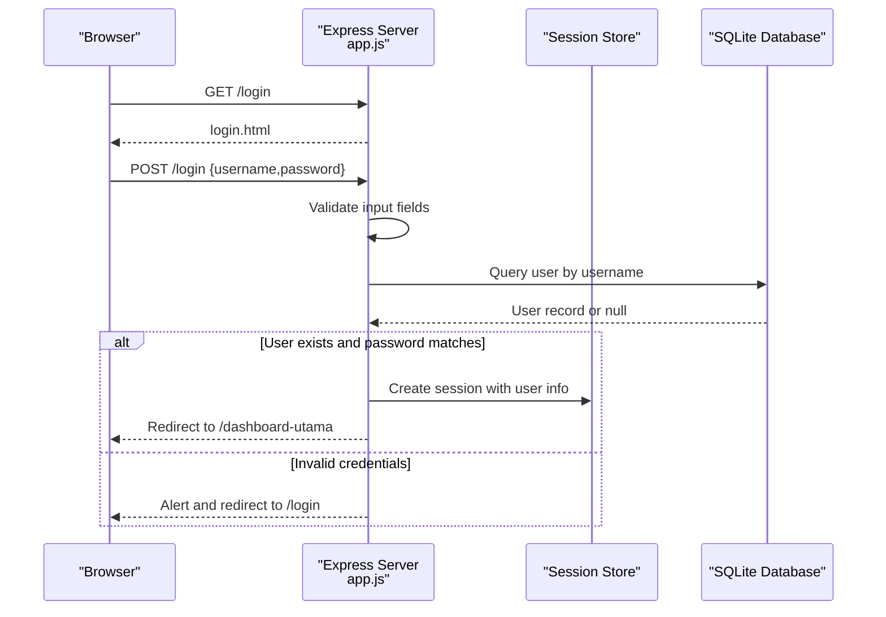
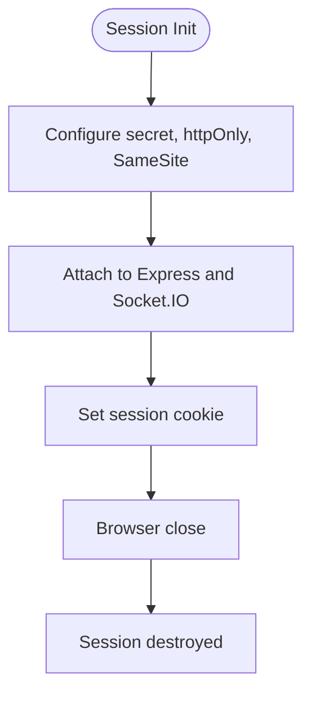
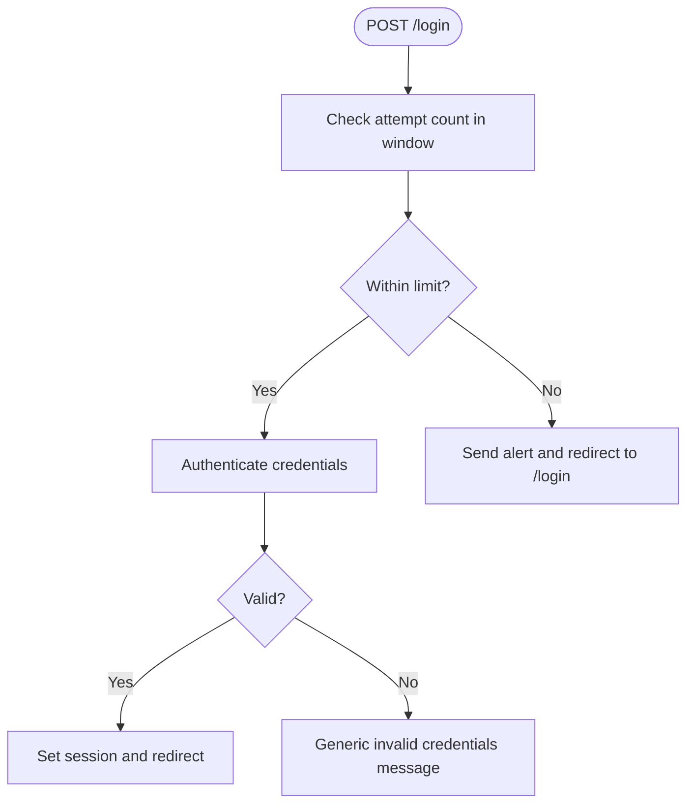
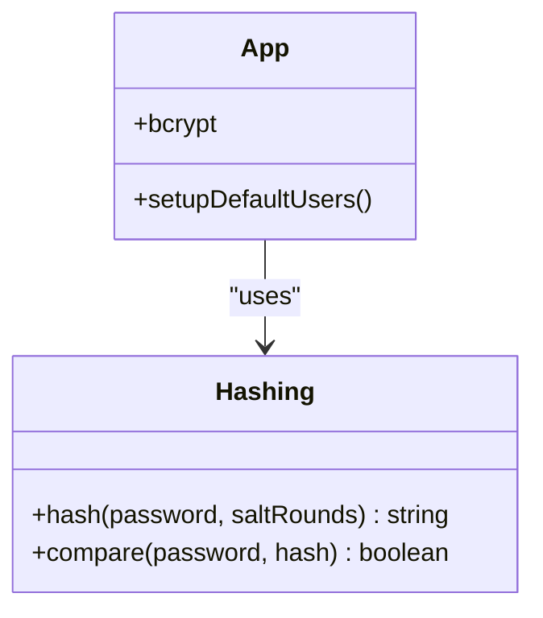
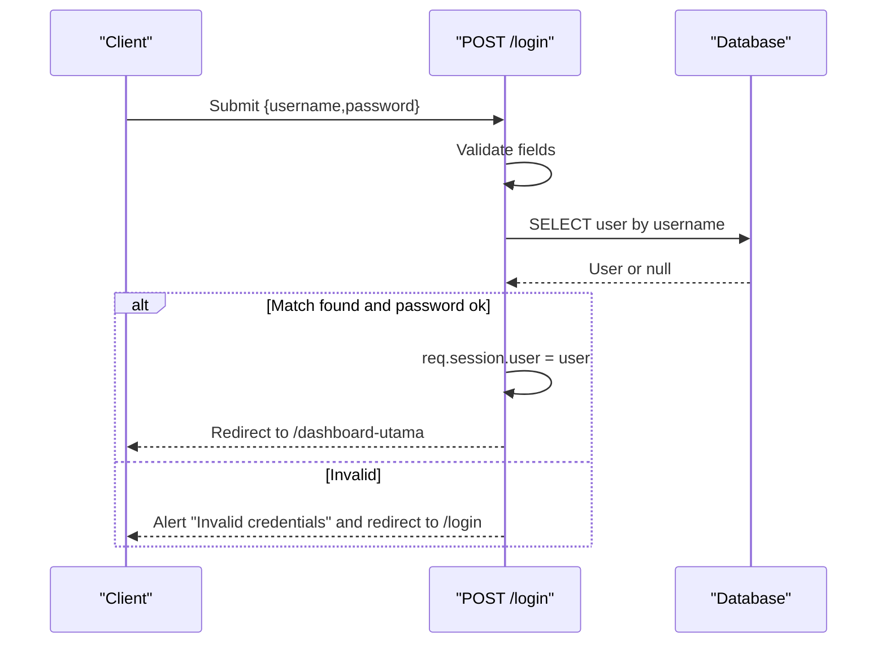
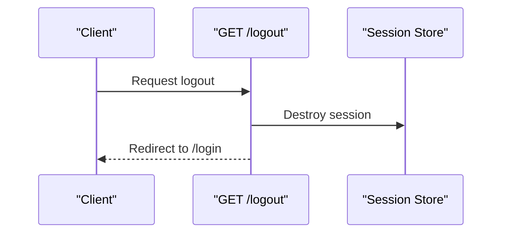
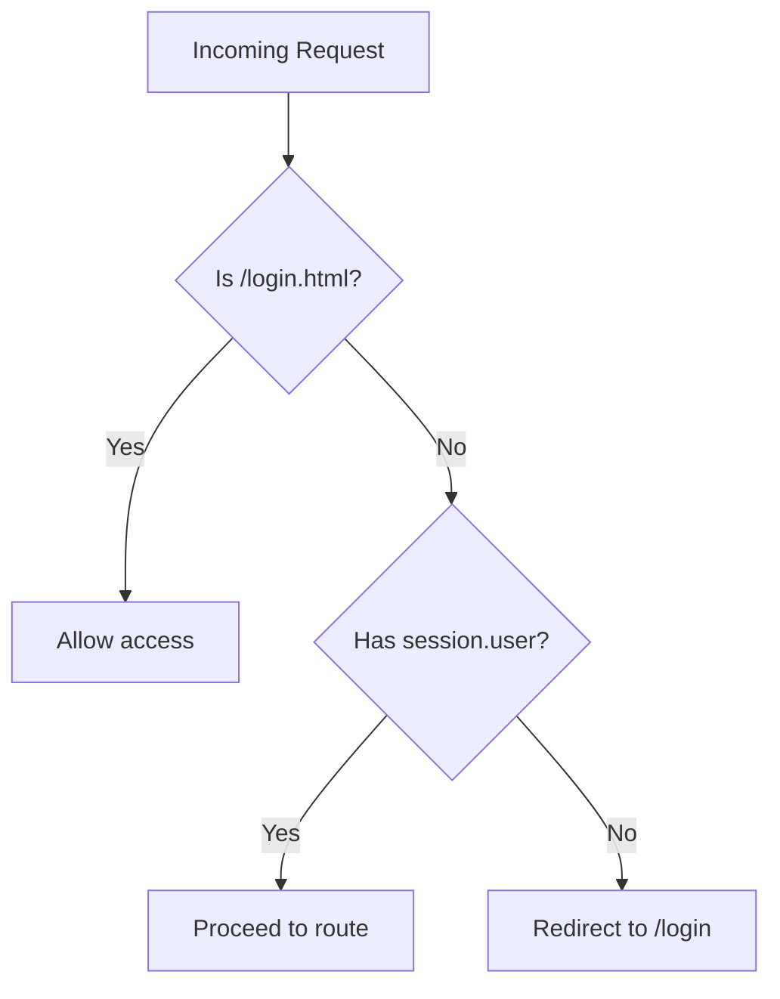
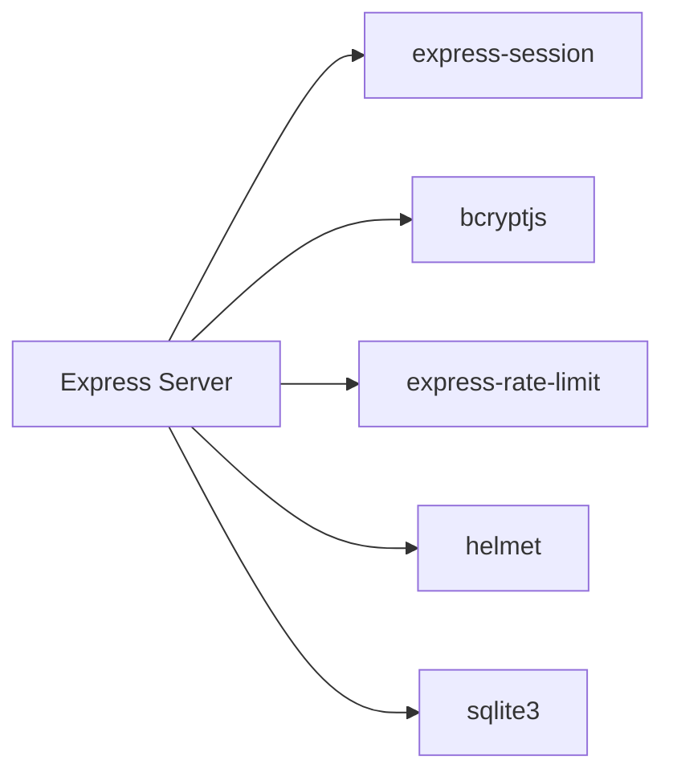

# Authentication System

<cite>
**Referenced Files in This Document**
- [app.js](file://app.js)
- [login.html](file://login.html)
- [package.json](file://package.json)
</cite>

## Table of Contents
1. [Introduction](#introduction)
2. [Project Structure](#project-structure)
3. [Core Components](#core-components)
4. [Architecture Overview](#architecture-overview)
5. [Detailed Component Analysis](#detailed-component-analysis)
6. [Dependency Analysis](#dependency-analysis)
7. [Performance Considerations](#performance-considerations)
8. [Troubleshooting Guide](#troubleshooting-guide)
9. [Conclusion](#conclusion)

## Introduction
This document provides comprehensive documentation for the authentication system. It covers the login/logout workflow, form validation, session management, authentication endpoints, request/response handling, integration with bcryptjs for password hashing, security measures, user interface components for login forms, error handling, user feedback mechanisms, session timeout configurations, automatic logout functionality, and security best practices. It also includes troubleshooting guidance for common authentication issues and login failures.

## Project Structure
The authentication system spans a small set of files:
- Backend server and routes: [app.js](file://app.js)
- Login page UI: [login.html](file://login.html)
- Dependencies and runtime packages: [package.json](file://package.json)

Key responsibilities:
- Express server initialization and middleware stack
- Session management via express-session
- Rate limiting for login attempts
- Password verification using bcryptjs
- Route protection and redirection logic
- Static file serving for the login page

**Diagram sources**
- [app.js](file://app.js)
- [package.json](file://package.json)

**Section sources**
- [app.js](file://app.js)
- [package.json](file://package.json)

## Core Components
- Session Management
  - Configured via express-session with httpOnly cookies and strict SameSite policy.
  - No persistent maxAge configured, resulting in session cookies that expire when the browser closes.
  - Shared with Socket.IO engine for real-time integrations.

- Rate Limiting
  - Login endpoint is protected by a sliding window limiter allowing a limited number of attempts per time window.

- Password Verification
  - Password comparison uses bcryptjs compareSync for verifying submitted credentials against stored hashes.

- Route Protection
  - A middleware checks for the presence of a session user and redirects unauthenticated requests to the login page.
  - JSON endpoints return a 401 Unauthorized response when no session exists.

- Authentication Endpoints
  - GET /login serves the login page.
  - POST /login validates input, queries the database, compares passwords, sets session, and redirects on success.
  - GET /logout destroys the session and redirects to the login page.

- Static File Serving
  - The login page is served as a static HTML file.

**Section sources**
- [app.js](file://app.js)

## Architecture Overview
The authentication flow integrates frontend and backend components with security middleware and session storage.

**Diagram sources**
- [app.js](file://app.js)

## Detailed Component Analysis

### Session Management
- Configuration
  - Secret key is sourced from environment variables.
  - Cookies are httpOnly and SameSite=strict to mitigate XSS and CSRF risks.
  - No maxAge means session cookies are cleared when the browser closes.

- Sharing with Real-Time Engine
  - Session middleware is attached to the Socket.IO engine to enable authenticated real-time features.

- Timeout Behavior
  - Because no maxAge is set, sessions are not persistent across browser sessions.
  - Automatic logout occurs when the browser is closed.

**Diagram sources**
- [app.js](file://app.js)

**Section sources**
- [app.js](file://app.js)

### Rate Limiting for Login
- Purpose
  - Prevent brute-force attacks by limiting login attempts within a fixed window.

- Behavior
  - After exceeding the threshold, clients receive a client-side alert and are redirected to the login page.

**Diagram sources**
- [app.js](file://app.js)

**Section sources**
- [app.js](file://app.js)

### Password Hashing and Verification
- Storage
  - Passwords are hashed using bcryptjs during user creation/setup.

- Verification
  - On login, the submitted password is compared against the stored hash using bcrypt compareSync.

- Security Implications
  - bcryptjs prevents rainbow table attacks and supports adaptive cost factors.

**Diagram sources**
- [app.js](file://app.js)
- [package.json](file://package.json)

**Section sources**
- [app.js](file://app.js)
- [package.json](file://package.json)

### Login Endpoint (/login)
- Request Handling
  - Validates presence of username and password.
  - Queries the database for the user by username.
  - Compares the submitted password with the stored hash.
  - On success, stores user information in the session and redirects to the dashboard.
  - On failure, displays a generic error message and redirects to the login page.

- Response Behavior
  - Uses client-side alerts and redirects for immediate feedback.

**Diagram sources**
- [app.js](file://app.js)

**Section sources**
- [app.js](file://app.js)

### Logout Endpoint (/logout)
- Behavior
  - Destroys the session and redirects to the login page.

- Impact
  - Immediately ends the authenticated session and clears the session cookie.

**Diagram sources**
- [app.js](file://app.js)

**Section sources**
- [app.js](file://app.js)

### Route Protection and Redirection
- Middleware
  - A check ensures that requests requiring authentication include a valid session user.
  - JSON endpoints return a 401 Unauthorized response when no session exists.

- Static File Access
  - The login page is exempt from authentication checks.

- Root Redirection
  - Requests to the root path redirect authenticated users to the dashboard and unauthenticated users to the login page.

**Diagram sources**
- [app.js](file://app.js)

**Section sources**
- [app.js](file://app.js)

### User Interface Components for Login Forms
- Static Page
  - The login page is served as a static HTML file and accessed via the GET /login route.

- Client-Side Feedback
  - Successful or failed login attempts trigger client-side alerts and subsequent redirects.

- Recommendations
  - Consider adding client-side validation for empty fields and improved visual feedback.
  - Ensure the login form enforces secure submission practices (HTTPS, CSRF tokens if applicable).

**Section sources**
- [app.js](file://app.js)
- [login.html](file://login.html)

## Dependency Analysis
External libraries and their roles:
- express-session: Manages server-side session storage and cookie policies.
- bcryptjs: Provides password hashing and verification.
- express-rate-limit: Enforces rate limits on login attempts.
- helmet: Adds security headers to HTTP responses.
- sqlite3: Provides local database connectivity.

**Diagram sources**
- [package.json](file://package.json)

**Section sources**
- [package.json](file://package.json)

## Performance Considerations
- Session Storage
  - Using an in-memory session store is suitable for development but not recommended for production. Consider a scalable store (e.g., Redis) for distributed environments.

- Rate Limiting
  - The current limiter reduces brute-force risk but does not persist across restarts. Combine with IP-based tracking for stronger resilience.

- Database Queries
  - Ensure the users table has appropriate indexes on username for fast lookup.

- Password Hash Cost
  - The hashing cost factor impacts CPU usage during login. Monitor performance under load and adjust accordingly.

[No sources needed since this section provides general guidance]

## Troubleshooting Guide
Common issues and resolutions:
- Invalid Credentials
  - Symptom: Generic error message after login attempt.
  - Cause: Username not found or password mismatch.
  - Resolution: Verify credentials and ensure the user exists in the database.

- Too Many Login Attempts
  - Symptom: Immediate redirect with an alert after multiple failed attempts.
  - Cause: Rate limiter threshold exceeded.
  - Resolution: Wait for the window to reset or reduce the number of attempts.

- Redirect Loops
  - Symptom: Browser stuck between login and dashboard.
  - Cause: Session not properly established or corrupted.
  - Resolution: Clear browser cookies, close and reopen the browser, and retry.

- Unauthenticated Access to Protected Routes
  - Symptom: Redirect to login page or 401 response for JSON endpoints.
  - Cause: Missing or expired session.
  - Resolution: Log in again and ensure cookies are enabled.

- Setup and Default Users
  - During initial setup, default users are created with a predefined password. Change the default password immediately upon first login.

**Section sources**
- [app.js](file://app.js)

## Conclusion
The authentication system implements essential security controls including session management, rate limiting, and bcrypt-based password verification. It provides a straightforward login/logout workflow with client-side feedback and protects routes through middleware. For production, consider enhancing session persistence, strengthening rate limiting, and improving client-side validation and feedback for a robust and user-friendly experience.