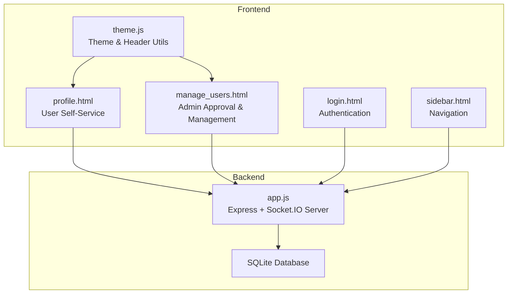
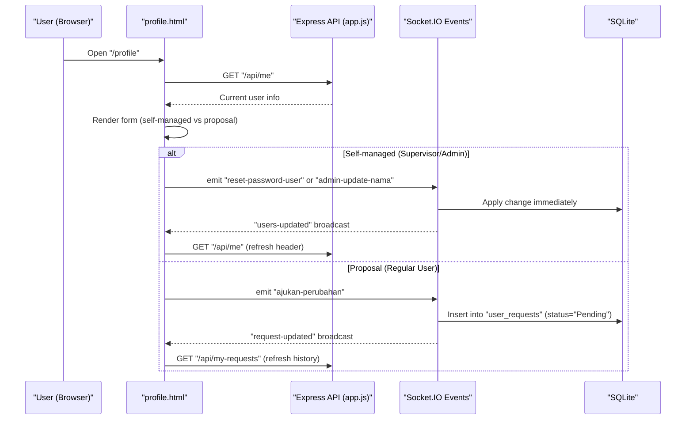
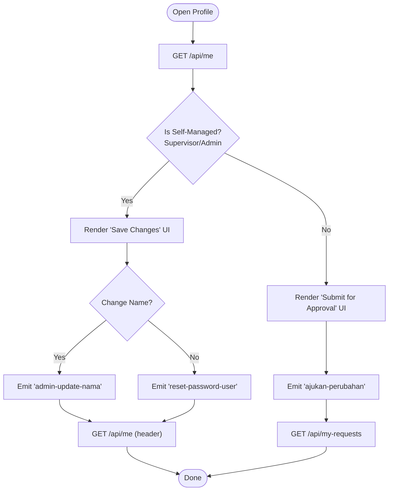
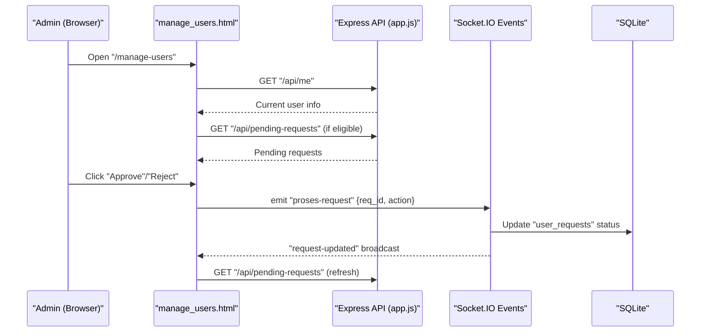
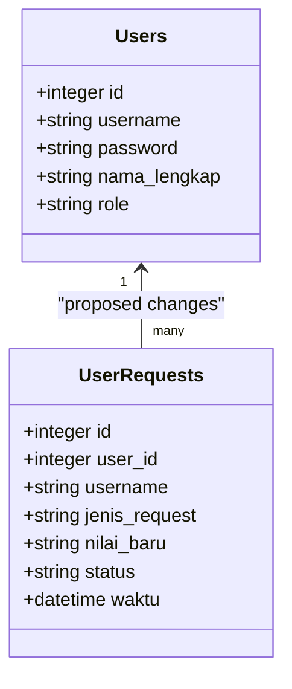
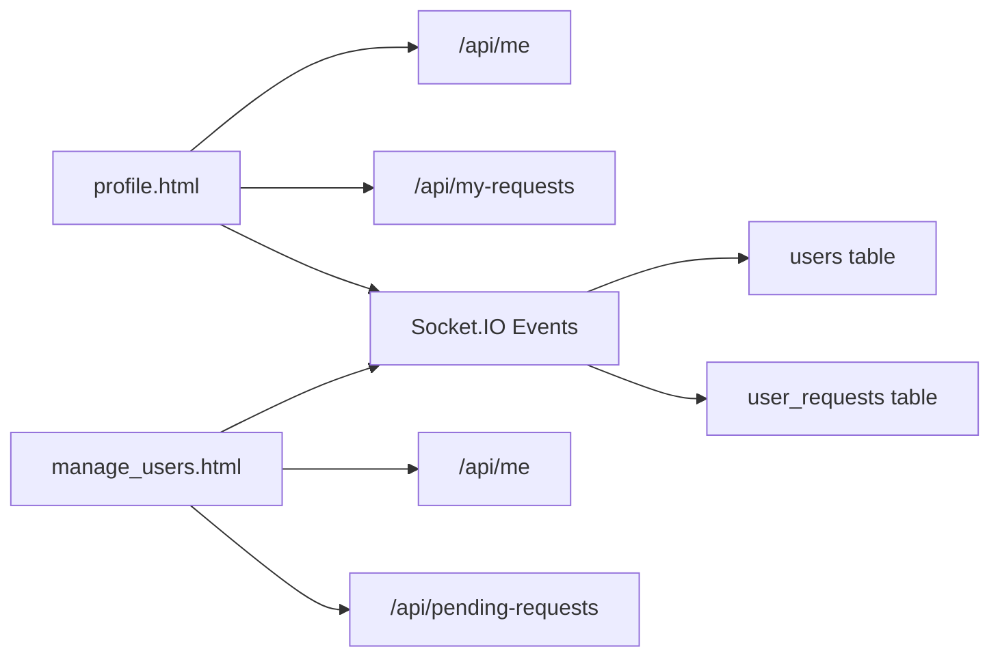

# User Profile Management

<cite>
**Referenced Files in This Document**
- [profile.html](file://profile.html)
- [manage_users.html](file://manage_users.html)
- [app.js](file://app.js)
- [login.html](file://login.html)
- [sidebar.html](file://sidebar.html)
- [theme.js](file://theme.js)
</cite>

## Table of Contents
1. [Introduction](#introduction)
2. [Project Structure](#project-structure)
3. [Core Components](#core-components)
4. [Architecture Overview](#architecture-overview)
5. [Detailed Component Analysis](#detailed-component-analysis)
6. [Dependency Analysis](#dependency-analysis)
7. [Performance Considerations](#performance-considerations)
8. [Troubleshooting Guide](#troubleshooting-guide)
9. [Conclusion](#conclusion)

## Introduction
This document explains the user profile management functionality of the Tax Database System. It covers how users edit personal information and change passwords, how administrators approve or apply changes immediately, and how the system persists and synchronizes profile updates across the application. It also documents the integration between user self-service profile changes and administrative approval workflows, along with guidance for troubleshooting and maintaining data consistency.

## Project Structure
The profile management feature spans three primary areas:
- Frontend pages for user self-service and administration
- Backend API endpoints and real-time events via Socket.IO
- Shared UI utilities for theme and navigation

**Diagram sources**
- [profile.html:1-189](file://profile.html#L1-L189)
- [manage_users.html:1-294](file://manage_users.html#L1-L294)
- [app.js:1-800](file://app.js#L1-L800)
- [login.html:1-51](file://login.html#L1-L51)
- [sidebar.html:1-101](file://sidebar.html#L1-L101)
- [theme.js:1-36](file://theme.js#L1-L36)

**Section sources**
- [profile.html:1-189](file://profile.html#L1-L189)
- [manage_users.html:1-294](file://manage_users.html#L1-L294)
- [app.js:1-800](file://app.js#L1-L800)
- [login.html:1-51](file://login.html#L1-L51)
- [sidebar.html:1-101](file://sidebar.html#L1-L101)
- [theme.js:1-36](file://theme.js#L1-L36)

## Core Components
- User Profile Page (profile.html)
  - Allows logged-in users to propose changes (change name or password) or immediately apply changes if authorized.
  - Displays a history of submitted requests and live updates via WebSocket.
- Administration Panel (manage_users.html)
  - Shows pending requests requiring approval for non-admin roles.
  - Enables administrators to approve or reject requests and to reset passwords.
- Backend Services (app.js)
  - Authentication middleware and role-based access control.
  - Real-time events for change proposals, approvals, and immediate updates.
  - API endpoints for retrieving current user info, request history, and pending requests.
- Shared Utilities (theme.js, sidebar.html)
  - Theme switching and persistent dark/light mode.
  - Navigation sidebar with role-aware visibility of administrative menus.

**Section sources**
- [profile.html:111-186](file://profile.html#L111-L186)
- [manage_users.html:112-292](file://manage_users.html#L112-L292)
- [app.js:486-494](file://app.js#L486-L494)
- [app.js:1212-1224](file://app.js#L1212-L1224)
- [theme.js:1-36](file://theme.js#L1-L36)
- [sidebar.html:78-92](file://sidebar.html#L78-L92)

## Architecture Overview
The profile management system integrates frontend forms, backend APIs, and real-time events to support two distinct flows:
- Self-managed changes for supervisors and administrators (immediate application)
- Propose-and-approve flow for regular users (pending queue)

**Diagram sources**
- [profile.html:111-186](file://profile.html#L111-L186)
- [app.js:2532-2575](file://app.js#L2532-L2575)
- [app.js:1229-1230](file://app.js#L1229-L1230)

## Detailed Component Analysis

### User Profile Page (profile.html)
Responsibilities:
- Present role-aware UI: immediate save for supervisors/administrators, proposal submission for others.
- Validate inputs and show notifications.
- Submit changes via Socket.IO events.
- Fetch and render request history.
- Subscribe to real-time updates to keep UI synchronized.

Key behaviors:
- Role detection determines whether to show “Apply Changes” or “Submit for Approval.”
- Form label and input type dynamically switch between changing name and password.
- On submit:
  - Self-managed users trigger immediate updates via Socket.IO.
  - Regular users submit a request to the approval queue.
- Live updates:
  - Subscribes to “request-updated” to refresh history.
  - Subscribes to “users-updated” to refresh current user name in the header.

**Diagram sources**
- [profile.html:93-186](file://profile.html#L93-L186)

**Section sources**
- [profile.html:72-109](file://profile.html#L72-L109)
- [profile.html:120-155](file://profile.html#L120-L155)
- [profile.html:157-175](file://profile.html#L157-L175)

### Administration Panel (manage_users.html)
Responsibilities:
- Display pending requests requiring approval.
- Allow administrators to approve or reject requests.
- Enable password resets for protected accounts.
- Manage user accounts (add users) for administrators.

Key behaviors:
- Role checks:
  - Only supervisors and above see the approval panel.
  - Only administrators see the user management section.
- Pending requests rendering:
  - Parses request details and displays human-readable summaries.
- Approval actions:
  - Emits “proses-request” with action “Setuju” or “Tolak.”
- User management:
  - Adds new users with role selection.
  - Resets passwords for eligible users.

**Diagram sources**
- [manage_users.html:112-292](file://manage_users.html#L112-L292)
- [app.js:1674-1712](file://app.js#L1674-L1712)

**Section sources**
- [manage_users.html:104-137](file://manage_users.html#L104-L137)
- [manage_users.html:139-230](file://manage_users.html#L139-L230)
- [manage_users.html:232-236](file://manage_users.html#L232-L236)
- [manage_users.html:261-283](file://manage_users.html#L261-L283)

### Backend Services (app.js)
Endpoints and events:
- Authentication and role checks:
  - Middleware validates sessions and enforces role-based access.
- API endpoints:
  - GET “/api/me”: returns current user info.
  - GET “/api/my-requests”: returns request history for the current user.
  - GET “/api/pending-requests”: returns pending requests for approvers.
- Socket.IO events:
  - reset-password-user: immediately updates user password.
  - admin-update-nama: immediately updates user’s full name.
  - ajukan-perubahan: inserts a new request into user_requests with status “Pending.”

Database schema:
- users: stores user credentials, full name, and role.
- user_requests: tracks proposed changes with timestamps and statuses.

**Diagram sources**
- [app.js:341-343](file://app.js#L341-L343)
- [app.js:1226-1230](file://app.js#L1226-L1230)
- [app.js:2532-2575](file://app.js#L2532-L2575)

**Section sources**
- [app.js:486-494](file://app.js#L486-L494)
- [app.js:1212-1224](file://app.js#L1212-L1224)
- [app.js:1226-1230](file://app.js#L1226-L1230)
- [app.js:2532-2575](file://app.js#L2532-L2575)

### Shared Utilities (theme.js, sidebar.html)
- theme.js
  - Applies saved theme preference and toggles dark/light mode.
  - Loads current user name for header display.
- sidebar.html
  - Provides navigation links and role-aware visibility of administrative sections.

**Section sources**
- [theme.js:1-36](file://theme.js#L1-L36)
- [sidebar.html:78-92](file://sidebar.html#L78-L92)

## Dependency Analysis
- Frontend-to-backend dependencies:
  - profile.html depends on /api/me and /api/my-requests, and emits Socket.IO events to apply changes.
  - manage_users.html depends on /api/me, /api/pending-requests, and emits approval/rejection events.
- Backend dependencies:
  - Socket.IO handlers depend on SQLite tables users and user_requests.
  - Role-based access control ensures only authorized users can manage users or approve requests.

**Diagram sources**
- [profile.html:111-186](file://profile.html#L111-L186)
- [manage_users.html:112-292](file://manage_users.html#L112-L292)
- [app.js:1226-1230](file://app.js#L1226-L1230)
- [app.js:2532-2575](file://app.js#L2532-L2575)

**Section sources**
- [profile.html:111-186](file://profile.html#L111-L186)
- [manage_users.html:112-292](file://manage_users.html#L112-L292)
- [app.js:1226-1230](file://app.js#L1226-L1230)
- [app.js:2532-2575](file://app.js#L2532-L2575)

## Performance Considerations
- Real-time synchronization:
  - Using Socket.IO reduces polling overhead and ensures immediate UI updates after approvals or self-managed changes.
- Database indexing:
  - Consider adding indexes on user_requests(user_id, status) to optimize fetching my-requests and pending-requests.
- Payload sizes:
  - Keep request payloads minimal (only changed fields) to reduce network overhead.
- Session security:
  - Session cookies are HttpOnly and SameSite strict, reducing XSS and CSRF risks.

## Troubleshooting Guide
Common issues and resolutions:
- Cannot submit change proposal
  - Verify the user is logged in and role allows proposing changes.
  - Confirm the “Nilai / Data Baru” field is not empty.
  - Check that “/api/my-requests” fetches successfully after emitting the proposal.
- Immediate change not applied
  - Ensure the user has a self-managed role (supervisor/administrator).
  - Confirm the appropriate Socket.IO event was emitted and “users-updated” was received.
- Approval not visible in admin panel
  - Ensure the current user has supervisor or administrator role.
  - Verify “/api/pending-requests” returns pending items and that “request-updated” broadcasts are received.
- Password reset not working
  - For administrators, use the “Reset Password” button in the user list.
  - For self-managed users, use the password change option in the profile page.
- Header name not updating after name change
  - The profile page listens for “users-updated” and refreshes “/api/me”; confirm the event is received and the header element exists.

Operational checks:
- Authentication
  - Login via “/login” sets a session; middleware redirects unauthenticated users.
- Role-based UI
  - Sidebar reveals administrative sections only for supervisors and above.

**Section sources**
- [profile.html:120-155](file://profile.html#L120-L155)
- [profile.html:177-186](file://profile.html#L177-L186)
- [manage_users.html:139-230](file://manage_users.html#L139-L230)
- [manage_users.html:273-283](file://manage_users.html#L273-L283)
- [login.html:25-35](file://login.html#L25-L35)
- [sidebar.html:503-514](file://sidebar.html#L503-L514)

## Conclusion
The profile management system provides a secure, role-aware mechanism for users to update personal information and passwords. Supervisors and administrators can apply changes immediately, while regular users must submit proposals that are approved by supervisors or administrators. The system leverages real-time communication and role-based access control to maintain consistency and usability across the application.