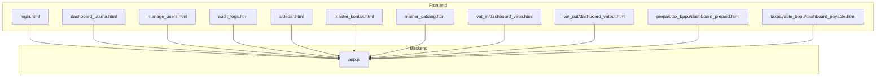
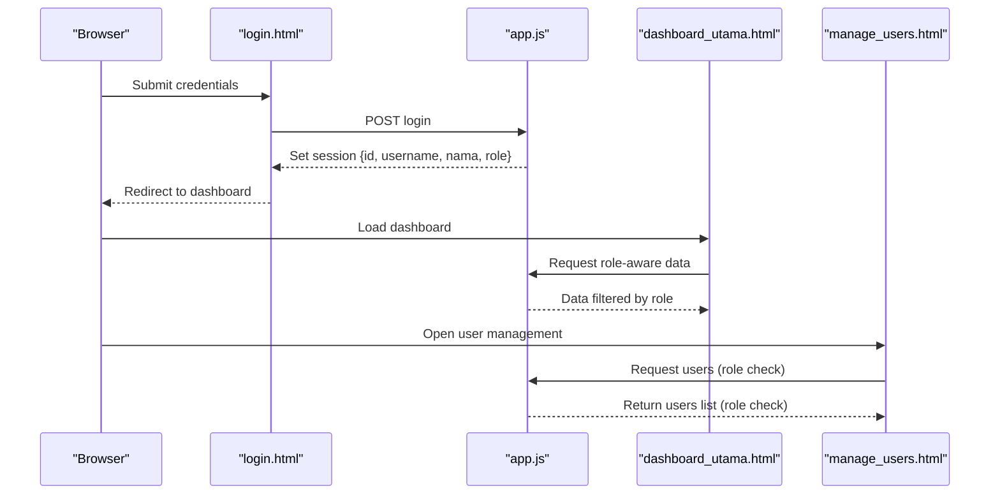
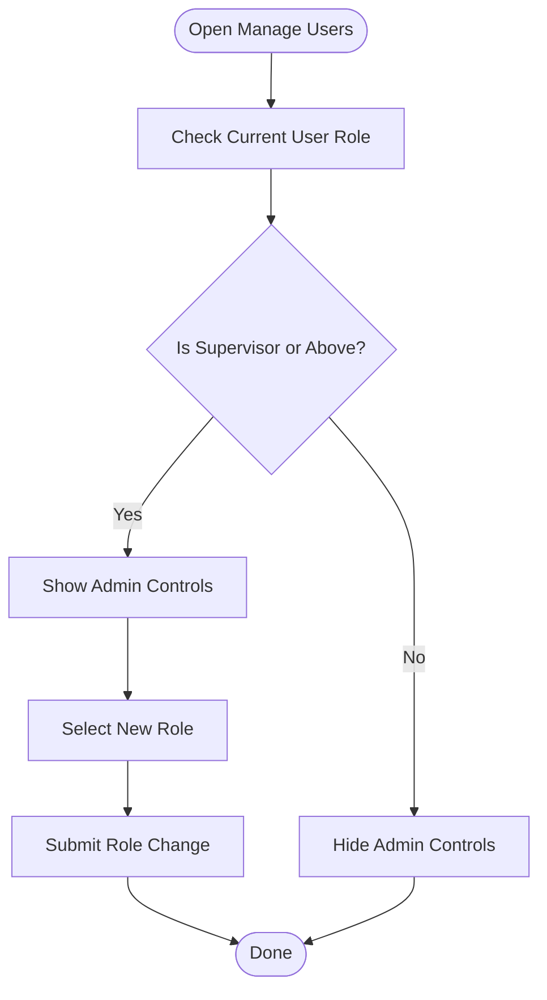
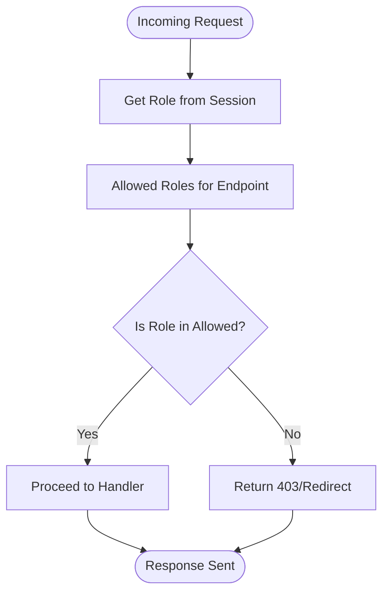
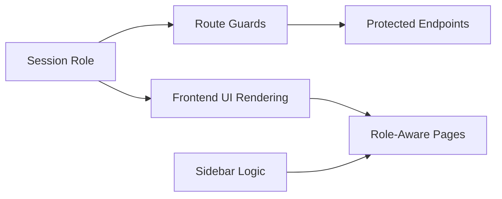

# User Roles & Permissions

<cite>
**Referenced Files in This Document**
- [app.js](file://app.js)
- [login.html](file://login.html)
- [dashboard_utama.html](file://dashboard_utama.html)
- [manage_users.html](file://manage_users.html)
- [audit_logs.html](file://audit_logs.html)
- [sidebar.html](file://sidebar.html)
- [sidebar.js](file://sidebar.js)
- [master_cabang.html](file://master_cabang.html)
- [master_kontak.html](file://master_kontak.html)
- [vat_in/dashboard_vatin.html](file://vat_in/dashboard_vatin.html)
- [vat_out/dashboard_vatout.html](file://vat_out/dashboard_vatout.html)
- [prepaidtax_bppu/dashboard_prepaid.html](file://prepaidtax_bppu/dashboard_prepaid.html)
- [taxpayable_bppu/dashboard_payable.html](file://taxpayable_bppu/dashboard_payable.html)
</cite>

## Table of Contents
1. [Introduction](#introduction)
2. [Project Structure](#project-structure)
3. [Core Components](#core-components)
4. [Architecture Overview](#architecture-overview)
5. [Detailed Component Analysis](#detailed-component-analysis)
6. [Dependency Analysis](#dependency-analysis)
7. [Performance Considerations](#performance-considerations)
8. [Troubleshooting Guide](#troubleshooting-guide)
9. [Conclusion](#conclusion)

## Introduction
This document describes the role-based access control (RBAC) system implemented in the application. It defines the three user roles (Administrator, Supervisor, Staff), their permission matrices, and access hierarchies. It also explains role assignment processes, permission validation mechanisms, and how access control is enforced across the application. The user management interface for role configuration and permission modifications is documented, along with examples of role-specific dashboards, feature availability, and administrative privileges. Security boundaries between roles are clarified, including authorization checks and enforcement points.

## Project Structure
The RBAC system spans backend route guards and frontend UI logic:
- Backend: Role middleware and API endpoints enforce authorization.
- Frontend: Login page sets session roles; dashboards and management pages conditionally render features based on roles.
- Shared UI: Sidebar and shared components reflect role-aware visibility.

**Diagram sources**
- [app.js](file://app.js)
- [login.html](file://login.html)
- [dashboard_utama.html](file://dashboard_utama.html)
- [manage_users.html](file://manage_users.html)
- [audit_logs.html](file://audit_logs.html)
- [sidebar.html](file://sidebar.html)
- [master_kontak.html](file://master_kontak.html)
- [master_cabang.html](file://master_cabang.html)
- [vat_in/dashboard_vatin.html](file://vat_in/dashboard_vatin.html)
- [vat_out/dashboard_vatout.html](file://vat_out/dashboard_vatout.html)
- [prepaidtax_bppu/dashboard_prepaid.html](file://prepaidtax_bppu/dashboard_prepaid.html)
- [taxpayable_bppu/dashboard_payable.html](file://taxpayable_bppu/dashboard_payable.html)

**Section sources**
- [app.js](file://app.js)
- [login.html](file://login.html)
- [dashboard_utama.html](file://dashboard_utama.html)
- [manage_users.html](file://manage_users.html)
- [audit_logs.html](file://audit_logs.html)
- [sidebar.html](file://sidebar.html)
- [master_kontak.html](file://master_kontak.html)
- [master_cabang.html](file://master_cabang.html)
- [vat_in/dashboard_vatin.html](file://vat_in/dashboard_vatin.html)
- [vat_out/dashboard_vatout.html](file://vat_out/dashboard_vatout.html)
- [prepaidtax_bppu/dashboard_prepaid.html](file://prepaidtax_bppu/dashboard_prepaid.html)
- [taxpayable_bppu/dashboard_payable.html](file://taxpayable_bppu/dashboard_payable.html)

## Core Components
- Roles and hierarchy:
  - Administrator: Full access; can manage users and administrative features.
  - Supervisor: Verify and approve; can access administrative APIs and user management.
  - Staff: Limited access; primarily operational dashboards and role-appropriate views.
- Role middleware:
  - Backend route guards restrict endpoints to authorized roles.
  - Socket-level checks enforce role-based permissions for real-time features.
- Session-based enforcement:
  - Login sets user session with role; subsequent UI and API requests rely on session role.
- Frontend role-aware rendering:
  - Dashboards and management pages show/hide controls based on current role.
  - Sidebar groups and navigation items adapt to role level.

Key implementation references:
- Role guard middleware and protected routes: [app.js](file://app.js)
- Socket role checks: [app.js](file://app.js)
- Role-aware UI rendering in dashboards and management pages: [dashboard_utama.html](file://dashboard_utama.html), [manage_users.html](file://manage_users.html), [audit_logs.html](file://audit_logs.html)
- Sidebar role-aware visibility: [sidebar.html](file://sidebar.html), [sidebar.js](file://sidebar.js)

**Section sources**
- [app.js](file://app.js)
- [dashboard_utama.html](file://dashboard_utama.html)
- [manage_users.html](file://manage_users.html)
- [audit_logs.html](file://audit_logs.html)
- [sidebar.html](file://sidebar.html)
- [sidebar.js](file://sidebar.js)

## Architecture Overview
The RBAC architecture combines backend authorization and frontend presentation:
- Authentication establishes a session with role.
- Route guards validate role for each request.
- Socket handlers enforce role for real-time actions.
- Frontend components conditionally render based on session role.

**Diagram sources**
- [login.html](file://login.html)
- [app.js](file://app.js)
- [dashboard_utama.html](file://dashboard_utama.html)
- [manage_users.html](file://manage_users.html)

## Detailed Component Analysis

### Role Definitions and Hierarchies
- Administrator:
  - Highest privilege; can manage users and access all administrative APIs.
  - Role typically stored as "administrator".
- Supervisor:
  - Can verify and approve; accesses administrative APIs and user management.
  - Role typically stored as "supervisor".
- Staff:
  - Operational role with limited access; primarily dashboards and role-appropriate views.
  - Role typically stored as "staff".

Security boundary:
- Suppression of unauthorized access via backend guards and frontend visibility.

**Section sources**
- [app.js](file://app.js)
- [manage_users.html](file://manage_users.html)

### Role Assignment and Management
- Initial users and roles are seeded during database initialization.
- User management page allows supervisors and administrators to:
  - View users.
  - Change roles (subject to protection rules).
  - Reset passwords (with protections).
- Role selection UI exposes Supervisor and Administrator options.

Implementation references:
- Seeded users and roles: [app.js](file://app.js)
- User management UI and role toggles: [manage_users.html](file://manage_users.html)
- Role-aware visibility in management UI: [manage_users.html](file://manage_users.html)

**Diagram sources**
- [manage_users.html](file://manage_users.html)

**Section sources**
- [app.js](file://app.js)
- [manage_users.html](file://manage_users.html)

### Permission Validation and Authorization Checks
- Backend route guards:
  - Middleware validates session role against allowed roles per endpoint.
  - Administrators and supervisors share access to administrative APIs.
- Socket-level checks:
  - Real-time features enforce role-based permissions using server-side socket.user.role.
- Frontend checks:
  - Dashboards and logs conditionally render based on current role.

Implementation references:
- Role guard middleware and protected endpoints: [app.js](file://app.js)
- Socket role checks: [app.js](file://app.js)
- Role-aware UI in dashboards and logs: [dashboard_utama.html](file://dashboard_utama.html), [audit_logs.html](file://audit_logs.html)

**Diagram sources**
- [app.js](file://app.js)

**Section sources**
- [app.js](file://app.js)
- [dashboard_utama.html](file://dashboard_utama.html)
- [audit_logs.html](file://audit_logs.html)

### Access Control Enforcement Across Application Areas
- Administrative APIs:
  - Master data endpoints require supervisor or administrator.
  - Audit logs and migration endpoints restricted to administrators/supervisors.
- Dashboards:
  - Role-specific content and actions appear depending on role.
  - Pending approvals visible to supervisors and administrators.
- User management:
  - Role-aware forms and actions; protected entries for higher roles.
- Sidebar:
  - Administrative groups shown only to supervisors and administrators.

Implementation references:
- Protected administrative endpoints: [app.js](file://app.js)
- Role-aware dashboard logic: [dashboard_utama.html](file://dashboard_utama.html)
- Role-aware management UI: [manage_users.html](file://manage_users.html)
- Sidebar role-aware groups: [sidebar.html](file://sidebar.html), [sidebar.js](file://sidebar.js)

**Section sources**
- [app.js](file://app.js)
- [dashboard_utama.html](file://dashboard_utama.html)
- [manage_users.html](file://manage_users.html)
- [sidebar.html](file://sidebar.html)
- [sidebar.js](file://sidebar.js)

### Role-Specific Dashboards and Feature Availability
- Administrator:
  - Full access to administrative dashboards and user management.
  - Can view and modify all user roles and reset passwords.
- Supervisor:
  - Access to verification and approval features.
  - Can manage users with protections for protected accounts.
  - Views pending approvals and administrative summaries.
- Staff:
  - Operational dashboards for VAT, Prepaid Tax, Payable Tax, and related summaries/inboxes.
  - Limited to role-appropriate views and actions.

Implementation references:
- Administrator dashboard and user management: [manage_users.html](file://manage_users.html)
- Supervisor visibility of pending approvals: [dashboard_utama.html](file://dashboard_utama.html)
- Staff dashboards: [vat_in/dashboard_vatin.html](file://vat_in/dashboard_vatin.html), [vat_out/dashboard_vatout.html](file://vat_out/dashboard_vatout.html), [prepaidtax_bppu/dashboard_prepaid.html](file://prepaidtax_bppu/dashboard_prepaid.html), [taxpayable_bppu/dashboard_payable.html](file://taxpayable_bppu/dashboard_payable.html)

**Section sources**
- [manage_users.html](file://manage_users.html)
- [dashboard_utama.html](file://dashboard_utama.html)
- [vat_in/dashboard_vatin.html](file://vat_in/dashboard_vatin.html)
- [vat_out/dashboard_vatout.html](file://vat_out/dashboard_vatout.html)
- [prepaidtax_bppu/dashboard_prepaid.html](file://prepaidtax_bppu/dashboard_prepaid.html)
- [taxpayable_bppu/dashboard_payable.html](file://taxpayable_bppu/dashboard_payable.html)

### User Management Interface for Role Configuration
- Displays current users with role badges.
- Shows administrative controls to supervisors and administrators.
- Protects protected accounts from modification by lower roles.
- Allows changing roles and resetting passwords with appropriate safeguards.

Implementation references:
- Role badge rendering and protection indicators: [manage_users.html](file://manage_users.html)
- Role-aware control visibility: [manage_users.html](file://manage_users.html)

**Section sources**
- [manage_users.html](file://manage_users.html)

## Dependency Analysis
The RBAC system depends on:
- Session storage for current user role.
- Backend middleware to enforce role-based access to endpoints.
- Frontend scripts to render role-appropriate UI.
- Shared sidebar logic to hide administrative sections for staff.

**Diagram sources**
- [app.js](file://app.js)
- [dashboard_utama.html](file://dashboard_utama.html)
- [manage_users.html](file://manage_users.html)
- [sidebar.html](file://sidebar.html)
- [sidebar.js](file://sidebar.js)

**Section sources**
- [app.js](file://app.js)
- [dashboard_utama.html](file://dashboard_utama.html)
- [manage_users.html](file://manage_users.html)
- [sidebar.html](file://sidebar.html)
- [sidebar.js](file://sidebar.js)

## Performance Considerations
- Keep role checks lightweight by relying on session data.
- Minimize repeated role computations in frontend by caching current role.
- Avoid unnecessary re-renders by batching role-aware UI updates.

## Troubleshooting Guide
Common issues and resolutions:
- Unauthorized access attempts:
  - Verify that route guards are applied to all administrative endpoints.
  - Confirm session role is set during login and propagated to frontend.
- Role-aware UI not updating:
  - Ensure frontend checks use the current session role.
  - Confirm sidebar logic reflects role changes after login.
- Socket actions failing:
  - Confirm server-side socket role checks use session-derived role, not client-provided role.

Relevant implementation references:
- Backend guards and socket role checks: [app.js](file://app.js)
- Role-aware UI in dashboards and logs: [dashboard_utama.html](file://dashboard_utama.html), [audit_logs.html](file://audit_logs.html)
- Sidebar role-aware visibility: [sidebar.html](file://sidebar.html), [sidebar.js](file://sidebar.js)

**Section sources**
- [app.js](file://app.js)
- [dashboard_utama.html](file://dashboard_utama.html)
- [audit_logs.html](file://audit_logs.html)
- [sidebar.html](file://sidebar.html)
- [sidebar.js](file://sidebar.js)

## Conclusion
The application implements a clear RBAC model with three roles and explicit security boundaries. Administrators have full control, supervisors can verify and approve while accessing administrative features, and staff have limited operational access. Backend route guards and socket-level checks enforce authorization, while frontend components conditionally render based on session role. The user management interface supports role configuration with protections for sensitive accounts. Together, these mechanisms provide a robust foundation for access control across the system.