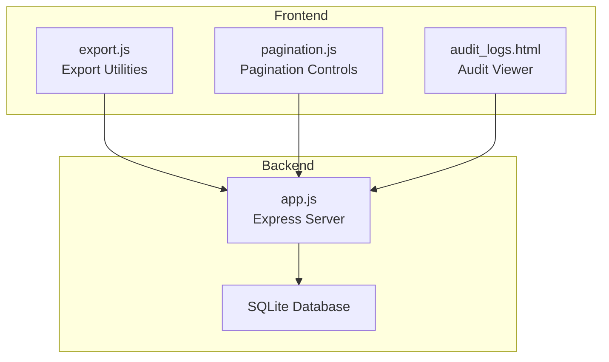
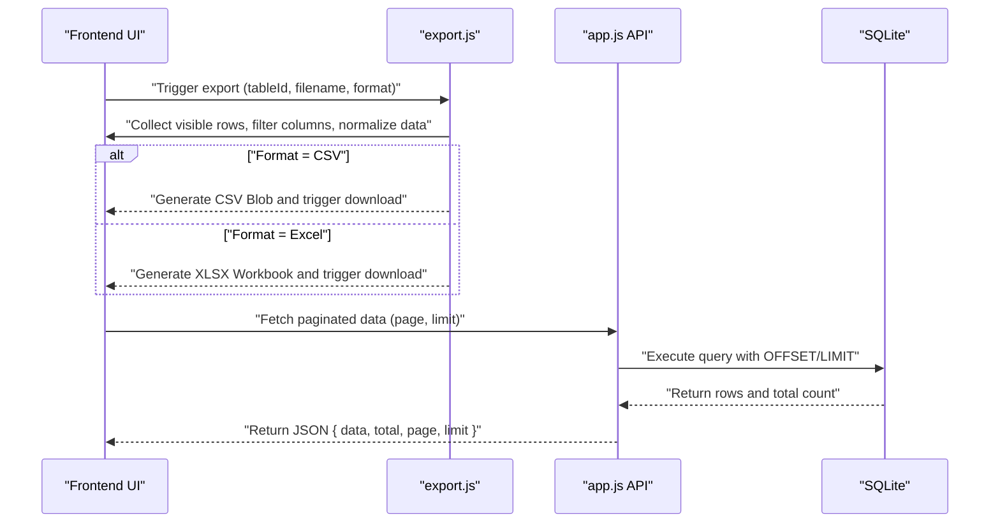
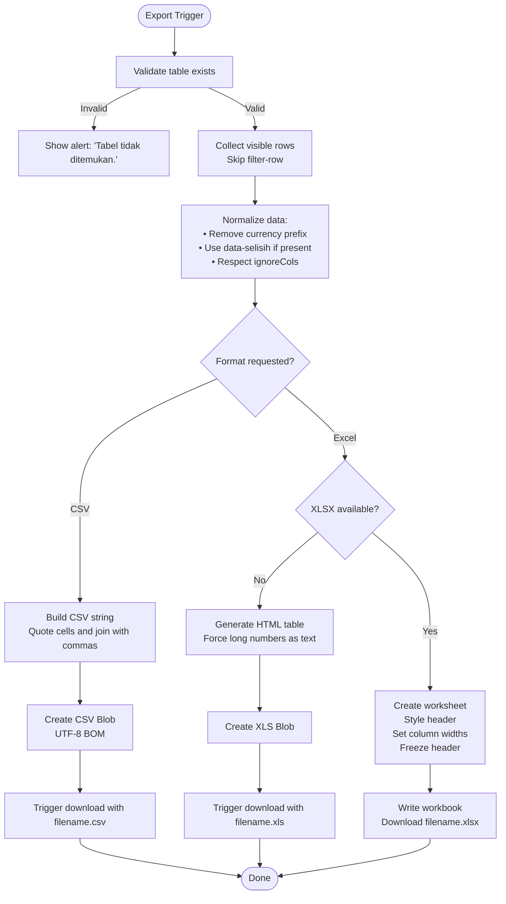
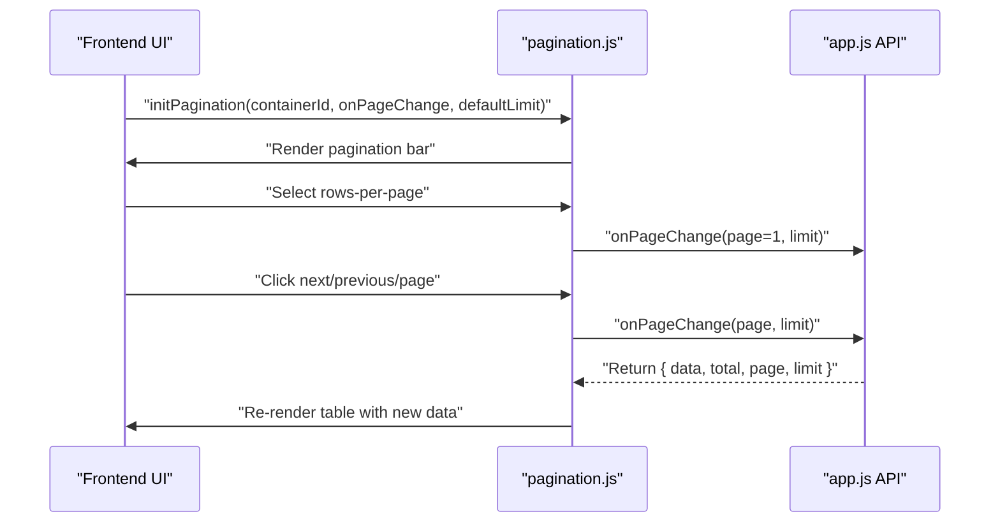
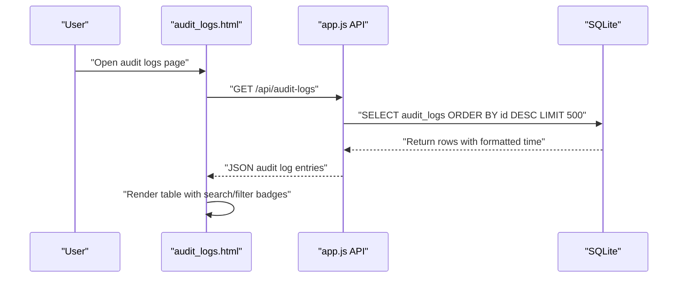
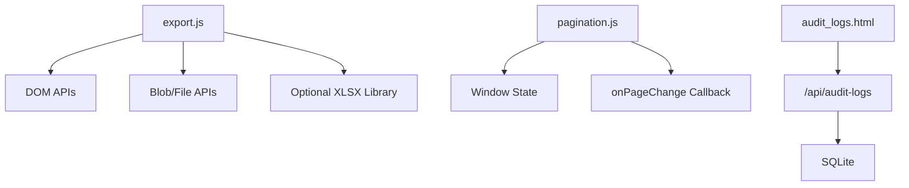

# Data Management & Export

<cite>
**Referenced Files in This Document**
- [export.js](file://export.js)
- [pagination.js](file://pagination.js)
- [audit_logs.html](file://audit_logs.html)
- [app.js](file://app.js)
- [TDS_Sequence_Diagram.md](file://TDS_Sequence_Diagram.md)
</cite>

## Table of Contents
1. [Introduction](#introduction)
2. [Project Structure](#project-structure)
3. [Core Components](#core-components)
4. [Architecture Overview](#architecture-overview)
5. [Detailed Component Analysis](#detailed-component-analysis)
6. [Dependency Analysis](#dependency-analysis)
7. [Performance Considerations](#performance-considerations)
8. [Troubleshooting Guide](#troubleshooting-guide)
9. [Conclusion](#conclusion)
10. [Appendices](#appendices)

## Introduction
This document explains the data management and export capabilities of the system, focusing on:
- Data export functionality supporting CSV and Excel (.xlsx) formats
- Server-side pagination for large datasets
- Audit logging and compliance reporting features
- Data export workflows, file generation processes, and format specifications
- Pagination controls, performance optimization for large datasets, and data filtering capabilities
- Export scheduling, batch processing, and data integrity validation
- Best practices and troubleshooting guidance for export-related issues

## Project Structure
The system comprises:
- Frontend utilities for exporting tabular data and rendering paginated views
- Backend APIs for audit logging and data retrieval
- Audit log viewer for compliance reporting

**Diagram sources**
- [export.js](file://export.js)
- [pagination.js](file://pagination.js)
- [audit_logs.html](file://audit_logs.html)
- [app.js](file://app.js)

**Section sources**
- [export.js](file://export.js)
- [pagination.js](file://pagination.js)
- [audit_logs.html](file://audit_logs.html)
- [app.js](file://app.js)

## Core Components
- Export utilities: CSV and Excel (.xlsx) generation, column filtering, and currency normalization
- Pagination controls: server-side pagination with configurable rows-per-page and navigation
- Audit logging: centralized audit trail storage and retrieval for compliance reporting
- Compliance reporting: audit log viewer with search and filtering

**Section sources**
- [export.js](file://export.js)
- [pagination.js](file://pagination.js)
- [audit_logs.html](file://audit_logs.html)
- [app.js](file://app.js)

## Architecture Overview
The export and pagination features integrate frontend controls with backend APIs:
- Export: Frontend collects visible table rows, optionally excludes specified columns, normalizes currency, and generates CSV/XLSX via client-side libraries
- Pagination: Frontend renders pagination UI and triggers server-side queries with page and limit parameters
- Audit logging: Frontend requests audit logs; backend stores immutable records and serves paginated results

**Diagram sources**
- [export.js](file://export.js)
- [pagination.js](file://pagination.js)
- [app.js](file://app.js)

## Detailed Component Analysis

### Export Functionality (CSV and Excel)
- Purpose: Export visible table data to CSV or Excel (.xlsx)
- Features:
  - Column exclusion via ignoreCols parameter
  - Special handling for difference/selisih column via data-selisih attributes
  - Currency symbol removal ("Rp ") for numeric consistency
  - Excel modern format (.xlsx) with styled header and frozen pane
  - Excel legacy format (.xls) fallback for older environments
  - Responsive export menu dropdown

**Diagram sources**
- [export.js](file://export.js)

**Section sources**
- [export.js](file://export.js)

### Pagination Controls (Server-Side)
- Purpose: Efficiently render large datasets with configurable rows-per-page and navigation
- Features:
  - Render pagination bar with info and controls
  - Change rows-per-page selection
  - Navigate pages with boundary checks
  - Maintain per-container state for page and limit
  - Trigger onPageChange callback with page and limit

**Diagram sources**
- [pagination.js](file://pagination.js)
- [app.js](file://app.js)

**Section sources**
- [pagination.js](file://pagination.js)
- [app.js](file://app.js)

### Audit Logging and Compliance Reporting
- Purpose: Maintain immutable audit trails and support compliance reporting
- Features:
  - Centralized audit log table with timestamps and user context
  - Backend API to serve recent audit logs
  - Frontend audit viewer with search/filter and role-based access
  - Immutable trail for financial integrity and regulatory compliance

**Diagram sources**
- [audit_logs.html](file://audit_logs.html)
- [app.js](file://app.js)

**Section sources**
- [audit_logs.html](file://audit_logs.html)
- [app.js](file://app.js)
- [TDS_Sequence_Diagram.md](file://TDS_Sequence_Diagram.md)

## Dependency Analysis
- export.js depends on:
  - Browser APIs for DOM manipulation and Blob creation
  - Optional XLSX library for modern Excel export
  - Inline HTML generation for legacy Excel export
- pagination.js depends on:
  - Window state for per-container pagination state
  - Callback-driven onPageChange for server-side integration
- audit_logs.html depends on:
  - Backend API for audit log retrieval
  - Role-based visibility for restricted access

**Diagram sources**
- [export.js](file://export.js)
- [pagination.js](file://pagination.js)
- [audit_logs.html](file://audit_logs.html)
- [app.js](file://app.js)

**Section sources**
- [export.js](file://export.js)
- [pagination.js](file://pagination.js)
- [audit_logs.html](file://audit_logs.html)
- [app.js](file://app.js)

## Performance Considerations
- Export performance:
  - Prefer server-side export for very large datasets to avoid client memory pressure
  - Use CSV for lightweight exports; reserve Excel for richer formatting needs
  - Avoid exporting hidden columns and unnecessary metadata
- Pagination performance:
  - Use server-side OFFSET/LIMIT queries to minimize payload sizes
  - Keep rows-per-page reasonable (e.g., 25–100) to balance responsiveness and bandwidth
  - Debounce search/filter operations to reduce frequent API calls
- Audit logging:
  - Limit returned audit logs (e.g., last 500) to maintain responsiveness
  - Index audit log table by timestamp for efficient sorting and filtering

[No sources needed since this section provides general guidance]

## Troubleshooting Guide
- Export issues:
  - "Tabel tidak ditemukan": Verify tableId matches an existing element
  - "Tidak ada data untuk diekspor": Ensure visible rows exist and filter-row is excluded
  - Excel library missing: Fallback to legacy .xls format; install XLSX library for modern .xlsx
  - Incorrect column data: Confirm ignoreCols parameter and data-selisih attributes
- Pagination issues:
  - Navigation disabled unexpectedly: Check page boundaries and total count
  - Rows-per-page not applying: Ensure defaultLimit and containerId are consistent
- Audit logging issues:
  - Unauthorized access: Confirm user role and sidebar access logic
  - Empty audit logs: Verify backend insertion and query limits

**Section sources**
- [export.js](file://export.js)
- [pagination.js](file://pagination.js)
- [audit_logs.html](file://audit_logs.html)
- [app.js](file://app.js)

## Conclusion
The system provides robust data management and export capabilities with:
- Flexible export to CSV and Excel with column control and currency normalization
- Scalable server-side pagination for large datasets
- Immutable audit logging and a dedicated compliance viewer
These features collectively support efficient data workflows, regulatory compliance, and user productivity.

[No sources needed since this section summarizes without analyzing specific files]

## Appendices

### Data Export Workflows and Formats
- CSV export:
  - Encodes cells with quotes and commas
  - Prepends UTF-8 BOM for spreadsheet compatibility
- Excel export:
  - Modern .xlsx with styled header, frozen pane, and auto-sized columns
  - Legacy .xls fallback with HTML table and forced text formatting for long numbers

**Section sources**
- [export.js](file://export.js)

### Audit Trail and Compliance Reporting
- Audit logs stored with timestamps and user context
- API endpoint returns paginated, time-sorted records
- Frontend viewer supports search and badge-based categorization

**Section sources**
- [app.js](file://app.js)
- [audit_logs.html](file://audit_logs.html)
- [TDS_Sequence_Diagram.md](file://TDS_Sequence_Diagram.md)