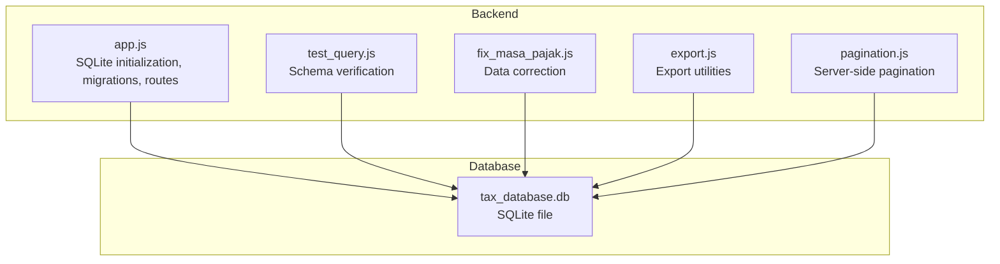
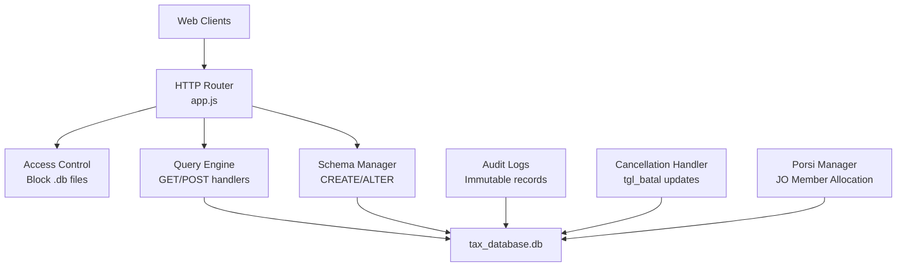
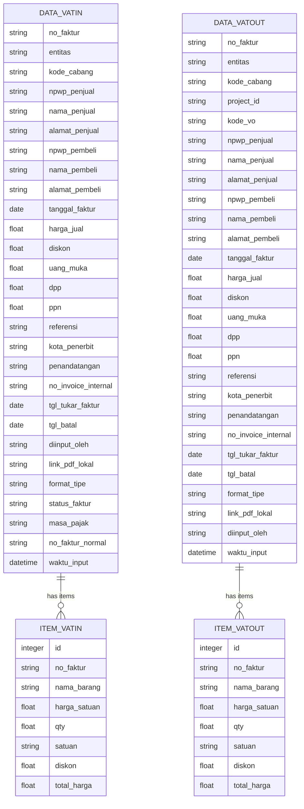
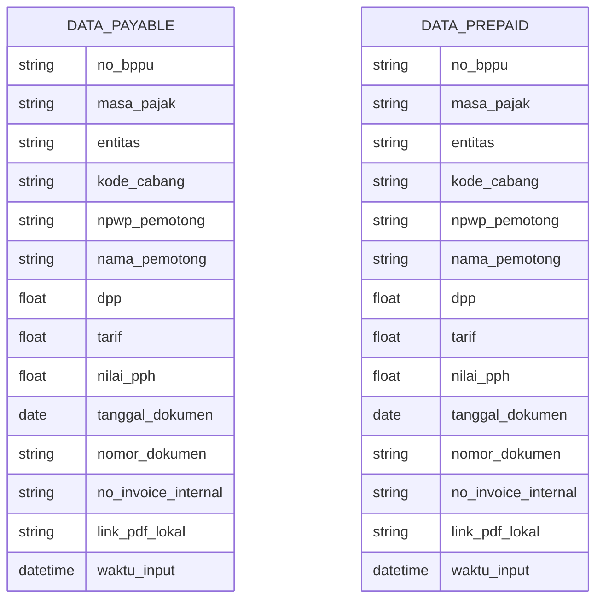
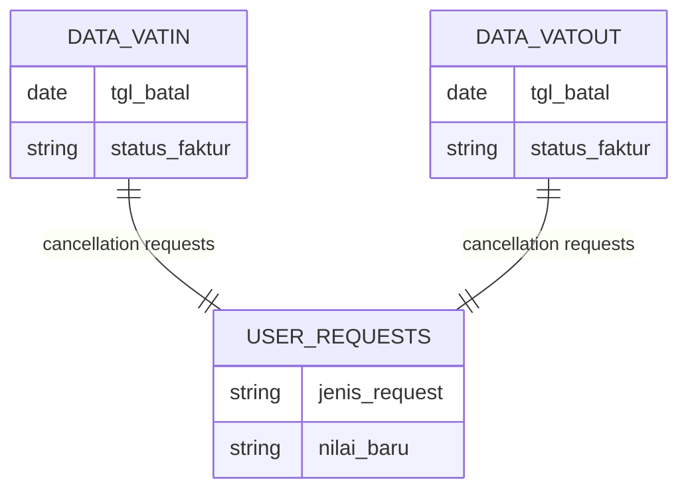
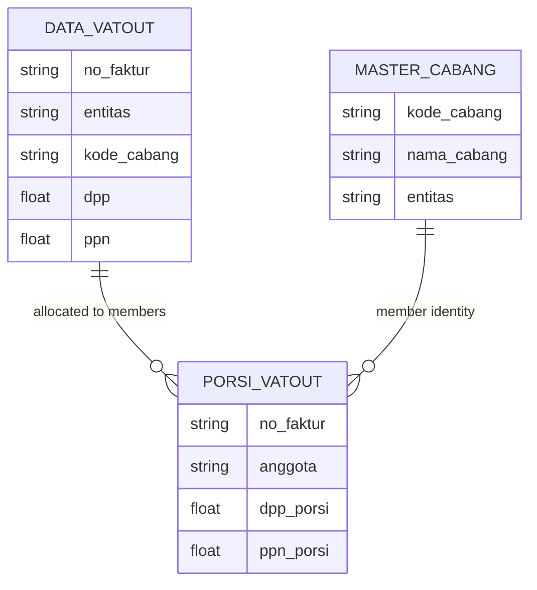
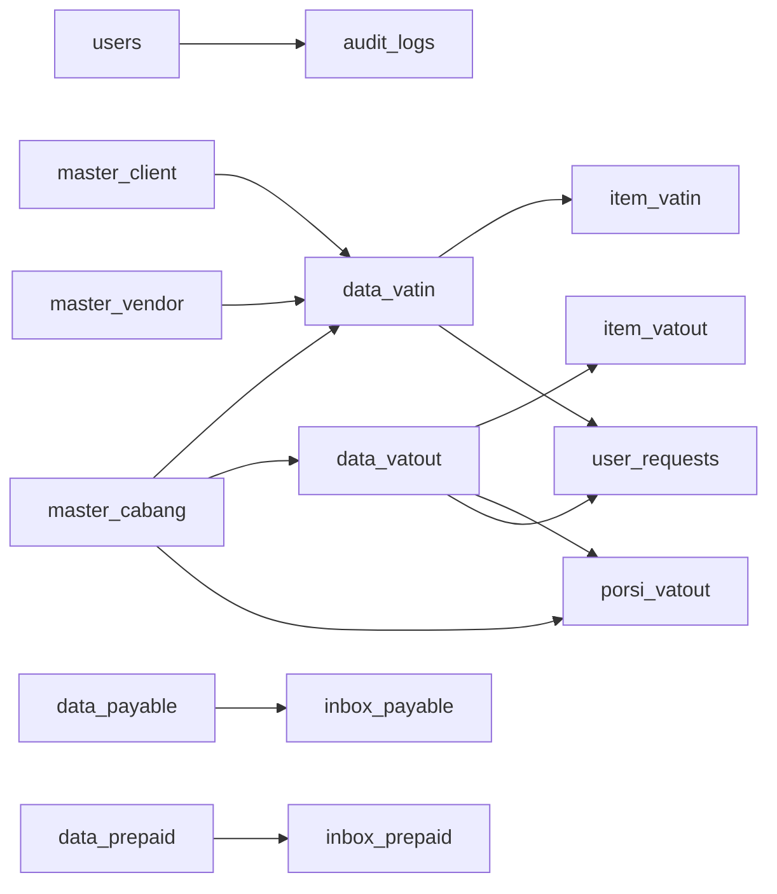

# Database Schema & Management

<cite>
**Referenced Files in This Document**
- [PRD_Tax_Database_System.md](file://PRD_Tax_Database_System.md)
- [TDS_Sequence_Diagram.md](file://TDS_Sequence_Diagram.md)
- [app.js](file://app.js)
- [taxprojectreport.html](file://taxprojectreport.html)
- [vat_out/dashboard_vatout.html](file://vat_out/dashboard_vatout.html)
- [vat_in/dashboard_vatin.html](file://vat_in/dashboard_vatin.html)
- [export.js](file://export.js)
- [pagination.js](file://pagination.js)
</cite>

## Update Summary
**Changes Made**
- Added comprehensive documentation for invoice cancellation tracking via `tgl_batal` column in VAT transaction tables
- Enhanced JO member allocation system with composite primary keys in `porsi_vatout` table
- Updated entity relationship diagrams to include cancellation workflow and porsi relationships
- Enhanced reporting section with cancellation status filtering and JO member allocation capabilities
- Added new API endpoints documentation for invoice cancellation and porsi management
- Updated data lifecycle management to include cancellation workflow and porsi allocation workflow

## Table of Contents
1. [Introduction](#introduction)
2. [Project Structure](#project-structure)
3. [Core Components](#core-components)
4. [Architecture Overview](#architecture-overview)
5. [Detailed Component Analysis](#detailed-component-analysis)
6. [Dependency Analysis](#dependency-analysis)
7. [Performance Considerations](#performance-considerations)
8. [Troubleshooting Guide](#troubleshooting-guide)
9. [Conclusion](#conclusion)
10. [Appendices](#appendices)

## Introduction
This document describes the database schema and management system used by the TDS (Tax Data System). It focuses on the SQLite-based relational model, table relationships, data models, indexing strategies, query optimization, data lifecycle management, backup procedures, and administrative guidance. It also documents PRD-derived specifications, schema evolution, and troubleshooting practices. **Updated** to include the new invoice cancellation tracking system and enhanced JO member allocation system for internal reporting.

## Project Structure
The database is implemented as a single SQLite file managed by the backend service. The backend initializes tables, enforces access controls, and exposes paginated queries to frontend modules. Supporting scripts handle data fixes, exports, and pagination.

**Diagram sources**
- [app.js:52-58](file://app.js#L52-L58)
- [export.js:1-50](file://export.js#L1-L50)
- [pagination.js:1-50](file://pagination.js#L1-L50)

**Section sources**
- [app.js:52-58](file://app.js#L52-L58)
- [PRD_Tax_Database_System.md:12-20](file://PRD_Tax_Database_System.md#L12-L20)

## Core Components
- Relational Database: SQLite3 file-based database named tax_database.db.
- Backend: Node.js with sqlite3 module for schema creation, migrations, and query execution.
- Access Control: Security middleware blocks direct access to database files.
- Pagination: Server-side LIMIT/OFFSET applied to high-volume tables.
- Audit Trail: Immutable audit logs capture all data mutations.
- Backup: Scheduled backups via Cron Job for disaster recovery.
- **Invoice Cancellation Tracking**: New `tgl_batal` column enables systematic tracking of cancelled invoices across VAT IN/OUT modules.
- **JO Member Allocation**: Enhanced porsi_vatout table with composite primary keys enables granular financial tracking per JO member while maintaining legal invoice validity under JO name.

**Section sources**
- [PRD_Tax_Database_System.md:12-20](file://PRD_Tax_Database_System.md#L12-L20)
- [PRD_Tax_Database_System.md:114-160](file://PRD_Tax_Database_System.md#L114-L160)
- [app.js:41-58](file://app.js#L41-L58)

## Architecture Overview
The system architecture centers on a single SQLite database file accessed through a Node.js backend. The backend creates tables, applies schema evolution, executes queries, and enforces access restrictions. Frontend modules consume paginated data and trigger exports. **Updated** to include invoice cancellation workflow and enhanced JO member allocation system for internal reporting.

**Diagram sources**
- [app.js:41-58](file://app.js#L41-L58)
- [app.js:341-350](file://app.js#L341-L350)
- [app.js:370-464](file://app.js#L370-L464)
- [app.js:2962-2978](file://app.js#L2962-L2978)

## Detailed Component Analysis

### Users and Access Control
- Purpose: Store credentials and roles for system users.
- Fields: id, username (unique), password, nama_lengkap, role.
- Security: Direct file access to .db is blocked to prevent unauthorized exposure.

**Section sources**
- [PRD_Tax_Database_System.md:23-26](file://PRD_Tax_Database_System.md#L23-L26)
- [app.js:41-58](file://app.js#L41-L58)

### Audit Logs
- Purpose: Immutable record of all data mutations.
- Fields: id, user_id, username, action, module, details, waktu (timestamp).
- Behavior: Insert-only, timestamp defaults to current time.

**Section sources**
- [PRD_Tax_Database_System.md:23-26](file://PRD_Tax_Database_System.md#L23-L26)

### Master Data Tables
- master_cabang: Branch reference with kode_cabang as primary key.
- master_vendor and master_client: Vendor/client references keyed by npwp; include format_tipe and tanggal_terakhir.
- master_vo: Variation order reference linked to branches.

**Section sources**
- [PRD_Tax_Database_System.md:28-31](file://PRD_Tax_Database_System.md#L28-L31)

### Projects
- Purpose: Track tax project metadata for reporting.
- Fields: id, kode, nama, deskripsi, status, progress, tanggal_mulai, tanggal_selesai, pm, anggaran, diinput_oleh.

**Section sources**
- [PRD_Tax_Database_System.md:31-32](file://PRD_Tax_Database_System.md#L31-L32)

### Transaction Modules (VAT IN/OUT)
- data_vatin: Header for input VAT invoices with comprehensive fields including buyer/seller identifiers, amounts, reference, location, signatures, invoice number, exchange date, format type, status, tax period, normalized invoice number, **invoice cancellation date**, and timestamps.
- data_vatout: Header for output VAT invoices with similar structure, including VO linkage, format type, **invoice cancellation date**, and timestamps.
- item_vatin/item_vatout: One-to-many detail lines per invoice with product info and totals.

**Diagram sources**
- [PRD_Tax_Database_System.md:34-39](file://PRD_Tax_Database_System.md#L34-L39)
- [app.js:468-470](file://app.js#L468-L470)

**Section sources**
- [PRD_Tax_Database_System.md:34-39](file://PRD_Tax_Database_System.md#L34-L39)
- [app.js:468-470](file://app.js#L468-L470)

### Payable and Prepaid Tax (BPPU)
- data_payable: Header for payable tax documents with masa_pajak, entity, branch code, withholding agent details, DPP, rate, tax amount, document date, document number, internal invoice number, and timestamps.
- data_prepaid: Header for prepaid tax claims with similar structure.
- Inbox tables: Temporary staging tables for verification before moving verified rows into data_payable/data_prepaid.

**Diagram sources**
- [PRD_Tax_Database_System.md:41-44](file://PRD_Tax_Database_System.md#L41-L44)
- [app.js:457-464](file://app.js#L457-L464)

**Section sources**
- [PRD_Tax_Database_System.md:41-44](file://PRD_Tax_Database_System.md#L41-L44)
- [app.js:457-464](file://app.js#L457-L464)

### Client Ledger
- data_client_ledger: Tracks financial history for project billing with fields for invoice number, entity, client name, income categories, advances, retention, net certificates, VAT, gross receipts/payments, debtor balances, withholding tax, net receipt, and references to related documents.

**Section sources**
- [PRD_Tax_Database_System.md:41-43](file://PRD_Tax_Database_System.md#L41-L43)

### Invoice Cancellation System
- **Purpose**: Systematic tracking of cancelled invoices with cancellation dates for both VAT IN and VAT OUT modules.
- **Implementation**: 
  - `tgl_batal` DATE column added to both `data_vatin` and `data_vatout` tables
  - Frontend cancellation workflows with supervisor approval process
  - Query filters exclude cancelled invoices from reports and summaries
  - Audit trail captures cancellation actions with timestamps
- **Business Logic**: 
  - Cancelled invoices are excluded from financial calculations and reports
  - Group-based cancellation logic for replacement invoices
  - Re-activation capability to clear cancellation status
  - Integration with project reporting to filter out cancelled transactions

**Diagram sources**
- [app.js:468-470](file://app.js#L468-L470)
- [app.js:2962-2978](file://app.js#L2962-L2978)
- [vat_in/dashboard_vatin.html:537-553](file://vat_in/dashboard_vatin.html#L537-L553)
- [vat_out/dashboard_vatout.html:561-582](file://vat_out/dashboard_vatout.html#L561-L582)

**Section sources**
- [app.js:468-470](file://app.js#L468-L470)
- [app.js:2962-2978](file://app.js#L2962-L2978)
- [vat_in/dashboard_vatin.html:537-553](file://vat_in/dashboard_vatin.html#L537-L553)
- [vat_out/dashboard_vatout.html:561-582](file://vat_out/dashboard_vatout.html#L561-L582)

### JO Member Allocation (Porsi) System
- **Purpose**: Internal reporting mechanism for recording portion allocations of DPP/PPN per JO member (BBS/BMP) while maintaining legal invoice validity under JO name.
- **Table Structure**: 
  - `no_faktur`: Links to original invoice
  - `anggota`: JO member identifier (BBS/BMP)
  - `dpp_porsi`: Allocated DPP amount for member
  - `ppn_porsi`: Allocated PPN amount for member
  - **Composite Primary Key**: `(no_faktur, anggota)` ensures unique member allocations per invoice
- **Business Logic**: 
  - Invoices remain legally valid under JO name
  - Granular financial tracking enabled per member entity
  - Automatic percentage calculation based on allocated amounts
  - Integration with project reporting for JO projects
  - **Enhanced**: Composite primary key prevents duplicate allocations and ensures data integrity

**Diagram sources**
- [app.js:365](file://app.js#L365)
- [app.js:843-848](file://app.js#L843-L848)

**Section sources**
- [app.js:365](file://app.js#L365)
- [app.js:843-848](file://app.js#L843-L848)
- [vat_out/dashboard_vatout.html:534-557](file://vat_out/dashboard_vatout.html#L534-L557)

### Inbox and Verification Flow
- Inbox tables: Temporary staging for VAT OUT and BPPU entries with status tracking and extraction data.
- Business logic: Verified rows are moved into respective transaction tables after approval.

**Section sources**
- [PRD_Tax_Database_System.md:46-49](file://PRD_Tax_Database_System.md#L46-L49)
- [app.js:449-455](file://app.js#L449-L455)

### Schema Evolution and Migrations
- Initialization: CREATE TABLE statements executed during startup for core and module-specific tables.
- Column additions: Dynamic ALTER TABLE commands append new columns to existing tables.
- Example: Adding columns to module data tables ensures backward compatibility.
- **New**: `tgl_batal` column added to VAT transaction tables for cancellation tracking.
- **Enhanced**: `porsi_vatout` table created with composite primary key for JO member allocation tracking.

**Section sources**
- [app.js:341-350](file://app.js#L341-L350)
- [app.js:370-396](file://app.js#L370-L396)
- [app.js:468-470](file://app.js#L468-L470)
- [app.js:365](file://app.js#L365)

### Data Validation Rules
- Primary keys: Enforced at schema level (e.g., npwp as PK for master tables, no_faktur/no_bppu as PK for transaction headers).
- Defaults: CURRENT_TIMESTAMP for audit/tracking fields; Pending for request status; format_tipe LEGACY for certain transactions.
- Referential intent: Foreign keys not enforced by SQLite; maintain referential integrity at application level.
- **New**: Composite primary key `(no_faktur, anggota)` in porsi_vatout ensures unique member allocations per invoice.
- **New**: `tgl_batal` field validation ensures proper date formatting for cancellation tracking.

**Section sources**
- [PRD_Tax_Database_System.md:23-31](file://PRD_Tax_Database_System.md#L23-L31)
- [PRD_Tax_Database_System.md:34-44](file://PRD_Tax_Database_System.md#L34-L44)
- [app.js:341-350](file://app.js#L341-L350)
- [app.js:365](file://app.js#L365)

### Indexing Strategies
- Primary keys: Implicitly indexed by SQLite for fast lookups.
- Recommendations: Add indexes on frequently filtered columns (e.g., masa_pajak, kode_cabang, entitas, npwp, tanggal_faktur/tanggal_dokumen).
- **New**: Composite index consideration for porsi_vatout table on `(no_faktur, anggota)` for efficient allocation lookups.
- **New**: Index optimization for `tgl_batal` column queries to improve cancellation filtering performance.

**Section sources**
- [PRD_Tax_Database_System.md:152-156](file://PRD_Tax_Database_System.md#L152-L156)
- [app.js:491-502](file://app.js#L491-L502)

### Query Optimization Techniques
- Server-side pagination: LIMIT and OFFSET applied at the database level to reduce payload sizes.
- Selective projections: Retrieve only required columns to minimize I/O.
- Prepared statements: Use parameterized queries to avoid SQL injection and enable plan reuse.
- **New**: LEFT JOIN optimization for JO member allocation queries to efficiently retrieve portioned data.
- **New**: Cancellation filtering using `(tgl_batal IS NULL OR tgl_batal = '')` pattern for consistent exclusion of cancelled invoices.

**Section sources**
- [PRD_Tax_Database_System.md:114-156](file://PRD_Tax_Database_System.md#L114-L156)
- [app.js:57-58](file://app.js#L57-L58)
- [app.js:852](file://app.js#L852)

### Data Lifecycle Management
- Staging: Inbox tables collect incoming data until verified.
- Verification: Approved rows move into transaction tables.
- Archiving: Not defined in current schema; consider partitioning or archival tables for historical data.
- **New**: Invoice cancellation lifecycle - cancelled invoices are marked with `tgl_batal` but retained for audit purposes.
- **New**: Porsi allocation lifecycle - allocations are maintained separately from legal invoices, allowing flexible internal reporting without affecting legal compliance.

**Section sources**
- [PRD_Tax_Database_System.md:46-49](file://PRD_Tax_Database_System.md#L46-L49)
- [app.js:2962-2978](file://app.js#L2962-L2978)

### Backup Procedures
- Schedule: Daily backups via Cron Job.
- Objective: Disaster recovery for tax_database.db.

**Section sources**
- [PRD_Tax_Database_System.md:156-160](file://PRD_Tax_Database_System.md#L156-L160)

### Database Administration Tasks
- Integrity checks: Periodic PRAGMA integrity-check and analysis.
- Vacuum/Analyze: Optimize storage and update statistics for large tables.
- Monitoring: Track slow queries and long-running transactions.
- **New**: Monitor cancellation rates and patterns for business insights.
- **New**: Validate composite key integrity in porsi_vatout table.

**Section sources**
- [PRD_Tax_Database_System.md:152-160](file://PRD_Tax_Database_System.md#L152-L160)

### Export and Reporting
- Export utilities: Scripts to produce spreadsheet-ready outputs for tax consolidation and ERP integration.
- **New**: Invoice cancellation filtering in export reports to exclude cancelled transactions.
- **New**: JO member allocation reporting integrated into project reports with automatic percentage calculations and member-specific breakdowns.

**Section sources**
- [export.js:1-50](file://export.js#L1-L50)
- [TDS_Sequence_Diagram.md:202-206](file://TDS_Sequence_Diagram.md#L202-L206)
- [app.js:847-852](file://app.js#L847-L852)

### API Endpoints for Invoice Cancellation and Porsi Management
- **GET /api/porsi-vatout/:faktur**: Retrieves portion allocations for a specific invoice
- **Integration**: Used by VAT Out dashboard for editing member allocations
- **Validation**: Ensures allocations match invoice totals and member identities
- **Cancellation Workflow**: Socket-based approval process for invoice cancellations with supervisor authorization

**Section sources**
- [app.js:914-918](file://app.js#L914-L918)
- [app.js:2962-2978](file://app.js#L2962-L2978)

## Dependency Analysis
The backend orchestrates schema creation and data operations. Module-specific tables depend on shared master/reference tables. Audit logs depend on users and actions. **Updated** to include invoice cancellation dependencies and enhanced porsi_vatout dependencies on both data_vatout and master_cabang tables.

**Diagram sources**
- [app.js:341-350](file://app.js#L341-L350)
- [app.js:370-464](file://app.js#L370-L464)
- [app.js:365](file://app.js#L365)
- [app.js:2962-2978](file://app.js#L2962-L2978)

**Section sources**
- [app.js:341-350](file://app.js#L341-L350)
- [app.js:370-464](file://app.js#L370-L464)
- [app.js:365](file://app.js#L365)

## Performance Considerations
- Pagination: Apply LIMIT and OFFSET to cap response sizes for large tables.
- Indexing: Add indexes on high-cardinality filter columns (masa_pajak, kode_cabang, entitas, npwp).
- Query patterns: Prefer exact-match lookups and range scans; avoid SELECT * on wide tables.
- Maintenance: Regular VACUUM and ANALYZE to keep SQLite optimized.
- **New**: Invoice cancellation filtering uses optimized WHERE clauses with `(tgl_batal IS NULL OR tgl_batal = '')` pattern.
- **New**: JO member allocation queries use LEFT JOIN optimization to efficiently combine invoice data with member allocations.
- **New**: Composite primary key in porsi_vatout improves lookup performance for member-specific allocations.

**Section sources**
- [PRD_Tax_Database_System.md:114-156](file://PRD_Tax_Database_System.md#L114-L156)
- [app.js:852](file://app.js#L852)
- [app.js:365](file://app.js#L365)

## Troubleshooting Guide
- Access Denied: Ensure .db file access is blocked by the backend.
- Slow Queries: Verify indexes exist on filter columns; review query plans.
- Schema Issues: Confirm CREATE/ALTER statements executed; check column addition logic.
- Data Fix: Use targeted scripts to correct anomalies (e.g., masa_pajak normalization).
- Exports: Validate export script outputs and formats.
- **New**: Invoice Cancellation Issues - Verify `tgl_batal` column exists and contains proper date values; check cancellation approval workflow.
- **New**: Porsi Allocation Issues - Verify composite key uniqueness in porsi_vatout table; ensure allocations sum to invoice totals; check member identity validation.

**Section sources**
- [app.js:41-58](file://app.js#L41-L58)
- [export.js:1-50](file://export.js#L1-L50)
- [app.js:2962-2978](file://app.js#L2962-L2978)
- [app.js:365](file://app.js#L365)

## Conclusion
The TDS database system employs a robust SQLite schema with clear separation of concerns across modules. The backend enforces access control, manages schema evolution, and optimizes queries through pagination and indexing. **Updated** to include the new invoice cancellation tracking system that provides systematic tracking of cancelled invoices while maintaining audit trails, and the enhanced JO member allocation system with composite primary keys that enables granular financial tracking while maintaining legal invoice validity. Adhering to the PRD guidelines ensures reliable data lifecycle management, backup, and maintainability.

## Appendices

### PRD Specifications Overview
- Database engine: SQLite3 file-based.
- Pagination: Server-side LIMIT/OFFSET.
- Load time targets: Optimized for high-volume tables.
- Backup: Daily Cron Job for tax_database.db.
- Export: Spreadsheet outputs for tax consolidation and ERP integration.
- **New**: Invoice cancellation tracking with `tgl_batal` column for systematic cancellation management.
- **New**: Enhanced JO member allocation system with composite primary keys for improved data integrity.

**Section sources**
- [PRD_Tax_Database_System.md:12-20](file://PRD_Tax_Database_System.md#L12-L20)
- [PRD_Tax_Database_System.md:114-160](file://PRD_Tax_Database_System.md#L114-L160)
- [TDS_Sequence_Diagram.md:202-206](file://TDS_Sequence_Diagram.md#L202-L206)

### Invoice Cancellation Technical Details
- **Column Addition**: `tgl_batal DATE` column added to both `data_vatin` and `data_vatout` tables
- **Business Rule**: Cancelled invoices are excluded from financial calculations and reports using `(tgl_batal IS NULL OR tgl_batal = '')` filter
- **Workflow Implementation**: 
  - Frontend cancellation modal with date picker
  - Supervisor approval process via socket-based requests
  - Audit trail captures cancellation actions with timestamps
  - Re-activation capability to clear cancellation status
- **Query Integration**: All reporting queries updated to filter out cancelled invoices

**Section sources**
- [app.js:468-470](file://app.js#L468-L470)
- [app.js:2962-2978](file://app.js#L2962-L2978)
- [vat_in/dashboard_vatin.html:537-553](file://vat_in/dashboard_vatin.html#L537-L553)
- [vat_out/dashboard_vatout.html:561-582](file://vat_out/dashboard_vatout.html#L561-L582)

### JO Member Allocation Technical Details
- **Table Creation**: `CREATE TABLE IF NOT EXISTS porsi_vatout (no_faktur TEXT, anggota TEXT, dpp_porsi REAL DEFAULT 0, ppn_porsi REAL DEFAULT 0, PRIMARY KEY (no_faktur, anggota))`
- **Business Rule**: Invoices remain legally valid under JO name while enabling granular financial tracking per member entity
- **Enhanced Features**: 
  - Composite primary key ensures unique member allocations per invoice
  - Automatic percentage calculation based on allocated amounts
  - Integration points with VAT Out dashboard and project reports
  - Validation ensures allocations match invoice totals and member identities
- **API Integration**: GET endpoint `/api/porsi-vatout/:faktur` for retrieving member allocations

**Section sources**
- [app.js:365](file://app.js#L365)
- [app.js:914-918](file://app.js#L914-L918)
- [vat_out/dashboard_vatout.html:534-557](file://vat_out/dashboard_vatout.html#L534-L557)
- [taxprojectreport.html:765-800](file://taxprojectreport.html#L765-L800)