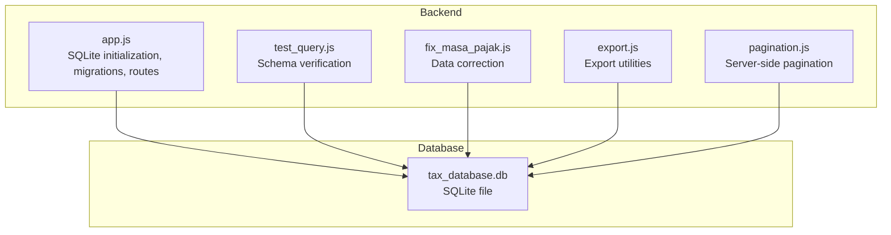
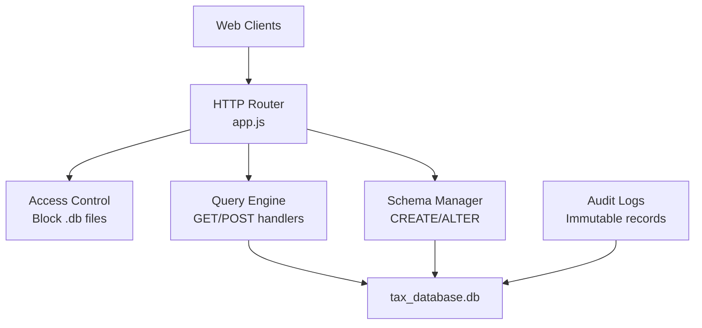
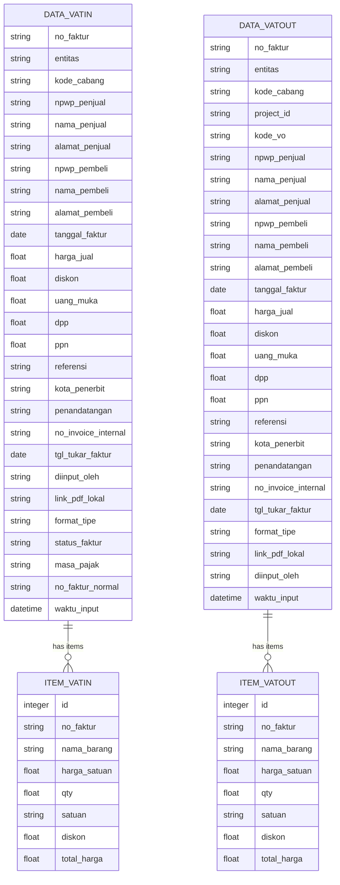
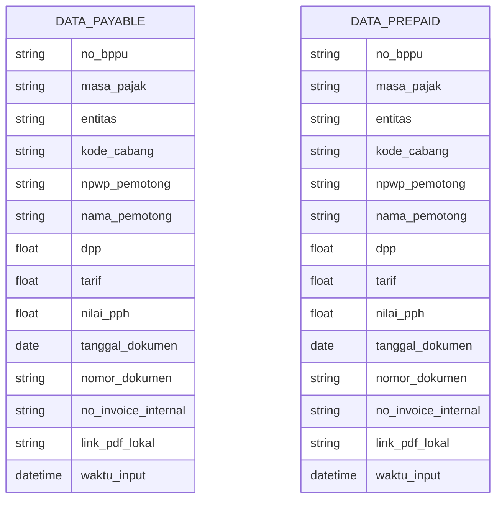
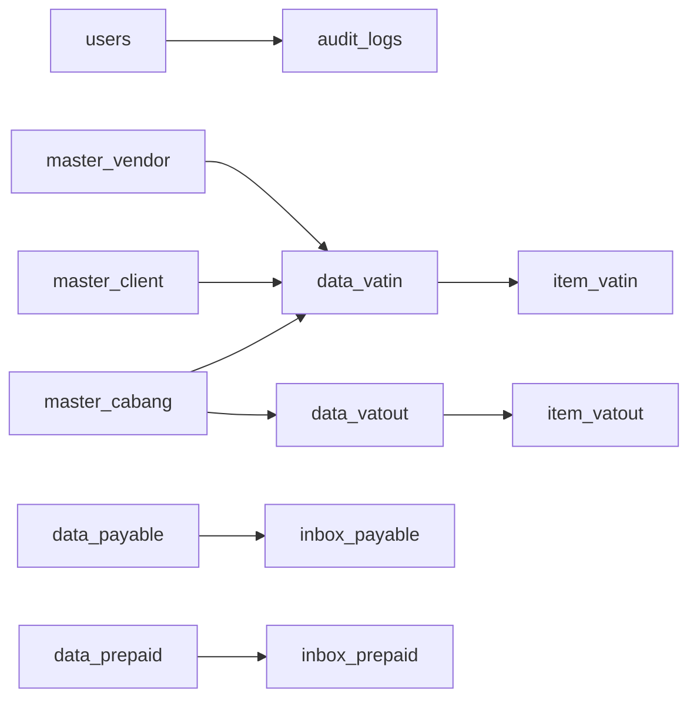

# Database Schema & Management

<cite>
**Referenced Files in This Document**
- [PRD_Tax_Database_System.md](file://PRD_Tax_Database_System.md)
- [TDS_Sequence_Diagram.md](file://TDS_Sequence_Diagram.md)
- [app.js](file://app.js)
- [test_query.js](file://test_query.js)
- [fix_masa_pajak.js](file://fix_masa_pajak.js)
- [export.js](file://export.js)
- [pagination.js](file://pagination.js)
</cite>

## Table of Contents
1. [Introduction](#introduction)
2. [Project Structure](#project-structure)
3. [Core Components](#core-components)
4. [Architecture Overview](#architecture-overview)
5. [Detailed Component Analysis](#detailed-component-analysis)
6. [Dependency Analysis](#dependency-analysis)
7. [Performance Considerations](#performance-considerations)
8. [Troubleshooting Guide](#troubleshooting-guide)
9. [Conclusion](#conclusion)
10. [Appendices](#appendices)

## Introduction
This document describes the database schema and management system used by the TDS (Tax Data System). It focuses on the SQLite-based relational model, table relationships, data models, indexing strategies, query optimization, data lifecycle management, backup procedures, and administrative guidance. It also documents PRD-derived specifications, schema evolution, and troubleshooting practices.

## Project Structure
The database is implemented as a single SQLite file managed by the backend service. The backend initializes tables, enforces access controls, and exposes paginated queries to frontend modules. Supporting scripts handle data fixes, exports, and pagination.

**Diagram sources**
- [app.js:52-58](file://app.js#L52-L58)
- [test_query.js:1-50](file://test_query.js#L1-L50)
- [fix_masa_pajak.js:1-50](file://fix_masa_pajak.js#L1-L50)
- [export.js:1-50](file://export.js#L1-L50)
- [pagination.js:1-50](file://pagination.js#L1-L50)

**Section sources**
- [app.js:52-58](file://app.js#L52-L58)
- [PRD_Tax_Database_System.md:12-20](file://PRD_Tax_Database_System.md#L12-L20)

## Core Components
- Relational Database: SQLite3 file-based database named tax_database.db.
- Backend: Node.js with sqlite3 module for schema creation, migrations, and query execution.
- Access Control: Security middleware blocks direct access to database files.
- Pagination: Server-side LIMIT/OFFSET applied to high-volume tables.
- Audit Trail: Immutable audit logs capture all data mutations.
- Backup: Scheduled backups via Cron Job for disaster recovery.

**Section sources**
- [PRD_Tax_Database_System.md:12-20](file://PRD_Tax_Database_System.md#L12-L20)
- [PRD_Tax_Database_System.md:114-160](file://PRD_Tax_Database_System.md#L114-L160)
- [app.js:41-58](file://app.js#L41-L58)

## Architecture Overview
The system architecture centers on a single SQLite database file accessed through a Node.js backend. The backend creates tables, applies schema evolution, executes queries, and enforces access restrictions. Frontend modules consume paginated data and trigger exports.

**Diagram sources**
- [app.js:41-58](file://app.js#L41-L58)
- [app.js:341-350](file://app.js#L341-L350)
- [app.js:370-464](file://app.js#L370-L464)

## Detailed Component Analysis

### Users and Access Control
- Purpose: Store credentials and roles for system users.
- Fields: id, username (unique), password, nama_lengkap, role.
- Security: Direct file access to .db is blocked to prevent unauthorized exposure.

**Section sources**
- [PRD_Tax_Database_System.md:23-26](file://PRD_Tax_Database_System.md#L23-L26)
- [app.js:41-58](file://app.js#L41-L58)

### Audit Logs
- Purpose: Immutable record of all data mutations.
- Fields: id, user_id, username, action, module, details, waktu (timestamp).
- Behavior: Insert-only, timestamp defaults to current time.

**Section sources**
- [PRD_Tax_Database_System.md:23-26](file://PRD_Tax_Database_System.md#L23-L26)

### Master Data Tables
- master_cabang: Branch reference with kode_cabang as primary key.
- master_vendor and master_client: Vendor/client references keyed by npwp; include format_tipe and tanggal_terakhir.
- master_vo: Variation order reference linked to branches.

**Section sources**
- [PRD_Tax_Database_System.md:28-31](file://PRD_Tax_Database_System.md#L28-L31)

### Projects
- Purpose: Track tax project metadata for reporting.
- Fields: id, kode, nama, deskripsi, status, progress, tanggal_mulai, tanggal_selesai, pm, anggaran, diinput_oleh.

**Section sources**
- [PRD_Tax_Database_System.md:31-32](file://PRD_Tax_Database_System.md#L31-L32)

### Transaction Modules (VAT IN/OUT)
- data_vatin: Header for input VAT invoices with comprehensive fields including buyer/seller identifiers, amounts, reference, location, signatures, invoice number, exchange date, format type, status, tax period, normalized invoice number, and timestamps.
- data_vatout: Header for output VAT invoices with similar structure, including VO linkage and format type.
- item_vatin/item_vatout: One-to-many detail lines per invoice with product info and totals.

**Diagram sources**
- [PRD_Tax_Database_System.md:34-39](file://PRD_Tax_Database_System.md#L34-L39)
- [app.js:452-455](file://app.js#L452-L455)

**Section sources**
- [PRD_Tax_Database_System.md:34-39](file://PRD_Tax_Database_System.md#L34-L39)
- [app.js:452-455](file://app.js#L452-L455)

### Payable and Prepaid Tax (BPPU)
- data_payable: Header for payable tax documents with masa_pajak, entity, branch code, withholding agent details, DPP, rate, tax amount, document date, document number, internal invoice number, and timestamps.
- data_prepaid: Header for prepaid tax claims with similar structure.
- Inbox tables: Temporary staging tables for verification before moving verified rows into data_payable/data_prepaid.

**Diagram sources**
- [PRD_Tax_Database_System.md:41-44](file://PRD_Tax_Database_System.md#L41-L44)
- [app.js:457-464](file://app.js#L457-L464)

**Section sources**
- [PRD_Tax_Database_System.md:41-44](file://PRD_Tax_Database_System.md#L41-L44)
- [app.js:457-464](file://app.js#L457-L464)

### Client Ledger
- data_client_ledger: Tracks financial history for project billing with fields for invoice number, entity, client name, income categories, advances, retention, net certificates, VAT, gross receipts/payments, debtor balances, withholding tax, net receipt, and references to related documents.

**Section sources**
- [PRD_Tax_Database_System.md:41-43](file://PRD_Tax_Database_System.md#L41-L43)

### Inbox and Verification Flow
- Inbox tables: Temporary staging for VAT OUT and BPPU entries with status tracking and extraction data.
- Business logic: Verified rows are moved into respective transaction tables after approval.

**Section sources**
- [PRD_Tax_Database_System.md:46-49](file://PRD_Tax_Database_System.md#L46-L49)
- [app.js:449-455](file://app.js#L449-L455)

### Schema Evolution and Migrations
- Initialization: CREATE TABLE statements executed during startup for core and module-specific tables.
- Column additions: Dynamic ALTER TABLE commands append new columns to existing tables.
- Example: Adding columns to module data tables ensures backward compatibility.

**Section sources**
- [app.js:341-350](file://app.js#L341-L350)
- [app.js:370-396](file://app.js#L370-L396)
- [app.js:454-455](file://app.js#L454-L455)

### Data Validation Rules
- Primary keys: Enforced at schema level (e.g., npwp as PK for master tables, no_faktur/no_bppu as PK for transaction headers).
- Defaults: CURRENT_TIMESTAMP for audit/tracking fields; Pending for request status; format_tipe LEGACY for certain transactions.
- Referential intent: Foreign keys not enforced by SQLite; maintain referential integrity at application level.

**Section sources**
- [PRD_Tax_Database_System.md:23-31](file://PRD_Tax_Database_System.md#L23-L31)
- [PRD_Tax_Database_System.md:34-44](file://PRD_Tax_Database_System.md#L34-L44)
- [app.js:341-350](file://app.js#L341-L350)

### Indexing Strategies
- Primary keys: Implicitly indexed by SQLite for fast lookups.
- Recommendations: Add indexes on frequently filtered columns (e.g., masa_pajak, kode_cabang, entitas, npwp, tanggal_faktur/tanggal_dokumen) to improve query performance on large datasets.

**Section sources**
- [PRD_Tax_Database_System.md:152-156](file://PRD_Tax_Database_System.md#L152-L156)

### Query Optimization Techniques
- Server-side pagination: LIMIT and OFFSET applied at the database level to reduce payload sizes.
- Selective projections: Retrieve only required columns to minimize I/O.
- Prepared statements: Use parameterized queries to avoid SQL injection and enable plan reuse.

**Section sources**
- [PRD_Tax_Database_System.md:114-156](file://PRD_Tax_Database_System.md#L114-L156)
- [app.js:57-58](file://app.js#L57-L58)

### Data Lifecycle Management
- Staging: Inbox tables collect incoming data until verified.
- Verification: Approved rows move into transaction tables.
- Archiving: Not defined in current schema; consider partitioning or archival tables for historical data.

**Section sources**
- [PRD_Tax_Database_System.md:46-49](file://PRD_Tax_Database_System.md#L46-L49)

### Backup Procedures
- Schedule: Daily backups via Cron Job.
- Objective: Disaster recovery for tax_database.db.

**Section sources**
- [PRD_Tax_Database_System.md:156-160](file://PRD_Tax_Database_System.md#L156-L160)

### Database Administration Tasks
- Integrity checks: Periodic PRAGMA integrity-check and analysis.
- Vacuum/Analyze: Optimize storage and update statistics for large tables.
- Monitoring: Track slow queries and long-running transactions.

**Section sources**
- [PRD_Tax_Database_System.md:152-160](file://PRD_Tax_Database_System.md#L152-L160)

### Export and Reporting
- Export utilities: Scripts to produce spreadsheet-ready outputs for tax consolidation and ERP integration.

**Section sources**
- [export.js:1-50](file://export.js#L1-L50)
- [TDS_Sequence_Diagram.md:202-206](file://TDS_Sequence_Diagram.md#L202-L206)

## Dependency Analysis
The backend orchestrates schema creation and data operations. Module-specific tables depend on shared master/reference tables. Audit logs depend on users and actions.

**Diagram sources**
- [app.js:341-350](file://app.js#L341-L350)
- [app.js:370-464](file://app.js#L370-L464)

**Section sources**
- [app.js:341-350](file://app.js#L341-L350)
- [app.js:370-464](file://app.js#L370-L464)

## Performance Considerations
- Pagination: Apply LIMIT and OFFSET to cap response sizes for large tables.
- Indexing: Add indexes on high-cardinality filter columns (masa_pajak, kode_cabang, entitas, npwp).
- Query patterns: Prefer exact-match lookups and range scans; avoid SELECT * on wide tables.
- Maintenance: Regular VACUUM and ANALYZE to keep SQLite optimized.

**Section sources**
- [PRD_Tax_Database_System.md:114-156](file://PRD_Tax_Database_System.md#L114-L156)

## Troubleshooting Guide
- Access Denied: Ensure .db file access is blocked by the backend.
- Slow Queries: Verify indexes exist on filter columns; review query plans.
- Schema Issues: Confirm CREATE/ALTER statements executed; check column addition logic.
- Data Fix: Use targeted scripts to correct anomalies (e.g., masa_pajak normalization).
- Exports: Validate export script outputs and formats.

**Section sources**
- [app.js:41-58](file://app.js#L41-L58)
- [fix_masa_pajak.js:1-50](file://fix_masa_pajak.js#L1-L50)
- [test_query.js:1-50](file://test_query.js#L1-L50)

## Conclusion
The TDS database system employs a robust SQLite schema with clear separation of concerns across modules. The backend enforces access control, manages schema evolution, and optimizes queries through pagination and indexing. Adhering to the PRD guidelines ensures reliable data lifecycle management, backup, and maintainability.

## Appendices

### PRD Specifications Overview
- Database engine: SQLite3 file-based.
- Pagination: Server-side LIMIT/OFFSET.
- Load time targets: Optimized for high-volume tables.
- Backup: Daily Cron Job for tax_database.db.
- Export: Spreadsheet outputs for tax consolidation and ERP integration.

**Section sources**
- [PRD_Tax_Database_System.md:12-20](file://PRD_Tax_Database_System.md#L12-L20)
- [PRD_Tax_Database_System.md:114-160](file://PRD_Tax_Database_System.md#L114-L160)
- [TDS_Sequence_Diagram.md:202-206](file://TDS_Sequence_Diagram.md#L202-L206)