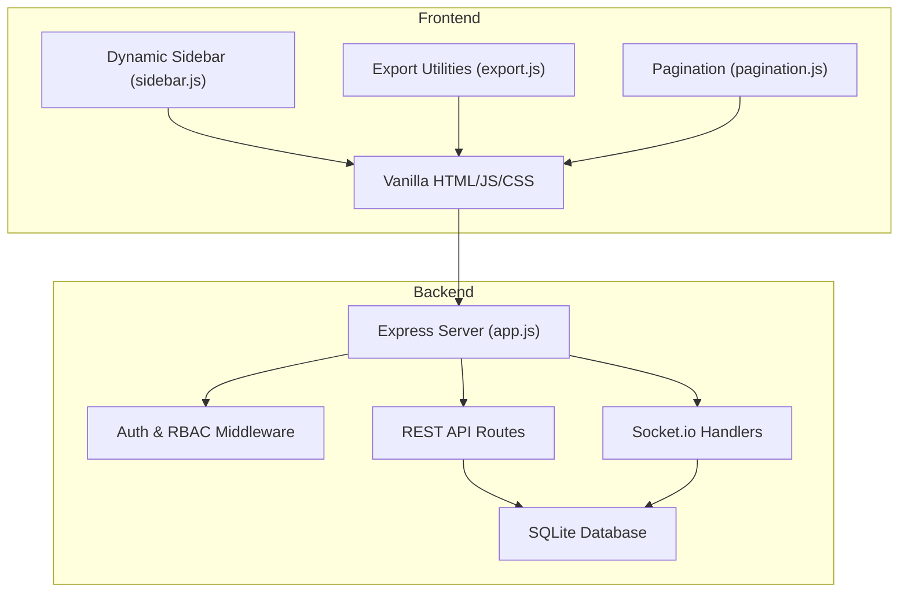
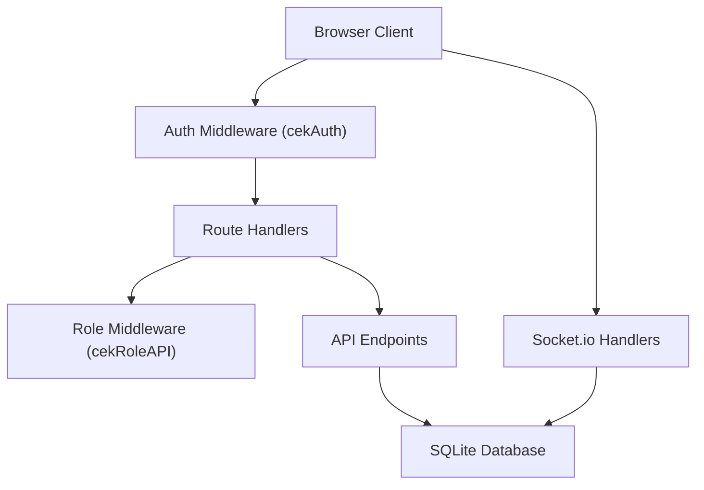
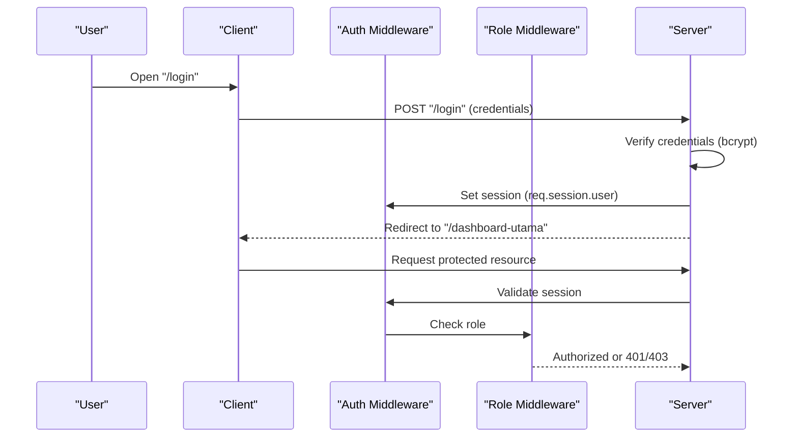
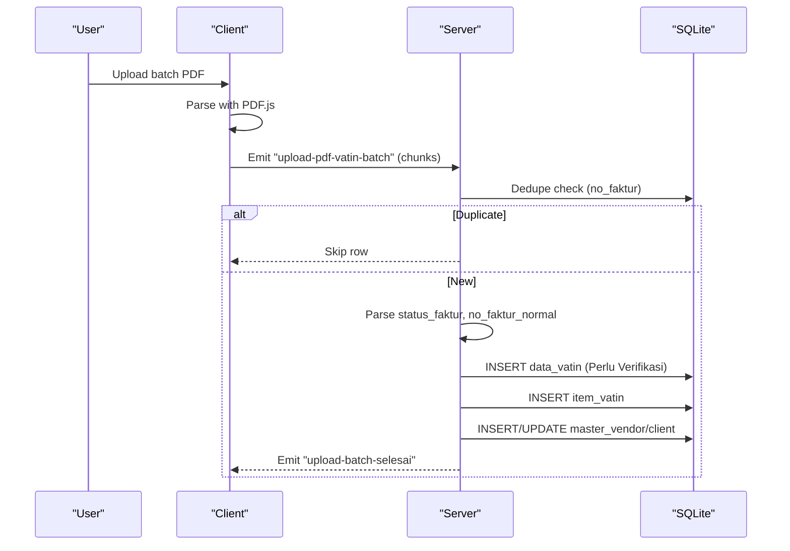
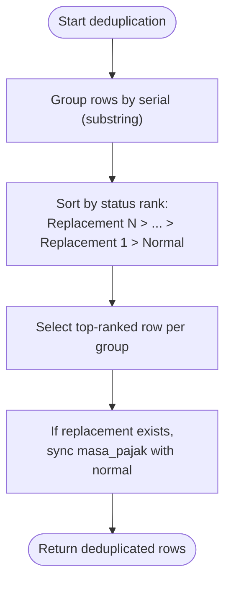
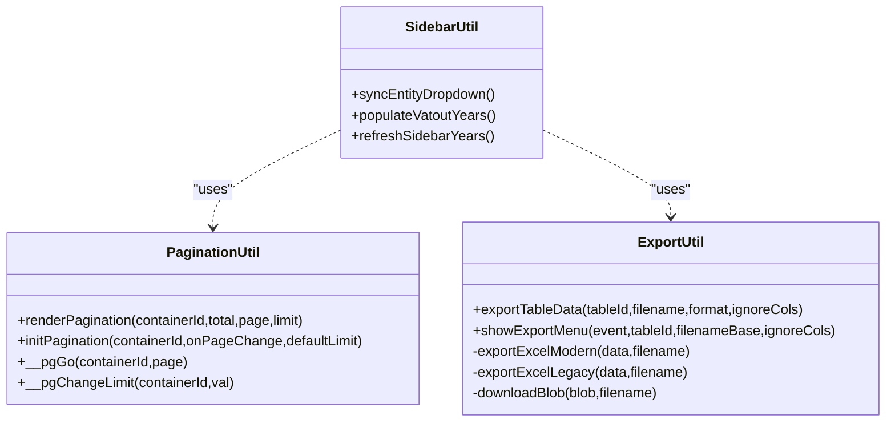
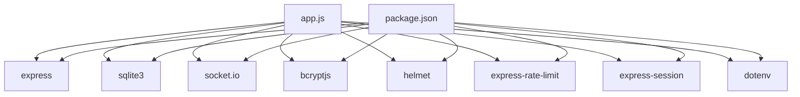
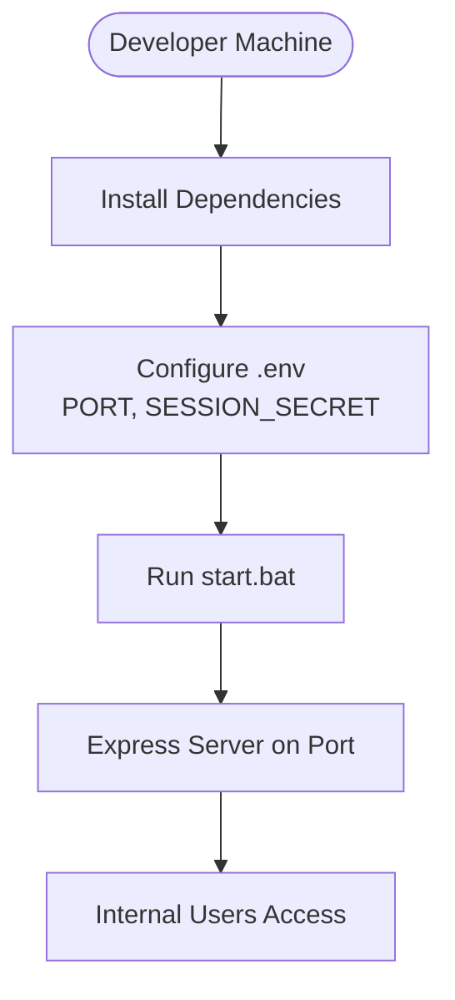

# Development Guidelines

<cite>
**Referenced Files in This Document**
- [README.md](file://README.md)
- [PRD_Tax_Database_System.md](file://PRD_Tax_Database_System.md)
- [TDS_Sequence_Diagram.md](file://TDS_Sequence_Diagram.md)
- [TODO.md](file://TODO.md)
- [package.json](file://package.json)
- [app.js](file://app.js)
- [sidebar.js](file://sidebar.js)
- [export.js](file://export.js)
- [pagination.js](file://pagination.js)
- [fix_masa_pajak.js](file://fix_masa_pajak.js)
- [start.bat](file://start.bat)
</cite>

## Table of Contents
1. [Introduction](#introduction)
2. [Project Structure](#project-structure)
3. [Core Components](#core-components)
4. [Architecture Overview](#architecture-overview)
5. [Detailed Component Analysis](#detailed-component-analysis)
6. [Dependency Analysis](#dependency-analysis)
7. [Performance Considerations](#performance-considerations)
8. [Testing and Quality Assurance](#testing-and-quality-assurance)
9. [Deployment and Environment Configuration](#deployment-and-environment-configuration)
10. [Version Control and Release Management](#version-control-and-release-management)
11. [Extending Functionality and Maintaining Compatibility](#extending-functionality-and-maintaining-compatibility)
12. [Debugging and Troubleshooting](#debugging-and-troubleshooting)
13. [Conclusion](#conclusion)

## Introduction
This document provides comprehensive development guidelines and best practices for the Tax Database System (TDS). It consolidates code standards, architectural patterns, development workflows, contribution guidelines, testing strategies, quality assurance processes, deployment procedures, environment configuration, production readiness requirements, debugging techniques, performance profiling, optimization strategies, version control practices, code review processes, release management, extension guidance, and troubleshooting procedures. The goal is to enable consistent, secure, and maintainable development across the TDS codebase.

## Project Structure
The TDS project is a Node.js/Express application with a vanilla HTML/JavaScript/CSS frontend and a SQLite database. Key characteristics:
- Backend: Express server with middleware for sessions, rate limiting, and security headers.
- Frontend: Pure HTML/JS/CSS with modular scripts for pagination, export, and dynamic sidebar population.
- Real-time: Socket.io for batch PDF uploads and live UI updates.
- Data: SQLite3 database with normalized relational tables and indexes for performance.
- Modules: VAT IN, VAT OUT, BPPU payable/prepaid, and client ledger integrated under unified routing and RBAC.

**Diagram sources**
- [app.js](file://app.js)
- [sidebar.js](file://sidebar.js)
- [export.js](file://export.js)
- [pagination.js](file://pagination.js)

**Section sources**
- [PRD_Tax_Database_System.md](file://PRD_Tax_Database_System.md)
- [package.json](file://package.json)
- [app.js](file://app.js)

## Core Components
- Express server initialization, middleware stack, and security configurations.
- Database bootstrap with table creation, migrations, and indexing.
- Authentication and RBAC enforcement via session middleware and role-based API guards.
- Real-time ingestion pipeline using Socket.io for batch PDF uploads.
- Data extraction helpers for parsing invoice texts and deduplicating VAT IN records.
- Frontend utilities for server-side pagination, export to CSV/XLSX, and dynamic sidebar generation.

**Section sources**
- [app.js](file://app.js)
- [sidebar.js](file://sidebar.js)
- [export.js](file://export.js)
- [pagination.js](file://pagination.js)

## Architecture Overview
The system follows a layered architecture:
- Presentation Layer: Static HTML pages and modular JS scripts.
- Application Layer: Express routes, middleware, and Socket.io handlers.
- Data Layer: SQLite database with relational tables and indexes.
- Security Layer: Helmet, rate limiting, session management, and RBAC.

**Diagram sources**
- [app.js](file://app.js)

**Section sources**
- [PRD_Tax_Database_System.md](file://PRD_Tax_Database_System.md)
- [TDS_Sequence_Diagram.md](file://TDS_Sequence_Diagram.md)
- [app.js](file://app.js)

## Detailed Component Analysis

### Authentication and Authorization
- Session-based authentication with strict cookie policies (HttpOnly, SameSite strict).
- Role-based access control enforced via middleware for sensitive routes and APIs.
- Rate limiting applied to login attempts to mitigate brute-force attacks.
- Security headers configured via Helmet; inline script allowance temporarily disabled for compatibility.

**Diagram sources**
- [app.js](file://app.js)

**Section sources**
- [app.js](file://app.js)

### Real-Time Batch Ingestion Pipeline
- Client-side PDF parsing using PDF.js.
- Chunked upload via Socket.io events for robustness and responsiveness.
- Deduplication checks on invoice numbers and staging tables.
- Automatic insertion into operational tables with master data updates.

**Diagram sources**
- [app.js](file://app.js)
- [TDS_Sequence_Diagram.md](file://TDS_Sequence_Diagram.md)

**Section sources**
- [app.js](file://app.js)
- [TDS_Sequence_Diagram.md](file://TDS_Sequence_Diagram.md)

### Data Deduplication and Replacement Invoices
- VAT IN deduplication logic groups by invoice serial and selects the highest-status record (replacement with higher rank overrides normal).
- Replacement invoices synchronize masa_pajak with their normal counterpart.

**Diagram sources**
- [app.js](file://app.js)

**Section sources**
- [app.js](file://app.js)

### Frontend Utilities
- Dynamic sidebar generation with entity persistence and year dropdown population.
- Server-side pagination with configurable limits and debounce-friendly filtering.
- Export utilities supporting CSV and modern Excel (.xlsx) with styling and frozen headers.

**Diagram sources**
- [sidebar.js](file://sidebar.js)
- [pagination.js](file://pagination.js)
- [export.js](file://export.js)

**Section sources**
- [sidebar.js](file://sidebar.js)
- [pagination.js](file://pagination.js)
- [export.js](file://export.js)

## Dependency Analysis
External dependencies include Express, Socket.io, SQLite3, bcrypt, helmet, express-rate-limit, express-session, and dotenv. These enable the web server, real-time communication, database operations, authentication, security hardening, and environment configuration.

**Diagram sources**
- [package.json](file://package.json)
- [app.js](file://app.js)

**Section sources**
- [package.json](file://package.json)
- [app.js](file://app.js)

## Performance Considerations
- Server-side pagination with LIMIT/OFFSET and debounced filters to handle large datasets efficiently.
- Database indexing on frequently queried columns to reduce query times.
- Client-side chunked uploads via Socket.io to avoid UI freezing during bulk operations.
- Currency and date sanitization helpers to normalize numeric and temporal data.

Recommendations:
- Monitor query plans and adjust indexes based on actual usage.
- Consider partitioning strategies for very large datasets.
- Profile CPU and memory usage during PDF parsing and export operations.

**Section sources**
- [PRD_Tax_Database_System.md](file://PRD_Tax_Database_System.md)
- [app.js](file://app.js)
- [pagination.js](file://pagination.js)

## Testing and Quality Assurance
Current state:
- Manual verification checkpoints documented in the project’s TODO list.
- Planned audit endpoints for VAT IN integrity checks.

Recommended practices:
- Implement unit tests for data extraction and deduplication helpers.
- Add integration tests for Socket.io ingestion flows and API endpoints.
- Establish automated linting and static analysis for JavaScript and Node.js code.
- Create regression tests for pagination and export utilities.

**Section sources**
- [TODO.md](file://TODO.md)
- [app.js](file://app.js)

## Deployment and Environment Configuration
- Start script launches the server with a local IP detection utility.
- Environment variables include port and session secret; the latter is mandatory for startup.
- Production readiness requires:
  - Strong session secret management.
  - HTTPS termination at the edge or reverse proxy.
  - Database backup automation and disaster recovery procedures.
  - Strict Content Security Policy and hardened headers.

**Diagram sources**
- [start.bat](file://start.bat)
- [app.js](file://app.js)

**Section sources**
- [start.bat](file://start.bat)
- [PRD_Tax_Database_System.md](file://PRD_Tax_Database_System.md)
- [app.js](file://app.js)

## Version Control and Release Management
- Use Git for source control with clear commit messages and feature branches.
- Maintain a changelog and semantic versioning for releases.
- Enforce pull requests with mandatory reviews before merging to main.
- Tag releases and document breaking changes and migration steps.

[No sources needed since this section provides general guidance]

## Extending Functionality and Maintaining Compatibility
- Follow established patterns for adding new modules:
  - Define module metadata and archive directories.
  - Create staging and operational tables with appropriate columns.
  - Implement ingestion pipeline with deduplication and master data updates.
  - Add RBAC-protected routes and Socket.io handlers.
- Preserve backward compatibility by:
  - Adding optional columns via ALTER TABLE with defaults.
  - Migrating existing data on startup with safe fallbacks.
  - Keeping UI labels and statuses consistent across modules.

**Section sources**
- [app.js](file://app.js)

## Debugging and Troubleshooting
Common areas to inspect:
- Authentication failures: verify session secret and login limiter thresholds.
- Database errors: check migrations and index creation logs.
- Socket.io connection issues: confirm shared session middleware and handshake.
- Export problems: validate presence of XLSX library and column exclusions.

Diagnostic utilities:
- Audit logs endpoint for immutable activity tracking.
- Migration verification endpoints for VAT IN status and masa_pajak synchronization.
- Dedicated maintenance script to fix masa_pajak for replacement invoices.

**Section sources**
- [app.js](file://app.js)
- [fix_masa_pajak.js](file://fix_masa_pajak.js)

## Conclusion
These guidelines consolidate the current architecture, workflows, and best practices for TDS development. By adhering to the outlined standards—security-first design, modular extensions, rigorous testing, and robust deployment—you can ensure a scalable, maintainable, and compliant tax database system tailored for internal corporate use.