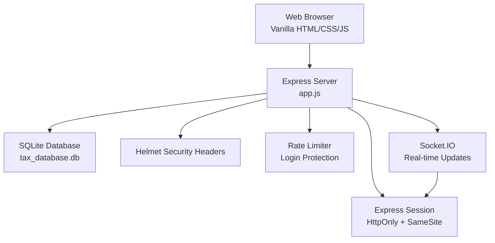

# Getting Started

<cite>
**Referenced Files in This Document**
- [README.md](file://README.md)
- [PRD_Tax_Database_System.md](file://PRD_Tax_Database_System.md)
- [package.json](file://package.json)
- [app.js](file://app.js)
- [start.bat](file://start.bat)
- [login.html](file://login.html)
- [dashboard_utama.html](file://dashboard_utama.html)
- [style.css](file://style.css)
- [sidebar.js](file://sidebar.js)
- [theme.js](file://theme.js)
- [pagination.js](file://pagination.js)
- [export.js](file://export.js)
- [test_query.js](file://test_query.js)
</cite>

## Table of Contents
1. [Introduction](#introduction)
2. [Prerequisites](#prerequisites)
3. [Installation](#installation)
4. [Initial Setup](#initial-setup)
5. [First-Time User Setup](#first-time-user-setup)
6. [Basic Navigation](#basic-navigation)
7. [System Requirements](#system-requirements)
8. [Security Configuration](#security-configuration)
9. [Architecture Overview](#architecture-overview)
10. [Troubleshooting](#troubleshooting)
11. [Verification Checklist](#verification-checklist)
12. [Conclusion](#conclusion)

## Introduction
Welcome to the TDS (Tax Database System) by Rendi Siagian. This guide helps you install, configure, and start using the system quickly. TDS is a web-based tax management platform built with Node.js and SQLite, designed for corporate tax operations including VAT input/output, withholding tax (BPPU), and project profitability reporting.

## Prerequisites
Before installing TDS, ensure your environment meets the following requirements:

- **Node.js**: The project targets Node.js runtime. The included startup script configures a specific Node.js path for Windows. Verify your system can run Node.js commands.
- **Operating System**: Tested on Windows with the provided batch script; Linux/macOS users can adapt the startup procedure accordingly.
- **Browser Compatibility**: The system is designed for modern browsers (Chrome, Edge, Firefox, Safari). It uses vanilla HTML, CSS, and JavaScript with native dark mode support.
- **SQLite**: The backend uses SQLite3 for local data persistence. No external database service is required.
- **Ports**: The server listens on port 3000 by default. Ensure this port is free or adjust the configuration as needed.

**Section sources**
- [PRD_Tax_Database_System.md:10-17](file://PRD_Tax_Database_System.md#L10-L17)
- [start.bat:21-22](file://start.bat#L21-L22)
- [package.json:1-20](file://package.json#L1-L20)

## Installation
Follow these steps to install and launch TDS:

1. **Clone or Download the Repository**
   - Obtain the project files to your local machine.

2. **Install Dependencies**
   - Open a terminal/command prompt in the project root.
   - Run the dependency installer to fetch required packages:
     ```
     npm install
     ```

3. **Launch the Application**
   - On Windows, use the provided batch script:
     ```
     start.bat
     ```
   - Alternatively, start manually with:
     ```
     npm start
     ```
   - The server starts on http://localhost:3000 by default.

4. **Verify Installation**
   - Open your browser and navigate to http://localhost:3000.
   - You should see the login page.

**Section sources**
- [start.bat:1-27](file://start.bat#L1-L27)
- [package.json:16-18](file://package.json#L16-L18)
- [app.js:16](file://app.js#L16)

## Initial Setup
On first launch, the system performs automatic initialization:

- **Database Creation**: A SQLite database file named tax_database.db is created automatically.
- **Default Users**: Two default users are created during initialization:
  - Username: admin
  - Username: rendisiagian
  - Default password: Emergent@2024!
- **Master Data**: Initial branch/corporate data is populated for internal use.

Important: Change the default passwords immediately after first login.

**Section sources**
- [app.js:399-407](file://app.js#L399-L407)
- [PRD_Tax_Database_System.md:20-50](file://PRD_Tax_Database_System.md#L20-L50)

## First-Time User Setup
1. **Access the Login Page**
   - Navigate to http://localhost:3000 in your browser.
   - The login interface is implemented in login.html.

2. **Log In**
   - Use one of the default accounts:
     - admin
     - rendisiagian
   - Enter the default password: Emergent@2024!

3. **Change Password**
   - After logging in, go to your profile and change the default password.
   - This is a critical security step.

4. **Explore the Dashboard**
   - The main dashboard (dashboard_utama.html) provides quick access to all modules and summaries.

**Section sources**
- [login.html:1-46](file://login.html#L1-L46)
- [dashboard_utama.html:1-1070](file://dashboard_utama.html#L1-L1070)

## Basic Navigation
Once logged in, use the sidebar to navigate between modules:

- **Sidebar Rendering**: The sidebar is dynamically loaded via sidebar.js.
- **Theme Toggle**: The theme.js file supports light/dark mode switching.
- **Styling**: Global styles are defined in style.css, including responsive layouts and card-based UI components.

Navigation tips:
- Use the sidebar links to access VAT modules, BPPU modules, client ledger, and administrative pages.
- The dashboard provides quick module summaries and recent transactions.

**Section sources**
- [sidebar.js](file://sidebar.js)
- [theme.js](file://theme.js)
- [style.css:1-800](file://style.css#L1-L800)
- [dashboard_utama.html:568-569](file://dashboard_utama.html#L568-L569)

## System Requirements
- **Runtime Environment**: Node.js V8 engine (as indicated in the PRD).
- **Database**: SQLite3 (file-based, no server process).
- **Frontend**: Vanilla HTML5, CSS3, and JavaScript (ES6+).
- **Real-time Communication**: Socket.io for batch uploads and live updates.
- **Browser Support**: Modern browsers (Chrome, Edge, Firefox, Safari).
- **File Processing**: PDF.js for extracting text from tax documents.

**Section sources**
- [PRD_Tax_Database_System.md:10-17](file://PRD_Tax_Database_System.md#L10-L17)
- [package.json:1-11](file://package.json#L1-L11)

## Security Configuration
Security measures implemented by the system:

- **Session Management**: Sessions are configured with HttpOnly cookies and SameSite strict policies.
- **Rate Limiting**: Login attempts are rate-limited to prevent brute force attacks.
- **Helmet Protection**: Content Security Policy and related headers are enabled (with temporary allowances for inline scripts).
- **Secret Validation**: The server requires a SESSION_SECRET environment variable; startup fails if missing.
- **Direct Access Blocking**: Attempts to access .db files are blocked.

Recommended actions:
- Set a strong SESSION_SECRET in your environment.
- Change default passwords immediately.
- Restrict network exposure to trusted environments.

**Section sources**
- [app.js:63-77](file://app.js#L63-L77)
- [app.js:80-87](file://app.js#L80-L87)
- [app.js:17-21](file://app.js#L17-L21)
- [app.js:42-49](file://app.js#L42-L49)

## Architecture Overview
High-level architecture of TDS:



**Diagram sources**
- [app.js:1-15](file://app.js#L1-L15)
- [app.js:63-77](file://app.js#L63-L77)
- [app.js:80-87](file://app.js#L80-L87)
- [package.json:1-11](file://package.json#L1-L11)

## Troubleshooting
Common issues and resolutions:

- **Port Already in Use**
  - The server runs on port 3000 by default. If occupied, change the PORT environment variable or stop the conflicting service.
  - Reference: [app.js:16](file://app.js#L16)

- **Missing SESSION_SECRET**
  - The server exits with an error if SESSION_SECRET is not found. Set it in your environment.
  - Reference: [app.js:17-21](file://app.js#L17-L21)

- **Cannot Access Login Page**
  - Ensure the server is running and reachable at http://localhost:3000.
  - Confirm static assets are served correctly.

- **Database Initialization Failures**
  - Verify write permissions in the project directory for tax_database.db creation.
  - Check Node.js and sqlite3 module installation.

- **PDF Upload Issues**
  - Ensure the browser supports the features used by the frontend (modern JS and fetch APIs).
  - Confirm Socket.IO connection is established.

**Section sources**
- [app.js:16](file://app.js#L16)
- [app.js:17-21](file://app.js#L17-L21)

## Verification Checklist
After installation, confirm the following:

- [ ] Server starts without errors and displays the login page at http://localhost:3000.
- [ ] Default users are present in the database (admin, rendisiagian).
- [ ] Default passwords are changed for all accounts.
- [ ] Dashboard loads and shows module summaries.
- [ ] Sidebar renders correctly and links are functional.
- [ ] Theme toggle switches between light and dark modes.
- [ ] Rate limiting protects login attempts.
- [ ] Direct access to .db files is blocked.

**Section sources**
- [app.js:399-407](file://app.js#L399-L407)
- [login.html:1-46](file://login.html#L1-L46)
- [dashboard_utama.html:1-1070](file://dashboard_utama.html#L1-L1070)
- [theme.js](file://theme.js)
- [sidebar.js](file://sidebar.js)
- [app.js:42-49](file://app.js#L42-L49)
- [app.js:80-87](file://app.js#L80-L87)

## Conclusion
You are now ready to use TDS for managing tax-related data. Start by changing default passwords, exploring the dashboard, and familiarizing yourself with the modules. For advanced tasks like exporting reports or testing queries, use the provided utilities and scripts.