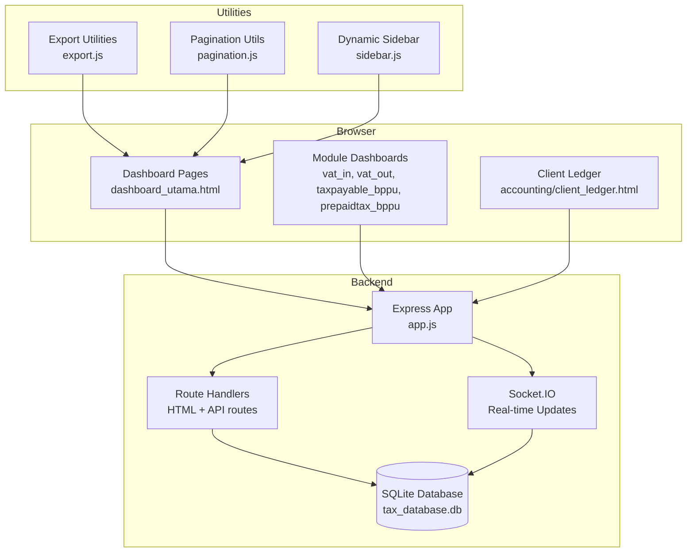
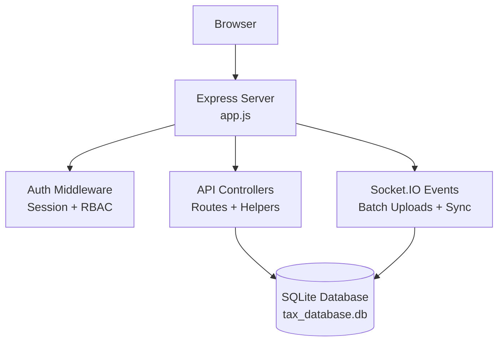
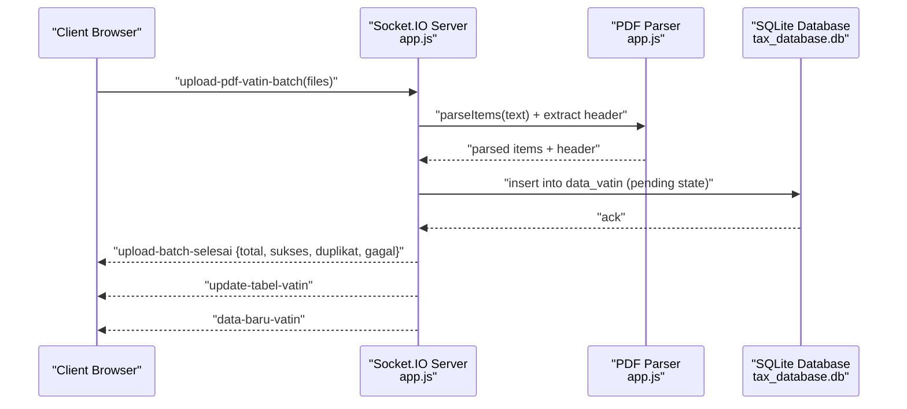
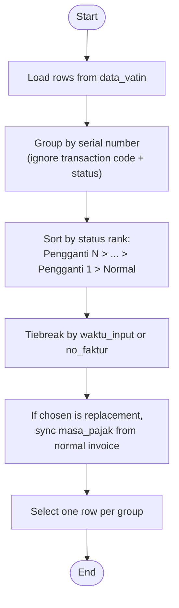
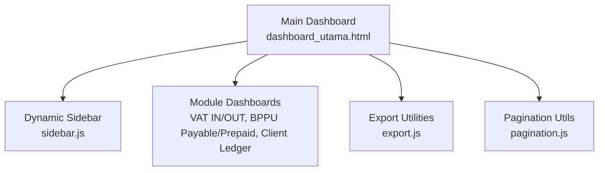
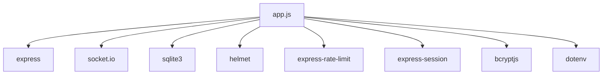

# Project Overview

<cite>
**Referenced Files in This Document**
- [PRD_Tax_Database_System.md](file://PRD_Tax_Database_System.md)
- [package.json](file://package.json)
- [app.js](file://app.js)
- [dashboard_utama.html](file://dashboard_utama.html)
- [export.js](file://export.js)
- [pagination.js](file://pagination.js)
- [sidebar.js](file://sidebar.js)
</cite>

## Table of Contents
1. [Introduction](#introduction)
2. [Project Structure](#project-structure)
3. [Core Components](#core-components)
4. [Architecture Overview](#architecture-overview)
5. [Detailed Component Analysis](#detailed-component-analysis)
6. [Dependency Analysis](#dependency-analysis)
7. [Performance Considerations](#performance-considerations)
8. [Troubleshooting Guide](#troubleshooting-guide)
9. [Conclusion](#conclusion)

## Introduction
The Tax Database System (TDS) is a comprehensive web-based tax management solution designed for corporate tax operations. It centralizes VAT transactions (VAT IN and VAT OUT), Tax Deducted at Source (TDS) tracking via BPPU (Payable and Prepaid), and tax payable monitoring across multiple business branches. Built as a single source of truth, TDS accelerates data extraction from PDF tax documents, automates invoice categorization, and provides real-time dashboards and audit trails for compliance and profitability insights.

Target audiences:
- Executives and finance leaders: Strategic visibility into tax positions, VAT balances, and project profitability.
- Accounting and tax staff: Daily transaction capture, batch uploads, verification, and reconciliation.
- Administrators and supervisors: User management, master data governance, and approval workflows.

Key benefits:
- Digital-first tax lifecycle automation from PDF ingestion to reporting.
- Real-time collaboration with role-based access control (RBAC) and immutable audit logs.
- Scalable server-side pagination and filtering for large datasets.
- Multi-module integration across VAT, TDS, and client ledger for holistic financial oversight.

## Project Structure
The system follows a modular, file-based organization with a Node.js/Express backend serving static HTML pages and REST APIs, backed by SQLite. Modules include VAT IN, VAT OUT, Tax Payable (BPPU Payable), Prepaid Tax (BPPU Prepaid), and Client Ledger. Real-time updates are enabled via Socket.IO for batch PDF uploads and live UI synchronization.

**Diagram sources**
- [app.js](file://app.js)
- [dashboard_utama.html](file://dashboard_utama.html)
- [export.js](file://export.js)
- [pagination.js](file://pagination.js)
- [sidebar.js](file://sidebar.js)

**Section sources**
- [PRD_Tax_Database_System.md](file://PRD_Tax_Database_System.md)
- [package.json](file://package.json)
- [app.js](file://app.js)

## Core Components
- Authentication and RBAC: Session-based middleware enforces access control across HTML pages and API endpoints. Roles include administrator, supervisor, and accounting/tax staff.
- Real-time PDF ingestion: Socket.IO handles batch PDF uploads, parsing, deduplication, and immediate UI feedback.
- Server-side pagination and filtering: Efficiently renders large datasets with configurable limits and debounce-based search.
- Audit logging: Immutable records track all data mutations for compliance and traceability.
- Export utilities: CSV and Excel exports support downstream ERP integration and reporting.

**Section sources**
- [PRD_Tax_Database_System.md](file://PRD_Tax_Database_System.md)
- [app.js](file://app.js)
- [export.js](file://export.js)
- [pagination.js](file://pagination.js)

## Architecture Overview
TDS employs a layered architecture:
- Presentation Layer: Static HTML pages rendered server-side with embedded JavaScript for interactivity.
- Application Layer: Express routes serve views, handle authentication, and expose REST endpoints.
- Data Access Layer: SQLite database with auto-created tables and indexes optimized for tax queries.
- Real-time Layer: Socket.IO sockets synchronize batch uploads and live table updates.

**Diagram sources**
- [app.js](file://app.js)

**Section sources**
- [PRD_Tax_Database_System.md](file://PRD_Tax_Database_System.md)
- [package.json](file://package.json)
- [app.js](file://app.js)

## Detailed Component Analysis

### Real-Time PDF Batch Upload Pipeline (VAT IN)
This pipeline demonstrates end-to-end processing of PDF tax documents with deduplication and immediate UI updates.

**Diagram sources**
- [app.js](file://app.js)

**Section sources**
- [PRD_Tax_Database_System.md](file://PRD_Tax_Database_System.md)
- [app.js](file://app.js)

### VAT Replacement Invoice Deduplication Logic
The system ensures accurate aggregation by selecting the highest-status invoice (replacement hierarchy) per serial number and synchronizing tax periods.

**Diagram sources**
- [app.js](file://app.js)

**Section sources**
- [PRD_Tax_Database_System.md](file://PRD_Tax_Database_System.md)
- [app.js](file://app.js)

### Dashboard and Navigation
The main dashboard aggregates module summaries, recent transactions, and navigation to module-specific dashboards. Dynamic sidebar populates year-based VAT OUT dashboards and persists entity selection.

**Diagram sources**
- [dashboard_utama.html](file://dashboard_utama.html)
- [sidebar.js](file://sidebar.js)
- [export.js](file://export.js)
- [pagination.js](file://pagination.js)

**Section sources**
- [dashboard_utama.html](file://dashboard_utama.html)
- [sidebar.js](file://sidebar.js)
- [export.js](file://export.js)
- [pagination.js](file://pagination.js)

## Dependency Analysis
External libraries and their roles:
- Express: Web framework for routing, sessions, and static asset serving.
- Socket.IO: Real-time bidirectional communication for batch uploads and live UI updates.
- SQLite3: Lightweight relational database for transactional and master data.
- Helmet: Security headers for HTTP response headers.
- Express-rate-limit: Login brute-force protection.
- Express-session: Secure session management with strict cookies.

**Diagram sources**
- [package.json](file://package.json)
- [app.js](file://app.js)

**Section sources**
- [package.json](file://package.json)
- [app.js](file://app.js)

## Performance Considerations
- Server-side pagination: Limits and offsets reduce payload sizes and improve responsiveness for large datasets.
- Database indexing: Strategic indexes on frequently filtered columns (e.g., entity and date) accelerate queries.
- Debounce filtering: Reduces API churn during interactive searches.
- Efficient export: CSV and Excel utilities avoid unnecessary DOM traversal and support large exports.

[No sources needed since this section provides general guidance]

## Troubleshooting Guide
Common operational checks:
- Verify database initialization and migrations executed successfully.
- Confirm session secret is configured to prevent startup failures.
- Review audit logs for denied access attempts and mutation events.
- Validate Socket.IO connection and session middleware integration for real-time features.

**Section sources**
- [PRD_Tax_Database_System.md](file://PRD_Tax_Database_System.md)
- [app.js](file://app.js)

## Conclusion
TDS delivers a robust, real-time tax management platform tailored for corporate environments requiring accuracy, compliance, and operational efficiency. Its modular design, strong security posture, and scalable data handling enable seamless operations across VAT, TDS, and client ledger domains while maintaining a single source of truth for tax data.