# Reporting & Analytics

<cite>
**Referenced Files in This Document**
- [taxprojectreport.html](file://taxprojectreport.html)
- [dashboard_utama.html](file://dashboard_utama.html)
- [dashboard_prepaid.html](file://prepaidtax_bppu/dashboard_prepaid.html)
- [dashboard_payable.html](file://taxpayable_bppu/dashboard_payable.html)
- [dashboard_vatin.html](file://vat_in/dashboard_vatin.html)
- [dashboard_vatout.html](file://vat_out/dashboard_vatout.html)
- [export.js](file://export.js)
- [app.js](file://app.js)
- [sidebar.js](file://sidebar.js)
- [pagination.js](file://pagination.js)
- [fix_masa_pajak.js](file://fix_masa_pajak.js)
- [test_query.js](file://test_query.js)
- [audit_logs.html](file://audit_logs.html)
- [master_cabang.html](file://master_cabang.html)
- [master_kontak.html](file://master_kontak.html)
- [profile.html](file://profile.html)
- [manage_users.html](file://manage_users.html)
- [login.html](file://login.html)
</cite>

## Table of Contents
1. [Introduction](#introduction)
2. [Project Structure](#project-structure)
3. [Core Components](#core-components)
4. [Architecture Overview](#architecture-overview)
5. [Detailed Component Analysis](#detailed-component-analysis)
6. [Dependency Analysis](#dependency-analysis)
7. [Performance Considerations](#performance-considerations)
8. [Troubleshooting Guide](#troubleshooting-guide)
9. [Conclusion](#conclusion)
10. [Appendices](#appendices)

## Introduction
This document describes the reporting and analytics capabilities within the TDS system. It focuses on cross-module analytics, tax project reports, and statistical dashboard functionality. It explains report generation workflows, data visualization features, and analytical insights. It also documents the tax project reporting system, performance metrics, business intelligence capabilities, customization options, filtering, export functionality, and integrations across tax modules. Guidance is provided for interpreting reports, analytical workflows, and decision-support features.

## Project Structure
The TDS system organizes reporting and analytics across:
- Central dashboards for high-level visibility
- Module-specific dashboards for VAT input, VAT output, Prepaid Tax, and Tax Payable
- A dedicated tax project report page
- Export utilities and shared application logic
- Supporting pages for administration, auditing, and user management

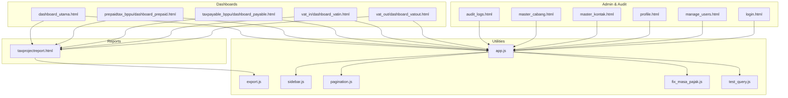

**Diagram sources**
- [dashboard_utama.html](file://dashboard_utama.html)
- [dashboard_prepaid.html](file://prepaidtax_bppu/dashboard_prepaid.html)
- [dashboard_payable.html](file://taxpayable_bppu/dashboard_payable.html)
- [dashboard_vatin.html](file://vat_in/dashboard_vatin.html)
- [dashboard_vatout.html](file://vat_out/dashboard_vatout.html)
- [taxprojectreport.html](file://taxprojectreport.html)
- [export.js](file://export.js)
- [app.js](file://app.js)
- [sidebar.js](file://sidebar.js)
- [pagination.js](file://pagination.js)
- [fix_masa_pajak.js](file://fix_masa_pajak.js)
- [test_query.js](file://test_query.js)
- [audit_logs.html](file://audit_logs.html)
- [master_cabang.html](file://master_cabang.html)
- [master_kontak.html](file://master_kontak.html)
- [profile.html](file://profile.html)
- [manage_users.html](file://manage_users.html)
- [login.html](file://login.html)

**Section sources**
- [dashboard_utama.html](file://dashboard_utama.html)
- [dashboard_prepaid.html](file://prepaidtax_bppu/dashboard_prepaid.html)
- [dashboard_payable.html](file://taxpayable_bppu/dashboard_payable.html)
- [dashboard_vatin.html](file://vat_in/dashboard_vatin.html)
- [dashboard_vatout.html](file://vat_out/dashboard_vatout.html)
- [taxprojectreport.html](file://taxprojectreport.html)
- [export.js](file://export.js)
- [app.js](file://app.js)
- [sidebar.js](file://sidebar.js)
- [pagination.js](file://pagination.js)
- [fix_masa_pajak.js](file://fix_masa_pajak.js)
- [test_query.js](file://test_query.js)
- [audit_logs.html](file://audit_logs.html)
- [master_cabang.html](file://master_cabang.html)
- [master_kontak.html](file://master_kontak.html)
- [profile.html](file://profile.html)
- [manage_users.html](file://manage_users.html)
- [login.html](file://login.html)

## Core Components
- Central Dashboard: Provides top-level KPIs and navigation to module dashboards and reports.
- Module Dashboards: Specialized dashboards for VAT In, VAT Out, Prepaid Tax, and Tax Payable, each exposing key metrics and summaries.
- Tax Project Report: Dedicated page aggregating cross-module analytics and enabling report generation and export.
- Export Utilities: Functions to support exporting report data in various formats.
- Application Logic: Shared logic for navigation, pagination, and administrative features.
- Audit and Administration: Pages supporting audit logging, branch/master data, contacts, user profiles, and user management.

Key responsibilities:
- Cross-module analytics: Consolidation of metrics across VAT, prepaid, payable, and project-level reporting.
- Statistical dashboards: Visual summaries and drill-down capabilities per module.
- Report generation: Workflows to produce, filter, customize, and export reports.
- Business intelligence: Performance indicators, trend analysis, and decision-support features.

**Section sources**
- [dashboard_utama.html](file://dashboard_utama.html)
- [dashboard_prepaid.html](file://prepaidtax_bppu/dashboard_prepaid.html)
- [dashboard_payable.html](file://taxpayable_bppu/dashboard_payable.html)
- [dashboard_vatin.html](file://vat_in/dashboard_vatin.html)
- [dashboard_vatout.html](file://vat_out/dashboard_vatout.html)
- [taxprojectreport.html](file://taxprojectreport.html)
- [export.js](file://export.js)
- [app.js](file://app.js)
- [sidebar.js](file://sidebar.js)
- [pagination.js](file://pagination.js)
- [fix_masa_pajak.js](file://fix_masa_pajak.js)
- [test_query.js](file://test_query.js)
- [audit_logs.html](file://audit_logs.html)
- [master_cabang.html](file://master_cabang.html)
- [master_kontak.html](file://master_kontak.html)
- [profile.html](file://profile.html)
- [manage_users.html](file://manage_users.html)
- [login.html](file://login.html)

## Architecture Overview
The reporting and analytics architecture integrates dashboards, module-specific views, and a centralized tax project report. Data flows from module dashboards into the central report page, where filters and customizations are applied. Export utilities finalize the report output. Shared application logic coordinates navigation, pagination, and administrative features.

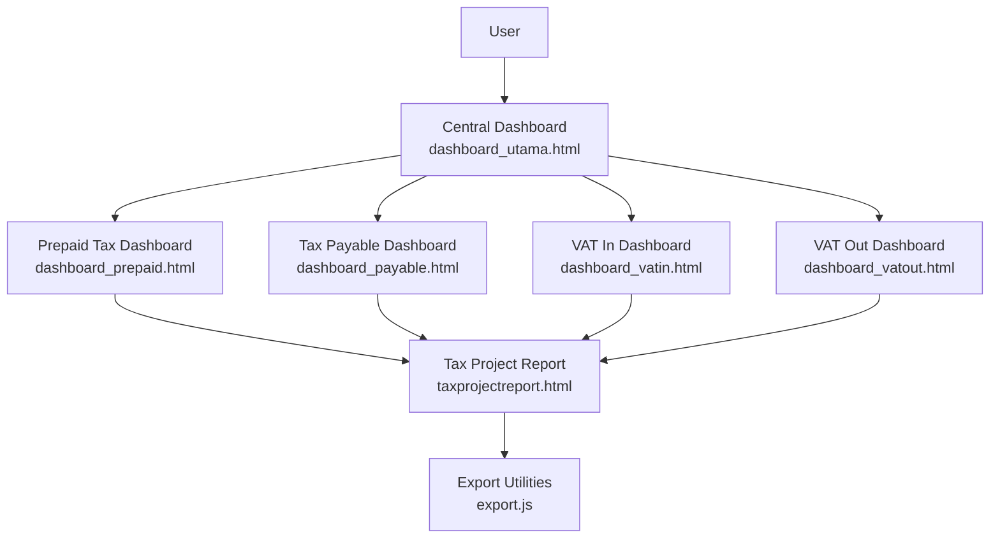

**Diagram sources**
- [dashboard_utama.html](file://dashboard_utama.html)
- [dashboard_prepaid.html](file://prepaidtax_bppu/dashboard_prepaid.html)
- [dashboard_payable.html](file://taxpayable_bppu/dashboard_payable.html)
- [dashboard_vatin.html](file://vat_in/dashboard_vatin.html)
- [dashboard_vatout.html](file://vat_out/dashboard_vatout.html)
- [taxprojectreport.html](file://taxprojectreport.html)
- [export.js](file://export.js)

## Detailed Component Analysis

### Central Dashboard (dashboard_utama.html)
- Purpose: High-level overview and navigation hub to module dashboards and the tax project report.
- Capabilities:
  - Navigation to module dashboards
  - Access to tax project report
  - Integration with shared application logic for consistent UX

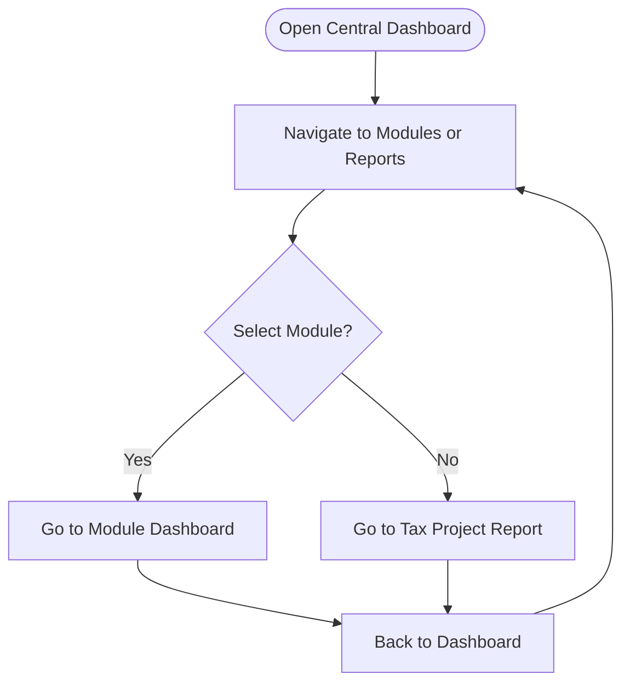

**Diagram sources**
- [dashboard_utama.html](file://dashboard_utama.html)

**Section sources**
- [dashboard_utama.html](file://dashboard_utama.html)

### VAT In Dashboard (vat_in/dashboard_vatin.html)
- Purpose: Visualize VAT input metrics and summaries.
- Capabilities:
  - Module-specific KPIs and charts
  - Drill-down to transaction details
  - Integration with central reporting pipeline

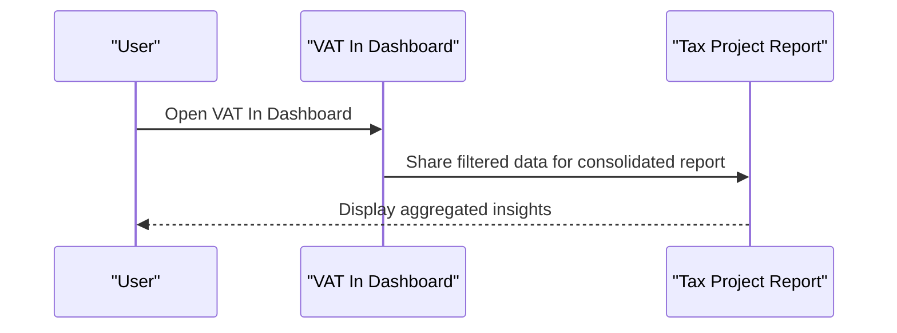

**Diagram sources**
- [dashboard_vatin.html](file://vat_in/dashboard_vatin.html)
- [taxprojectreport.html](file://taxprojectreport.html)

**Section sources**
- [dashboard_vatin.html](file://vat_in/dashboard_vatin.html)

### VAT Out Dashboard (vat_out/dashboard_vatout.html)
- Purpose: Visualize VAT output metrics and summaries.
- Capabilities:
  - Module-specific KPIs and charts
  - Drill-down to transaction details
  - Integration with central reporting pipeline

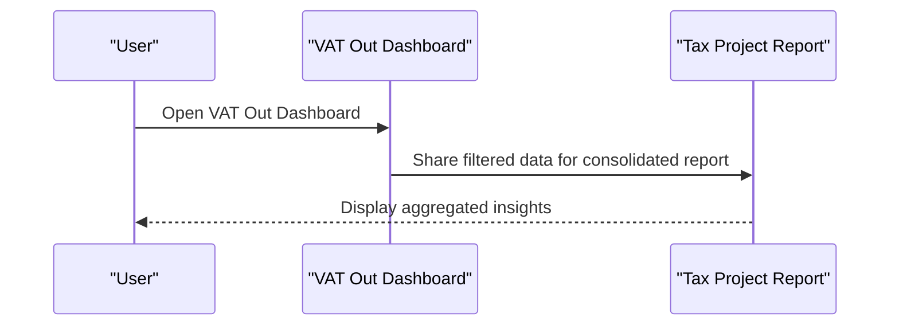

**Diagram sources**
- [dashboard_vatout.html](file://vat_out/dashboard_vatout.html)
- [taxprojectreport.html](file://taxprojectreport.html)

**Section sources**
- [dashboard_vatout.html](file://vat_out/dashboard_vatout.html)

### Prepaid Tax Dashboard (prepaidtax_bppu/dashboard_prepaid.html)
- Purpose: Visualize prepaid tax metrics and summaries.
- Capabilities:
  - Module-specific KPIs and charts
  - Drill-down to transaction details
  - Integration with central reporting pipeline

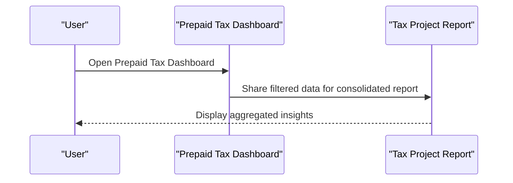

**Diagram sources**
- [dashboard_prepaid.html](file://prepaidtax_bppu/dashboard_prepaid.html)
- [taxprojectreport.html](file://taxprojectreport.html)

**Section sources**
- [dashboard_prepaid.html](file://prepaidtax_bppu/dashboard_prepaid.html)

### Tax Payable Dashboard (taxpayable_bppu/dashboard_payable.html)
- Purpose: Visualize tax payable metrics and summaries.
- Capabilities:
  - Module-specific KPIs and charts
  - Drill-down to transaction details
  - Integration with central reporting pipeline

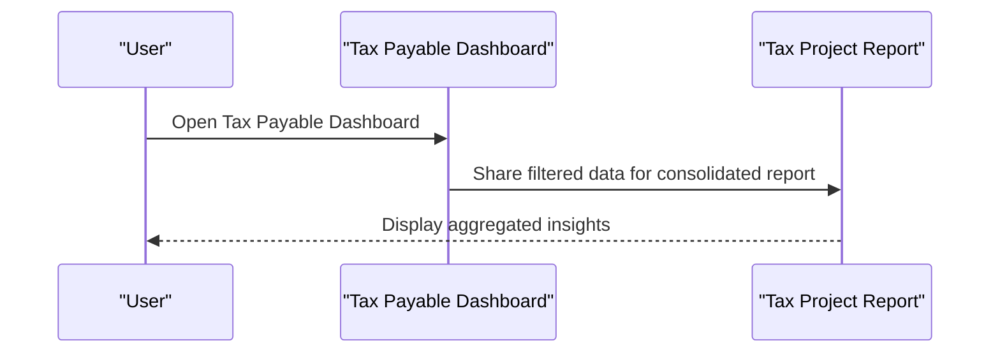

**Diagram sources**
- [dashboard_payable.html](file://taxpayable_bppu/dashboard_payable.html)
- [taxprojectreport.html](file://taxprojectreport.html)

**Section sources**
- [dashboard_payable.html](file://taxpayable_bppu/dashboard_payable.html)

### Tax Project Report (taxprojectreport.html)
- Purpose: Centralized reporting page aggregating cross-module analytics.
- Capabilities:
  - Cross-module data consolidation
  - Filtering and customization options
  - Export functionality via export utilities
  - Integration with shared application logic

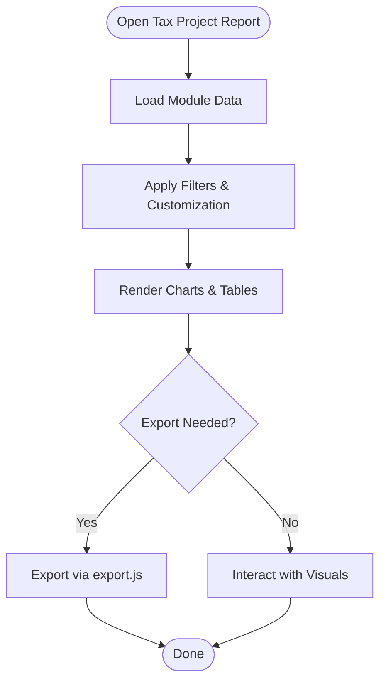

**Diagram sources**
- [taxprojectreport.html](file://taxprojectreport.html)
- [export.js](file://export.js)

**Section sources**
- [taxprojectreport.html](file://taxprojectreport.html)

### Export Utilities (export.js)
- Purpose: Provide export functionality for report data.
- Capabilities:
  - Export formatted datasets
  - Support multiple output formats
  - Integration with report generation workflows

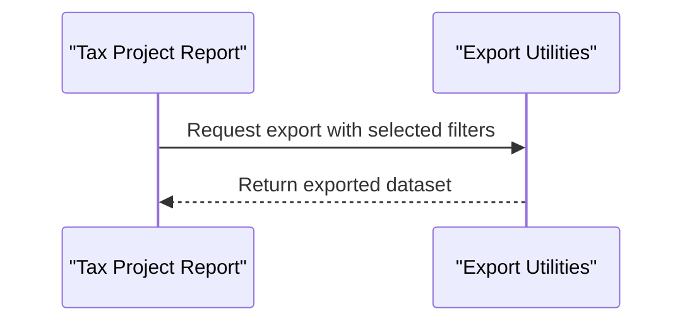

**Diagram sources**
- [taxprojectreport.html](file://taxprojectreport.html)
- [export.js](file://export.js)

**Section sources**
- [export.js](file://export.js)

### Application Logic (app.js, sidebar.js, pagination.js)
- Purpose: Provide shared functionality for navigation, sidebar behavior, and pagination.
- Capabilities:
  - Consistent navigation across dashboards and reports
  - Sidebar controls for module access
  - Pagination for large datasets

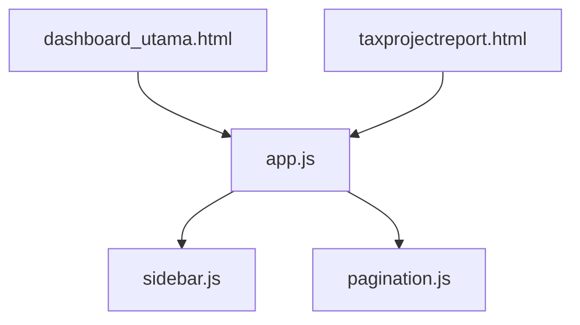

**Diagram sources**
- [app.js](file://app.js)
- [sidebar.js](file://sidebar.js)
- [pagination.js](file://pagination.js)
- [dashboard_utama.html](file://dashboard_utama.html)
- [taxprojectreport.html](file://taxprojectreport.html)

**Section sources**
- [app.js](file://app.js)
- [sidebar.js](file://sidebar.js)
- [pagination.js](file://pagination.js)

### Administrative and Audit Pages
- Audit Logs: Track system activities for compliance and traceability.
- Master Data: Branch and contact management for organizational context.
- User Management: Profile, permissions, and user administration.
- Login: Authentication and session management.

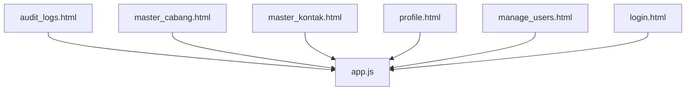

**Diagram sources**
- [audit_logs.html](file://audit_logs.html)
- [master_cabang.html](file://master_cabang.html)
- [master_kontak.html](file://master_kontak.html)
- [profile.html](file://profile.html)
- [manage_users.html](file://manage_users.html)
- [login.html](file://login.html)
- [app.js](file://app.js)

**Section sources**
- [audit_logs.html](file://audit_logs.html)
- [master_cabang.html](file://master_cabang.html)
- [master_kontak.html](file://master_kontak.html)
- [profile.html](file://profile.html)
- [manage_users.html](file://manage_users.html)
- [login.html](file://login.html)
- [app.js](file://app.js)

## Dependency Analysis
The reporting and analytics subsystem exhibits clear module-to-report dependencies and shared-application dependencies:
- Module dashboards feed into the tax project report.
- The tax project report depends on export utilities for output.
- Shared application logic underpins navigation, sidebar, and pagination across all pages.

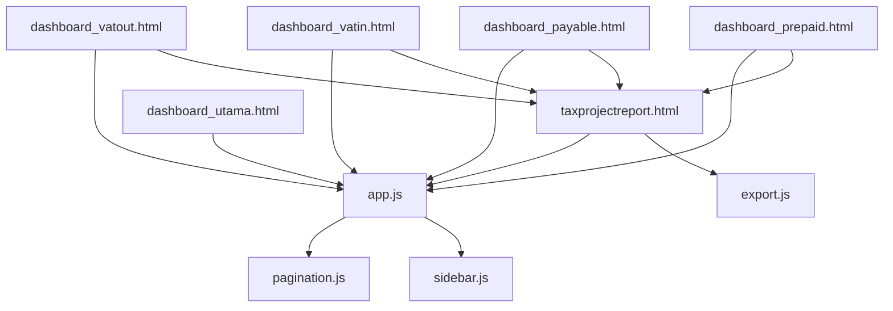

**Diagram sources**
- [dashboard_prepaid.html](file://prepaidtax_bppu/dashboard_prepaid.html)
- [dashboard_payable.html](file://taxpayable_bppu/dashboard_payable.html)
- [dashboard_vatin.html](file://vat_in/dashboard_vatin.html)
- [dashboard_vatout.html](file://vat_out/dashboard_vatout.html)
- [taxprojectreport.html](file://taxprojectreport.html)
- [export.js](file://export.js)
- [dashboard_utama.html](file://dashboard_utama.html)
- [app.js](file://app.js)
- [sidebar.js](file://sidebar.js)
- [pagination.js](file://pagination.js)

**Section sources**
- [dashboard_prepaid.html](file://prepaidtax_bppu/dashboard_prepaid.html)
- [dashboard_payable.html](file://taxpayable_bppu/dashboard_payable.html)
- [dashboard_vatin.html](file://vat_in/dashboard_vatin.html)
- [dashboard_vatout.html](file://vat_out/dashboard_vatout.html)
- [taxprojectreport.html](file://taxprojectreport.html)
- [export.js](file://export.js)
- [dashboard_utama.html](file://dashboard_utama.html)
- [app.js](file://app.js)
- [sidebar.js](file://sidebar.js)
- [pagination.js](file://pagination.js)

## Performance Considerations
- Pagination: Use pagination for large datasets to improve rendering performance and responsiveness.
- Export Efficiency: Optimize export utilities to handle large volumes without blocking the UI.
- Dashboard Rendering: Prefer lazy loading and modular chart rendering to minimize initial load times.
- Data Aggregation: Apply server-side filtering and aggregation where possible to reduce client-side computation overhead.

[No sources needed since this section provides general guidance]

## Troubleshooting Guide
- Navigation Issues: Verify shared application logic and sidebar initialization.
- Pagination Problems: Confirm pagination script is loaded and initialized after data binding.
- Export Failures: Validate export utility integration and ensure filters are applied before export.
- Module Data Discrepancies: Check module dashboards for consistent data sources and refresh mechanisms.
- Audit and Admin Pages: Ensure audit logs and admin pages are accessible and properly integrated with application logic.

**Section sources**
- [app.js](file://app.js)
- [sidebar.js](file://sidebar.js)
- [pagination.js](file://pagination.js)
- [export.js](file://export.js)
- [audit_logs.html](file://audit_logs.html)
- [master_cabang.html](file://master_cabang.html)
- [master_kontak.html](file://master_kontak.html)
- [profile.html](file://profile.html)
- [manage_users.html](file://manage_users.html)
- [login.html](file://login.html)

## Conclusion
The TDS system’s reporting and analytics capabilities center on a centralized tax project report that aggregates insights from module dashboards. The architecture supports cross-module analytics, customizable filtering, and robust export functionality. Shared application logic ensures consistent navigation and user experience. Administrative and audit pages complement the reporting ecosystem, enabling compliance and operational oversight.

[No sources needed since this section summarizes without analyzing specific files]

## Appendices
- Additional Scripts and Utilities:
  - Fix Masa Pajak: Utility for period adjustments impacting reporting accuracy.
  - Test Query: Tool for validating queries and report data integrity.
- Report Interpretation Guidelines:
  - Understand module-specific KPIs and their interdependencies.
  - Use filters to isolate trends and anomalies.
  - Leverage exports for external analysis and stakeholder communication.

**Section sources**
- [fix_masa_pajak.js](file://fix_masa_pajak.js)
- [test_query.js](file://test_query.js)