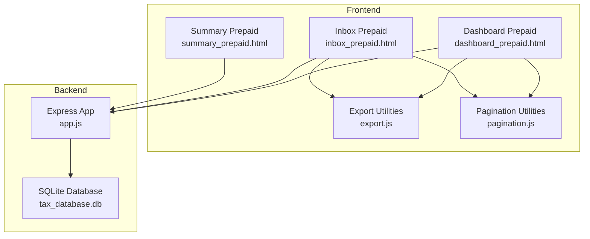
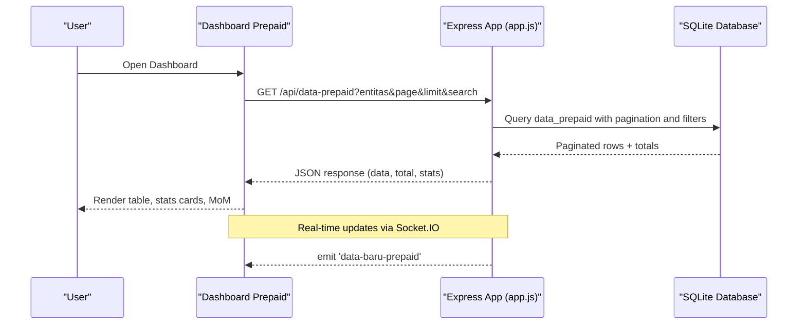
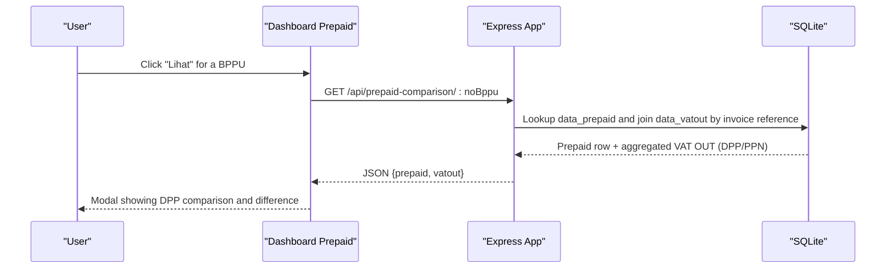
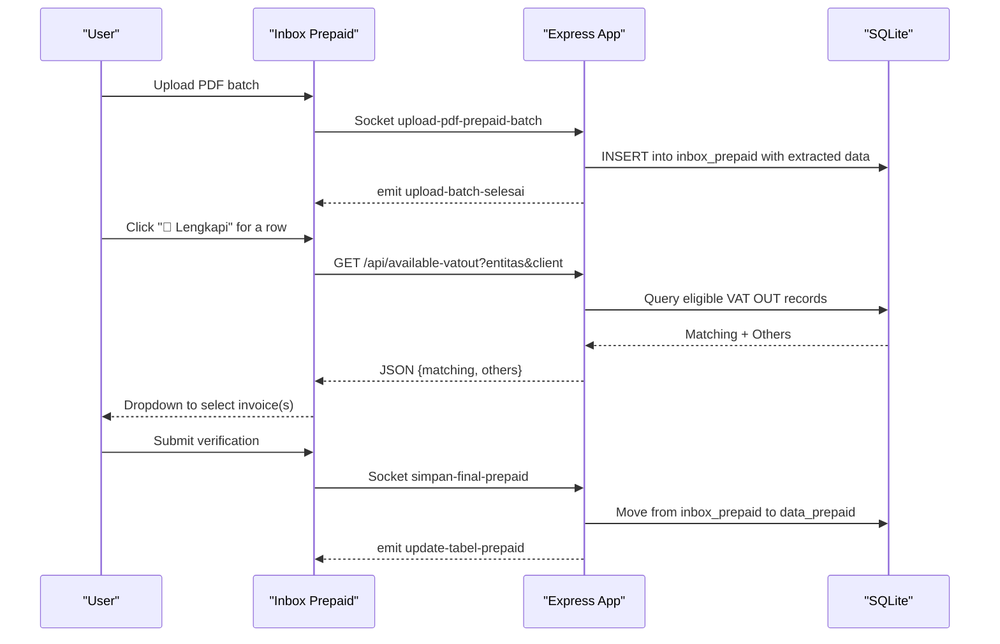
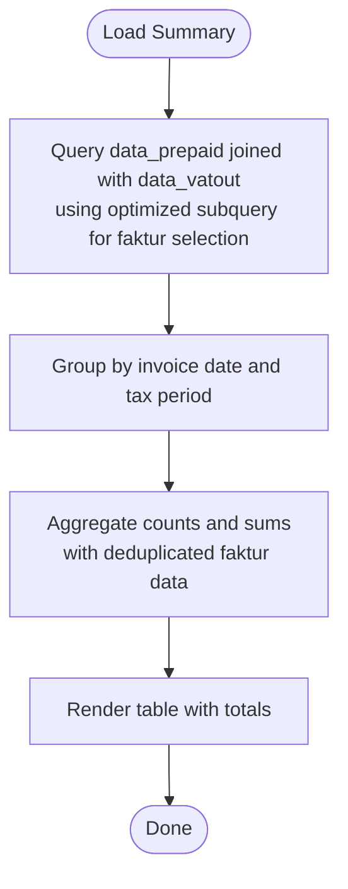
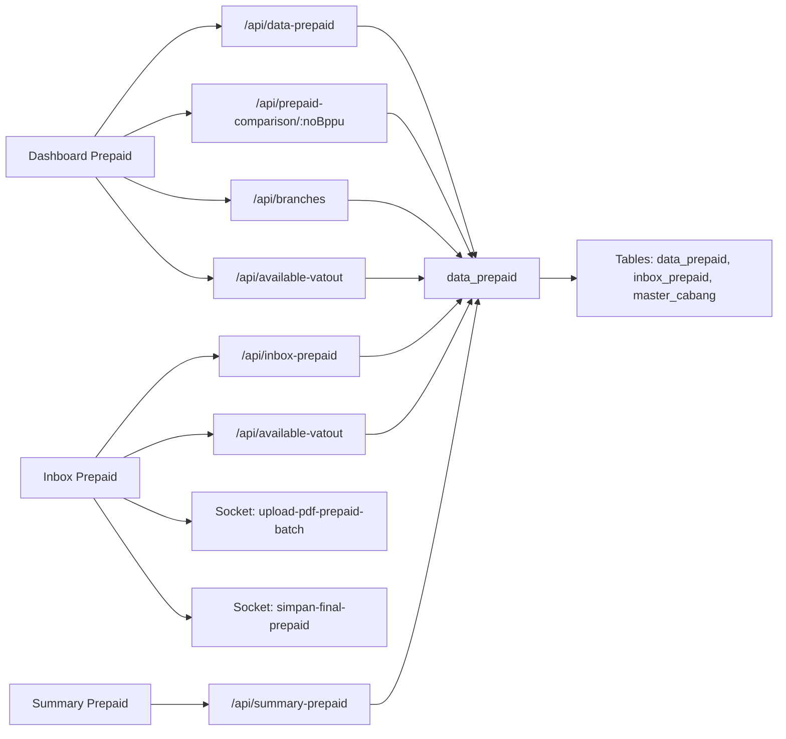

# Prepaid Tax Management

<cite>
**Referenced Files in This Document**
- [dashboard_prepaid.html](file://prepaidtax_bppu/dashboard_prepaid.html)
- [inbox_prepaid.html](file://prepaidtax_bppu/inbox_prepaid.html)
- [summary_prepaid.html](file://prepaidtax_bppu/summary_prepaid.html)
- [app.js](file://app.js)
- [export.js](file://export.js)
- [pagination.js](file://pagination.js)
- [PRD_Tax_Database_System.md](file://PRD_Tax_Database_System.md)
- [dashboard_utama.html](file://dashboard_utama.html)
</cite>

## Update Summary
**Changes Made**
- Updated database join logic with subquery prioritization for 'Pengganti' fakturs to prevent fan-out issues
- Enhanced cancellation date handling in VAT queries with improved tgl_batal filtering
- Improved deduplication logic across multiple endpoints including /api/summary-prepaid and JO project summary API
- Fixed performance issues in prepaid tax summary queries by limiting JOIN results to single effective faktur per invoice

## Table of Contents
1. [Introduction](#introduction)
2. [Project Structure](#project-structure)
3. [Core Components](#core-components)
4. [Architecture Overview](#architecture-overview)
5. [Detailed Component Analysis](#detailed-component-analysis)
6. [Dependency Analysis](#dependency-analysis)
7. [Performance Considerations](#performance-considerations)
8. [Troubleshooting Guide](#troubleshooting-guide)
9. [Conclusion](#conclusion)

## Introduction
This document describes the prepaid tax management module within the TDS (Tax Database System). It explains prepaid tax concepts, calculation methodologies, compliance requirements for tax deducted at source (TDS), and documents the dashboard functionality for transaction monitoring, payment tracking, and status indicators. It also covers the inbox processing workflow for reviewing and approving TDS transactions, including document verification and approval workflows, and details summary reporting features for tax liability analysis, payment history, and quarterly tax summaries. Practical examples of transaction entry, payment processing, and reconciliation procedures are included, along with guidance for integrating with payroll and financial accounting modules, and handling tax filings, compliance, and audit preparation.

## Project Structure
The prepaid tax module consists of three primary frontend pages and supporting utilities:
- Dashboard: Register of Prepaid Tax documents, filtering, pagination, and real-time updates
- Inbox: Verification queue for Prepaid Tax documents with PDF upload and review
- Summary: Comparative reporting between VAT OUT invoices and Prepaid Tax records
- Supporting utilities: Export and pagination helpers
- Backend: Express.js routes for data retrieval, batch uploads, comparisons, and approvals

**Diagram sources**
- [dashboard_prepaid.html](file://prepaidtax_bppu/dashboard_prepaid.html)
- [inbox_prepaid.html](file://prepaidtax_bppu/inbox_prepaid.html)
- [summary_prepaid.html](file://prepaidtax_bppu/summary_prepaid.html)
- [export.js](file://export.js)
- [pagination.js](file://pagination.js)
- [app.js](file://app.js)

**Section sources**
- [dashboard_prepaid.html](file://prepaidtax_bppu/dashboard_prepaid.html)
- [inbox_prepaid.html](file://prepaidtax_bppu/inbox_prepaid.html)
- [summary_prepaid.html](file://prepaidtax_bppu/summary_prepaid.html)
- [export.js](file://export.js)
- [pagination.js](file://pagination.js)
- [app.js](file://app.js)

## Core Components
- Dashboard Prepaid: Displays the register of Prepaid Tax documents with filtering, sorting, pagination, and real-time updates. Provides actions to view comparisons, edit relations, and export data.
- Inbox Prepaid: Manages verification queue for Prepaid Tax documents, supports PDF batch upload, extraction, and final verification with maker-checker workflow.
- Summary Prepaid: Compares VAT OUT invoices with Prepaid Tax records to analyze tax liability and payment consistency across periods.
- Backend APIs: Serve data for dashboards, support batch uploads, comparisons, and approvals; maintain audit logs and enforce RBAC.

**Section sources**
- [dashboard_prepaid.html](file://prepaidtax_bppu/dashboard_prepaid.html)
- [inbox_prepaid.html](file://prepaidtax_bppu/inbox_prepaid.html)
- [summary_prepaid.html](file://prepaidtax_bppu/summary_prepaid.html)
- [app.js](file://app.js)

## Architecture Overview
The module follows a client-server architecture with real-time capabilities:
- Frontend pages communicate with backend via REST endpoints and WebSocket events.
- Batch PDF uploads leverage PDF.js for client-side parsing and Socket.IO for streaming progress and completion notifications.
- Maker-checker approval workflow uses Socket.IO events to synchronize UI updates after supervisor actions.
- Server-side pagination and debounced filtering optimize performance for large datasets.

**Diagram sources**
- [dashboard_prepaid.html](file://prepaidtax_bppu/dashboard_prepaid.html)
- [app.js](file://app.js)

**Section sources**
- [dashboard_prepaid.html](file://prepaidtax_bppu/dashboard_prepaid.html)
- [app.js](file://app.js)

## Detailed Component Analysis

### Dashboard Prepaid Tax
The dashboard presents:
- Summary cards: Total documents, total tax withheld, total DPP, pending verification count
- Transaction register with columns for branch, tax period, payer/client, BPPU number, invoice period, DPP, tax rate, tax amount, difference, input by, and invoice reference
- Filtering per column with debounced search
- Pagination with server-side limits
- Actions: View comparison, edit relation, delete (with approval workflow)
- Export and print utilities

Key behaviors:
- Real-time updates triggered by Socket.IO when new data arrives
- Comparison view computes DPP difference between Prepaid Tax and matched VAT OUT records
- Edit modal allows selecting branch and linking VAT OUT invoice(s), with auto-detection of branch from invoice reference

**Diagram sources**
- [dashboard_prepaid.html](file://prepaidtax_bppu/dashboard_prepaid.html)
- [app.js](file://app.js)

**Section sources**
- [dashboard_prepaid.html](file://prepaidtax_bppu/dashboard_prepaid.html)
- [app.js](file://app.js)

### Inbox Prepaid Tax
The inbox manages verification and approval:
- Lists pending Prepaid Tax documents extracted from uploaded PDFs
- Supports bulk PDF upload with chunked processing and progress feedback
- Review modal displays extracted data and allows completing branch and invoice linkage
- Final verification triggers approval workflow (maker-checker) via Socket.IO
- Supports exporting and printing

**Diagram sources**
- [inbox_prepaid.html](file://prepaidtax_bppu/inbox_prepaid.html)
- [app.js](file://app.js)

**Section sources**
- [inbox_prepaid.html](file://prepaidtax_bppu/inbox_prepaid.html)
- [app.js](file://app.js)

### Summary Prepaid Tax
The summary page compares VAT OUT invoices with Prepaid Tax records:
- Groups by invoice date and tax period
- Counts BPPU entries, aggregates DPP and tax amounts
- Supports export and print

**Updated** Enhanced with improved database join logic that prevents fan-out issues by using subquery prioritization for 'Pengganti' fakturs and better cancellation date handling.

**Diagram sources**
- [summary_prepaid.html](file://prepaidtax_bppu/summary_prepaid.html)
- [app.js](file://app.js)

**Section sources**
- [summary_prepaid.html](file://prepaidtax_bppu/summary_prepaid.html)
- [app.js](file://app.js)

### Prepaid Tax Concepts, Calculations, and Compliance
- Prepaid tax (BPPU) represents tax deducted at source by the company on payments made to vendors or service providers.
- Calculation methodology:
  - DPP (Taxable Amount) × Tarif (%) = Nilai PPh (Withholding Tax)
  - Difference check: Compare DPP in Prepaid Tax with aggregated DPP from linked VAT OUT invoices to detect discrepancies.
- Compliance requirements:
  - Proper linkage to VAT OUT invoices via internal invoice reference
  - Accurate branch/cabang assignment aligned with master data
  - Audit trail maintained via audit logs and staged inbox-to-final transitions

**Section sources**
- [PRD_Tax_Database_System.md](file://PRD_Tax_Database_System.md)
- [app.js](file://app.js)

### Practical Examples

#### Example 1: Transaction Entry and Payment Processing
- Upload PDF of BPPU via Inbox Prepaid
- System extracts header fields and stores in inbox
- Supervisor verifies and completes branch and invoice linkage
- Record moves to final data_prepaid table

#### Example 2: Reconciliation Procedure
- Use Dashboard comparison to compute DPP difference between Prepaid Tax and linked VAT OUT
- Investigate positive/negative differences and adjust invoice linkage or rates as needed
- Generate Summary report for monthly/quarterly analysis

#### Example 3: Quarterly Tax Summaries
- Use Summary Prepaid to compare counts and totals across tax periods
- Export to Excel for filing and reporting

**Section sources**
- [inbox_prepaid.html](file://prepaidtax_bppu/inbox_prepaid.html)
- [dashboard_prepaid.html](file://prepaidtax_bppu/dashboard_prepaid.html)
- [summary_prepaid.html](file://prepaidtax_bppu/summary_prepaid.html)
- [app.js](file://app.js)

### Integration with Payroll and Financial Accounting
- Branch/internal invoice linkage ensures proper allocation to projects/branches
- Client Ledger integration can reference Prepaid Tax via reference fields for consolidated reporting
- Master data synchronization maintains consistency across modules

**Section sources**
- [PRD_Tax_Database_System.md](file://PRD_Tax_Database_System.md)
- [app.js](file://app.js)

### Handling Tax Filings, Compliance, and Audit Preparation
- Maintain audit logs for all edits and approvals
- Use export utilities to produce reports for tax authorities and internal audits
- Monitor pending verification counts and resolve discrepancies promptly

**Section sources**
- [PRD_Tax_Database_System.md](file://PRD_Tax_Database_System.md)
- [export.js](file://export.js)
- [app.js](file://app.js)

## Dependency Analysis
The module depends on:
- Backend routes for data retrieval, batch uploads, comparisons, and approvals
- Database tables for staging (inbox), final storage (data_prepaid), and master data (master_cabang)
- Frontend utilities for export and pagination
- Socket.IO for real-time updates and batch progress

**Diagram sources**
- [dashboard_prepaid.html](file://prepaidtax_bppu/dashboard_prepaid.html)
- [inbox_prepaid.html](file://prepaidtax_bppu/inbox_prepaid.html)
- [summary_prepaid.html](file://prepaidtax_bppu/summary_prepaid.html)
- [app.js](file://app.js)

**Section sources**
- [dashboard_prepaid.html](file://prepaidtax_bppu/dashboard_prepaid.html)
- [inbox_prepaid.html](file://prepaidtax_bppu/inbox_prepaid.html)
- [summary_prepaid.html](file://prepaidtax_bppu/summary_prepaid.html)
- [app.js](file://app.js)

## Performance Considerations
- Server-side pagination and debounced filtering reduce client load and API spam
- Efficient database indexing on entity and date columns improves query performance
- Chunked PDF uploads minimize UI blocking and enable progress feedback
- **Updated** Optimized database joins with subquery prioritization prevent fan-out issues in summary queries
- **Updated** Enhanced cancellation date handling improves query efficiency by properly filtering cancelled fakturs

[No sources needed since this section provides general guidance]

## Troubleshooting Guide
Common issues and resolutions:
- No data shown in dashboard/inbox: Verify entity selection and pagination limits; ensure filters are not overly restrictive
- Discrepancy in DPP comparison: Confirm invoice linkage and branch assignment; re-run comparison after corrections
- Upload progress not updating: Check browser console for Socket.IO connection errors; ensure server is reachable
- Export failures: Confirm Excel library availability; fall back to CSV export
- **Updated** Summary query performance issues: The system now uses optimized subqueries to prevent fan-out when multiple fakturs exist for the same invoice

**Section sources**
- [dashboard_prepaid.html](file://prepaidtax_bppu/dashboard_prepaid.html)
- [inbox_prepaid.html](file://prepaidtax_bppu/inbox_prepaid.html)
- [export.js](file://export.js)

## Conclusion
The prepaid tax management module provides a robust, real-time solution for managing tax deducted at source. Its dashboard enables efficient monitoring and reconciliation, the inbox streamlines document verification and approval, and the summary offers insightful reporting for compliance and tax filings. Integration with master data and client ledger supports end-to-end financial tracking, while export and pagination utilities enhance usability and performance. Recent enhancements include improved database join logic with subquery prioritization for 'Pengganti' fakturs, enhanced cancellation date handling, and better deduplication logic across multiple endpoints, ensuring optimal performance and accurate reporting even with complex faktur hierarchies.