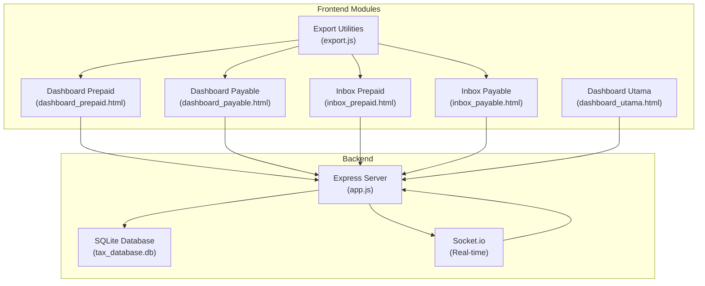
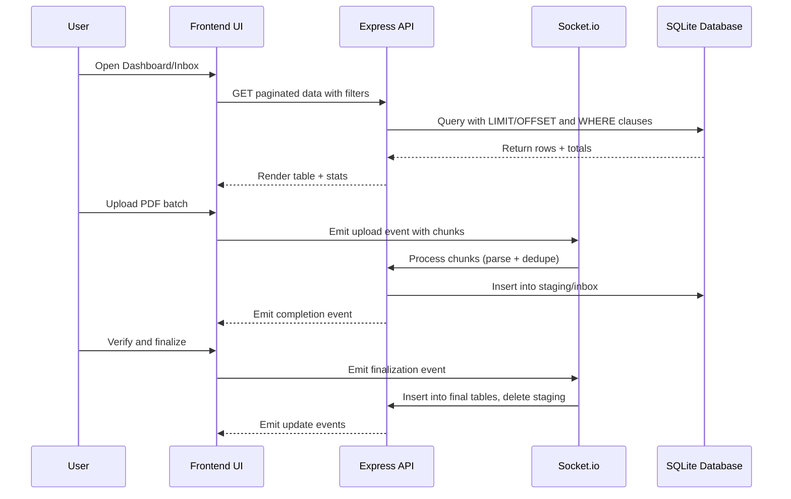
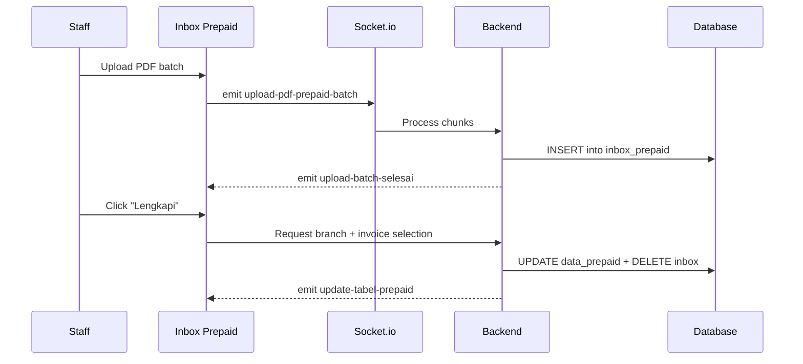
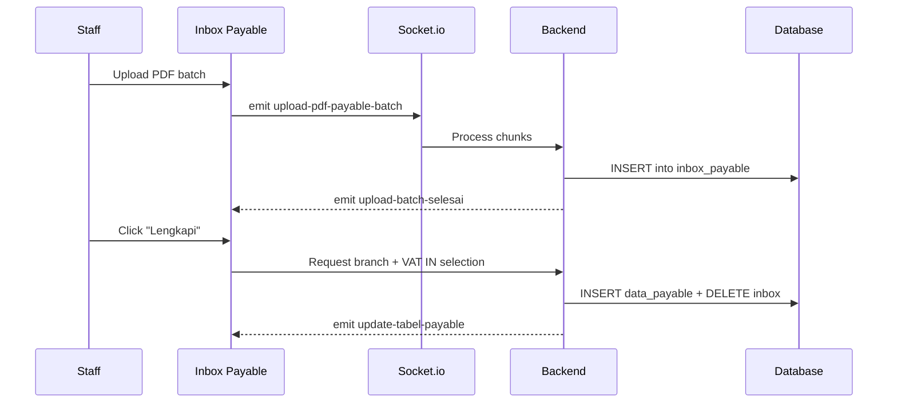
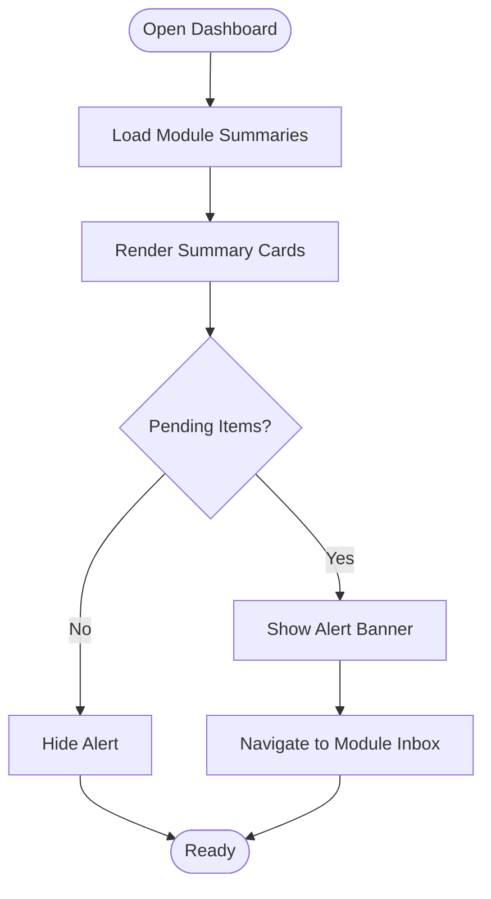
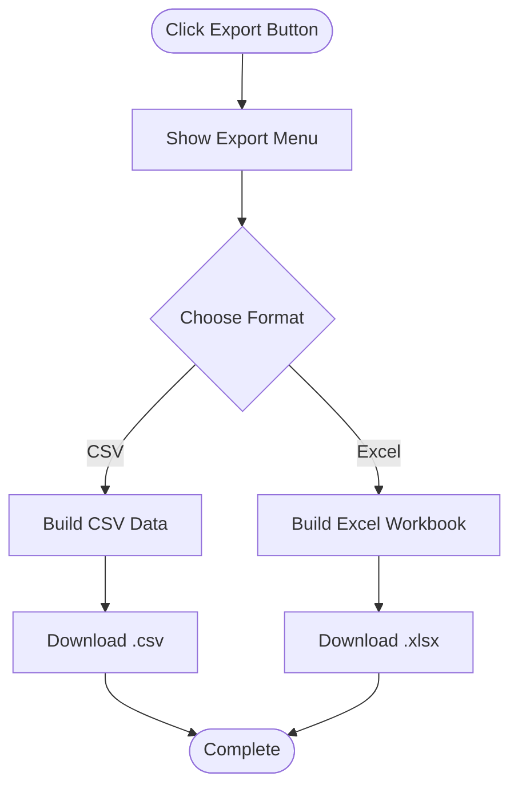
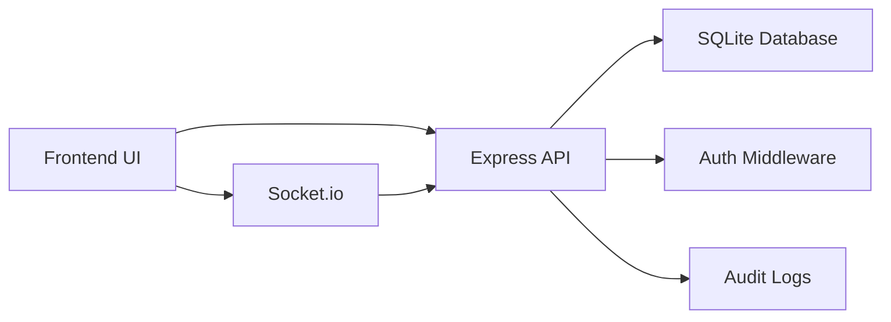

# Tax Deducted at Source (TDS) System

<cite>
**Referenced Files in This Document**
- [dashboard_utama.html](file://dashboard_utama.html)
- [PRD_Tax_Database_System.md](file://PRD_Tax_Database_System.md)
- [TDS_Sequence_Diagram.md](file://TDS_Sequence_Diagram.md)
- [app.js](file://app.js)
- [export.js](file://export.js)
- [prepaidtax_bppu/dashboard_prepaid.html](file://prepaidtax_bppu/dashboard_prepaid.html)
- [prepaidtax_bppu/inbox_prepaid.html](file://prepaidtax_bppu/inbox_prepaid.html)
- [taxpayable_bppu/dashboard_payable.html](file://taxpayable_bppu/dashboard_payable.html)
- [taxpayable_bppu/inbox_payable.html](file://taxpayable_bppu/inbox_payable.html)
</cite>

## Table of Contents
1. [Introduction](#introduction)
2. [Project Structure](#project-structure)
3. [Core Components](#core-components)
4. [Architecture Overview](#architecture-overview)
5. [Detailed Component Analysis](#detailed-component-analysis)
6. [Dependency Analysis](#dependency-analysis)
7. [Performance Considerations](#performance-considerations)
8. [Troubleshooting Guide](#troubleshooting-guide)
9. [Conclusion](#conclusion)
10. [Appendices](#appendices)

## Introduction
This document provides comprehensive documentation for the Tax Deducted at Source (TDS) system, focusing on the Prepaid Tax and Tax Payable modules. It explains TDS concepts, calculation methods, compliance requirements, and the operational workflows implemented in the system. The TDS system serves as a digital single source of truth for corporate tax data, automating PDF extraction, mapping to internal organizational structures, managing withholding tax documents (Bukti Potong PPh), and delivering real-time dashboards and reporting.

## Project Structure
The TDS system is organized around modular HTML dashboards and a central backend service:
- Prepaid Tax module: dashboard and inbox for managing Prepaid Tax (BPPU) entries
- Tax Payable module: dashboard and inbox for managing Tax Payable (BPPU) entries
- Central backend: Express.js server with Socket.io for real-time batch uploads and synchronization
- Shared utilities: export functionality, pagination, and theme support
- Database: SQLite3 with normalized tables for tax transactions, master data, and audit logs

**Diagram sources**
- [dashboard_utama.html](file://dashboard_utama.html)
- [prepaidtax_bppu/dashboard_prepaid.html](file://prepaidtax_bppu/dashboard_prepaid.html)
- [taxpayable_bppu/dashboard_payable.html](file://taxpayable_bppu/dashboard_payable.html)
- [prepaidtax_bppu/inbox_prepaid.html](file://prepaidtax_bppu/inbox_prepaid.html)
- [taxpayable_bppu/inbox_payable.html](file://taxpayable_bppu/inbox_payable.html)
- [export.js](file://export.js)
- [app.js](file://app.js)

**Section sources**
- [dashboard_utama.html](file://dashboard_utama.html)
- [PRD_Tax_Database_System.md](file://PRD_Tax_Database_System.md)

## Core Components
- Prepaid Tax Dashboard: Displays register of Prepaid Tax entries, filtering, export/print actions, and links to verification inbox. Includes comparative analysis between Prepaid entries and VAT OUT invoices.
- Prepaid Tax Inbox: Manages unverified Prepaid Tax documents, supports PDF batch upload, auto-extraction, and final verification with branch assignment and internal invoice linkage.
- Tax Payable Dashboard: Shows Tax Payable entries, filtering, export/print actions, and links to verification inbox.
- Tax Payable Inbox: Manages unverified Tax Payable documents, supports PDF batch upload, auto-extraction, and final verification with branch assignment and VAT IN invoice linkage.
- Export Utilities: Provides CSV and Excel export functionality for tables with configurable ignored columns and currency normalization.
- Backend Services: Express server with authentication, role-based access control (RBAC), database initialization, and Socket.io integration for batch processing and real-time updates.

**Section sources**
- [prepaidtax_bppu/dashboard_prepaid.html](file://prepaidtax_bppu/dashboard_prepaid.html)
- [prepaidtax_bppu/inbox_prepaid.html](file://prepaidtax_bppu/inbox_prepaid.html)
- [taxpayable_bppu/dashboard_payable.html](file://taxpayable_bppu/dashboard_payable.html)
- [taxpayable_bppu/inbox_payable.html](file://taxpayable_bppu/inbox_payable.html)
- [export.js](file://export.js)
- [app.js](file://app.js)

## Architecture Overview
The TDS system follows a client-server architecture with real-time capabilities:
- Authentication and session management with middleware protection
- Role-based access control (Staff, Supervisor, Administrator)
- Real-time batch ingestion via Socket.io for PDF parsing and deduplication
- Server-side pagination and debounced filtering for large datasets
- Audit trail for all mutations
- Cross-module analytics and reporting

**Diagram sources**
- [TDS_Sequence_Diagram.md](file://TDS_Sequence_Diagram.md)
- [app.js](file://app.js)

**Section sources**
- [TDS_Sequence_Diagram.md](file://TDS_Sequence_Diagram.md)
- [PRD_Tax_Database_System.md](file://PRD_Tax_Database_System.md)

## Detailed Component Analysis

### Prepaid Tax Module
The Prepaid Tax module manages withholding tax collected by the company on behalf of clients. It includes:
- Dashboard: Register of Prepaid Tax entries with filtering, export, print, and verification inbox navigation. Displays comparative DPP differences against related VAT OUT invoices.
- Inbox: Unverified Prepaid Tax documents awaiting finalization. Supports PDF batch upload, auto-extraction, branch assignment, and internal invoice linkage. Provides VAT OUT dropdown selection with manual override.

**Diagram sources**
- [prepaidtax_bppu/inbox_prepaid.html](file://prepaidtax_bppu/inbox_prepaid.html)
- [app.js](file://app.js)

**Section sources**
- [prepaidtax_bppu/dashboard_prepaid.html](file://prepaidtax_bppu/dashboard_prepaid.html)
- [prepaidtax_bppu/inbox_prepaid.html](file://prepaidtax_bppu/inbox_prepaid.html)

### Tax Payable Module
The Tax Payable module manages withholding tax obligations of the company towards vendors. It includes:
- Dashboard: Register of Tax Payable entries with filtering, export, print, and verification inbox navigation.
- Inbox: Unverified Tax Payable documents awaiting finalization. Supports PDF batch upload, auto-extraction, branch assignment, and VAT IN invoice linkage. Provides VAT IN recommendation based on vendor match.

**Diagram sources**
- [taxpayable_bppu/inbox_payable.html](file://taxpayable_bppu/inbox_payable.html)
- [app.js](file://app.js)

**Section sources**
- [taxpayable_bppu/dashboard_payable.html](file://taxpayable_bppu/dashboard_payable.html)
- [taxpayable_bppu/inbox_payable.html](file://taxpayable_bppu/inbox_payable.html)

### Dashboard Functionality
The main dashboard aggregates module summaries and highlights pending verification tasks across VAT OUT, VAT IN, Tax Payable, Prepaid Tax, and Client Ledger. It displays total counts, amounts, and pending items with animated counters and responsive cards.

**Diagram sources**
- [dashboard_utama.html](file://dashboard_utama.html)

**Section sources**
- [dashboard_utama.html](file://dashboard_utama.html)

### Export and Reporting
The export utility supports CSV and Excel exports from tables with configurable ignored columns and currency normalization. It generates downloadable files for downstream reconciliation and filing.

**Diagram sources**
- [export.js](file://export.js)

**Section sources**
- [export.js](file://export.js)

## Dependency Analysis
The system exhibits clear separation of concerns:
- Frontend modules depend on shared utilities (export, pagination, theme) and communicate with the backend via REST and Socket.io
- Backend depends on SQLite for persistence, with indexes optimized for frequent queries
- RBAC middleware protects sensitive routes and APIs
- Audit logging captures all mutations for compliance

**Diagram sources**
- [app.js](file://app.js)

**Section sources**
- [app.js](file://app.js)
- [PRD_Tax_Database_System.md](file://PRD_Tax_Database_System.md)

## Performance Considerations
- Server-side pagination with LIMIT/OFFSET prevents heavy client loads for large datasets
- Debounced filtering reduces API spam and improves responsiveness
- Indexes on frequently queried columns (entity/date/internal invoice) improve query performance
- Chunked batch uploads via Socket.io avoid memory pressure during PDF processing
- Currency normalization in exports ensures accurate downstream reconciliation

## Troubleshooting Guide
Common issues and resolutions:
- Authentication failures: Ensure session cookies are enabled and session middleware is active
- Permission denied: Verify user roles and apply cekRoleAPI middleware for protected endpoints
- Upload failures: Confirm Socket.io connection and chunk size limits; check PDF.js parsing errors
- Export empty data: Verify table visibility and ignored column configuration
- Audit trail gaps: Confirm insertAuditLog function is invoked on all mutations

**Section sources**
- [app.js](file://app.js)
- [export.js](file://export.js)

## Conclusion
The TDS system provides a robust, real-time platform for managing Prepaid Tax and Tax Payable workflows. Its architecture emphasizes automation, compliance, and transparency through audit trails and cross-module analytics. The Prepaid and Payable modules streamline document verification, branch assignment, and internal invoice linkage, while the export utilities facilitate regulatory reporting and reconciliation.

## Appendices

### TDS Concepts and Calculations
- Withholding Tax (PPh): Tax deducted at source from payments to third parties
- DPP (Taxable Amount): Gross amount subject to withholding tax before deductions
- Tariff (Rate): Percentage applied to DPP to compute tax liability
- Tax Amount: DPP × Tariff
- Comparative Analysis: Matching Prepaid entries with related VAT OUT invoices to validate DPP and detect discrepancies

**Section sources**
- [prepaidtax_bppu/dashboard_prepaid.html](file://prepaidtax_bppu/dashboard_prepaid.html)
- [taxpayable_bppu/dashboard_payable.html](file://taxpayable_bppu/dashboard_payable.html)

### Compliance Requirements
- Maintain accurate records of withholding tax documents (BPPU)
- Assign proper branch/cost center to each transaction
- Link to internal invoices (VAT OUT for Prepaid, VAT IN for Payable)
- Preserve audit trail for all modifications
- Generate periodic reports for tax filing

**Section sources**
- [PRD_Tax_Database_System.md](file://PRD_Tax_Database_System.md)

### Practical Workflows
- Prepaid Tax Processing:
  1. Upload Prepaid Tax PDFs in batch
  2. Review extracted data in inbox
  3. Assign branch and internal invoice
  4. Finalize and move to register
- Tax Payable Processing:
  1. Upload Tax Payable PDFs in batch
  2. Review extracted data in inbox
  3. Assign branch and VAT IN invoice(s)
  4. Finalize and move to register

**Section sources**
- [prepaidtax_bppu/inbox_prepaid.html](file://prepaidtax_bppu/inbox_prepaid.html)
- [taxpayable_bppu/inbox_payable.html](file://taxpayable_bppu/inbox_payable.html)