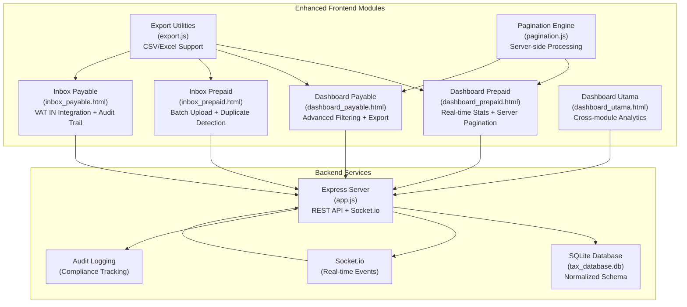
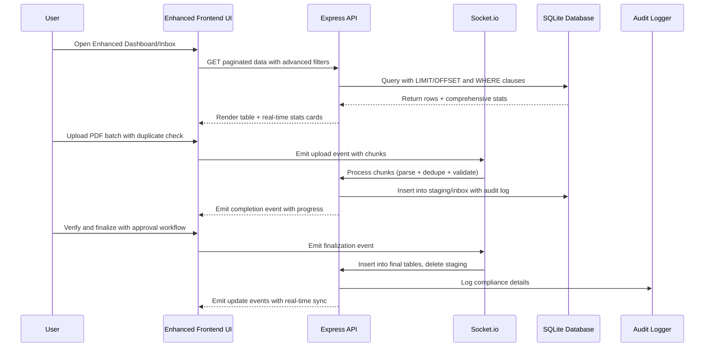
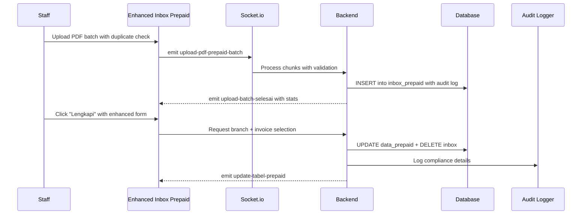
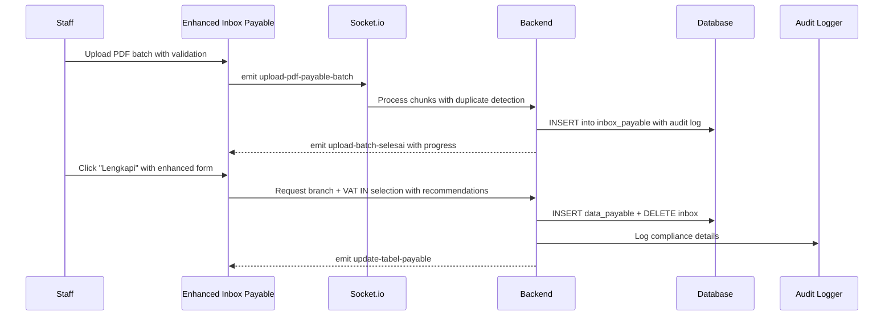
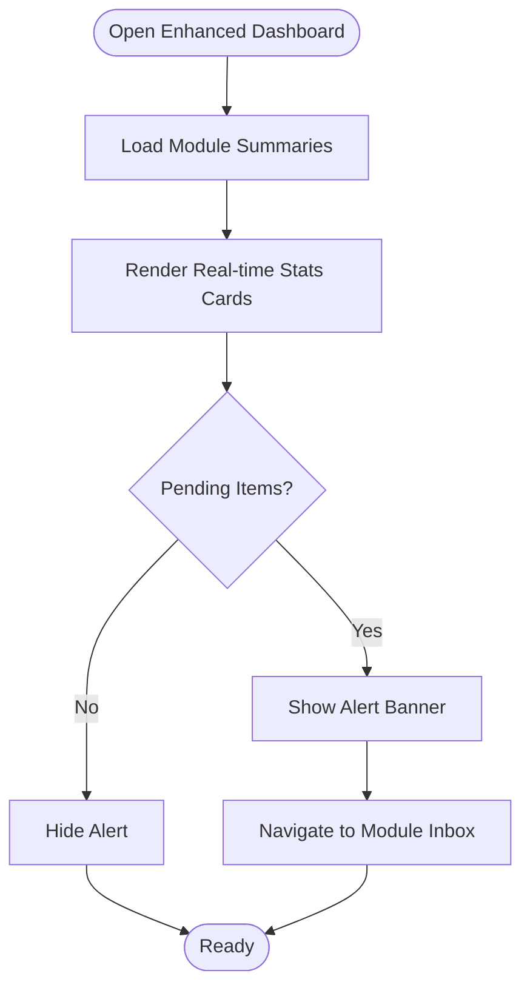
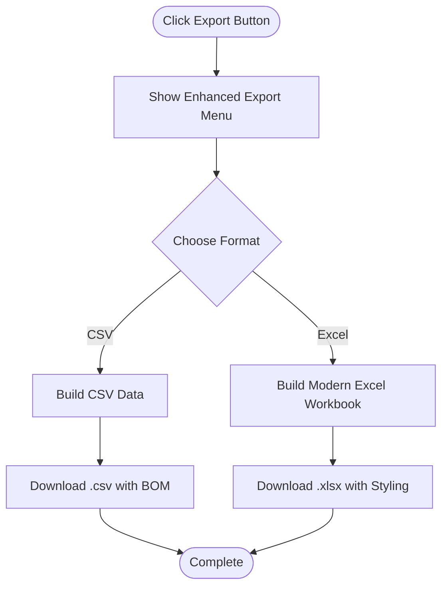
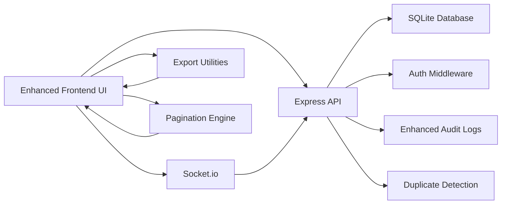

# Tax Deducted at Source (TDS) System

<cite>
**Referenced Files in This Document**
- [dashboard_utama.html](file://dashboard_utama.html)
- [PRD_Tax_Database_System.md](file://PRD_Tax_Database_System.md)
- [TDS_Sequence_Diagram.md](file://TDS_Sequence_Diagram.md)
- [app.js](file://app.js)
- [export.js](file://export.js)
- [pagination.js](file://pagination.js)
- [prepaidtax_bppu/dashboard_prepaid.html](file://prepaidtax_bppu/dashboard_prepaid.html)
- [prepaidtax_bppu/inbox_prepaid.html](file://prepaidtax_bppu/inbox_prepaid.html)
- [taxpayable_bppu/dashboard_payable.html](file://taxpayable_bppu/dashboard_payable.html)
- [taxpayable_bppu/inbox_payable.html](file://taxpayable_bppu/inbox_payable.html)
</cite>

## Update Summary
**Changes Made**
- Enhanced dashboard and inbox modules for Prepaid Tax and Tax Payable with improved UI components
- Added real-time statistics cards with month-over-month analysis
- Implemented server-side pagination with debounced filtering
- Integrated advanced search functionality across all columns
- Enhanced export capabilities with CSV and Excel support
- Added batch operations with duplicate detection and audit logging
- Improved compliance tracking with comprehensive audit trails

## Table of Contents
1. [Introduction](#introduction)
2. [Project Structure](#project-structure)
3. [Core Components](#core-components)
4. [Architecture Overview](#architecture-overview)
5. [Detailed Component Analysis](#detailed-component-analysis)
6. [Enhanced Features](#enhanced-features)
7. [Dependency Analysis](#dependency-analysis)
8. [Performance Considerations](#performance-considerations)
9. [Troubleshooting Guide](#troubleshooting-guide)
10. [Conclusion](#conclusion)
11. [Appendices](#appendices)

## Introduction
This document provides comprehensive documentation for the Tax Deducted at Source (TDS) system, focusing on the Prepaid Tax and Tax Payable modules. The system has been significantly enhanced with modern UI components, real-time statistics, server-side processing, and advanced compliance features. It serves as a digital single source of truth for corporate tax data, automating PDF extraction, mapping to internal organizational structures, managing withholding tax documents (Bukti Potong PPh), and delivering real-time dashboards and reporting with enhanced user experience.

## Project Structure
The TDS system is organized around modular HTML dashboards and a central backend service:
- Prepaid Tax module: Enhanced dashboard and inbox for managing Prepaid Tax (BPPU) entries with advanced filtering and statistics
- Tax Payable module: Enhanced dashboard and inbox for managing Tax Payable (BPPU) entries with real-time updates
- Central backend: Express.js server with Socket.io for real-time batch uploads and synchronization
- Shared utilities: Export functionality, pagination, and theme support
- Database: SQLite3 with normalized tables for tax transactions, master data, and audit logs

**Diagram sources**
- [dashboard_utama.html](file://dashboard_utama.html)
- [prepaidtax_bppu/dashboard_prepaid.html](file://prepaidtax_bppu/dashboard_prepaid.html)
- [taxpayable_bppu/dashboard_payable.html](file://taxpayable_bppu/dashboard_payable.html)
- [prepaidtax_bppu/inbox_prepaid.html](file://prepaidtax_bppu/inbox_prepaid.html)
- [taxpayable_bppu/inbox_payable.html](file://taxpayable_bppu/inbox_payable.html)
- [export.js](file://export.js)
- [pagination.js](file://pagination.js)
- [app.js](file://app.js)

**Section sources**
- [dashboard_utama.html](file://dashboard_utama.html)
- [PRD_Tax_Database_System.md](file://PRD_Tax_Database_System.md)

## Core Components
- **Enhanced Prepaid Tax Dashboard**: Displays register of Prepaid Tax entries with real-time statistics cards, advanced filtering, export/print actions, and links to verification inbox. Includes comparative analysis between Prepaid entries and VAT OUT invoices with month-over-month trends.
- **Enhanced Prepaid Tax Inbox**: Manages unverified Prepaid Tax documents with PDF batch upload, auto-extraction, duplicate detection, final verification with branch assignment and internal invoice linkage. Features advanced search and audit trail.
- **Enhanced Tax Payable Dashboard**: Shows Tax Payable entries with real-time statistics, advanced filtering, export/print actions, and links to verification inbox.
- **Enhanced Tax Payable Inbox**: Manages unverified Tax Payable documents with PDF batch upload, auto-extraction, VAT IN invoice linkage with vendor matching recommendations, and comprehensive audit logging.
- **Advanced Export Utilities**: Provides CSV and Excel export functionality for tables with configurable ignored columns and currency normalization. Supports modern .xlsx format with styling.
- **Server-side Pagination**: Implements efficient pagination with debounced filtering for large datasets, reducing server load and improving responsiveness.
- **Enhanced Backend Services**: Express server with authentication, role-based access control (RBAC), database initialization, Socket.io integration for batch processing, duplicate detection, and comprehensive audit logging.

**Section sources**
- [prepaidtax_bppu/dashboard_prepaid.html](file://prepaidtax_bppu/dashboard_prepaid.html)
- [prepaidtax_bppu/inbox_prepaid.html](file://prepaidtax_bppu/inbox_prepaid.html)
- [taxpayable_bppu/dashboard_payable.html](file://taxpayable_bppu/dashboard_payable.html)
- [taxpayable_bppu/inbox_payable.html](file://taxpayable_bppu/inbox_payable.html)
- [export.js](file://export.js)
- [pagination.js](file://pagination.js)
- [app.js](file://app.js)

## Architecture Overview
The TDS system follows an enhanced client-server architecture with real-time capabilities and advanced compliance features:
- Authentication and session management with middleware protection and role-based access control
- Real-time batch ingestion via Socket.io for PDF parsing, deduplication, and audit logging
- Server-side pagination and debounced filtering for optimal performance with large datasets
- Comprehensive audit trail for all mutations with detailed compliance tracking
- Cross-module analytics and reporting with real-time statistics
- Advanced duplicate detection and validation during batch processing

**Diagram sources**
- [TDS_Sequence_Diagram.md](file://TDS_Sequence_Diagram.md)
- [app.js](file://app.js)

**Section sources**
- [TDS_Sequence_Diagram.md](file://TDS_Sequence_Diagram.md)
- [PRD_Tax_Database_System.md](file://PRD_Tax_Database_System.md)

## Detailed Component Analysis

### Enhanced Prepaid Tax Module
The Prepaid Tax module manages withholding tax collected by the company on behalf of clients with significant enhancements:
- **Enhanced Dashboard**: Register of Prepaid Tax entries with real-time statistics cards showing total documents, tax amounts, DPP totals, and pending items. Features advanced filtering, export, print, and verification inbox navigation. Displays comparative DPP differences against related VAT OUT invoices with visual indicators.
- **Enhanced Inbox**: Unverified Prepaid Tax documents awaiting finalization with PDF batch upload, auto-extraction, duplicate detection, branch assignment, and internal invoice linkage. Provides VAT OUT dropdown selection with manual override and comprehensive audit trail.

**Diagram sources**
- [prepaidtax_bppu/inbox_prepaid.html](file://prepaidtax_bppu/inbox_prepaid.html)
- [app.js](file://app.js)

**Section sources**
- [prepaidtax_bppu/dashboard_prepaid.html](file://prepaidtax_bppu/dashboard_prepaid.html)
- [prepaidtax_bppu/inbox_prepaid.html](file://prepaidtax_bppu/inbox_prepaid.html)

### Enhanced Tax Payable Module
The Tax Payable module manages withholding tax obligations of the company towards vendors with advanced features:
- **Enhanced Dashboard**: Register of Tax Payable entries with real-time statistics cards, advanced filtering, export, print, and verification inbox navigation.
- **Enhanced Inbox**: Unverified Tax Payable documents awaiting finalization with PDF batch upload, auto-extraction, branch assignment, and VAT IN invoice linkage with vendor matching recommendations. Features comprehensive audit logging and compliance tracking.

**Diagram sources**
- [taxpayable_bppu/inbox_payable.html](file://taxpayable_bppu/inbox_payable.html)
- [app.js](file://app.js)

**Section sources**
- [taxpayable_bppu/dashboard_payable.html](file://taxpayable_bppu/dashboard_payable.html)
- [taxpayable_bppu/inbox_payable.html](file://taxpayable_bppu/inbox_payable.html)

### Enhanced Dashboard Functionality
The main dashboard aggregates module summaries and highlights pending verification tasks across VAT OUT, VAT IN, Tax Payable, Prepaid Tax, and Client Ledger with real-time updates. It displays total counts, amounts, and pending items with animated counters and responsive cards.

**Diagram sources**
- [dashboard_utama.html](file://dashboard_utama.html)

**Section sources**
- [dashboard_utama.html](file://dashboard_utama.html)

### Enhanced Export and Reporting
The export utility supports CSV and Excel exports from tables with configurable ignored columns and currency normalization. It generates downloadable files for downstream reconciliation and filing with modern formatting and styling.

**Diagram sources**
- [export.js](file://export.js)

**Section sources**
- [export.js](file://export.js)

## Enhanced Features

### Real-time Statistics Cards
Both Prepaid Tax and Tax Payable dashboards now feature comprehensive statistics cards displaying:
- Total document counts with month-over-month comparison
- Total tax amounts with trend analysis
- Total DPP (Taxable Amount) calculations
- Pending verification items count
- Animated counters and responsive design

### Advanced Search and Filtering
Enhanced search functionality includes:
- Debounced server-side filtering with 500ms delay
- Column-specific search inputs with placeholder guidance
- Date range filtering support
- Branch name and code search capability
- Clear filter functionality with visual feedback

### Batch Operations with Duplicate Detection
PDF batch processing now includes:
- Chunked file processing (5 files per chunk)
- Real-time progress tracking
- Duplicate detection against existing records
- Comprehensive error handling and reporting
- Audit logging for compliance tracking

### Enhanced Compliance and Audit Trail
All operations are logged with:
- User identification and timestamps
- Action types (CREATE, EDIT, DELETE, UPLOAD_BATCH)
- Before and after values for modifications
- File path tracking for PDF documents
- Module-specific categorization

**Section sources**
- [prepaidtax_bppu/dashboard_prepaid.html](file://prepaidtax_bppu/dashboard_prepaid.html)
- [taxpayable_bppu/dashboard_payable.html](file://taxpayable_bppu/dashboard_payable.html)
- [prepaidtax_bppu/inbox_prepaid.html](file://prepaidtax_bppu/inbox_prepaid.html)
- [taxpayable_bppu/inbox_payable.html](file://taxpayable_bppu/inbox_payable.html)
- [app.js](file://app.js)

## Dependency Analysis
The system exhibits clear separation of concerns with enhanced dependencies:
- Frontend modules depend on shared utilities (export, pagination, theme) and communicate with the backend via REST and Socket.io
- Backend depends on SQLite for persistence, with indexes optimized for frequent queries
- RBAC middleware protects sensitive routes and APIs
- Audit logging captures all mutations for compliance with detailed transaction tracking
- Enhanced duplicate detection prevents data integrity issues

**Diagram sources**
- [app.js](file://app.js)
- [export.js](file://export.js)
- [pagination.js](file://pagination.js)

**Section sources**
- [app.js](file://app.js)
- [PRD_Tax_Database_System.md](file://PRD_Tax_Database_System.md)

## Performance Considerations
Enhanced performance optimizations include:
- Server-side pagination with LIMIT/OFFSET prevents heavy client loads for large datasets
- Debounced filtering reduces API spam and improves responsiveness (500ms delay)
- Indexes on frequently queried columns (entity/date/internal invoice) improve query performance
- Chunked batch uploads via Socket.io avoid memory pressure during PDF processing
- Currency normalization in exports ensures accurate downstream reconciliation
- Real-time statistics calculated server-side for accuracy and performance
- Efficient JSON parsing and validation for batch processing

## Troubleshooting Guide
Common issues and resolutions with enhanced features:
- Authentication failures: Ensure session cookies are enabled and session middleware is active
- Permission denied: Verify user roles and apply cekRoleAPI middleware for protected endpoints
- Upload failures: Confirm Socket.io connection and chunk size limits; check PDF.js parsing errors
- Export empty data: Verify table visibility and ignored column configuration
- Audit trail gaps: Confirm insertAuditLog function is invoked on all mutations
- Pagination issues: Check server-side limit parameters and offset calculations
- Search performance: Verify debouncing implementation and server-side filtering logic

**Section sources**
- [app.js](file://app.js)
- [export.js](file://export.js)
- [pagination.js](file://pagination.js)

## Conclusion
The enhanced TDS system provides a robust, real-time platform for managing Prepaid Tax and Tax Payable workflows with modern UI components, advanced compliance features, and superior user experience. Its architecture emphasizes automation, compliance, and transparency through comprehensive audit trails, real-time statistics, and cross-module analytics. The enhanced Prepaid and Payable modules streamline document verification, branch assignment, and internal invoice linkage, while the advanced export utilities facilitate regulatory reporting and reconciliation.

## Appendices

### TDS Concepts and Calculations
- Withholding Tax (PPh): Tax deducted at source from payments to third parties
- DPP (Taxable Amount): Gross amount subject to withholding tax before deductions
- Tariff (Rate): Percentage applied to DPP to compute tax liability
- Tax Amount: DPP × Tariff
- Comparative Analysis: Matching Prepaid entries with related VAT OUT invoices to validate DPP and detect discrepancies
- Month-over-Month Analysis: Trend calculation comparing current period vs previous period metrics

**Section sources**
- [prepaidtax_bppu/dashboard_prepaid.html](file://prepaidtax_bppu/dashboard_prepaid.html)
- [taxpayable_bppu/dashboard_payable.html](file://taxpayable_bppu/dashboard_payable.html)

### Enhanced Compliance Requirements
- Maintain accurate records of withholding tax documents (BPPU) with audit trails
- Assign proper branch/cost center to each transaction with validation
- Link to internal invoices (VAT OUT for Prepaid, VAT IN for Payable) with recommendations
- Preserve comprehensive audit trail for all modifications with before/after values
- Generate periodic reports for tax filing with export capabilities
- Implement duplicate detection to prevent data integrity issues
- Support batch operations with progress tracking and error handling

**Section sources**
- [PRD_Tax_Database_System.md](file://PRD_Tax_Database_System.md)
- [app.js](file://app.js)

### Enhanced Practical Workflows
- **Enhanced Prepaid Tax Processing**:
  1. Upload Prepaid Tax PDFs in batch with duplicate detection
  2. Review extracted data in enhanced inbox with advanced filtering
  3. Assign branch and internal invoice with recommendations
  4. Finalize with audit logging and move to register
- **Enhanced Tax Payable Processing**:
  1. Upload Tax Payable PDFs in batch with validation
  2. Review extracted data in enhanced inbox with VAT IN recommendations
  3. Assign branch and VAT IN invoice(s) with vendor matching
  4. Finalize with comprehensive audit trail and move to register

**Section sources**
- [prepaidtax_bppu/inbox_prepaid.html](file://prepaidtax_bppu/inbox_prepaid.html)
- [taxpayable_bppu/inbox_payable.html](file://taxpayable_bppu/inbox_payable.html)
- [app.js](file://app.js)