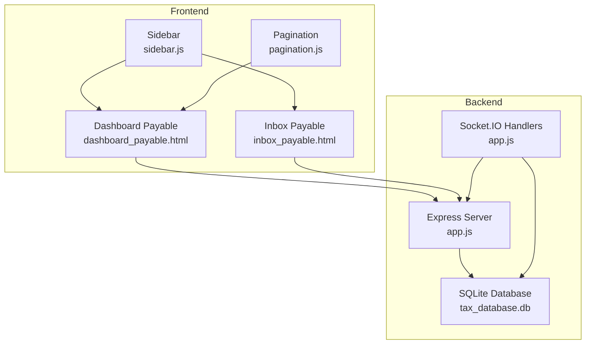
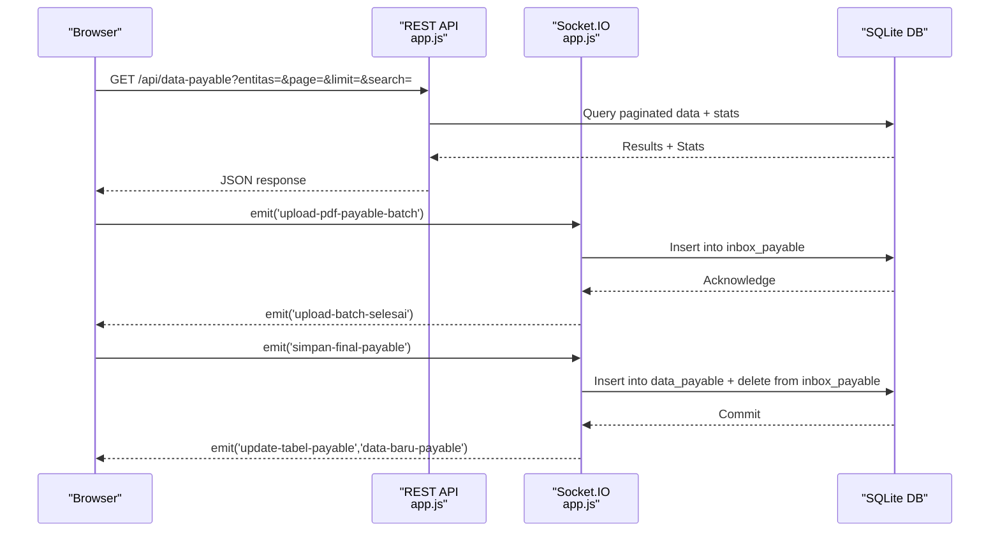
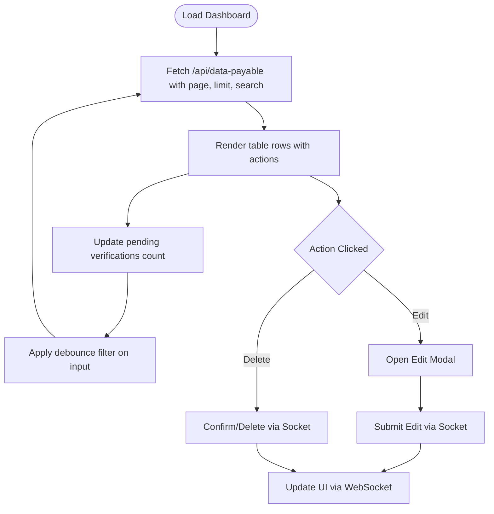
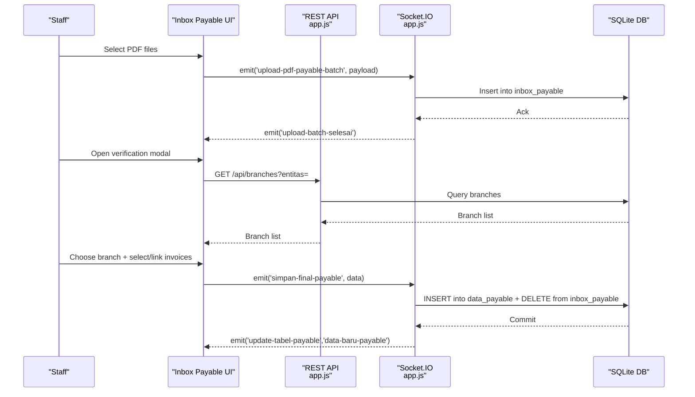
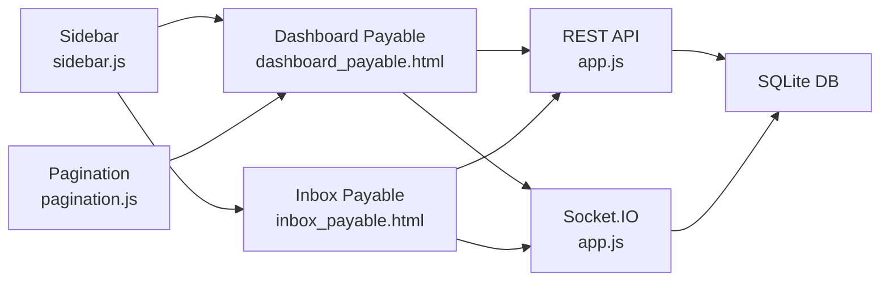

# Tax Payable Tracking

<cite>
**Referenced Files in This Document**
- [dashboard_payable.html](file://taxpayable_bppu/dashboard_payable.html)
- [inbox_payable.html](file://taxpayable_bppu/inbox_payable.html)
- [app.js](file://app.js)
- [PRD_Tax_Database_System.md](file://PRD_Tax_Database_System.md)
- [sidebar.js](file://sidebar.js)
- [pagination.js](file://pagination.js)
</cite>

## Table of Contents
1. [Introduction](#introduction)
2. [Project Structure](#project-structure)
3. [Core Components](#core-components)
4. [Architecture Overview](#architecture-overview)
5. [Detailed Component Analysis](#detailed-component-analysis)
6. [Dependency Analysis](#dependency-analysis)
7. [Performance Considerations](#performance-considerations)
8. [Troubleshooting Guide](#troubleshooting-guide)
9. [Conclusion](#conclusion)

## Introduction
This document provides comprehensive technical documentation for the Tax Payable Tracking module within the TDS (Tax Database System). It explains tax payable concepts, accrual accounting methods, and tax liability recognition principles as implemented in the system. It documents dashboard functionality for monitoring outstanding tax obligations, payment schedules, and compliance deadlines, along with the inbox processing workflow for reviewing tax payable entries, verification procedures, and approval processes. It also covers tax calculation methods, interest accrual, penalty assessment, and payment allocation procedures, with practical examples and integration points with accounting systems and cash flow management.

## Project Structure
The Tax Payable module consists of two primary user interface pages and supporting backend APIs and WebSocket handlers:
- Frontend:
  - Dashboard page for registering and viewing tax payable entries
  - Inbox page for verifying and completing tax payable entries
- Backend:
  - REST API endpoints for paginated data retrieval, filtering, and statistics
  - WebSocket handlers for batch PDF uploads, verification completion, and approval workflows
  - Database schema for storing tax payable records and staging entries

**Diagram sources**
- [dashboard_payable.html](file://taxpayable_bppu/dashboard_payable.html)
- [inbox_payable.html](file://taxpayable_bppu/inbox_payable.html)
- [app.js](file://app.js)
- [sidebar.js](file://sidebar.js)
- [pagination.js](file://pagination.js)

**Section sources**
- [dashboard_payable.html](file://taxpayable_bppu/dashboard_payable.html)
- [inbox_payable.html](file://taxpayable_bppu/inbox_payable.html)
- [app.js](file://app.js)

## Core Components
- Dashboard Payable: Displays registered tax payable entries with filtering, pagination, and summary statistics. Supports actions like editing and deleting entries, and linking to the verification inbox.
- Inbox Payable: Manages verification of newly uploaded tax payable entries, allowing staff to complete branch assignment and invoice linkage, and submitting final entries to the main register.
- Backend APIs: Provide paginated data retrieval, server-side filtering, and statistics for dashboard summaries.
- WebSocket Handlers: Enable batch PDF uploads, real-time updates, and maker-checker approval workflows for edits and deletions.

Key implementation references:
- Dashboard Payable UI and actions: [dashboard_payable.html](file://taxpayable_bppu/dashboard_payable.html)
- Inbox Payable UI and verification workflow: [inbox_payable.html](file://taxpayable_bppu/inbox_payable.html)
- Backend API endpoints and statistics: [app.js](file://app.js)
- WebSocket handlers for payable module: [app.js](file://app.js)
- Product Requirements and database schema: [PRD_Tax_Database_System.md](file://PRD_Tax_Database_System.md)

**Section sources**
- [dashboard_payable.html](file://taxpayable_bppu/dashboard_payable.html)
- [inbox_payable.html](file://taxpayable_bppu/inbox_payable.html)
- [app.js](file://app.js)
- [PRD_Tax_Database_System.md](file://PRD_Tax_Database_System.md)

## Architecture Overview
The system follows a client-server architecture with real-time capabilities:
- Client-side pages communicate with the backend via REST APIs and Socket.IO events.
- Server-side routes handle data retrieval, filtering, and statistics aggregation.
- WebSocket handlers process batch uploads, verification completion, and approval requests.
- Database schema supports both staging (inbox) and final (data) tables for tax payable entries.

**Diagram sources**
- [app.js](file://app.js)
- [dashboard_payable.html](file://taxpayable_bppu/dashboard_payable.html)
- [inbox_payable.html](file://taxpayable_bppu/inbox_payable.html)

## Detailed Component Analysis

### Dashboard Payable Component
The dashboard displays tax payable entries with:
- Summary cards for total documents, total tax, total DPP, and pending verifications
- Filterable table columns for branch, tax period, vendor name, BPPU number, DPP, rate, tax amount, invoice number, and input user
- Pagination controls and export/print actions
- Action buttons for editing and deleting entries
- Real-time updates via WebSocket when new entries are processed

Processing logic highlights:
- Server-side pagination and debounced filtering
- Monthly-over-month comparisons using server-calculated stats
- Maker-checker workflow for edits/deletes requiring supervisor approval

**Diagram sources**
- [dashboard_payable.html](file://taxpayable_bppu/dashboard_payable.html)
- [app.js](file://app.js)

**Section sources**
- [dashboard_payable.html](file://taxpayable_bppu/dashboard_payable.html)
- [app.js](file://app.js)

### Inbox Payable Component
The inbox manages verification of newly uploaded tax payable entries:
- Lists pending entries extracted from PDFs
- Allows selection of branch and linking to related VAT IN invoices
- Supports manual invoice input for unmatched vendors
- Batch PDF upload with chunked processing and progress feedback
- Real-time synchronization of counts and table updates

Verification and approval workflow:
- Staff completes branch and invoice linkage
- Submission triggers final insertion into data_payable and removal from inbox
- Supervisor/administrator bypasses approval for direct edits/deletes

**Diagram sources**
- [inbox_payable.html](file://taxpayable_bppu/inbox_payable.html)
- [app.js](file://app.js)

**Section sources**
- [inbox_payable.html](file://taxpayable_bppu/inbox_payable.html)
- [app.js](file://app.js)

### Backend API and WebSocket Handlers
The backend provides:
- REST endpoints for paginated data retrieval with server-side filtering and statistics
- Endpoints for branch lists and user requests
- WebSocket handlers for batch uploads, verification completion, and approval workflows

Key endpoints and handlers:
- GET /api/data-payable: Paginated data with stats and monthly-over-month metrics
- GET /api/inbox-payable: Paginated inbox entries with filtering
- GET /api/branches: Branch list for entity selection
- Socket events:
  - upload-pdf-payable-batch: Batch upload processing
  - simpan-final-payable: Verification completion
  - request-action-faktur: Edit/delete approval workflow
  - update-tabel-payable, data-baru-payable: Real-time UI updates

**Section sources**
- [app.js](file://app.js)

### Database Schema and Data Model
The database schema supports:
- Staging table (inbox_payable) for newly uploaded entries
- Final table (data_payable) for verified entries
- Supporting master data for branches and audit logs

Schema highlights:
- data_payable: Stores BPPU number, tax period, entity, branch, vendor details, DPP, rate, tax amount, document date, document number, linked invoice, input user, and PDF location
- inbox_payable: Stores extracted data and PDF location until verification
- master_cabang: Branch reference with entity association
- audit_logs: Immutable audit trail for all mutations

**Section sources**
- [PRD_Tax_Database_System.md](file://PRD_Tax_Database_System.md)
- [app.js](file://app.js)

## Dependency Analysis
The module depends on:
- Frontend: Vanilla JavaScript with Socket.IO for real-time updates, PDF.js for client-side parsing during uploads, and local storage for entity selection persistence
- Backend: Express.js for routing, SQLite for persistence, and Socket.IO for real-time communication
- Shared utilities: Pagination helpers and sidebar initialization

**Diagram sources**
- [dashboard_payable.html](file://taxpayable_bppu/dashboard_payable.html)
- [inbox_payable.html](file://taxpayable_bppu/inbox_payable.html)
- [app.js](file://app.js)
- [sidebar.js](file://sidebar.js)
- [pagination.js](file://pagination.js)

**Section sources**
- [dashboard_payable.html](file://taxpayable_bppu/dashboard_payable.html)
- [inbox_payable.html](file://taxpayable_bppu/inbox_payable.html)
- [app.js](file://app.js)
- [sidebar.js](file://sidebar.js)
- [pagination.js](file://pagination.js)

## Performance Considerations
- Server-side pagination and filtering minimize client-side load for large datasets
- Debounced filtering prevents excessive API requests during typing
- Batch processing with chunked uploads reduces memory pressure and improves responsiveness
- Real-time updates via WebSocket avoid frequent polling

[No sources needed since this section provides general guidance]

## Troubleshooting Guide
Common issues and resolutions:
- Duplicate uploads: The system checks duplicates against both final and staging tables before insertion
- Upload failures: Verify PDF validity and ensure required fields are present; review batch completion notifications
- Approval delays: Maker-checker workflow requires supervisor/administrator approval for edits/deletes
- Entity switching: Ensure entity selection persists across sessions via local storage and sidebar synchronization

Operational references:
- Duplicate guard logic in upload handlers
- Approval workflow via user_requests table
- Real-time status updates via Socket.IO events

**Section sources**
- [app.js](file://app.js)

## Conclusion
The Tax Payable Tracking module provides a robust, real-time solution for managing tax payable obligations. It integrates seamlessly with the broader TDS ecosystem, offering comprehensive dashboards, streamlined verification workflows, and secure approval processes. The implementation emphasizes accuracy, compliance, and operational efficiency through server-side pagination, batch processing, and immutable audit trails.