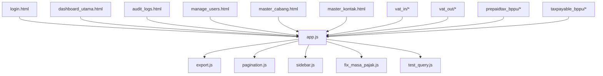
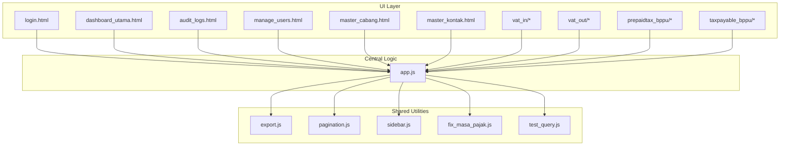
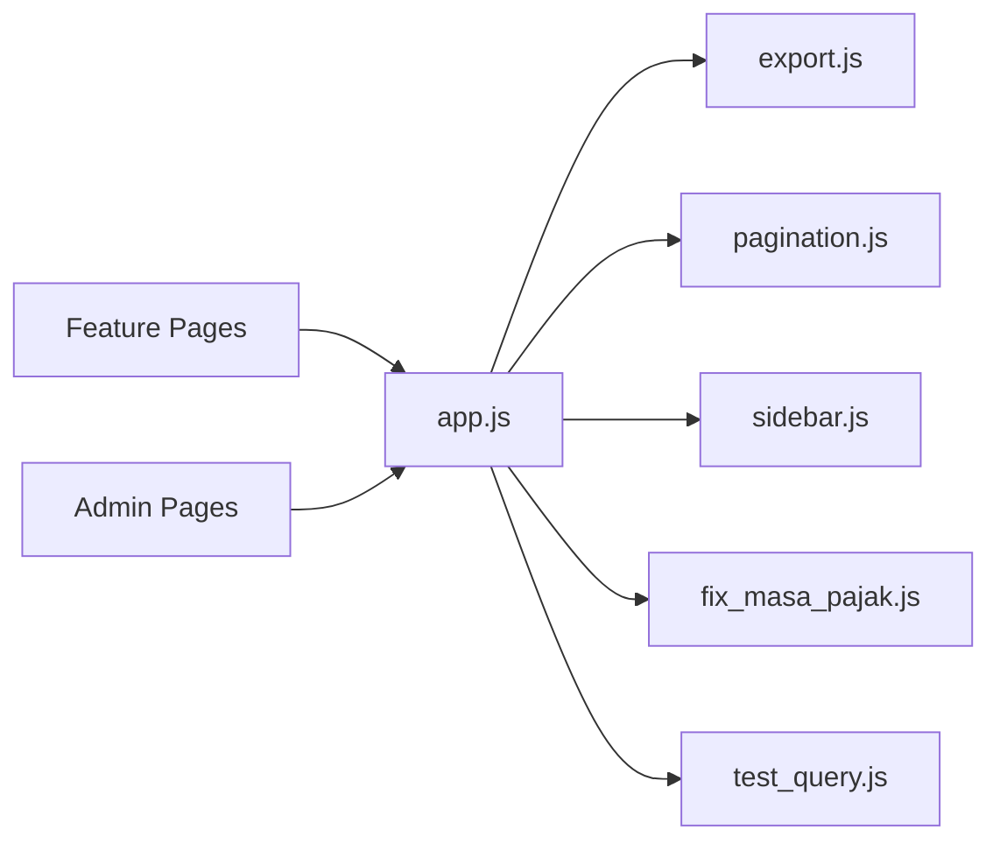

# Troubleshooting & FAQ

<cite>
**Referenced Files in This Document**
- [README.md](file://README.md)
- [PRD_Tax_Database_System.md](file://PRD_Tax_Database_System.md)
- [TDS_Sequence_Diagram.md](file://TDS_Sequence_Diagram.md)
- [app.js](file://app.js)
- [export.js](file://export.js)
- [pagination.js](file://pagination.js)
- [sidebar.js](file://sidebar.js)
- [fix_masa_pajak.js](file://fix_masa_pajak.js)
- [test_query.js](file://test_query.js)
- [login.html](file://login.html)
- [dashboard_utama.html](file://dashboard_utama.html)
- [audit_logs.html](file://audit_logs.html)
- [manage_users.html](file://manage_users.html)
- [master_cabang.html](file://master_cabang.html)
- [master_kontak.html](file://master_kontak.html)
- [vat_in/dashboard_vatin.html](file://vat_in/dashboard_vatin.html)
- [vat_in/summary_vatin.html](file://vat_in/summary_vatin.html)
- [vat_out/dashboard_vatout.html](file://vat_out/dashboard_vatout.html)
- [vat_out/summary_vatout.html](file://vat_out/summary_vatout.html)
- [prepaidtax_bppu/dashboard_prepaid.html](file://prepaidtax_bppu/dashboard_prepaid.html)
- [prepaidtax_bppu/inbox_prepaid.html](file://prepaidtax_bppu/inbox_prepaid.html)
- [prepaidtax_bppu/summary_prepaid.html](file://prepaidtax_bppu/summary_prepaid.html)
- [taxpayable_bppu/dashboard_payable.html](file://taxpayable_bppu/dashboard_payable.html)
- [taxpayable_bppu/inbox_payable.html](file://taxpayable_bppu/inbox_payable.html)
</cite>

## Table of Contents
1. [Introduction](#introduction)
2. [Project Structure](#project-structure)
3. [Core Components](#core-components)
4. [Architecture Overview](#architecture-overview)
5. [Detailed Component Analysis](#detailed-component-analysis)
6. [Dependency Analysis](#dependency-analysis)
7. [Performance Considerations](#performance-considerations)
8. [Troubleshooting Guide](#troubleshooting-guide)
9. [Conclusion](#conclusion)
10. [Appendices](#appendices)

## Introduction
This document provides comprehensive troubleshooting guidance and frequently asked questions for the TDS (Tax Data System). It focuses on diagnosing common issues, optimizing performance, resolving errors, and maintaining system health. It also covers user interface troubleshooting, data import/export concerns, integration pitfalls, and recovery procedures derived from the repository’s frontend and backend scripts.

## Project Structure
The TDS system is primarily a static web application with server-side logic encapsulated in JavaScript files. Key areas include:
- Central application logic and routing in [app.js](file://app.js)
- Export utilities in [export.js](file://export.js)
- Pagination helpers in [pagination.js](file://pagination.js)
- Sidebar navigation logic in [sidebar.js](file://sidebar.js)
- Data correction utilities in [fix_masa_pajak.js](file://fix_masa_pajak.js)
- Diagnostic queries in [test_query.js](file://test_query.js)
- Feature pages under domain-specific folders (e.g., VAT In, VAT Out, Prepaid Tax, Tax Payable)
- Administrative pages for users, branches, and contacts
- Audit logging page for compliance visibility

**Diagram sources**
- [app.js](file://app.js)
- [export.js](file://export.js)
- [pagination.js](file://pagination.js)
- [sidebar.js](file://sidebar.js)
- [fix_masa_pajak.js](file://fix_masa_pajak.js)
- [test_query.js](file://test_query.js)
- [login.html](file://login.html)
- [dashboard_utama.html](file://dashboard_utama.html)
- [audit_logs.html](file://audit_logs.html)
- [manage_users.html](file://manage_users.html)
- [master_cabang.html](file://master_cabang.html)
- [master_kontak.html](file://master_kontak.html)
- [vat_in/dashboard_vatin.html](file://vat_in/dashboard_vatin.html)
- [vat_out/dashboard_vatout.html](file://vat_out/dashboard_vatout.html)
- [prepaidtax_bppu/dashboard_prepaid.html](file://prepaidtax_bppu/dashboard_prepaid.html)
- [taxpayable_bppu/dashboard_payable.html](file://taxpayable_bppu/dashboard_payable.html)

**Section sources**
- [README.md](file://README.md)
- [PRD_Tax_Database_System.md](file://PRD_Tax_Database_System.md)

## Core Components
- Application entry and routing logic: [app.js](file://app.js)
- Export utilities: [export.js](file://export.js)
- Pagination helpers: [pagination.js](file://pagination.js)
- Sidebar navigation: [sidebar.js](file://sidebar.js)
- Data correction utilities: [fix_masa_pajak.js](file://fix_masa_pajak.js)
- Diagnostic queries: [test_query.js](file://test_query.js)
- Feature pages:
  - VAT In: [dashboard_vatin.html](file://vat_in/dashboard_vatin.html), [summary_vatin.html](file://vat_in/summary_vatin.html)
  - VAT Out: [dashboard_vatout.html](file://vat_out/dashboard_vatout.html), [summary_vatout.html](file://vat_out/summary_vatout.html)
  - Prepaid Tax: [dashboard_prepaid.html](file://prepaidtax_bppu/dashboard_prepaid.html), [inbox_prepaid.html](file://prepaidtax_bppu/inbox_prepaid.html), [summary_prepaid.html](file://prepaidtax_bppu/summary_prepaid.html)
  - Tax Payable: [dashboard_payable.html](file://taxpayable_bppu/dashboard_payable.html), [inbox_payable.html](file://taxpayable_bppu/inbox_payable.html)
- Administrative pages:
  - Login: [login.html](file://login.html)
  - Dashboard: [dashboard_utama.html](file://dashboard_utama.html)
  - Audit Logs: [audit_logs.html](file://audit_logs.html)
  - Manage Users: [manage_users.html](file://manage_users.html)
  - Master Branches: [master_cabang.html](file://master_cabang.html)
  - Master Contacts: [master_kontak.html](file://master_kontak.html)

**Section sources**
- [app.js](file://app.js)
- [export.js](file://export.js)
- [pagination.js](file://pagination.js)
- [sidebar.js](file://sidebar.js)
- [fix_masa_pajak.js](file://fix_masa_pajak.js)
- [test_query.js](file://test_query.js)
- [login.html](file://login.html)
- [dashboard_utama.html](file://dashboard_utama.html)
- [audit_logs.html](file://audit_logs.html)
- [manage_users.html](file://manage_users.html)
- [master_cabang.html](file://master_cabang.html)
- [master_kontak.html](file://master_kontak.html)
- [vat_in/dashboard_vatin.html](file://vat_in/dashboard_vatin.html)
- [vat_in/summary_vatin.html](file://vat_in/summary_vatin.html)
- [vat_out/dashboard_vatout.html](file://vat_out/dashboard_vatout.html)
- [vat_out/summary_vatout.html](file://vat_out/summary_vatout.html)
- [prepaidtax_bppu/dashboard_prepaid.html](file://prepaidtax_bppu/dashboard_prepaid.html)
- [prepaidtax_bppu/inbox_prepaid.html](file://prepaidtax_bppu/inbox_prepaid.html)
- [prepaidtax_bppu/summary_prepaid.html](file://prepaidtax_bppu/summary_prepaid.html)
- [taxpayable_bppu/dashboard_payable.html](file://taxpayable_bppu/dashboard_payable.html)
- [taxpayable_bppu/inbox_payable.html](file://taxpayable_bppu/inbox_payable.html)

## Architecture Overview
The system follows a client-side rendered SPA pattern with centralized logic in [app.js](file://app.js). Navigation and feature pages are HTML templates that delegate actions to shared utilities ([export.js](file://export.js), [pagination.js](file://pagination.js), [sidebar.js](file://sidebar.js)). Data correction and diagnostics are handled by dedicated scripts ([fix_masa_pajak.js](file://fix_masa_pajak.js), [test_query.js](file://test_query.js)).

**Diagram sources**
- [app.js](file://app.js)
- [export.js](file://export.js)
- [pagination.js](file://pagination.js)
- [sidebar.js](file://sidebar.js)
- [fix_masa_pajak.js](file://fix_masa_pajak.js)
- [test_query.js](file://test_query.js)
- [login.html](file://login.html)
- [dashboard_utama.html](file://dashboard_utama.html)
- [audit_logs.html](file://audit_logs.html)
- [manage_users.html](file://manage_users.html)
- [master_cabang.html](file://master_cabang.html)
- [master_kontak.html](file://master_kontak.html)
- [vat_in/dashboard_vatin.html](file://vat_in/dashboard_vatin.html)
- [vat_out/dashboard_vatout.html](file://vat_out/dashboard_vatout.html)
- [prepaidtax_bppu/dashboard_prepaid.html](file://prepaidtax_bppu/dashboard_prepaid.html)
- [taxpayable_bppu/dashboard_payable.html](file://taxpayable_bppu/dashboard_payable.html)

## Detailed Component Analysis

### Central Application Logic (app.js)
Responsibilities:
- Orchestrates navigation and page transitions
- Coordinates with shared utilities for export, pagination, sidebar, and diagnostics
- Provides hooks for feature modules to register handlers and lifecycle events

Common issues:
- Navigation failures due to missing route handlers
- Export/pagination not applied to target containers
- Sidebar state not persisting across page loads

Resolution steps:
- Verify route registration and handler wiring
- Confirm container selectors for export and pagination targets
- Ensure sidebar initialization runs after DOM ready

**Section sources**
- [app.js](file://app.js)

### Export Utilities (export.js)
Responsibilities:
- Implements export functionality for feature lists and summaries
- Handles CSV/JSON generation and download triggers

Common issues:
- Empty exports or missing data
- Download fails silently
- Incorrect column mapping

Resolution steps:
- Validate data source arrays and headers
- Check browser download permissions and pop-up blockers
- Confirm MIME type and filename formatting

**Section sources**
- [export.js](file://export.js)

### Pagination Helpers (pagination.js)
Responsibilities:
- Manages paginated rendering of lists
- Calculates page boundaries and controls navigation UI

Common issues:
- Pagination not visible or disabled prematurely
- Incorrect total count causing “no results”
- Navigation buttons unresponsive

Resolution steps:
- Verify total item count and items per page
- Ensure DOM containers exist and are targeted correctly
- Reinitialize pagination after dynamic updates

**Section sources**
- [pagination.js](file://pagination.js)

### Sidebar Navigation (sidebar.js)
Responsibilities:
- Initializes and manages sidebar menu state
- Applies active class to current page
- Ensures consistent navigation across feature modules

Common issues:
- Active page highlighting not updating
- Menu items not clickable
- State lost after navigation

Resolution steps:
- Confirm selector correctness and DOM readiness
- Re-run initialization on page load
- Validate event delegation for dynamic menus

**Section sources**
- [sidebar.js](file://sidebar.js)

### Data Correction Utilities (fix_masa_pajak.js)
Responsibilities:
- Corrects period/month fields for tax records
- Supports batch updates and validation

Common issues:
- No change detected after correction
- Incorrect month/year mapping
- Partial updates or skipped rows

Resolution steps:
- Validate input date formats and ranges
- Run pre-checks to confirm affected rows
- Retry with smaller batches if timeouts occur

**Section sources**
- [fix_masa_pajak.js](file://fix_masa_pajak.js)

### Diagnostic Queries (test_query.js)
Responsibilities:
- Executes ad-hoc queries for verification and testing
- Returns structured results for inspection

Common issues:
- Query timeout or failure
- Unexpected empty results
- Permission denied errors

Resolution steps:
- Check connectivity and credentials
- Simplify query and re-run incrementally
- Review server logs for detailed error messages

**Section sources**
- [test_query.js](file://test_query.js)

### Feature Pages (VAT In/Out, Prepaid Tax, Tax Payable)
Responsibilities:
- Present dashboards, summaries, and inboxes for respective domains
- Integrate with central logic for export, pagination, and navigation

Common issues:
- Dashboards not loading data
- Summaries missing totals
- Inbox filters not applying

Resolution steps:
- Confirm data endpoints and CORS policies
- Validate selectors for charts/tables
- Reinitialize export/pagination on data refresh

**Section sources**
- [vat_in/dashboard_vatin.html](file://vat_in/dashboard_vatin.html)
- [vat_in/summary_vatin.html](file://vat_in/summary_vatin.html)
- [vat_out/dashboard_vatout.html](file://vat_out/dashboard_vatout.html)
- [vat_out/summary_vatout.html](file://vat_out/summary_vatout.html)
- [prepaidtax_bppu/dashboard_prepaid.html](file://prepaidtax_bppu/dashboard_prepaid.html)
- [prepaidtax_bppu/inbox_prepaid.html](file://prepaidtax_bppu/inbox_prepaid.html)
- [prepaidtax_bppu/summary_prepaid.html](file://prepaidtax_bppu/summary_prepaid.html)
- [taxpayable_bppu/dashboard_payable.html](file://taxpayable_bppu/dashboard_payable.html)
- [taxpayable_bppu/inbox_payable.html](file://taxpayable_bppu/inbox_payable.html)

### Administrative Pages
- Login: [login.html](file://login.html)
- Dashboard: [dashboard_utama.html](file://dashboard_utama.html)
- Audit Logs: [audit_logs.html](file://audit_logs.html)
- Manage Users: [manage_users.html](file://manage_users.html)
- Master Branches: [master_cabang.html](file://master_cabang.html)
- Master Contacts: [master_kontak.html](file://master_kontak.html)

Common issues:
- Login session invalidation
- Audit logs not updating
- User/Branch/Contact edits not saved

Resolution steps:
- Clear browser cache and cookies
- Refresh audit log page after changes
- Confirm backend write permissions and response codes

**Section sources**
- [login.html](file://login.html)
- [dashboard_utama.html](file://dashboard_utama.html)
- [audit_logs.html](file://audit_logs.html)
- [manage_users.html](file://manage_users.html)
- [master_cabang.html](file://master_cabang.html)
- [master_kontak.html](file://master_kontak.html)

## Dependency Analysis
The central logic in [app.js](file://app.js) depends on shared utilities and feature pages. Dependencies are primarily runtime imports and DOM interactions.

**Diagram sources**
- [app.js](file://app.js)
- [export.js](file://export.js)
- [pagination.js](file://pagination.js)
- [sidebar.js](file://sidebar.js)
- [fix_masa_pajak.js](file://fix_masa_pajak.js)
- [test_query.js](file://test_query.js)
- [login.html](file://login.html)
- [dashboard_utama.html](file://dashboard_utama.html)
- [audit_logs.html](file://audit_logs.html)
- [manage_users.html](file://manage_users.html)
- [master_cabang.html](file://master_cabang.html)
- [master_kontak.html](file://master_kontak.html)
- [vat_in/dashboard_vatin.html](file://vat_in/dashboard_vatin.html)
- [vat_out/dashboard_vatout.html](file://vat_out/dashboard_vatout.html)
- [prepaidtax_bppu/dashboard_prepaid.html](file://prepaidtax_bppu/dashboard_prepaid.html)
- [taxpayable_bppu/dashboard_payable.html](file://taxpayable_bppu/dashboard_payable.html)

**Section sources**
- [app.js](file://app.js)
- [export.js](file://export.js)
- [pagination.js](file://pagination.js)
- [sidebar.js](file://sidebar.js)
- [fix_masa_pajak.js](file://fix_masa_pajak.js)
- [test_query.js](file://test_query.js)

## Performance Considerations
- Minimize DOM operations during pagination and export by batching updates.
- Defer heavy computations until after initial render completes.
- Use efficient selectors and avoid deep traversal in [sidebar.js](file://sidebar.js).
- Limit export payload sizes and split large datasets into chunks.
- Cache computed totals and summaries to reduce repeated calculations.

[No sources needed since this section provides general guidance]

## Troubleshooting Guide

### Authentication and Session Issues
Symptoms:
- Cannot log in or redirected immediately after login
- Session expires mid-use

Resolution:
- Clear browser cache and cookies, then retry login
- Confirm server availability and network connectivity
- Check for mixed content warnings in the browser console

**Section sources**
- [login.html](file://login.html)

### UI Not Loading or Elements Missing
Symptoms:
- Blank page or partially loaded dashboard
- Navigation links not working

Resolution:
- Reload the page and disable ad blockers
- Verify [sidebar.js](file://sidebar.js) initializes after DOM ready
- Confirm [app.js](file://app.js) routes are registered and reachable

**Section sources**
- [sidebar.js](file://sidebar.js)
- [app.js](file://app.js)

### Export Problems
Symptoms:
- Export button does nothing or downloads empty files
- Exported data missing expected columns

Resolution:
- Ensure data exists in the target container
- Check browser download permissions and pop-up settings
- Validate headers and row structures in [export.js](file://export.js)

**Section sources**
- [export.js](file://export.js)

### Pagination Not Working
Symptoms:
- Pagination controls hidden or disabled
- Next/previous buttons inactive

Resolution:
- Confirm total item count and items per page
- Reinitialize pagination after data updates
- Verify container selectors in [pagination.js](file://pagination.js)

**Section sources**
- [pagination.js](file://pagination.js)

### Data Correction Failures
Symptoms:
- Correction script runs but no rows updated
- Incorrect month/year mapping

Resolution:
- Validate input date formats and ranges
- Run a dry-run to preview affected rows
- Retry with smaller batches if timeouts occur

**Section sources**
- [fix_masa_pajak.js](file://fix_masa_pajak.js)

### Diagnostic Query Failures
Symptoms:
- Query returns timeout or permission errors
- Results appear truncated

Resolution:
- Simplify query and re-run incrementally
- Check server logs for detailed error messages
- Confirm database credentials and connection settings

**Section sources**
- [test_query.js](file://test_query.js)

### Feature Page Issues
Symptoms:
- Dashboards show no data
- Summaries missing totals
- Filters not applied in inboxes

Resolution:
- Confirm endpoint URLs and CORS policies
- Validate chart/table selectors
- Reinitialize export/pagination after refresh

**Section sources**
- [vat_in/dashboard_vatin.html](file://vat_in/dashboard_vatin.html)
- [vat_in/summary_vatin.html](file://vat_in/summary_vatin.html)
- [vat_out/dashboard_vatout.html](file://vat_out/dashboard_vatout.html)
- [vat_out/summary_vatout.html](file://vat_out/summary_vatout.html)
- [prepaidtax_bppu/dashboard_prepaid.html](file://prepaidtax_bppu/dashboard_prepaid.html)
- [prepaidtax_bppu/inbox_prepaid.html](file://prepaidtax_bppu/inbox_prepaid.html)
- [prepaidtax_bppu/summary_prepaid.html](file://prepaidtax_bppu/summary_prepaid.html)
- [taxpayable_bppu/dashboard_payable.html](file://taxpayable_bppu/dashboard_payable.html)
- [taxpayable_bppu/inbox_payable.html](file://taxpayable_bppu/inbox_payable.html)

### Administrative Page Issues
Symptoms:
- Audit logs not updating after changes
- User/Branch/Contact edits not saved

Resolution:
- Refresh audit log page after modifications
- Clear browser cache and retry
- Confirm backend write permissions and response codes

**Section sources**
- [audit_logs.html](file://audit_logs.html)
- [manage_users.html](file://manage_users.html)
- [master_cabang.html](file://master_cabang.html)
- [master_kontak.html](file://master_kontak.html)

### Log Analysis and Problem Isolation
- Use browser developer tools to inspect Network tab for failed requests
- Check Console tab for JavaScript errors and stack traces
- Review server logs for database and permission-related errors
- Correlate timestamps between client and server logs

**Section sources**
- [test_query.js](file://test_query.js)

### Recovery and Emergency Procedures
- Rollback recent changes to [app.js](file://app.js) or feature pages
- Restore exports to previous working versions
- Re-run [fix_masa_pajak.js](file://fix_masa_pajak.js) with corrected parameters
- Perform incremental [test_query.js](file://test_query.js) checks post-fix

**Section sources**
- [app.js](file://app.js)
- [fix_masa_pajak.js](file://fix_masa_pajak.js)
- [test_query.js](file://test_query.js)

### Frequently Asked Questions
Q: Why does the export fail?
A: Check browser download permissions, confirm data exists, and validate headers in [export.js](file://export.js).

Q: How do I fix pagination issues?
A: Verify total counts and items per page, then reinitialize pagination in [pagination.js](file://pagination.js).

Q: Why is the sidebar not highlighting the active page?
A: Ensure [sidebar.js](file://sidebar.js) runs after DOM ready and selectors match the current page.

Q: How do I correct tax periods?
A: Use [fix_masa_pajak.js](file://fix_masa_pajak.js) with validated date formats and retry small batches.

Q: How do I run diagnostics?
A: Use [test_query.js](file://test_query.js) to execute queries and inspect results.

Q: Where are audit logs located?
A: View audit logs in [audit_logs.html](file://audit_logs.html).

Q: How do I reset my session?
A: Clear browser cache and cookies, then log in again via [login.html](file://login.html).

**Section sources**
- [export.js](file://export.js)
- [pagination.js](file://pagination.js)
- [sidebar.js](file://sidebar.js)
- [fix_masa_pajak.js](file://fix_masa_pajak.js)
- [test_query.js](file://test_query.js)
- [audit_logs.html](file://audit_logs.html)
- [login.html](file://login.html)

## Conclusion
This guide consolidates practical troubleshooting steps, performance tips, and recovery procedures for the TDS system. By following the component-specific resolutions and adopting the recommended diagnostics and maintenance practices, most issues can be quickly identified and resolved.

[No sources needed since this section summarizes without analyzing specific files]

## Appendices

### System Health Monitoring Checklist
- Verify login and navigation work across browsers
- Confirm export and pagination produce expected outputs
- Validate audit logs update after administrative changes
- Run periodic diagnostic queries to check connectivity and permissions

**Section sources**
- [login.html](file://login.html)
- [export.js](file://export.js)
- [pagination.js](file://pagination.js)
- [audit_logs.html](file://audit_logs.html)
- [test_query.js](file://test_query.js)

### Maintenance Procedures
- Periodically review and update feature pages to align with central logic
- Back up exports and keep a changelog of corrections performed via [fix_masa_pajak.js](file://fix_masa_pajak.js)
- Monitor browser compatibility and address console errors promptly

**Section sources**
- [fix_masa_pajak.js](file://fix_masa_pajak.js)

### Integration Notes
- Ensure endpoints and CORS policies support feature pages and administrative modules
- Validate that shared utilities are loaded before invoking their functions

**Section sources**
- [app.js](file://app.js)
- [export.js](file://export.js)
- [pagination.js](file://pagination.js)
- [sidebar.js](file://sidebar.js)