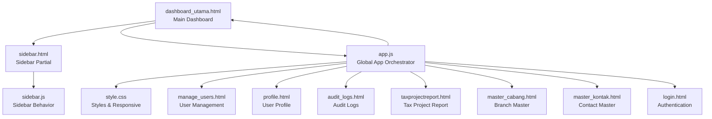
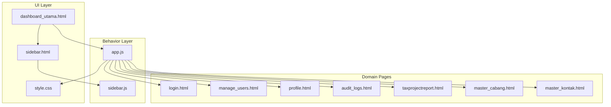
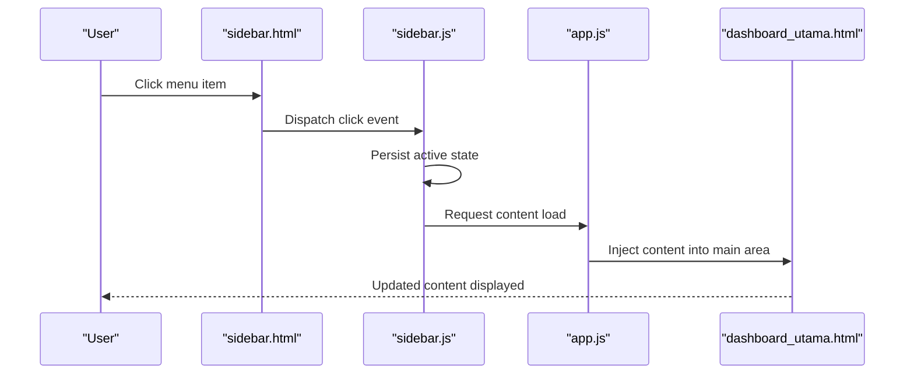
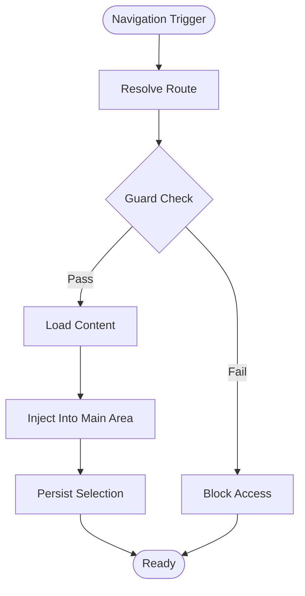
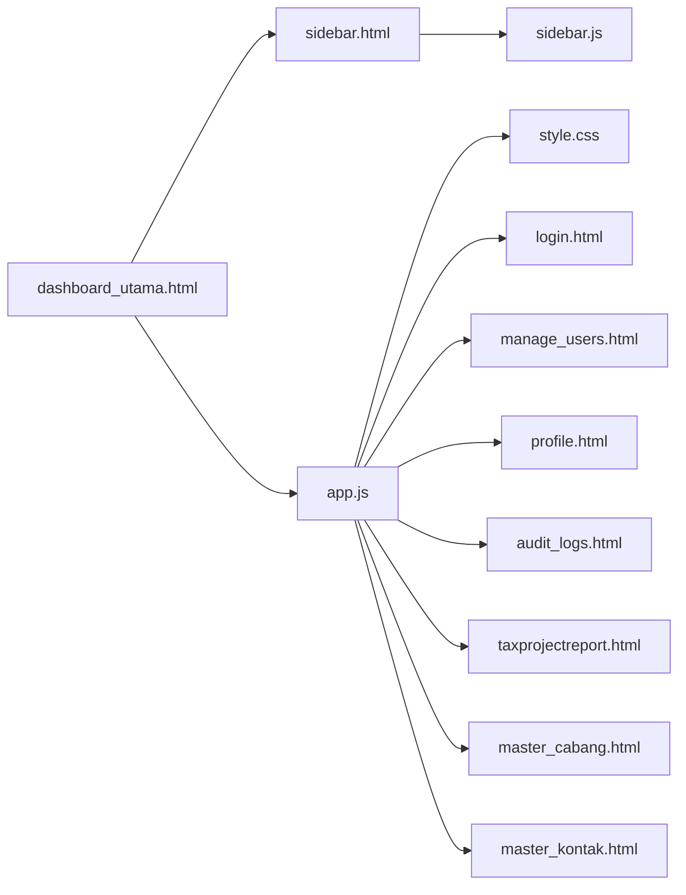

# Dashboard & Navigation

<cite>
**Referenced Files in This Document**
- [dashboard_utama.html](file://dashboard_utama.html)
- [sidebar.html](file://sidebar.html)
- [sidebar.js](file://sidebar.js)
- [app.js](file://app.js)
- [style.css](file://style.css)
- [login.html](file://login.html)
- [manage_users.html](file://manage_users.html)
- [profile.html](file://profile.html)
- [audit_logs.html](file://audit_logs.html)
- [taxprojectreport.html](file://taxprojectreport.html)
- [master_cabang.html](file://master_cabang.html)
- [master_kontak.html](file://master_kontak.html)
- [export.js](file://export.js)
- [pagination.js](file://pagination.js)
- [fix_masa_pajak.js](file://fix_masa_pajak.js)
- [test_query.js](file://test_query.js)
- [theme.js](file://theme.js)
</cite>

## Table of Contents
1. [Introduction](#introduction)
2. [Project Structure](#project-structure)
3. [Core Components](#core-components)
4. [Architecture Overview](#architecture-overview)
5. [Detailed Component Analysis](#detailed-component-analysis)
6. [Dependency Analysis](#dependency-analysis)
7. [Performance Considerations](#performance-considerations)
8. [Troubleshooting Guide](#troubleshooting-guide)
9. [Conclusion](#conclusion)

## Introduction
This document describes the dashboard and navigation system of the Tax Database System. It explains the main dashboard layout, component organization, and user interface hierarchy. It documents the navigation sidebar functionality, including menu items, role-based visibility, and dynamic content loading. It details the sidebar.js implementation for menu management, click handlers, and state persistence. It also covers responsive design patterns, mobile navigation adaptation, user workflow optimization, and integration with the authentication system and user permissions.

## Project Structure
The navigation and dashboard system is composed of:
- A central dashboard page that hosts the main content area
- A reusable sidebar partial that renders navigation menus
- A JavaScript module responsible for sidebar behavior and state
- A global application script that orchestrates navigation and routing
- A stylesheet that defines responsive and theme-aware UI
- Supporting pages for roles, profiles, reports, and administrative tasks

**Diagram sources**
- [dashboard_utama.html](file://dashboard_utama.html)
- [sidebar.html](file://sidebar.html)
- [sidebar.js](file://sidebar.js)
- [app.js](file://app.js)
- [style.css](file://style.css)
- [login.html](file://login.html)
- [manage_users.html](file://manage_users.html)
- [profile.html](file://profile.html)
- [audit_logs.html](file://audit_logs.html)
- [taxprojectreport.html](file://taxprojectreport.html)
- [master_cabang.html](file://master_cabang.html)
- [master_kontak.html](file://master_kontak.html)

**Section sources**
- [dashboard_utama.html](file://dashboard_utama.html)
- [sidebar.html](file://sidebar.html)
- [sidebar.js](file://sidebar.js)
- [app.js](file://app.js)
- [style.css](file://style.css)

## Core Components
- Main Dashboard Layout: Provides the primary container for the application’s content and integrates the sidebar partial.
- Sidebar Partial: Defines the navigation menu structure and renders links to various functional areas.
- Sidebar Behavior Module: Manages click events, active state persistence, and dynamic content loading.
- Global Application Orchestrator: Coordinates navigation, route resolution, and integration with authentication and permissions.
- Stylesheet: Implements responsive breakpoints, theme-aware styling, and mobile-first navigation adaptations.
- Authentication Page: Entry point for login and session initialization.
- Feature Pages: Role-based dashboards, user management, profile, audit logs, tax reports, and master data screens.

Key responsibilities:
- Dashboard layout: Hosts the main content area and ensures proper integration with the sidebar.
- Sidebar: Renders menu items, applies role-based visibility, and persists active selection.
- Behavior: Handles clicks, updates DOM state, loads content dynamically, and maintains user preferences.
- App orchestration: Routes navigation, enforces guards, and integrates with authentication and permissions.
- Styles: Ensures responsive behavior and adaptive layouts for mobile devices.

**Section sources**
- [dashboard_utama.html](file://dashboard_utama.html)
- [sidebar.html](file://sidebar.html)
- [sidebar.js](file://sidebar.js)
- [app.js](file://app.js)
- [style.css](file://style.css)
- [login.html](file://login.html)

## Architecture Overview
The navigation system follows a modular pattern:
- The dashboard page includes the sidebar partial and initializes the application.
- The sidebar behavior module listens for clicks and manages active states.
- The global application orchestrator resolves routes and enforces navigation guards.
- The stylesheet provides responsive design and theme support.

**Diagram sources**
- [dashboard_utama.html](file://dashboard_utama.html)
- [sidebar.html](file://sidebar.html)
- [sidebar.js](file://sidebar.js)
- [app.js](file://app.js)
- [style.css](file://style.css)
- [login.html](file://login.html)
- [manage_users.html](file://manage_users.html)
- [profile.html](file://profile.html)
- [audit_logs.html](file://audit_logs.html)
- [taxprojectreport.html](file://taxprojectreport.html)
- [master_cabang.html](file://master_cabang.html)
- [master_kontak.html](file://master_kontak.html)

## Detailed Component Analysis

### Dashboard Layout (dashboard_utama.html)
Responsibilities:
- Includes the sidebar partial to render navigation.
- Provides the main content container where dynamic content is loaded.
- Integrates with the global application orchestrator for navigation and routing.

Implementation highlights:
- Embeds the sidebar partial to ensure consistent navigation across the application.
- Establishes a content area for dynamic page loading.
- Initializes application-level event listeners and state hooks.

**Section sources**
- [dashboard_utama.html](file://dashboard_utama.html)

### Sidebar Partial (sidebar.html)
Responsibilities:
- Defines the menu structure with top-level items and nested submenus.
- Supports role-based visibility of menu items.
- Provides anchors for dynamic content loading and navigation.

Implementation highlights:
- Menu items are organized with identifiers for consistent targeting.
- Submenu toggles enable hierarchical navigation.
- Accessibility attributes and semantic markup improve usability.

**Section sources**
- [sidebar.html](file://sidebar.html)

### Sidebar Behavior (sidebar.js)
Responsibilities:
- Manages click handlers for menu items and submenu toggles.
- Persists active state and selected item in storage.
- Loads content dynamically into the main content area.
- Applies role-based visibility and guards during navigation.

Implementation highlights:
- Event delegation ensures robust handling of dynamic menu items.
- Active state persistence improves user experience by remembering selections.
- Dynamic content loading reduces page reloads and enhances responsiveness.
- Role-based filtering prevents unauthorized access to restricted areas.

**Diagram sources**
- [sidebar.html](file://sidebar.html)
- [sidebar.js](file://sidebar.js)
- [app.js](file://app.js)
- [dashboard_utama.html](file://dashboard_utama.html)

**Section sources**
- [sidebar.js](file://sidebar.js)

### Global Application Orchestrator (app.js)
Responsibilities:
- Resolves navigation routes and loads appropriate content.
- Enforces navigation guards based on authentication and permissions.
- Integrates with the authentication system to initialize user sessions.
- Coordinates with the sidebar behavior module for state synchronization.

Implementation highlights:
- Route resolution determines which domain page to load.
- Guards prevent access to unauthorized pages.
- Session initialization occurs upon successful login.
- State synchronization ensures sidebar and content remain aligned.

**Diagram sources**
- [app.js](file://app.js)
- [sidebar.js](file://sidebar.js)
- [dashboard_utama.html](file://dashboard_utama.html)

**Section sources**
- [app.js](file://app.js)

### Stylesheet (style.css)
Responsibilities:
- Implements responsive breakpoints for mobile and tablet devices.
- Provides theme-aware styling for light/dark modes.
- Adapts navigation layout for smaller screens with collapsible menus.

Implementation highlights:
- Media queries adjust sidebar width and content padding.
- Theme variables support dynamic color schemes.
- Mobile-first design ensures touch-friendly navigation.

**Section sources**
- [style.css](file://style.css)

### Authentication Integration (login.html)
Responsibilities:
- Provides the login entry point and session initialization.
- Integrates with the application orchestrator to establish user context.
- Enables subsequent navigation based on user roles and permissions.

**Section sources**
- [login.html](file://login.html)
- [app.js](file://app.js)

### Domain Pages
- User Management (manage_users.html): Role-based access for administrators.
- Profile (profile.html): Personal settings and account management.
- Audit Logs (audit_logs.html): Compliance and monitoring features.
- Tax Project Report (taxprojectreport.html): Reporting and analytics.
- Master Data (master_cabang.html, master_kontak.html): Administrative data management.

These pages integrate with the navigation system via the global orchestrator and sidebar behavior.

**Section sources**
- [manage_users.html](file://manage_users.html)
- [profile.html](file://profile.html)
- [audit_logs.html](file://audit_logs.html)
- [taxprojectreport.html](file://taxprojectreport.html)
- [master_cabang.html](file://master_cabang.html)
- [master_kontak.html](file://master_kontak.html)

## Dependency Analysis
The navigation system exhibits low coupling and high cohesion:
- The dashboard depends on the sidebar partial and the application orchestrator.
- The sidebar behavior module depends on the sidebar partial and the application orchestrator.
- The application orchestrator coordinates navigation and guards.
- Stylesheet supports responsive behavior across all pages.

**Diagram sources**
- [dashboard_utama.html](file://dashboard_utama.html)
- [sidebar.html](file://sidebar.html)
- [sidebar.js](file://sidebar.js)
- [app.js](file://app.js)
- [style.css](file://style.css)
- [login.html](file://login.html)
- [manage_users.html](file://manage_users.html)
- [profile.html](file://profile.html)
- [audit_logs.html](file://audit_logs.html)
- [taxprojectreport.html](file://taxprojectreport.html)
- [master_cabang.html](file://master_cabang.html)
- [master_kontak.html](file://master_kontak.html)

**Section sources**
- [dashboard_utama.html](file://dashboard_utama.html)
- [sidebar.html](file://sidebar.html)
- [sidebar.js](file://sidebar.js)
- [app.js](file://app.js)
- [style.css](file://style.css)

## Performance Considerations
- Lazy loading: Load content on demand to minimize initial payload.
- Event delegation: Use delegated event handlers to reduce binding overhead.
- State persistence: Persist active selections to avoid re-computation.
- Responsive design: Minimize layout thrashing by leveraging CSS transforms and media queries.
- Caching: Cache frequently accessed pages to improve perceived performance.

## Troubleshooting Guide
Common issues and resolutions:
- Menu items not visible: Verify role-based visibility logic and user permissions.
- Active state not persisting: Confirm storage keys and persistence logic in the sidebar behavior module.
- Content not loading: Check route resolution and injection logic in the application orchestrator.
- Mobile layout problems: Inspect responsive breakpoints and media queries in the stylesheet.
- Authentication redirects: Ensure login integration and session initialization occur before navigation.

**Section sources**
- [sidebar.js](file://sidebar.js)
- [app.js](file://app.js)
- [style.css](file://style.css)
- [login.html](file://login.html)

## Conclusion
The dashboard and navigation system is structured around a clean separation of concerns: a reusable sidebar partial, a focused behavior module, and a global orchestrator that coordinates navigation, guards, and content loading. The stylesheet ensures responsive and theme-aware experiences. Together, these components deliver a scalable, maintainable, and user-friendly navigation solution integrated with authentication and permission handling.