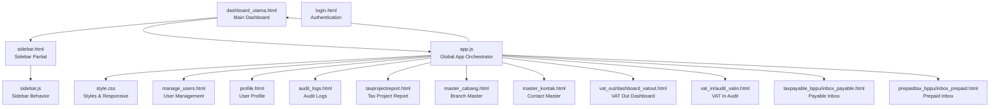
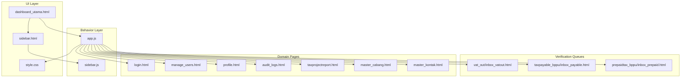
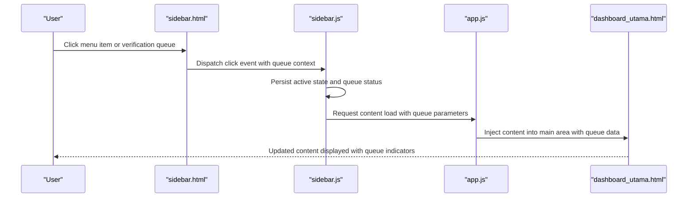
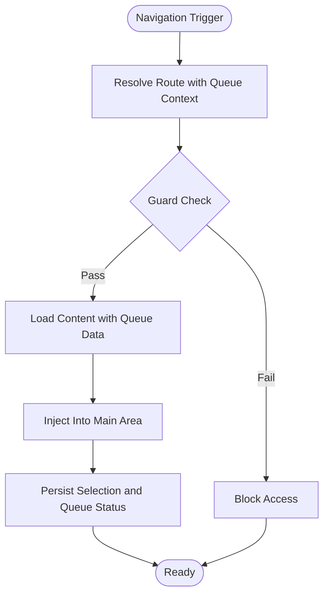
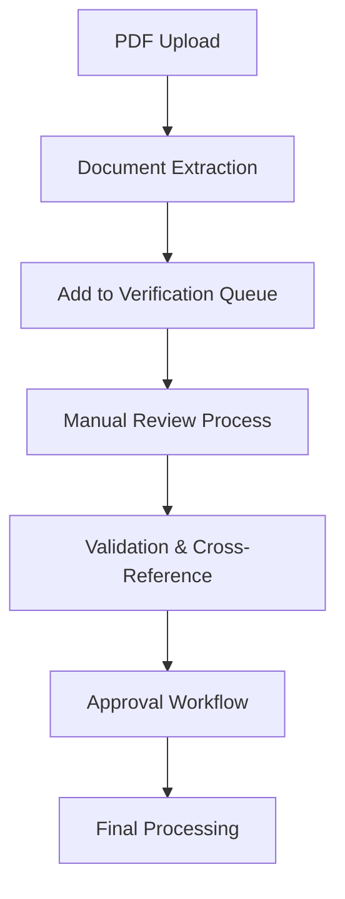
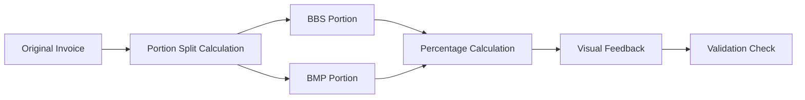
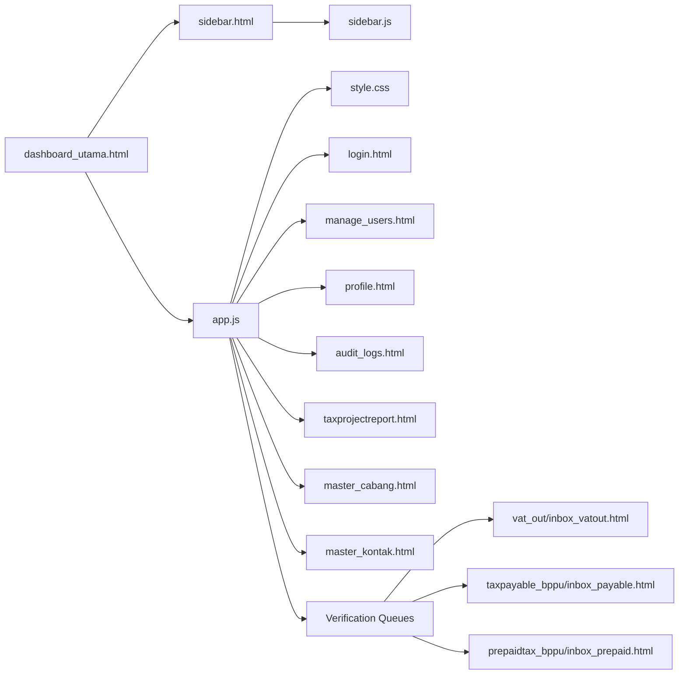

# Dashboard & Navigation

<cite>
**Referenced Files in This Document**
- [dashboard_utama.html](file://dashboard_utama.html)
- [sidebar.html](file://sidebar.html)
- [sidebar.js](file://sidebar.js)
- [app.js](file://app.js)
- [style.css](file://style.css)
- [login.html](file://login.html)
- [manage_users.html](file://manage_users.html)
- [profile.html](file://profile.html)
- [audit_logs.html](file://audit_logs.html)
- [taxprojectreport.html](file://taxprojectreport.html)
- [master_cabang.html](file://master_cabang.html)
- [master_kontak.html](file://master_kontak.html)
- [export.js](file://export.js)
- [pagination.js](file://pagination.js)
- [theme.js](file://theme.js)
- [vat_out/dashboard_vatout.html](file://vat_out/dashboard_vatout.html)
- [vat_out/inbox_vatout.html](file://vat_out/inbox_vatout.html)
- [vat_in/audit_vatin.html](file://vat_in/audit_vatin.html)
- [taxpayable_bppu/inbox_payable.html](file://taxpayable_bppu/inbox_payable.html)
- [prepaidtax_bppu/inbox_prepaid.html](file://prepaidtax_bppu/inbox_prepaid.html)
</cite>

## Update Summary
**Changes Made**
- Enhanced sidebar navigation with new verification queue menus for Tax Payable and Prepaid Tax modules
- Updated VAT IN audit menu item labeling from "Audit Integritas Faktur" to "Audit Integritas Faktur Masukan"
- Improved VAT OUT dashboard with enhanced status badge styling and advanced filtering capabilities
- Integrated new portion tracking system for Joint Venture (JO) entities with DPP/PPN allocation
- Added comprehensive verification queue functionality across all tax modules

## Table of Contents
1. [Introduction](#introduction)
2. [Project Structure](#project-structure)
3. [Core Components](#core-components)
4. [Architecture Overview](#architecture-overview)
5. [Detailed Component Analysis](#detailed-component-analysis)
6. [Enhanced Verification Queue System](#enhanced-verification-queue-system)
7. [Portion Tracking Integration](#portion-tracking-integration)
8. [Dependency Analysis](#dependency-analysis)
9. [Performance Considerations](#performance-considerations)
10. [Troubleshooting Guide](#troubleshooting-guide)
11. [Conclusion](#conclusion)

## Introduction
This document describes the dashboard and navigation system of the Tax Database System. It explains the main dashboard layout, component organization, and user interface hierarchy. It documents the navigation sidebar functionality, including menu items, role-based visibility, and dynamic content loading. It details the sidebar.js implementation for menu management, click handlers, and state persistence. It also covers responsive design patterns, mobile navigation adaptation, user workflow optimization, and integration with the authentication system and user permissions.

**Updated** Enhanced with comprehensive verification queue functionality for all tax modules and improved portion tracking for Joint Venture entities.

## Project Structure
The navigation and dashboard system is composed of:
- A central dashboard page that hosts the main content area
- A reusable sidebar partial that renders navigation menus with verification queue indicators
- A JavaScript module responsible for sidebar behavior and state management
- A global application script that orchestrates navigation and routing
- A stylesheet that defines responsive and theme-aware UI with enhanced badge styling
- Supporting pages for roles, profiles, reports, and administrative tasks
- Dedicated verification queue interfaces for each tax module

**Diagram sources**
- [dashboard_utama.html](file://dashboard_utama.html)
- [sidebar.html](file://sidebar.html)
- [sidebar.js](file://sidebar.js)
- [app.js](file://app.js)
- [style.css](file://style.css)
- [vat_out/dashboard_vatout.html](file://vat_out/dashboard_vatout.html)
- [vat_in/audit_vatin.html](file://vat_in/audit_vatin.html)
- [taxpayable_bppu/inbox_payable.html](file://taxpayable_bppu/inbox_payable.html)
- [prepaidtax_bppu/inbox_prepaid.html](file://prepaidtax_bppu/inbox_prepaid.html)

**Section sources**
- [dashboard_utama.html](file://dashboard_utama.html)
- [sidebar.html](file://sidebar.html)
- [sidebar.js](file://sidebar.js)
- [app.js](file://app.js)
- [style.css](file://style.css)

## Core Components
- Main Dashboard Layout: Provides the primary container for the application's content and integrates the sidebar partial with verification queue indicators.
- Sidebar Partial: Defines the navigation menu structure with enhanced verification queue links for all tax modules and supports role-based visibility.
- Sidebar Behavior Module: Manages click events, active state persistence, dynamic content loading, and verification queue synchronization.
- Global Application Orchestrator: Coordinates navigation, route resolution, and integration with authentication and permissions.
- Stylesheet: Implements responsive breakpoints, theme-aware styling, and mobile-first navigation adaptations with enhanced badge styling.
- Authentication Page: Entry point for login and session initialization.
- Feature Pages: Role-based dashboards, user management, profile, audit logs, tax reports, and master data screens.
- Verification Queue Interfaces: Dedicated inbox pages for VAT OUT, Tax Payable, and Prepaid Tax modules with PDF processing capabilities.

Key responsibilities:
- Dashboard layout: Hosts the main content area and ensures proper integration with the sidebar and verification queues.
- Sidebar: Renders menu items with verification queue indicators, applies role-based visibility, and persists active selection.
- Behavior: Handles clicks, updates DOM state, loads content dynamically, maintains user preferences, and synchronizes verification queues.
- App orchestration: Routes navigation, enforces guards, and integrates with authentication and permissions.
- Styles: Ensures responsive behavior and adaptive layouts for mobile devices with enhanced visual feedback.

**Section sources**
- [dashboard_utama.html](file://dashboard_utama.html)
- [sidebar.html](file://sidebar.html)
- [sidebar.js](file://sidebar.js)
- [app.js](file://app.js)
- [style.css](file://style.css)
- [login.html](file://login.html)

## Architecture Overview
The navigation system follows a modular pattern with enhanced verification queue integration:
- The dashboard page includes the sidebar partial and initializes the application with verification queue awareness.
- The sidebar behavior module listens for clicks and manages active states while monitoring verification queue status.
- The global application orchestrator resolves routes and enforces navigation guards across all tax modules.
- The stylesheet provides responsive design and theme support with enhanced badge and status styling.

**Diagram sources**
- [dashboard_utama.html](file://dashboard_utama.html)
- [sidebar.html](file://sidebar.html)
- [sidebar.js](file://sidebar.js)
- [app.js](file://app.js)
- [style.css](file://style.css)
- [vat_out/inbox_vatout.html](file://vat_out/inbox_vatout.html)
- [taxpayable_bppu/inbox_payable.html](file://taxpayable_bppu/inbox_payable.html)
- [prepaidtax_bppu/inbox_prepaid.html](file://prepaidtax_bppu/inbox_prepaid.html)

## Detailed Component Analysis

### Dashboard Layout (dashboard_utama.html)
Responsibilities:
- Includes the sidebar partial to render navigation with verification queue indicators.
- Provides the main content container where dynamic content is loaded.
- Integrates with the global application orchestrator for navigation and routing.
- Displays module summary cards with pending verification queue status.

Implementation highlights:
- Embeds the sidebar partial to ensure consistent navigation across the application.
- Establishes a content area for dynamic page loading with verification queue awareness.
- Initializes application-level event listeners and state hooks for real-time updates.
- Shows pending verification badges for each tax module with animated status indicators.

**Section sources**
- [dashboard_utama.html](file://dashboard_utama.html)

### Sidebar Partial (sidebar.html)
Responsibilities:
- Defines the menu structure with top-level items and nested submenus including verification queues.
- Supports role-based visibility of menu items with enhanced verification queue links.
- Provides anchors for dynamic content loading and navigation with queue status indicators.

Implementation highlights:
- Menu items are organized with identifiers for consistent targeting and queue synchronization.
- Submenu toggles enable hierarchical navigation with verification queue access points.
- Accessibility attributes and semantic markup improve usability across all modules.
- Enhanced styling for verification queue links with color-coded indicators.

**Section sources**
- [sidebar.html](file://sidebar.html)

### Sidebar Behavior (sidebar.js)
Responsibilities:
- Manages click handlers for menu items and submenu toggles with verification queue awareness.
- Persists active state and selected item in storage while monitoring queue status.
- Loads content dynamically into the main content area with real-time queue updates.
- Applies role-based visibility and guards during navigation across all tax modules.

Implementation highlights:
- Event delegation ensures robust handling of dynamic menu items and verification queues.
- Active state persistence improves user experience by remembering selections and queue status.
- Dynamic content loading reduces page reloads and enhances responsiveness with queue synchronization.
- Role-based filtering prevents unauthorized access to restricted areas and verification queues.

**Diagram sources**
- [sidebar.html](file://sidebar.html)
- [sidebar.js](file://sidebar.js)
- [app.js](file://app.js)
- [dashboard_utama.html](file://dashboard_utama.html)

**Section sources**
- [sidebar.js](file://sidebar.js)

### Global Application Orchestrator (app.js)
Responsibilities:
- Resolves navigation routes and loads appropriate content with verification queue context.
- Enforces navigation guards based on authentication and permissions across all modules.
- Integrates with the authentication system to initialize user sessions with queue access.
- Coordinates with the sidebar behavior module for state synchronization and queue updates.

Implementation highlights:
- Route resolution determines which domain page to load with queue parameters.
- Guards prevent access to unauthorized pages and verification queues.
- Session initialization occurs upon successful login with queue permissions.
- State synchronization ensures sidebar and content remain aligned with queue status.

**Diagram sources**
- [app.js](file://app.js)
- [sidebar.js](file://sidebar.js)
- [dashboard_utama.html](file://dashboard_utama.html)

**Section sources**
- [app.js](file://app.js)

### Stylesheet (style.css)
Responsibilities:
- Implements responsive breakpoints for mobile and tablet devices with enhanced queue styling.
- Provides theme-aware styling for light/dark modes with improved badge appearance.
- Adapts navigation layout for smaller screens with collapsible menus and queue indicators.

Implementation highlights:
- Media queries adjust sidebar width and content padding for optimal queue viewing.
- Theme variables support dynamic color schemes with queue-specific enhancements.
- Mobile-first design ensures touch-friendly navigation with accessible queue interactions.
- Enhanced badge styling for verification queue status indicators.

**Section sources**
- [style.css](file://style.css)

### Authentication Integration (login.html)
Responsibilities:
- Provides the login entry point and session initialization with queue permissions.
- Integrates with the application orchestrator to establish user context and queue access.
- Enables subsequent navigation based on user roles and permissions across all modules.

**Section sources**
- [login.html](file://login.html)
- [app.js](file://app.js)

### Domain Pages
- User Management (manage_users.html): Role-based access for administrators with queue oversight.
- Profile (profile.html): Personal settings and account management with queue preferences.
- Audit Logs (audit_logs.html): Compliance and monitoring features with queue activity tracking.
- Tax Project Report (taxprojectreport.html): Reporting and analytics with queue performance metrics.
- Master Data (master_cabang.html, master_kontak.html): Administrative data management supporting queue operations.

These pages integrate with the navigation system via the global orchestrator and sidebar behavior with queue awareness.

**Section sources**
- [manage_users.html](file://manage_users.html)
- [profile.html](file://profile.html)
- [audit_logs.html](file://audit_logs.html)
- [taxprojectreport.html](file://taxprojectreport.html)
- [master_cabang.html](file://master_cabang.html)
- [master_kontak.html](file://master_kontak.html)

## Enhanced Verification Queue System

The system now includes comprehensive verification queue functionality across all tax modules:

### VAT OUT Verification Queue
- Real-time PDF processing and extraction capabilities
- Advanced filtering with date ranges and multiple criteria
- Status badge styling with Normal/Pengganti indicators
- Cross-module integration with portion tracking for JO entities

### Tax Payable Verification Queue  
- Automated BPPU document processing with vendor matching
- Cross-referencing with VAT IN invoices for compliance
- Branch auto-detection from invoice numbers
- Manual input fallback for unmatched documents

### Prepaid Tax Verification Queue
- Intelligent VAT OUT invoice suggestion system
- Multi-invoice selection with automatic branch detection
- Client-based filtering for relevant invoices
- Enhanced validation and error handling

**Diagram sources**
- [vat_out/inbox_vatout.html](file://vat_out/inbox_vatout.html)
- [taxpayable_bppu/inbox_payable.html](file://taxpayable_bppu/inbox_payable.html)
- [prepaidtax_bppu/inbox_prepaid.html](file://prepaidtax_bppu/inbox_prepaid.html)

**Section sources**
- [vat_out/inbox_vatout.html](file://vat_out/inbox_vatout.html)
- [taxpayable_bppu/inbox_payable.html](file://taxpayable_bppu/inbox_payable.html)
- [prepaidtax_bppu/inbox_prepaid.html](file://prepaidtax_bppu/inbox_prepaid.html)

## Portion Tracking Integration

The system now includes sophisticated portion tracking for Joint Venture (JO) entities:

### DPP/PPN Allocation System
- Automatic calculation of ownership portions for BBS and BMP members
- Real-time percentage calculation based on total DPP/PPN values
- Visual feedback for portion validation and completeness
- Support for manual adjustments with validation warnings

### Integration Points
- VAT OUT editing modal with portion tracking fields
- Real-time calculation updates when portions change
- Validation ensuring portions sum to original invoice totals
- Display of calculated percentages for transparency

**Diagram sources**
- [vat_out/dashboard_vatout.html](file://vat_out/dashboard_vatout.html)

**Section sources**
- [vat_out/dashboard_vatout.html](file://vat_out/dashboard_vatout.html)

## Dependency Analysis
The navigation system exhibits low coupling and high cohesion with enhanced verification queue integration:
- The dashboard depends on the sidebar partial and the application orchestrator with queue awareness.
- The sidebar behavior module depends on the sidebar partial and the application orchestrator for queue synchronization.
- The application orchestrator coordinates navigation, guards, and queue status updates.
- Stylesheet supports responsive behavior across all pages with enhanced queue styling.

**Diagram sources**
- [dashboard_utama.html](file://dashboard_utama.html)
- [sidebar.html](file://sidebar.html)
- [sidebar.js](file://sidebar.js)
- [app.js](file://app.js)
- [style.css](file://style.css)
- [vat_out/inbox_vatout.html](file://vat_out/inbox_vatout.html)
- [taxpayable_bppu/inbox_payable.html](file://taxpayable_bppu/inbox_payable.html)
- [prepaidtax_bppu/inbox_prepaid.html](file://prepaidtax_bppu/inbox_prepaid.html)

**Section sources**
- [dashboard_utama.html](file://dashboard_utama.html)
- [sidebar.html](file://sidebar.html)
- [sidebar.js](file://sidebar.js)
- [app.js](file://app.js)
- [style.css](file://style.css)

## Performance Considerations
- Lazy loading: Load content on demand to minimize initial payload with queue optimization.
- Event delegation: Use delegated event handlers to reduce binding overhead for queue interactions.
- State persistence: Persist active selections and queue status to avoid re-computation.
- Responsive design: Minimize layout thrashing by leveraging CSS transforms and media queries.
- Caching: Cache frequently accessed pages and queue data to improve perceived performance.
- Queue optimization: Implement efficient PDF processing and batch operations for large file uploads.

## Troubleshooting Guide
Common issues and resolutions:
- Menu items not visible: Verify role-based visibility logic and user permissions for queue access.
- Active state not persisting: Confirm storage keys and persistence logic in the sidebar behavior module.
- Content not loading: Check route resolution and injection logic in the application orchestrator.
- Mobile layout problems: Inspect responsive breakpoints and media queries in the stylesheet.
- Authentication redirects: Ensure login integration and session initialization occur before navigation.
- Queue sync issues: Verify WebSocket connections and real-time queue updates.
- Portion calculation errors: Check JO entity configuration and portion validation logic.

**Section sources**
- [sidebar.js](file://sidebar.js)
- [app.js](file://app.js)
- [style.css](file://style.css)
- [login.html](file://login.html)

## Conclusion
The dashboard and navigation system is structured around a clean separation of concerns with enhanced verification queue functionality: a reusable sidebar partial, a focused behavior module, and a global orchestrator that coordinates navigation, guards, content loading, and queue synchronization. The stylesheet ensures responsive and theme-aware experiences with improved visual feedback. Together, these components deliver a scalable, maintainable, and user-friendly navigation solution integrated with authentication, permission handling, and comprehensive verification queue management across all tax modules.

**Updated** The system now provides complete verification queue functionality for VAT OUT, Tax Payable, and Prepaid Tax modules with intelligent cross-referencing, portion tracking for Joint Venture entities, and enhanced user experience through real-time updates and improved visual indicators.