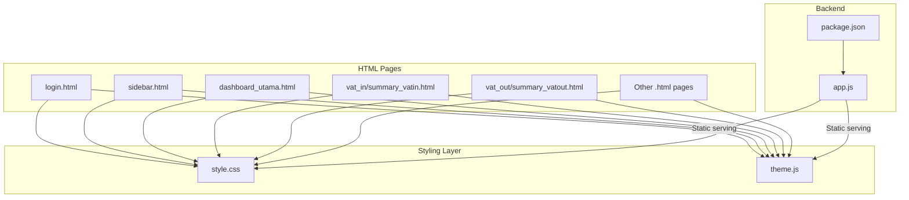
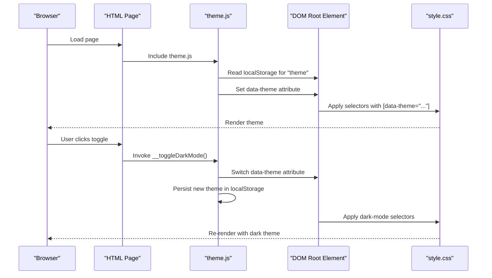
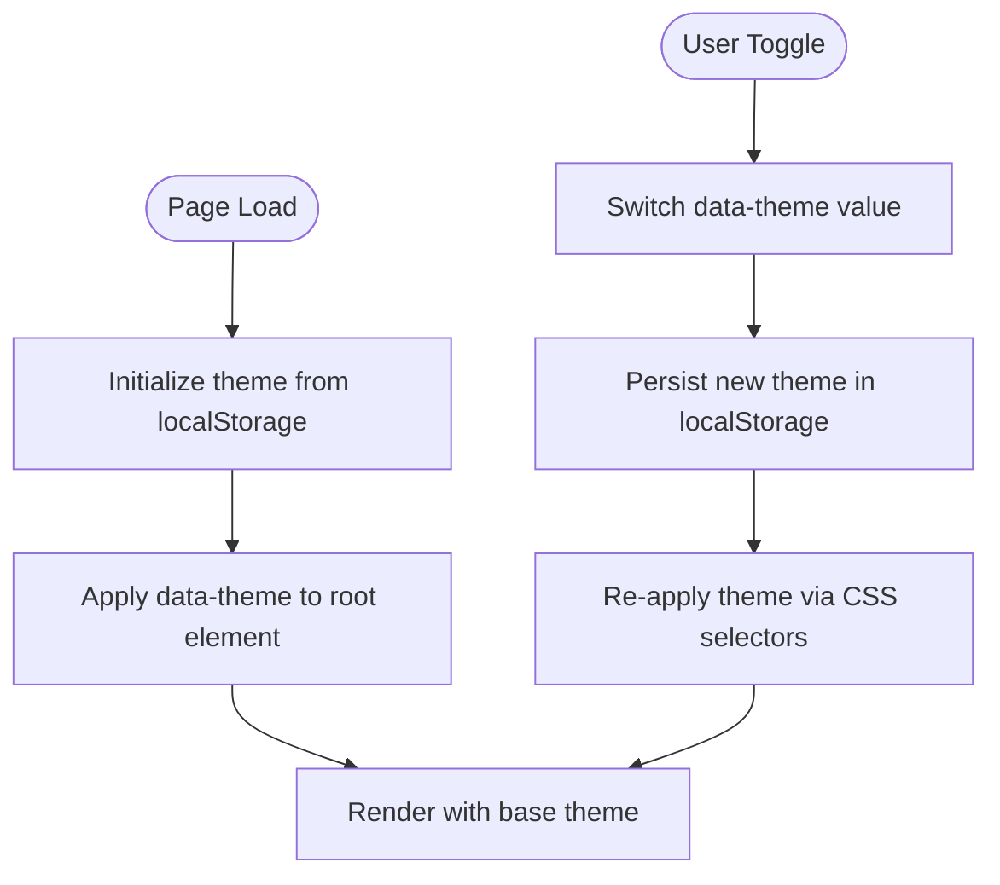
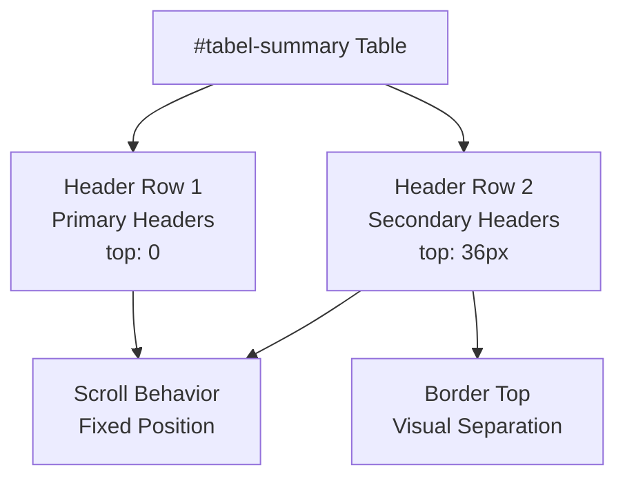
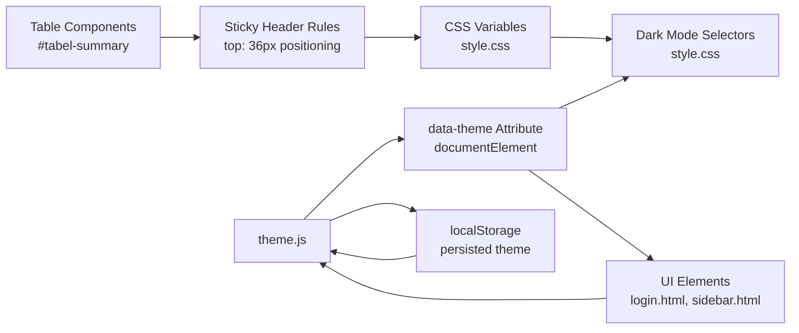

# Theme & Styling

<cite>
**Referenced Files in This Document**
- [style.css](file://style.css)
- [theme.js](file://theme.js)
- [login.html](file://login.html)
- [sidebar.html](file://sidebar.html)
- [app.js](file://app.js)
- [package.json](file://package.json)
- [summary_vatin.html](file://vat_in/summary_vatin.html)
- [summary_vatout.html](file://vat_out/summary_vatout.html)
</cite>

## Update Summary
**Changes Made**
- Updated Table Components section to document the sticky header positioning fix for #tabel-summary
- Added detailed explanation of multi-row header handling and scroll behavior
- Enhanced troubleshooting guide with sticky header-specific issues

## Table of Contents
1. [Introduction](#introduction)
2. [Project Structure](#project-structure)
3. [Core Components](#core-components)
4. [Architecture Overview](#architecture-overview)
5. [Detailed Component Analysis](#detailed-component-analysis)
6. [Dependency Analysis](#dependency-analysis)
7. [Performance Considerations](#performance-considerations)
8. [Troubleshooting Guide](#troubleshooting-guide)
9. [Conclusion](#conclusion)
10. [Appendices](#appendices)

## Introduction
This document explains the theme and styling system used across the application. It covers the CSS architecture, design system implementation, and styling patterns. It documents the theme.js functionality for dark/light mode switching, theme persistence, and dynamic styling updates. It also details CSS custom properties, color schemes, typography, responsive breakpoints, and provides practical guidance for customizing themes, adding new color variants, and implementing brand-specific styling. Finally, it outlines component styling patterns, alternatives to CSS-in-JS, and performance optimization techniques, along with browser compatibility considerations and fallback strategies.

## Project Structure
The styling system is implemented primarily through a single stylesheet and a small JavaScript module that manages theme state and UI interactions. The HTML pages embed the theme initialization and toggle logic, while the backend serves static assets and enforces authentication.

**Diagram sources**
- [login.html:1-51](file://login.html#L1-L51)
- [sidebar.html:1-101](file://sidebar.html#L1-L101)
- [summary_vatin.html:55-72](file://vat_in/summary_vatin.html#L55-L72)
- [summary_vatout.html:56-67](file://vat_out/summary_vatout.html#L56-L67)
- [style.css:1-3221](file://style.css#L1-L3221)
- [theme.js:1-107](file://theme.js#L1-L107)
- [app.js:1-800](file://app.js#L1-L800)
- [package.json:1-20](file://package.json#L1-L20)

**Section sources**
- [style.css:1-3221](file://style.css#L1-L3221)
- [theme.js:1-107](file://theme.js#L1-L107)
- [login.html:1-51](file://login.html#L1-L51)
- [sidebar.html:1-101](file://sidebar.html#L1-L101)
- [summary_vatin.html:55-72](file://vat_in/summary_vatin.html#L55-L72)
- [summary_vatout.html:56-67](file://vat_out/summary_vatout.html#L56-L67)
- [app.js:1-800](file://app.js#L1-L800)
- [package.json:1-20](file://package.json#L1-L20)

## Core Components
- CSS custom properties and theme variables define primary, neutral, semantic, and functional colors, spacing, radius, shadows, transitions, and typography roots.
- Dark mode is toggled via a data attribute applied to the root element and persisted in local storage.
- Utility classes and component-specific styles (sidebar, cards, tables, forms, buttons, modals, toasts) leverage variables for consistent theming.
- Responsive breakpoints adapt layout and typography for desktop, tablet, and mobile experiences.
- Accessibility focus styles and print media queries ensure inclusive and printable output.
- **Updated**: Specialized table components handle complex multi-row headers with proper sticky positioning to prevent overlap during scrolling.

**Section sources**
- [style.css:8-100](file://style.css#L8-L100)
- [style.css:1356-1486](file://style.css#L1356-L1486)
- [style.css:1488-1563](file://style.css#L1488-L1563)
- [style.css:1565-2399](file://style.css#L1565-L2399)
- [style.css:2429-2887](file://style.css#L2429-L2887)
- [style.css:1238-1247](file://style.css#L1238-L1247)

## Architecture Overview
The theme system follows a data-attribute-driven approach:
- The root element carries a data-theme attribute indicating light or dark mode.
- CSS selectors targeting the data-theme attribute apply dark-mode overrides.
- JavaScript reads and writes the data-theme attribute and persists the preference in local storage.
- HTML pages initialize the theme on load and provide a toggle UI.

**Diagram sources**
- [theme.js:1-107](file://theme.js#L1-L107)
- [login.html:13-19](file://login.html#L13-L19)
- [sidebar.html:96-100](file://sidebar.html#L96-L100)
- [style.css:87-100](file://style.css#L87-L100)

## Detailed Component Analysis

### CSS Custom Properties and Design Tokens
- Color palette: primary (blue spectrum), accent (cyan/teal), gray (neutral), and semantic (success, warning, danger).
- Theme variables: background and text colors, borders, shadows, transitions, spacing units, and border radii.
- Typography roots: font family stack and baseline line height.

Practical usage:
- Replace a single variable to change a theme aspect (e.g., primary hue) across the app.
- Extend palettes by adding new variables grouped under semantic or functional categories.

**Section sources**
- [style.css:8-84](file://style.css#L8-L84)

### Dark Mode Implementation
- Light/dark modes are toggled by setting the data-theme attribute on the root element.
- Overrides in the stylesheet target [data-theme="dark"] to invert backgrounds, borders, and text colors.
- Local storage persists the user's choice across sessions.

**Diagram sources**
- [theme.js:1-19](file://theme.js#L1-L19)
- [style.css:87-100](file://style.css#L87-L100)

**Section sources**
- [theme.js:1-19](file://theme.js#L1-L19)
- [style.css:87-100](file://style.css#L87-L100)

### Layout and Navigation Theming
- Sidebar branding and navigation use gradient overlays and translucent backgrounds aligned with the theme.
- Active states and hover effects rely on CSS transitions and theme-aware colors.
- Dark mode fine-tuning adjusts gradients, borders, and text contrast for readability.

**Section sources**
- [style.css:171-322](file://style.css#L171-L322)
- [style.css:1928-1941](file://style.css#L1928-L1941)
- [style.css:2133-2399](file://style.css#L2133-L2399)

### Cards, Tables, Forms, and Buttons
- Cards, tables, and form controls use theme variables for background, border, and text colors.
- Buttons adopt gradient accents and elevation shadows that adapt to the theme.
- Dark mode selectors refine hover states, focus rings, and selection highlights.

**Section sources**
- [style.css:482-494](file://style.css#L482-L494)
- [style.css:536-611](file://style.css#L536-L611)
- [style.css:649-798](file://style.css#L649-L798)
- [style.css:1914-1927](file://style.css#L1914-L1927)

### Advanced Table Components with Sticky Headers
- **Updated**: The #tabel-summary component implements sophisticated multi-row header handling with proper sticky positioning.
- Multi-row headers use `thead tr:nth-child(2)` selector to position secondary header rows at `top: 36px` to prevent overlap with primary headers.
- Border-top properties ensure visual separation between header rows remains visible during scrolling.
- Consistent with `.filter-row th` convention using `top: 36px` offset for secondary sticky elements.
- Prevents the second header row (containing "Jml Dokumen / Total PPN") from competing for the same `offset: 0` position as the first header row.

**Diagram sources**
- [style.css:1238-1247](file://style.css#L1238-L1247)
- [summary_vatin.html:55-72](file://vat_in/summary_vatin.html#L55-L72)

**Section sources**
- [style.css:1238-1247](file://style.css#L1238-L1247)
- [summary_vatin.html:55-72](file://vat_in/summary_vatin.html#L55-L72)

### Modals, Tooltips, and Notifications
- Modals and toasts use theme-aware backgrounds, borders, and subtle animations.
- Toast variants (success, error, warning, info) apply themed left borders and icons.

**Section sources**
- [style.css:851-901](file://style.css#L851-L901)
- [style.css:2596-2674](file://style.css#L2596-L2674)

### Responsive Breakpoints and Print Styles
- Desktop-first design with media queries for tablet and mobile adjustments.
- Print styles hide interactive elements, adjust layouts, and improve readability.

**Section sources**
- [style.css:1356-1486](file://style.css#L1356-L1486)
- [style.css:1403-1486](file://style.css#L1403-L1486)

### Accessibility and Focus States
- Explicit focus-visible outlines ensure keyboard navigation usability.
- Contrast and readable text weights are maintained across themes.

**Section sources**
- [style.css:1545-1562](file://style.css#L1545-L1562)

### Theme Initialization and Toggle in HTML
- Pages embed a self-executing script to initialize the theme from localStorage.
- A dedicated dark mode toggle updates the data-theme attribute and reflects the icon/text accordingly.

**Section sources**
- [login.html:13-19](file://login.html#L13-L19)
- [login.html:43-47](file://login.html#L43-L47)
- [sidebar.html:96-100](file://sidebar.html#L96-L100)

### Backend Serving and Security Context
- Static assets (CSS, JS) are served by the Express server.
- Authentication middleware protects routes and ensures only authorized users access protected pages.

**Section sources**
- [app.js:526-537](file://app.js#L526-L537)
- [app.js:486-494](file://app.js#L486-L494)
- [package.json:16-18](file://package.json#L16-L18)

## Dependency Analysis
The styling system depends on:
- CSS custom properties for centralized theming.
- Data-attribute selectors for theme switching.
- Local storage for persistence.
- HTML pages for initialization and UI triggers.
- **Updated**: Complex table structures require specific CSS rules for proper sticky header behavior.

**Diagram sources**
- [style.css:8-100](file://style.css#L8-L100)
- [style.css:1238-1247](file://style.css#L1238-L1247)
- [theme.js:1-19](file://theme.js#L1-L19)
- [login.html:13-19](file://login.html#L13-L19)
- [sidebar.html:96-100](file://sidebar.html#L96-L100)

**Section sources**
- [style.css:8-100](file://style.css#L8-L100)
- [style.css:1238-1247](file://style.css#L1238-L1247)
- [theme.js:1-19](file://theme.js#L1-L19)
- [login.html:13-19](file://login.html#L13-L19)
- [sidebar.html:96-100](file://sidebar.html#L96-L100)

## Performance Considerations
- CSS variables minimize repeated color declarations and reduce maintenance overhead.
- Prefer class-based selectors over deep nesting to keep specificity low and rendering efficient.
- Use transitions sparingly; keep durations short for smooth yet snappy UI.
- Avoid excessive repaints by leveraging transform and opacity for animations.
- Keep media queries focused on essential breakpoints to prevent layout thrashing.
- **Updated**: Sticky header positioning uses optimized CSS selectors to minimize reflow during scrolling operations.

[No sources needed since this section provides general guidance]

## Troubleshooting Guide
Common issues and resolutions:
- Theme does not persist after reload
  - Ensure the initialization script runs before UI renders and that localStorage keys are present.
  - Verify the data-theme attribute is applied to the root element.
  - Confirm theme.js is included and executed.

- Toggle button not working
  - Check that the toggle function exists and updates the data-theme attribute.
  - Ensure localStorage is writable and not blocked by browser privacy settings.

- Dark mode not applying to specific components
  - Confirm [data-theme="dark"] selectors exist for the component.
  - Verify the component uses theme variables rather than hardcoded colors.

- Print styles not working
  - Ensure print media queries are not overridden by higher specificity rules.
  - Test print preview in supported browsers.

- **Updated**: Sticky header overlap issues in tables
  - Verify that multi-row headers use proper `top` positioning (e.g., `top: 36px` for secondary rows).
  - Check that border-top properties are set for visual separation between header rows.
  - Ensure the table structure uses `thead tr:nth-child(2)` selectors for secondary header rows.
  - Confirm that the table has proper `position: sticky` and `z-index` values.

**Section sources**
- [theme.js:1-19](file://theme.js#L1-L19)
- [style.css:87-100](file://style.css#L87-L100)
- [style.css:1238-1247](file://style.css#L1238-L1247)
- [style.css:1403-1486](file://style.css#L1403-L1486)

## Conclusion
The theme and styling system leverages CSS custom properties and a data-attribute-driven approach to deliver a cohesive, maintainable design system. With robust dark mode support, responsive design, accessibility considerations, and specialized table components with proper sticky header handling, the system scales across modules and pages. Extending the theme involves updating variables and selectors, ensuring consistent application across components.

[No sources needed since this section summarizes without analyzing specific files]

## Appendices

### How to Customize Themes
- Change primary or semantic hues by editing the relevant CSS variables.
- Add new color variants by introducing new variables and using them consistently across components.
- Extend dark mode overrides for new components by adding [data-theme="dark"] rules.

**Section sources**
- [style.css:8-84](file://style.css#L8-L84)
- [style.css:2133-2399](file://style.css#L2133-L2399)

### Implementing Brand-Specific Styling
- Replace primary and accent colors with brand equivalents.
- Adjust typography roots and spacing tokens to match brand guidelines.
- Update gradients and shadows to reflect brand personality.

**Section sources**
- [style.css:109-117](file://style.css#L109-L117)
- [style.css:8-84](file://style.css#L8-L84)

### Component Styling Patterns
- Use utility classes for common layouts and text styles.
- Encapsulate component-specific styles with scoped selectors and theme-aware variables.
- Maintain consistent spacing and border radius tokens across components.
- **Updated**: For complex table structures, implement proper sticky header positioning with appropriate `top` offsets and border properties to prevent overlap during scrolling.

**Section sources**
- [style.css:1143-1199](file://style.css#L1143-L1199)
- [style.css:1565-1637](file://style.css#L1565-L1637)
- [style.css:1238-1247](file://style.css#L1238-L1247)

### Alternatives to CSS-in-JS
- Prefer CSS modules or styled-components if adopting a component-scoped styling approach.
- Keep global theme variables in CSS custom properties to retain runtime switching capabilities.
- Use CSS custom properties alongside component libraries to preserve theme continuity.

[No sources needed since this section provides general guidance]

### Browser Compatibility and Fallbacks
- CSS variables are widely supported; provide sensible fallbacks for older browsers.
- Use prefixed properties where necessary and test across major browsers.
- Ensure print styles degrade gracefully and remain readable.
- **Updated**: Sticky positioning features work in modern browsers; test thoroughly for edge cases with complex table layouts.

**Section sources**
- [style.css:1403-1486](file://style.css#L1403-L1486)
- [style.css:1238-1247](file://style.css#L1238-L1247)