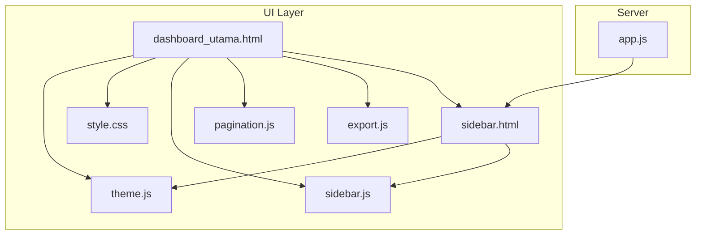
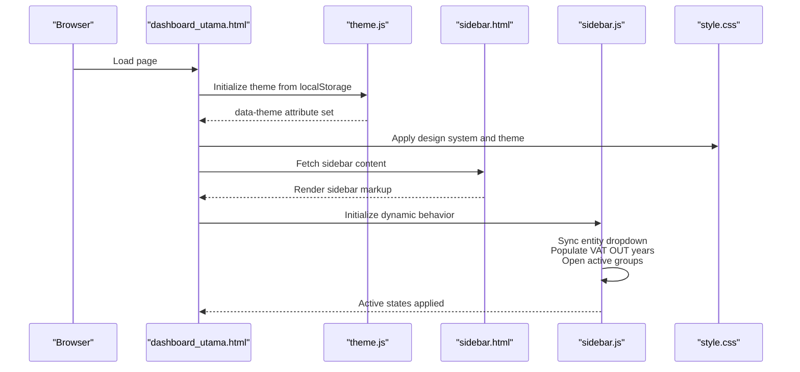
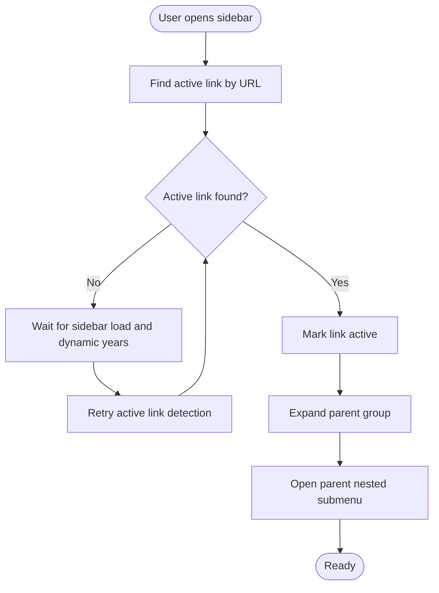
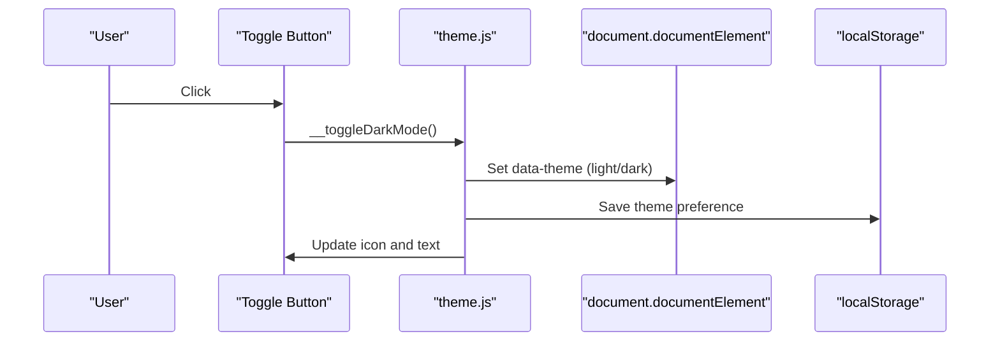
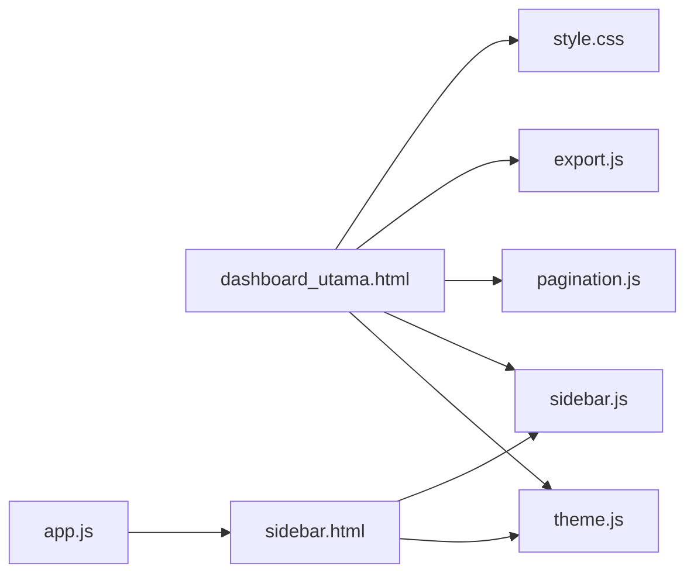

# User Interface & Experience

<cite>
**Referenced Files in This Document**
- [dashboard_utama.html](file://dashboard_utama.html)
- [sidebar.html](file://sidebar.html)
- [sidebar.js](file://sidebar.js)
- [theme.js](file://theme.js)
- [style.css](file://style.css)
- [pagination.js](file://pagination.js)
- [export.js](file://export.js)
- [app.js](file://app.js)
</cite>

## Table of Contents
1. [Introduction](#introduction)
2. [Project Structure](#project-structure)
3. [Core Components](#core-components)
4. [Architecture Overview](#architecture-overview)
5. [Detailed Component Analysis](#detailed-component-analysis)
6. [Dependency Analysis](#dependency-analysis)
7. [Performance Considerations](#performance-considerations)
8. [Troubleshooting Guide](#troubleshooting-guide)
9. [Conclusion](#conclusion)
10. [Appendices](#appendices)

## Introduction
This document explains the user interface and experience components of the Tax Database System. It covers the main dashboard layout, navigation sidebar functionality, and theme management system. It also documents responsive design patterns, dark/light mode implementation, styling architecture, and user experience optimizations. Guidance is included for UI customization, theme modification, and best practices for accessibility and performance.

## Project Structure
The UI is composed of:
- A central dashboard page that renders summaries and recent activity
- A dynamic sidebar with collapsible menus and entity switching
- A shared stylesheet implementing a modern professional design system with light/dark themes
- Utilities for pagination and export
- A theme manager that persists user preference

**Diagram sources**
- [dashboard_utama.html](file://dashboard_utama.html)
- [sidebar.html](file://sidebar.html)
- [style.css](file://style.css)
- [theme.js](file://theme.js)
- [sidebar.js](file://sidebar.js)
- [pagination.js](file://pagination.js)
- [export.js](file://export.js)
- [app.js](file://app.js)

**Section sources**
- [dashboard_utama.html](file://dashboard_utama.html)
- [sidebar.html](file://sidebar.html)
- [style.css](file://style.css)
- [theme.js](file://theme.js)
- [sidebar.js](file://sidebar.js)
- [pagination.js](file://pagination.js)
- [export.js](file://export.js)
- [app.js](file://app.js)

## Core Components
- Dashboard layout: Hero greeting, alerts, module summary cards, and recent transactions grid
- Navigation sidebar: Collapsible groups, nested submenus, active state highlighting, and entity selector
- Theme system: CSS custom properties with light/dark variants and runtime toggle
- Styling architecture: Design tokens (colors, spacing, shadows, transitions), reusable components, and responsive breakpoints
- UX utilities: Pagination controls, export menu, and smooth animations/transitions

**Section sources**
- [dashboard_utama.html](file://dashboard_utama.html)
- [sidebar.html](file://sidebar.html)
- [style.css](file://style.css)
- [theme.js](file://theme.js)
- [sidebar.js](file://sidebar.js)
- [pagination.js](file://pagination.js)
- [export.js](file://export.js)

## Architecture Overview
The UI architecture centers on a single-page-like experience:
- The dashboard page loads styles and scripts, initializes theme, and mounts the sidebar asynchronously
- The sidebar is injected via server-rendered HTML and enhanced by client-side JavaScript
- Theme persistence is handled via localStorage and applied to the root element
- Responsive behavior is controlled by CSS media queries and layout utilities

**Diagram sources**
- [dashboard_utama.html](file://dashboard_utama.html)
- [theme.js](file://theme.js)
- [sidebar.html](file://sidebar.html)
- [sidebar.js](file://sidebar.js)
- [style.css](file://style.css)

## Detailed Component Analysis

### Dashboard Layout
The main dashboard organizes information into:
- Hero banner with greeting, user name, entity badge, date/time
- Alert panel for pending items
- Module summary cards (VAT OUT, VAT IN, Tax Payable, Prepaid Tax, Client Ledger)
- Net VAT position card with formula breakdown
- Recent transactions grid

Responsive adjustments:
- On small screens, the hero switches to a stacked layout and the recent grid becomes single-column

Accessibility and UX:
- Clear typography hierarchy and semantic labels
- Hover and focus affordances for interactive elements
- Pending indicators with subtle animations

**Section sources**
- [dashboard_utama.html](file://dashboard_utama.html)

### Navigation Sidebar
The sidebar provides:
- Branding and entity selection with persistent storage
- Collapsible groups for modules and administrative sections
- Nested submenus (e.g., VAT OUT with yearly dashboards)
- Active link detection and automatic expansion
- Dark mode toggle button integrated into the sidebar

Dynamic behavior:
- Entity dropdown synchronization from localStorage
- VAT OUT submenu populated via API with MutationObserver-driven initialization
- Automatic open/close of groups and submenus based on active page

**Section sources**
- [sidebar.html](file://sidebar.html)
- [sidebar.js](file://sidebar.js)
- [theme.js](file://theme.js)

### Theme Management System
The theme system uses:
- CSS custom properties for colors, backgrounds, borders, and shadows
- A data-theme attribute on the root element to switch modes
- LocalStorage persistence for user preference
- A runtime toggle that updates both the attribute and UI text/icon

Dark mode fine-tuning:
- Specific overrides for header, badges, and cards in dark mode
- Smooth transitions across all themed elements

**Section sources**
- [theme.js](file://theme.js)
- [style.css](file://style.css)

### Styling Architecture and Design Tokens
Design system:
- Color palette: primary blue, accent cyan, neutral grays, semantic success/warning/danger
- Spacing scale: xs, sm, md, lg, xl, 2xl
- Border radius scale: sm, md, lg, xl
- Shadow scale: sm, md, lg, xl
- Transition durations: fast, base, slow
- Typography and layout utilities

Component primitives:
- Cards, tables, buttons, badges, forms, and responsive grids
- Sticky headers, hover effects, and zebra striping
- Scrollbar styling and print-friendly overrides

Responsive breakpoints:
- 1024px and 768px adjust sidebar width, grid layouts, and spacing

**Section sources**
- [style.css](file://style.css)

### Pagination and Export Utilities
Pagination:
- Renders page info, rows-per-page selector, and navigational buttons
- Maintains state per container and triggers callbacks on change

Export:
- CSV and Excel export with optional column filtering
- Modern Excel export via external library with styled headers and frozen panes
- Legacy Excel fallback for environments without the library

**Section sources**
- [pagination.js](file://pagination.js)
- [export.js](file://export.js)

### Sidebar Interaction Flow

**Diagram sources**
- [sidebar.js](file://sidebar.js)

### Theme Toggle Flow

**Diagram sources**
- [theme.js](file://theme.js)

## Dependency Analysis
- The dashboard depends on the theme manager for initial theme and on the sidebar for navigation
- The sidebar relies on the theme manager for the dark mode toggle and on sidebar.js for dynamic behavior
- The sidebar is injected by the server and customized based on user roles
- Pagination and export utilities are standalone helpers consumed by pages

**Diagram sources**
- [dashboard_utama.html](file://dashboard_utama.html)
- [sidebar.html](file://sidebar.html)
- [sidebar.js](file://sidebar.js)
- [theme.js](file://theme.js)
- [style.css](file://style.css)
- [pagination.js](file://pagination.js)
- [export.js](file://export.js)
- [app.js](file://app.js)

**Section sources**
- [app.js](file://app.js)
- [dashboard_utama.html](file://dashboard_utama.html)
- [sidebar.html](file://sidebar.html)
- [sidebar.js](file://sidebar.js)
- [theme.js](file://theme.js)
- [style.css](file://style.css)
- [pagination.js](file://pagination.js)
- [export.js](file://export.js)

## Performance Considerations
- CSS custom properties enable efficient theme switching without recalculating styles
- Media queries minimize layout thrashing by adjusting only affected components
- Lazy population of dynamic submenus reduces initial payload
- Smooth transitions and transforms leverage GPU acceleration
- Consider deferring non-critical scripts and using intersection observers for lazy loading of heavy widgets

## Troubleshooting Guide
Common issues and resolutions:
- Sidebar not expanding: Ensure MutationObserver has run and active link detection completes; verify that the active link exists in the DOM
- Yearly links missing in VAT OUT: Confirm the API endpoint returns data; the fallback injects current year if needed
- Theme not persisting: Verify localStorage access and that the data-theme attribute updates on toggle
- Pagination controls not working: Check container ID and callback registration; confirm state initialization
- Export fails silently: Ensure the export menu is appended to the DOM and that the table exists

**Section sources**
- [sidebar.js](file://sidebar.js)
- [theme.js](file://theme.js)
- [pagination.js](file://pagination.js)
- [export.js](file://export.js)

## Conclusion
The Tax Database System delivers a cohesive, accessible, and performant user experience through a modular UI built on a robust design system. The dashboard consolidates key insights, the sidebar enables efficient navigation, and the theme system supports user preferences. With responsive patterns, smooth interactions, and extensible utilities, the platform is well-positioned for further customization and growth.

## Appendices

### UI Customization and Theme Modification
- Modify color tokens in the CSS variable declarations to adapt brand colors
- Extend semantic color usage for new statuses or modules
- Add new transition durations or shadow presets for component variations
- Introduce new responsive breakpoints as needed

### Accessibility Best Practices
- Maintain sufficient color contrast in both light and dark modes
- Provide keyboard navigation support for sidebar groups and menus
- Use ARIA attributes for expanded/collapsed states where appropriate
- Ensure focus indicators are visible and consistent across themes

### User Workflow Optimization
- Keep active states synchronized automatically using the existing detection logic
- Minimize layout shifts by preallocating space for loading skeletons
- Use subtle animations to indicate state changes without overwhelming users