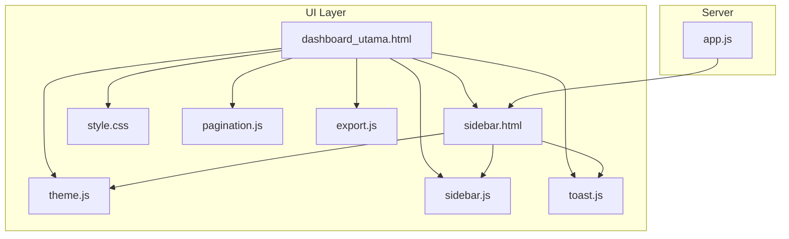
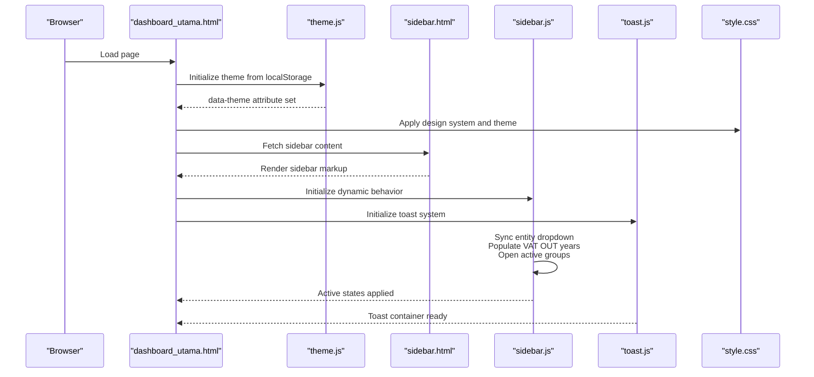
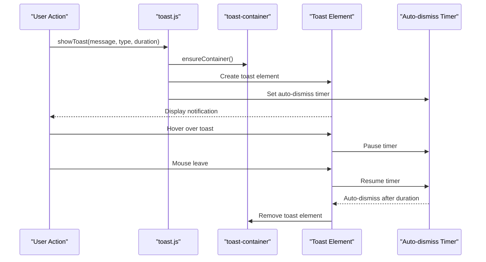
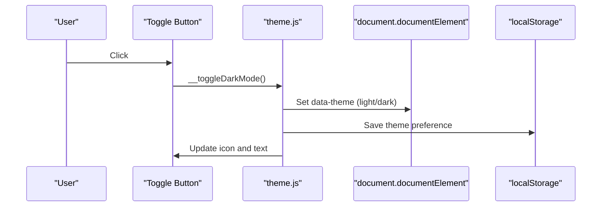
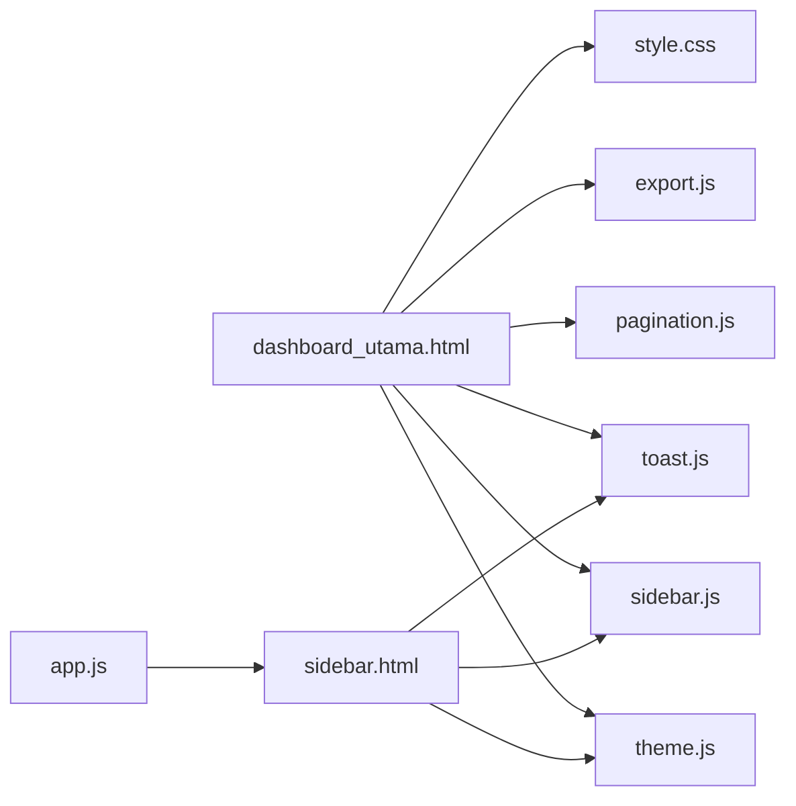

# User Interface & Experience

<cite>
**Referenced Files in This Document**
- [dashboard_utama.html](file://dashboard_utama.html)
- [sidebar.html](file://sidebar.html)
- [sidebar.js](file://sidebar.js)
- [theme.js](file://theme.js)
- [style.css](file://style.css)
- [pagination.js](file://pagination.js)
- [export.js](file://export.js)
- [app.js](file://app.js)
- [toast.js](file://toast.js)
</cite>

## Update Summary
**Changes Made**
- Added comprehensive Toast Notification System section documenting the modern non-blocking notification framework
- Enhanced Mobile User Experience section with responsive sidebar navigation and touch-friendly controls
- Updated Architecture Overview to include toast system integration
- Added new diagrams for toast notification flow and mobile sidebar interaction
- Expanded troubleshooting guide with toast-related issues

## Table of Contents
1. [Introduction](#introduction)
2. [Project Structure](#project-structure)
3. [Core Components](#core-components)
4. [Architecture Overview](#architecture-overview)
5. [Detailed Component Analysis](#detailed-component-analysis)
6. [Dependency Analysis](#dependency-analysis)
7. [Performance Considerations](#performance-considerations)
8. [Troubleshooting Guide](#troubleshooting-guide)
9. [Conclusion](#conclusion)
10. [Appendices](#appendices)

## Introduction
This document explains the user interface and experience components of the Tax Database System. It covers the main dashboard layout, navigation sidebar functionality, theme management system, and the comprehensive toast notification system. It also documents responsive design patterns, dark/light mode implementation, styling architecture, and enhanced mobile user experience optimizations. Guidance is included for UI customization, theme modification, and best practices for accessibility and performance.

## Project Structure
The UI is composed of:
- A central dashboard page that renders summaries and recent activity
- A dynamic sidebar with collapsible menus, entity switching, and mobile hamburger menu
- A shared stylesheet implementing a modern professional design system with light/dark themes
- Utilities for pagination, export, and toast notifications
- A theme manager that persists user preference
- A comprehensive toast notification system replacing native browser alerts



**Diagram sources**
- [dashboard_utama.html](file://dashboard_utama.html)
- [sidebar.html](file://sidebar.html)
- [style.css](file://style.css)
- [theme.js](file://theme.js)
- [sidebar.js](file://sidebar.js)
- [pagination.js](file://pagination.js)
- [export.js](file://export.js)
- [toast.js](file://toast.js)
- [app.js](file://app.js)

**Section sources**
- [dashboard_utama.html](file://dashboard_utama.html)
- [sidebar.html](file://sidebar.html)
- [style.css](file://style.css)
- [theme.js](file://theme.js)
- [sidebar.js](file://sidebar.js)
- [pagination.js](file://pagination.js)
- [export.js](file://export.js)
- [toast.js](file://toast.js)
- [app.js](file://app.js)

## Core Components
- Dashboard layout: Hero greeting, alerts, module summary cards, and recent transactions grid
- Navigation sidebar: Collapsible groups, nested submenus, active state highlighting, entity selector, and mobile hamburger menu
- Theme system: CSS custom properties with light/dark variants and runtime toggle
- **Toast notification system**: Modern non-blocking notifications with success, error, warning, and info types
- Styling architecture: Design tokens (colors, spacing, shadows, transitions), reusable components, and responsive breakpoints
- UX utilities: Pagination controls, export menu, loading states, and smooth animations/transitions

**Section sources**
- [dashboard_utama.html](file://dashboard_utama.html)
- [sidebar.html](file://sidebar.html)
- [style.css](file://style.css)
- [theme.js](file://theme.js)
- [sidebar.js](file://sidebar.js)
- [pagination.js](file://pagination.js)
- [export.js](file://export.js)
- [toast.js](file://toast.js)

## Architecture Overview
The UI architecture centers on a single-page-like experience:
- The dashboard page loads styles and scripts, initializes theme, and mounts the sidebar asynchronously
- The sidebar is injected via server-rendered HTML and enhanced by client-side JavaScript
- Theme persistence is handled via localStorage and applied to the root element
- Toast notifications are dynamically created and managed with automatic cleanup
- Responsive behavior is controlled by CSS media queries and layout utilities
- Mobile interactions use touch-friendly controls with backdrop overlays



**Diagram sources**
- [dashboard_utama.html](file://dashboard_utama.html)
- [theme.js](file://theme.js)
- [sidebar.html](file://sidebar.html)
- [sidebar.js](file://sidebar.js)
- [toast.js](file://toast.js)
- [style.css](file://style.css)

## Detailed Component Analysis

### Dashboard Layout
The main dashboard organizes information into:
- Hero banner with greeting, user name, entity badge, date/time
- Alert panel for pending items
- Module summary cards (VAT OUT, VAT IN, Tax Payable, Prepaid Tax, Client Ledger)
- Net VAT position card with formula breakdown
- Recent transactions grid

Responsive adjustments:
- On small screens, the hero switches to a stacked layout and the recent grid becomes single-column

Accessibility and UX:
- Clear typography hierarchy and semantic labels
- Hover and focus affordances for interactive elements
- Pending indicators with subtle animations

**Section sources**
- [dashboard_utama.html](file://dashboard_utama.html)

### Navigation Sidebar
The sidebar provides:
- Branding and entity selection with persistent storage
- Collapsible groups for modules and administrative sections
- Nested submenus (e.g., VAT OUT with yearly dashboards)
- Active link detection and automatic expansion
- Dark mode toggle button integrated into the sidebar
- **Mobile hamburger menu** with touch-friendly controls and backdrop overlay

Dynamic behavior:
- Entity dropdown synchronization from localStorage
- VAT OUT submenu populated via API with MutationObserver-driven initialization
- Automatic open/close of groups and submenus based on active page
- **Mobile sidebar toggle** with smooth slide-in/out animations

**Updated** Enhanced with mobile-responsive hamburger menu and touch-friendly controls for better mobile user experience.

**Section sources**
- [sidebar.html](file://sidebar.html)
- [sidebar.js](file://sidebar.js)
- [theme.js](file://theme.js)
- [toast.js](file://toast.js)

### Toast Notification System
**New** The comprehensive toast notification system replaces native browser alerts with modern, non-blocking notifications:

**Core Features:**
- **Four notification types**: success (✅), error (❌), warning (⚠️), and info (ℹ️)
- **Non-blocking interface**: Users can continue working while notifications display
- **Auto-dismissal**: Configurable duration with hover-to-pause functionality
- **Visual feedback**: Animated progress bars, icons, and smooth transitions
- **Manual control**: Close buttons and click-outside dismissal
- **Keyboard support**: Escape key closes confirmation dialogs

**API Functions:**
- `showToast(message, type, duration)`: Display toast notifications
- `showConfirm(message, onConfirm, options)`: Non-blocking confirmation dialogs
- `showLoading(containerId, text)` / `hideLoading(containerId)`: Loading state management

**Visual Design:**
- Fixed positioning in top-right corner (desktop) or full-width (mobile)
- Type-specific color coding with left border accents
- Smooth slide-in/slide-out animations
- Backdrop blur effects for confirmation dialogs
- Responsive design adapting to screen sizes

**Integration:**
- Automatically creates toast container when needed
- Manages multiple concurrent notifications
- Handles memory cleanup and DOM element removal
- Supports custom durations and callback functions

**Section sources**
- [toast.js](file://toast.js)
- [style.css](file://style.css)

### Theme Management System
The theme system uses:
- CSS custom properties for colors, backgrounds, borders, and shadows
- A data-theme attribute on the root element to switch modes
- LocalStorage persistence for user preference
- A runtime toggle that updates both the attribute and UI text/icon

Dark mode fine-tuning:
- Specific overrides for header, badges, and cards in dark mode
- Smooth transitions across all themed elements

**Section sources**
- [theme.js](file://theme.js)
- [style.css](file://style.css)

### Styling Architecture and Design Tokens
Design system:
- Color palette: primary blue, accent cyan, neutral grays, semantic success/warning/danger
- Spacing scale: xs, sm, md, lg, xl, 2xl
- Border radius scale: sm, md, lg, xl
- Shadow scale: sm, md, lg, xl
- Transition durations: fast, base, slow
- Typography and layout utilities

Component primitives:
- Cards, tables, buttons, badges, forms, and responsive grids
- Sticky headers, hover effects, and zebra striping
- Scrollbar styling and print-friendly overrides

**Updated** Added comprehensive toast notification styles with four type variants, confirmation dialog styling, and mobile-responsive layouts.

Responsive breakpoints:
- 1024px and 768px adjust sidebar width, grid layouts, and spacing
- **Mobile-specific enhancements**: Hamburger menu visibility, sidebar slide-in behavior, and touch-friendly sizing

**Section sources**
- [style.css](file://style.css)

### Pagination and Export Utilities
Pagination:
- Renders page info, rows-per-page selector, and navigational buttons
- Maintains state per container and triggers callbacks on change

Export:
- CSV and Excel export with optional column filtering
- Modern Excel export via external library with styled headers and frozen panes
- Legacy Excel fallback for environments without the library

**Section sources**
- [pagination.js](file://pagination.js)
- [export.js](file://export.js)

### Mobile User Experience Enhancements
**New** Comprehensive mobile-responsive design with touch-friendly controls:

**Hamburger Menu System:**
- Fixed-position hamburger button visible only on mobile devices
- Touch-optimized SVG icon with hover effects
- Smooth slide-in/out sidebar animation with backdrop overlay
- Click-outside-to-close functionality for improved usability

**Responsive Layout Adaptations:**
- Single-column grid layouts on mobile devices
- Optimized table rendering with reduced font sizes
- Touch-friendly button sizing and spacing
- Full-width toast notifications on small screens

**Interactive Elements:**
- All interactive elements optimized for touch targets (minimum 44px)
- Smooth transitions and animations using GPU acceleration
- Proper viewport handling for mobile browsers
- Backdrop blur effects for modal overlays

**Section sources**
- [toast.js](file://toast.js)
- [style.css](file://style.css)
- [sidebar.html](file://sidebar.html)

### Sidebar Interaction Flow


**Diagram sources**
- [sidebar.js](file://sidebar.js)

### Toast Notification Flow


**Diagram sources**
- [toast.js](file://toast.js)

### Theme Toggle Flow


**Diagram sources**
- [theme.js](file://theme.js)

## Dependency Analysis
- The dashboard depends on the theme manager for initial theme and on the sidebar for navigation
- The sidebar relies on the theme manager for the dark mode toggle and on sidebar.js for dynamic behavior
- **The toast system is independently loaded and provides global notification functionality**
- The sidebar is injected by the server and customized based on user roles
- Pagination and export utilities are standalone helpers consumed by pages



**Diagram sources**
- [dashboard_utama.html](file://dashboard_utama.html)
- [sidebar.html](file://sidebar.html)
- [sidebar.js](file://sidebar.js)
- [theme.js](file://theme.js)
- [toast.js](file://toast.js)
- [style.css](file://style.css)
- [pagination.js](file://pagination.js)
- [export.js](file://export.js)
- [app.js](file://app.js)

**Section sources**
- [app.js](file://app.js)
- [dashboard_utama.html](file://dashboard_utama.html)
- [sidebar.html](file://sidebar.html)
- [sidebar.js](file://sidebar.js)
- [theme.js](file://theme.js)
- [toast.js](file://toast.js)
- [style.css](file://style.css)
- [pagination.js](file://pagination.js)
- [export.js](file://export.js)

## Performance Considerations
- CSS custom properties enable efficient theme switching without recalculating styles
- Media queries minimize layout thrashing by adjusting only affected components
- Lazy population of dynamic submenus reduces initial payload
- Smooth transitions and transforms leverage GPU acceleration
- **Toast notifications use efficient DOM manipulation with automatic cleanup**
- **Mobile optimizations include reduced animations and optimized touch interactions**
- Consider deferring non-critical scripts and using intersection observers for lazy loading of heavy widgets

## Troubleshooting Guide
Common issues and resolutions:
- Sidebar not expanding: Ensure MutationObserver has run and active link detection completes; verify that the active link exists in the DOM
- Yearly links missing in VAT OUT: Confirm the API endpoint returns data; the fallback injects current year if needed
- Theme not persisting: Verify localStorage access and that the data-theme attribute updates on toggle
- Pagination controls not working: Check container ID and callback registration; confirm state initialization
- Export fails silently: Ensure the export menu is appended to the DOM and that the table exists
- **Toast notifications not appearing: Verify toast.js is loaded before usage; check for console errors related to DOM manipulation**
- **Mobile sidebar not responding: Ensure hamburger button is visible and __toggleMobileSidebar function is accessible**
- **Confirmation dialogs not closing: Check event listeners and keyboard escape key handling**

**Section sources**
- [sidebar.js](file://sidebar.js)
- [theme.js](file://theme.js)
- [toast.js](file://toast.js)
- [pagination.js](file://pagination.js)
- [export.js](file://export.js)

## Conclusion
The Tax Database System delivers a cohesive, accessible, and performant user experience through a modular UI built on a robust design system. The dashboard consolidates key insights, the sidebar enables efficient navigation with enhanced mobile support, the theme system supports user preferences, and the comprehensive toast notification system provides modern, non-blocking user feedback. With responsive patterns, smooth interactions, and extensible utilities, the platform is well-positioned for further customization and growth.

## Appendices

### UI Customization and Theme Modification
- Modify color tokens in the CSS variable declarations to adapt brand colors
- Extend semantic color usage for new statuses or modules
- Add new transition durations or shadow presets for component variations
- Introduce new responsive breakpoints as needed
- **Customize toast notification styles by modifying the toast-* class definitions**
- **Add new toast types by extending the ICONS object and adding corresponding CSS classes**

### Accessibility Best Practices
- Maintain sufficient color contrast in both light and dark modes
- Provide keyboard navigation support for sidebar groups and menus
- Use ARIA attributes for expanded/collapsed states where appropriate
- Ensure focus indicators are visible and consistent across themes
- **Ensure toast notifications are announced by screen readers with proper ARIA labels**
- **Provide keyboard shortcuts for dismissing notifications and confirmation dialogs**

### Mobile Optimization Guidelines
- Optimize touch target sizes for all interactive elements
- Implement swipe gestures where appropriate for navigation
- Use viewport meta tags for proper mobile rendering
- Test on various device sizes and orientations
- **Ensure hamburger menu works reliably across different mobile browsers**
- **Optimize toast notification positioning for different screen sizes**

### Toast Notification Usage Examples
**Basic usage:**
```javascript
showToast('Operation completed successfully!', 'success');
showToast('An error occurred during processing', 'error');
showToast('Please review the highlighted fields', 'warning');
showToast('Information about your account', 'info');
```

**Advanced usage:**
```javascript
// Custom duration
showToast('Long operation in progress...', 'info', 10000);

// Confirmation dialog
showConfirm('Are you sure you want to delete this item?', function() {
    // Delete action here
}, { title: 'Delete Confirmation', danger: true });

// Loading states
showLoading('data-container', 'Loading data...');
// ... perform operations ...
hideLoading('data-container');
```

**Section sources**
- [toast.js](file://toast.js)
- [style.css](file://style.css)