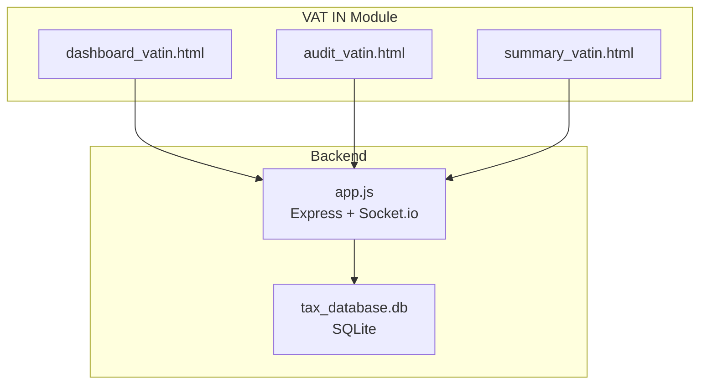
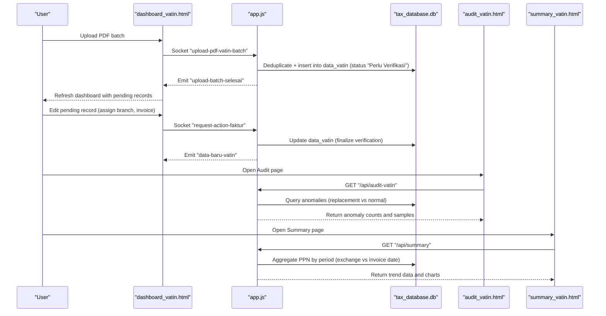
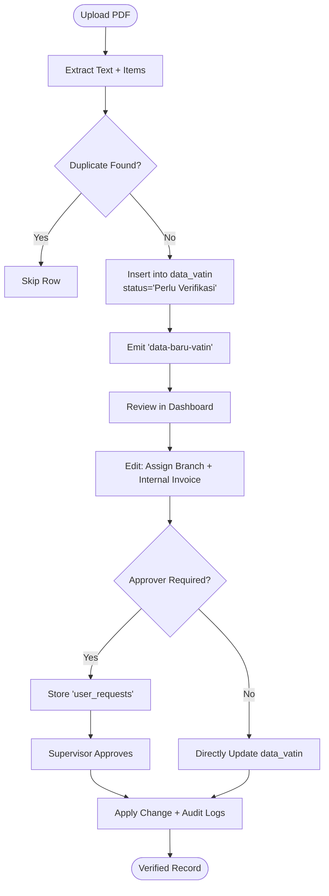
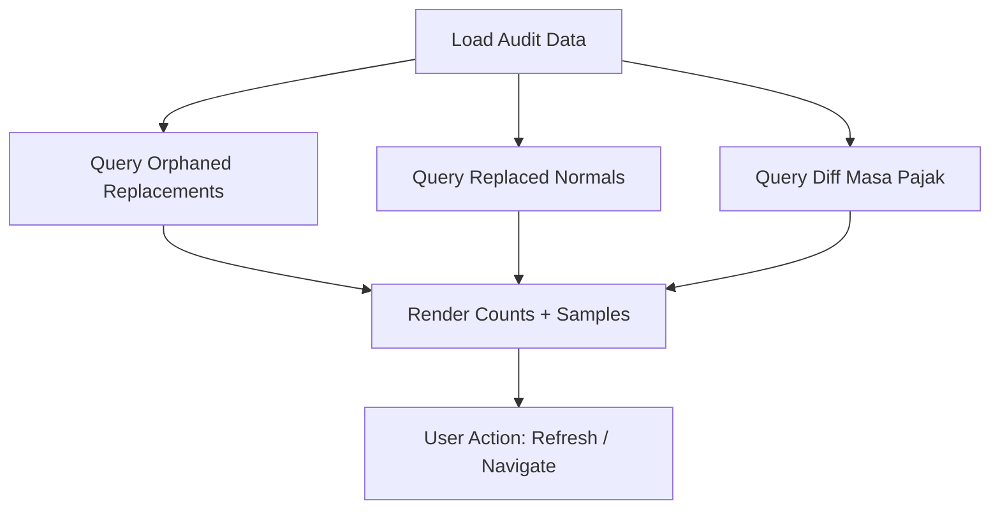
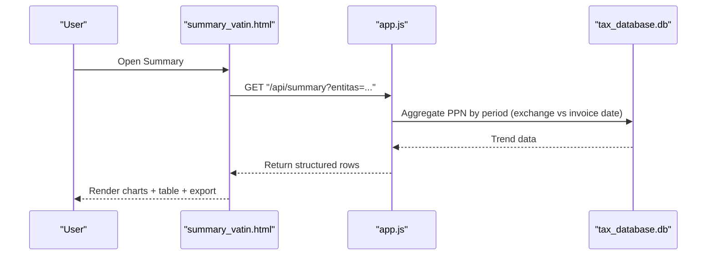
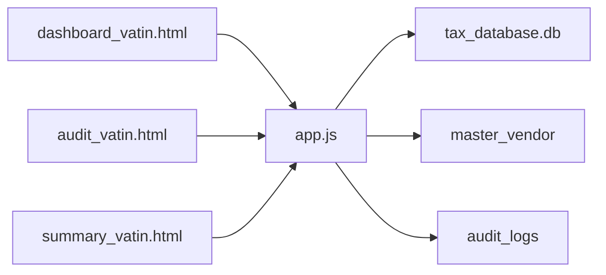

# VAT Input (VAT IN)

<cite>
**Referenced Files in This Document**
- [dashboard_vatin.html](file://vat_in/dashboard_vatin.html)
- [audit_vatin.html](file://vat_in/audit_vatin.html)
- [summary_vatin.html](file://vat_in/summary_vatin.html)
- [app.js](file://app.js)
- [PRD_Tax_Database_System.md](file://PRD_Tax_Database_System.md)
- [TDS_Sequence_Diagram.md](file://TDS_Sequence_Diagram.md)
- [TODO.md](file://TODO.md)
</cite>

## Table of Contents
1. [Introduction](#introduction)
2. [Project Structure](#project-structure)
3. [Core Components](#core-components)
4. [Architecture Overview](#architecture-overview)
5. [Detailed Component Analysis](#detailed-component-analysis)
6. [Dependency Analysis](#dependency-analysis)
7. [Performance Considerations](#performance-considerations)
8. [Troubleshooting Guide](#troubleshooting-guide)
9. [Conclusion](#conclusion)
10. [Appendices](#appendices)

## Introduction
This document describes the VAT Input (VAT IN) management module of the Tax Database System (TDS). It covers the transaction lifecycle from invoice entry and validation to approval, audit trail capabilities, compliance reporting, and user interface components. It also explains VAT calculation logic, input tax credit handling, integration points with supplier/vendor management and accounting modules, and practical examples and troubleshooting guidance.

## Project Structure
The VAT IN module consists of three primary pages:
- Dashboard: Register and manage VAT IN entries, filtering, pagination, and batch upload from PDFs.
- Audit: Integrity checks for replacement invoices and anomalies.
- Summary: Comparative reporting of tax trends by invoice date versus exchange date.

**Diagram sources**
- [dashboard_vatin.html:1-569](file://vat_in/dashboard_vatin.html#L1-L569)
- [audit_vatin.html:1-244](file://vat_in/audit_vatin.html#L1-L244)
- [summary_vatin.html:1-263](file://vat_in/summary_vatin.html#L1-L263)
- [app.js:1-800](file://app.js#L1-L800)

**Section sources**
- [dashboard_vatin.html:1-569](file://vat_in/dashboard_vatin.html#L1-L569)
- [audit_vatin.html:1-244](file://vat_in/audit_vatin.html#L1-L244)
- [summary_vatin.html:1-263](file://vat_in/summary_vatin.html#L1-L263)
- [app.js:1-800](file://app.js#L1-L800)

## Core Components
- VAT IN Dashboard
  - Displays registered invoices with filtering, pagination, and actions (view items, edit, delete).
  - Supports batch upload of PDFs via WebSocket, extracting text and items.
  - Provides export/print capabilities and real-time updates via Socket.IO.
- Audit Page
  - Detects integrity anomalies: orphaned replacement invoices and mismatched tax periods between normal and replacement invoices.
  - Summarizes findings and lists samples for review.
- Summary Page
  - Presents comparative tax trends grouped by period based on invoice exchange date versus invoice date.
  - Renders interactive charts and supports CSV export.

**Section sources**
- [dashboard_vatin.html:77-158](file://vat_in/dashboard_vatin.html#L77-L158)
- [audit_vatin.html:48-124](file://vat_in/audit_vatin.html#L48-L124)
- [summary_vatin.html:32-72](file://vat_in/summary_vatin.html#L32-L72)

## Architecture Overview
The VAT IN workflow integrates client-side UI, server-side APIs, and real-time communication:

**Diagram sources**
- [TDS_Sequence_Diagram.md:1-177](file://TDS_Sequence_Diagram.md#L1-L177)
- [app.js:1720-1907](file://app.js#L1720-L1907)
- [app.js:1348-1482](file://app.js#L1348-L1482)
- [app.js:1286-1346](file://app.js#L1286-L1346)

## Detailed Component Analysis

### VAT IN Dashboard (Entry, Validation, Approval)
- Data Entry and Validation
  - Batch upload of PDFs extracts textual content and itemized details.
  - Duplicate detection prevents ingestion of existing invoices.
  - Newly ingested invoices are placed in a pending state requiring branch and internal invoice assignment.
- Approval Workflow
  - Maker-checker via Socket events routes edits/deletes to supervisors when roles do not permit direct mutation.
  - Final verification updates the invoice with branch and internal invoice metadata.
- UI Features
  - Filtering by multiple columns including date ranges and empty/null values.
  - Pagination with server-side limits and debounced search.
  - Export/print and real-time notifications via Socket.IO.

**Diagram sources**
- [PRD_Tax_Database_System.md:77-92](file://PRD_Tax_Database_System.md#L77-L92)
- [app.js:1720-1907](file://app.js#L1720-L1907)
- [dashboard_vatin.html:454-506](file://vat_in/dashboard_vatin.html#L454-L506)

**Section sources**
- [dashboard_vatin.html:100-158](file://vat_in/dashboard_vatin.html#L100-L158)
- [dashboard_vatin.html:250-354](file://vat_in/dashboard_vatin.html#L250-L354)
- [dashboard_vatin.html:532-565](file://vat_in/dashboard_vatin.html#L532-L565)
- [PRD_Tax_Database_System.md:77-92](file://PRD_Tax_Database_System.md#L77-L92)
- [app.js:1720-1907](file://app.js#L1720-L1907)

### Audit Trail and Integrity Checks
- Purpose
  - Detect anomalies in replacement invoice logic: orphaned replacements and mismatched tax periods.
- Functionality
  - Counts and lists orphaned replacement invoices (replacement exists without a normal parent).
  - Lists normal invoices replaced by later replacements.
  - Highlights mismatches in tax periods between normal and replacement invoices.
- UI Behavior
  - Displays summary counts and refresh button.
  - Shows detailed tables with sortable columns and formatted currency values.

**Diagram sources**
- [audit_vatin.html:131-221](file://vat_in/audit_vatin.html#L131-L221)
- [app.js:1348-1482](file://app.js#L1348-L1482)

**Section sources**
- [audit_vatin.html:48-124](file://vat_in/audit_vatin.html#L48-L124)
- [audit_vatin.html:131-221](file://vat_in/audit_vatin.html#L131-L221)
- [app.js:1348-1482](file://app.js#L1348-L1482)

### Compliance Reporting and Summary Reports
- Comparative Trends
  - Compares invoice counts and total PPN grouped by period based on invoice exchange date versus invoice date.
- Visualization
  - Line chart for PPN trends and bar chart for document counts.
- Export
  - CSV export of the comparison table for external reporting.

**Diagram sources**
- [summary_vatin.html:118-235](file://vat_in/summary_vatin.html#L118-L235)
- [app.js:1286-1346](file://app.js#L1286-L1346)

**Section sources**
- [summary_vatin.html:32-72](file://vat_in/summary_vatin.html#L32-L72)
- [summary_vatin.html:118-235](file://vat_in/summary_vatin.html#L118-L235)
- [app.js:1286-1346](file://app.js#L1286-L1346)

### VAT Calculation Methodologies and Input Tax Credit Handling
- Status and Serial Logic
  - Invoice status derived from digits in the invoice number: normal or replacement series.
  - Normal invoice number computed by resetting replacement digits to zero.
- Deduplication and Aggregation
  - Aggregated VAT IN reports select the highest-ranked invoice per serial group (replacement precedence over normal).
  - Replacement invoices synchronize tax period with their normal parent to avoid double counting.
- Practical Implications
  - Ensures accurate input tax credit reporting by consolidating replacement series and preventing duplication.

**Section sources**
- [PRD_Tax_Database_System.md:94-111](file://PRD_Tax_Database_System.md#L94-L111)
- [app.js:115-210](file://app.js#L115-L210)

### Integration with Supplier/Vendor Management and Accounting Modules
- Supplier/Vendor Master Data
  - Automatically populated from extracted invoice data; maintained with format type and last update date.
- Accounting Integration
  - VAT IN data feeds into cross-module analytics and profitability reporting.
  - Client ledger and related tables support consolidated financial views.

**Section sources**
- [PRD_Tax_Database_System.md:34-45](file://PRD_Tax_Database_System.md#L34-L45)
- [PRD_Tax_Database_System.md:121-137](file://PRD_Tax_Database_System.md#L121-L137)
- [app.js:321-339](file://app.js#L321-L339)

## Dependency Analysis
- Frontend Dependencies
  - Uses vanilla JS, Chart.js for visualization, PDF.js for client-side parsing, and Socket.IO for real-time updates.
- Backend Dependencies
  - Express.js, SQLite3, Socket.IO, session management, rate limiting, and helmet for security.
- Data Model
  - Core tables: data_vatin, item_vatin, master_vendor, audit_logs, and supporting indexes for performance.

**Diagram sources**
- [dashboard_vatin.html:1-16](file://vat_in/dashboard_vatin.html#L1-L16)
- [audit_vatin.html:1-11](file://vat_in/audit_vatin.html#L1-L11)
- [summary_vatin.html:1-12](file://vat_in/summary_vatin.html#L1-L12)
- [app.js:1-17](file://app.js#L1-L17)

**Section sources**
- [app.js:1-17](file://app.js#L1-L17)
- [PRD_Tax_Database_System.md:20-45](file://PRD_Tax_Database_System.md#L20-L45)

## Performance Considerations
- Server-side pagination and debounced filtering reduce API load and improve responsiveness for large datasets.
- Database indexing on frequently queried columns (entity + date) enhances query performance.
- Client-side PDF parsing uses chunked uploads and workers to prevent UI blocking during batch processing.

[No sources needed since this section provides general guidance]

## Troubleshooting Guide
- Upload Issues
  - Verify PDF parsing success and that duplicate detection does not skip valid invoices unintentionally.
  - Monitor Socket.IO batch completion events for successful ingestion.
- Pending Verification Records
  - Ensure branch and internal invoice fields are assigned; otherwise records remain in pending state.
- Audit Anomalies
  - Investigate orphaned replacement invoices and mismatched tax periods flagged by the audit page.
- Export Failures
  - Confirm HTTP status checks and error messages returned by summary API; retry after resolving underlying data issues.

**Section sources**
- [dashboard_vatin.html:532-565](file://vat_in/dashboard_vatin.html#L532-L565)
- [audit_vatin.html:131-221](file://vat_in/audit_vatin.html#L131-L221)
- [summary_vatin.html:225-235](file://vat_in/summary_vatin.html#L225-L235)

## Conclusion
The VAT IN module provides a robust, real-time pipeline for invoice ingestion, validation, and approval, supported by integrity auditing and comparative reporting. Its design ensures compliance with replacement invoice logic and integrates seamlessly with vendor master data and broader accounting analytics.

[No sources needed since this section summarizes without analyzing specific files]

## Appendices

### Practical Examples
- Example 1: Batch Upload and Verification
  - Upload multiple VAT IN PDFs; confirm pending records appear on the dashboard; assign branch/internal invoice; finalize verification.
- Example 2: Replacement Invoice Handling
  - Ingest a replacement invoice; verify it synchronizes tax period with its normal parent and appears correctly in aggregated summaries.
- Example 3: Compliance Reporting
  - Generate comparative reports by period; export CSV for external submission; monitor audit anomalies and resolve flagged records.

**Section sources**
- [PRD_Tax_Database_System.md:77-111](file://PRD_Tax_Database_System.md#L77-L111)
- [audit_vatin.html:131-221](file://vat_in/audit_vatin.html#L131-L221)
- [summary_vatin.html:118-235](file://vat_in/summary_vatin.html#L118-L235)

### Roadmap Notes
- Planned enhancements include applying server-side pagination and debounce to other modules, OCR improvements, automated journal exports, and centralized SSO.

**Section sources**
- [PRD_Tax_Database_System.md:141-147](file://PRD_Tax_Database_System.md#L141-L147)
- [TODO.md:1-26](file://TODO.md#L1-L26)