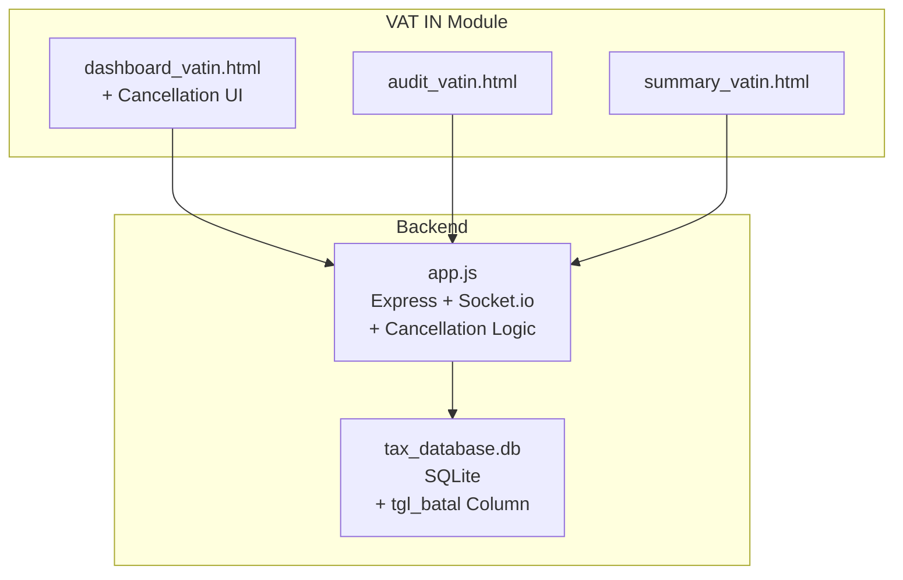
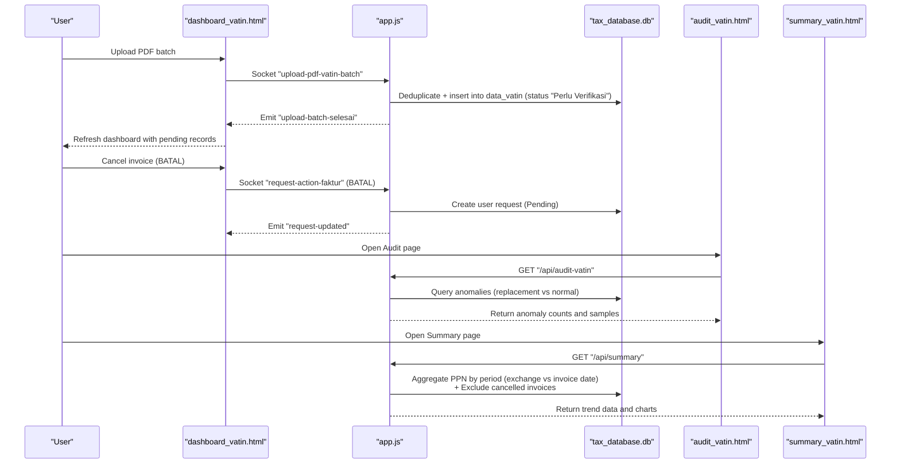
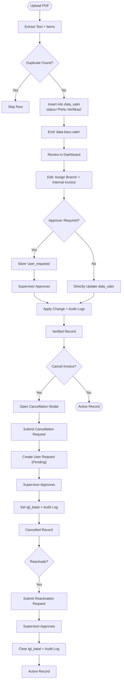
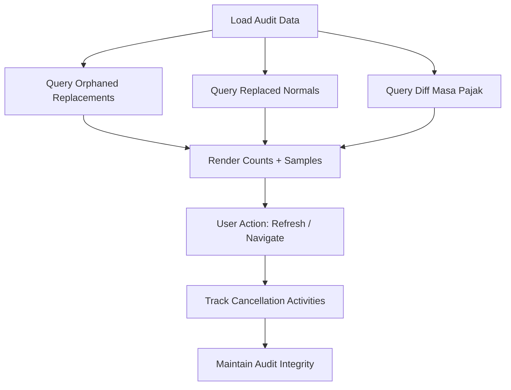
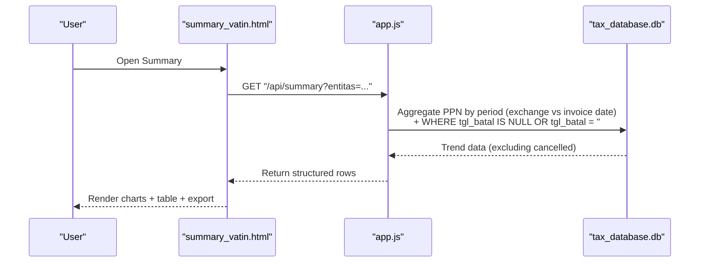
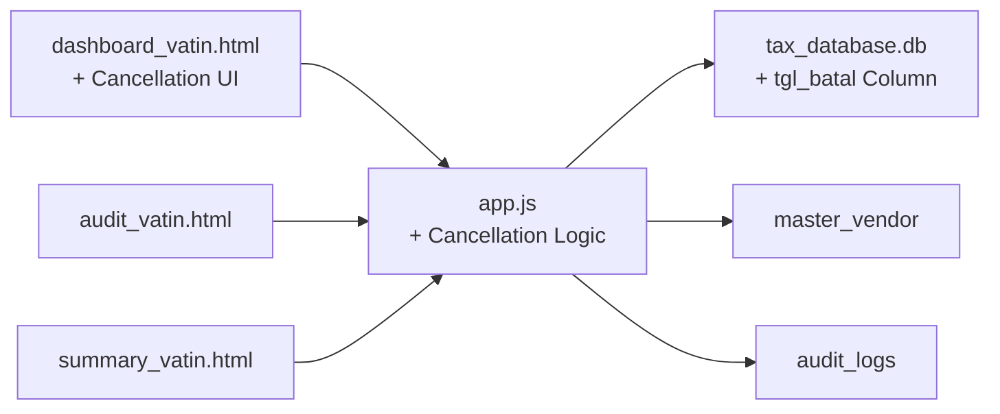

# VAT Input (VAT IN)

<cite>
**Referenced Files in This Document**
- [dashboard_vatin.html](file://vat_in/dashboard_vatin.html)
- [audit_vatin.html](file://vat_in/audit_vatin.html)
- [summary_vatin.html](file://vat_in/summary_vatin.html)
- [app.js](file://app.js)
- [PRD_Tax_Database_System.md](file://PRD_Tax_Database_System.md)
- [TDS_Sequence_Diagram.md](file://TDS_Sequence_Diagram.md)
- [TODO.md](file://TODO.md)
</cite>

## Update Summary
**Changes Made**
- Enhanced invoice cancellation system with comprehensive supervisor approval workflow
- Improved deduplication logic for replacement invoices considering cancellation status
- Consistent cancellation filtering across all reporting modules using `tgl_batal` column
- Updated audit trail functionality to track cancellation activities and maintain audit integrity
- Enhanced user interface components with visual indicators for cancelled invoices

## Table of Contents
1. [Introduction](#introduction)
2. [Project Structure](#project-structure)
3. [Core Components](#core-components)
4. [Architecture Overview](#architecture-overview)
5. [Detailed Component Analysis](#detailed-component-analysis)
6. [Dependency Analysis](#dependency-analysis)
7. [Performance Considerations](#performance-considerations)
8. [Troubleshooting Guide](#troubleshooting-guide)
9. [Conclusion](#conclusion)
10. [Appendices](#appendices)

## Introduction
This document describes the VAT Input (VAT IN) management module of the Tax Database System (TDS). It covers the complete transaction lifecycle from invoice entry and validation to approval, including the comprehensive invoice cancellation system with supervisor approval workflows. The module provides robust audit trail capabilities, compliance reporting with consistent cancellation filtering, and enhanced user interface components for complete invoice lifecycle management.

## Project Structure
The VAT IN module consists of three primary pages with enhanced cancellation functionality:
- Dashboard: Register and manage VAT IN entries with cancellation/reaction capabilities, filtering, pagination, and batch upload from PDFs.
- Audit: Integrity checks for replacement invoices, anomalies, and cancellation tracking.
- Summary: Comparative reporting of tax trends by invoice date versus exchange date, excluding cancelled invoices.

**Diagram sources**
- [dashboard_vatin.html:192-204](file://vat_in/dashboard_vatin.html#L192-L204)
- [audit_vatin.html:1-263](file://vat_in/audit_vatin.html#L1-L263)
- [summary_vatin.html:1-266](file://vat_in/summary_vatin.html#L1-L266)
- [app.js:2962-2982](file://app.js#L2962-L2982)

**Section sources**
- [dashboard_vatin.html:192-204](file://vat_in/dashboard_vatin.html#L192-L204)
- [audit_vatin.html:1-263](file://vat_in/audit_vatin.html#L1-L263)
- [summary_vatin.html:1-266](file://vat_in/summary_vatin.html#L1-L266)
- [app.js:2962-2982](file://app.js#L2962-L2982)

## Core Components
- **Enhanced VAT IN Dashboard**
  - Displays registered invoices with filtering, pagination, and actions (view items, edit, delete, cancel/reactivate).
  - Supports batch upload of PDFs via WebSocket, extracting text and items.
  - Provides export/print capabilities and real-time updates via Socket.IO.
  - **New**: Comprehensive invoice cancellation/reaction workflow with supervisor approval and visual status indicators.
- **Audit Page**
  - Detects integrity anomalies: orphaned replacement invoices and mismatched tax periods between normal and replacement invoices.
  - Summarizes findings and lists samples for review.
  - **Enhanced**: Tracks cancellation-related anomalies and maintains complete audit integrity.
- **Summary Page**
  - Presents comparative tax trends grouped by period based on invoice exchange date versus invoice date.
  - Renders interactive charts and supports CSV export.
  - **Updated**: Excludes cancelled invoices from all calculations and reports using consistent `tgl_batal` filtering.

**Section sources**
- [dashboard_vatin.html:95-99](file://vat_in/dashboard_vatin.html#L95-L99)
- [dashboard_vatin.html:335-347](file://vat_in/dashboard_vatin.html#L335-L347)
- [audit_vatin.html:48-124](file://vat_in/audit_vatin.html#L48-L124)
- [summary_vatin.html:32-72](file://vat_in/summary_vatin.html#L32-L72)

## Architecture Overview
The VAT IN workflow integrates client-side UI, server-side APIs, and real-time communication with enhanced cancellation capabilities:

**Diagram sources**
- [TDS_Sequence_Diagram.md:1-177](file://TDS_Sequence_Diagram.md#L1-L177)
- [app.js:2962-2982](file://app.js#L2962-L2982)
- [app.js:1289-1295](file://app.js#L1289-L1295)
- [dashboard_vatin.html:547-554](file://vat_in/dashboard_vatin.html#L547-L554)

## Detailed Component Analysis

### Enhanced VAT IN Dashboard (Entry, Validation, Approval, Cancellation)
- **Data Entry and Validation**
  - Batch upload of PDFs extracts textual content and itemized details.
  - Duplicate detection prevents ingestion of existing invoices.
  - Newly ingested invoices are placed in a pending state requiring branch and internal invoice assignment.
- **Approval Workflow**
  - Maker-checker via Socket events routes edits/deletes to supervisors when roles do not permit direct mutation.
  - Final verification updates the invoice with branch and internal invoice metadata.
- **Cancellation System**
  - **New**: Comprehensive invoice cancellation with `tgl_batal` column tracking.
  - Supervisor approval required for cancellation and reactivation actions.
  - Cancelled invoices remain visible but are visually distinguished and excluded from calculations.
  - Reactivation capability allows restoring previously cancelled invoices.
- **UI Features**
  - Filtering by multiple columns including date ranges and empty/null values.
  - Pagination with server-side limits and debounced search.
  - Export/print and real-time notifications via Socket.IO.
  - **Enhanced**: Visual indicators for cancelled invoices (reduced opacity, different status color).

**Diagram sources**
- [PRD_Tax_Database_System.md:77-92](file://PRD_Tax_Database_System.md#L77-L92)
- [app.js:2962-2982](file://app.js#L2962-L2982)
- [dashboard_vatin.html:533-554](file://vat_in/dashboard_vatin.html#L533-L554)

**Section sources**
- [dashboard_vatin.html:100-158](file://vat_in/dashboard_vatin.html#L100-L158)
- [dashboard_vatin.html:335-347](file://vat_in/dashboard_vatin.html#L335-L347)
- [dashboard_vatin.html:533-554](file://vat_in/dashboard_vatin.html#L533-L554)
- [PRD_Tax_Database_System.md:77-92](file://PRD_Tax_Database_System.md#L77-L92)
- [app.js:2962-2982](file://app.js#L2962-L2982)

### Enhanced Audit Trail and Integrity Checks
- **Purpose**
  - Detect anomalies in replacement invoice logic: orphaned replacements and mismatched tax periods.
  - Track cancellation activities and maintain audit integrity.
- **Functionality**
  - Counts and lists orphaned replacement invoices (replacement exists without a normal parent).
  - Lists normal invoices replaced by later replacements.
  - Highlights mismatches in tax periods between normal and replacement invoices.
  - **Enhanced**: Maintains complete audit trail for cancellation and reactivation activities.
- **UI Behavior**
  - Displays summary counts and refresh button.
  - Shows detailed tables with sortable columns and formatted currency values.
  - **Improved**: Better error handling and loading states.

**Diagram sources**
- [audit_vatin.html:131-221](file://vat_in/audit_vatin.html#L131-L221)
- [app.js:1638-1669](file://app.js#L1638-L1669)

**Section sources**
- [audit_vatin.html:48-124](file://vat_in/audit_vatin.html#L48-L124)
- [audit_vatin.html:131-221](file://vat_in/audit_vatin.html#L131-L221)
- [app.js:1638-1669](file://app.js#L1638-L1669)

### Compliance Reporting and Summary Reports
- **Comparative Trends**
  - Compares invoice counts and total PPN grouped by period based on invoice exchange date versus invoice date.
  - **Updated**: Excludes cancelled invoices from all calculations using `tgl_batal IS NULL OR tgl_batal = ''` conditions.
- **Visualization**
  - Line chart for PPN trends and bar chart for document counts.
  - **Enhanced**: Accurate representation of active invoices only.
- **Export**
  - CSV export of the comparison table for external reporting.
  - **Improved**: Consistent exclusion of cancelled invoices in exports.

**Diagram sources**
- [summary_vatin.html:118-235](file://vat_in/summary_vatin.html#L118-L235)
- [app.js:1289-1295](file://app.js#L1289-L1295)

**Section sources**
- [summary_vatin.html:32-72](file://vat_in/summary_vatin.html#L32-L72)
- [summary_vatin.html:118-235](file://vat_in/summary_vatin.html#L118-L235)
- [app.js:1289-1295](file://app.js#L1289-L1295)

### Enhanced Invoice Cancellation System
- **Database Schema**
  - Added `tgl_batal DATE` column to `data_vatin` table for tracking cancellation dates.
  - Maintains historical records while marking invoices as cancelled.
- **Cancellation Workflow**
  - Users can initiate cancellation through enhanced dashboard interface.
  - Requires supervisor approval for non-supervisor users.
  - Sets `tgl_batal` field with cancellation date upon approval.
  - Creates audit log entries for cancellation activities.
- **Reactivation Process**
  - Previously cancelled invoices can be reactivated through the same interface.
  - Clears `tgl_batal` field upon supervisor approval.
  - Maintains complete audit trail of cancellation and reactivation history.
- **Visual Indicators**
  - Cancelled invoices display with reduced opacity (0.55) for easy identification.
  - Status shows "Dibatalkan" with red color coding.
  - Tooltip displays cancellation date information.

**Section sources**
- [app.js:468-470](file://app.js#L468-L470)
- [dashboard_vatin.html:335-360](file://vat_in/dashboard_vatin.html#L335-L360)
- [app.js:2962-2982](file://app.js#L2962-L2982)

### VAT Calculation Methodologies and Input Tax Credit Handling
- **Status and Serial Logic**
  - Invoice status derived from digits in the invoice number: normal or replacement series.
  - Normal invoice number computed by resetting replacement digits to zero.
- **Deduplication and Aggregation**
  - Aggregated VAT IN reports select the highest-ranked invoice per serial group (replacement precedence over normal).
  - Replacement invoices synchronize tax period with their normal parent to avoid double counting.
  - **Updated**: All calculations exclude cancelled invoices using `tgl_batal` filters.
- **Practical Implications**
  - Ensures accurate input tax credit reporting by consolidating replacement series and preventing duplication.
  - Cancelled invoices are completely excluded from financial calculations and reporting.

**Section sources**
- [PRD_Tax_Database_System.md:94-111](file://PRD_Tax_Database_System.md#L94-L111)
- [app.js:115-210](file://app.js#L115-L210)
- [app.js:1289-1295](file://app.js#L1289-L1295)

### Integration with Supplier/Vendor Management and Accounting Modules
- **Supplier/Vendor Master Data**
  - Automatically populated from extracted invoice data; maintained with format type and last update date.
- **Accounting Integration**
  - VAT IN data feeds into cross-module analytics and profitability reporting.
  - Client ledger and related tables support consolidated financial views.
  - **Enhanced**: Cancellation status properly reflected across all integrated modules.

**Section sources**
- [PRD_Tax_Database_System.md:34-45](file://PRD_Tax_Database_System.md#L34-L45)
- [PRD_Tax_Database_System.md:121-137](file://PRD_Tax_Database_System.md#L121-L137)
- [app.js:321-339](file://app.js#L321-339)

## Dependency Analysis
- **Frontend Dependencies**
  - Uses vanilla JS, Chart.js for visualization, PDF.js for client-side parsing, and Socket.IO for real-time updates.
  - **Enhanced**: Additional UI components for cancellation modal and status indicators.
- **Backend Dependencies**
  - Express.js, SQLite3, Socket.IO, session management, rate limiting, and helmet for security.
  - **Updated**: Enhanced approval workflow handlers for cancellation and reactivation.
- **Data Model**
  - Core tables: data_vatin, item_vatin, master_vendor, audit_logs, and supporting indexes for performance.
  - **Added**: `tgl_batal` column in data_vatin table for cancellation tracking.

**Diagram sources**
- [dashboard_vatin.html:1-16](file://vat_in/dashboard_vatin.html#L1-L16)
- [audit_vatin.html:1-11](file://vat_in/audit_vatin.html#L1-L11)
- [summary_vatin.html:1-12](file://vat_in/summary_vatin.html#L1-L12)
- [app.js:1-17](file://app.js#L1-L17)

**Section sources**
- [app.js:1-17](file://app.js#L1-L17)
- [PRD_Tax_Database_System.md:20-45](file://PRD_Tax_Database_System.md#L20-L45)

## Performance Considerations
- Server-side pagination and debounced filtering reduce API load and improve responsiveness for large datasets.
- Database indexing on frequently queried columns (entity + date) enhances query performance.
- Client-side PDF parsing uses chunked uploads and workers to prevent UI blocking during batch processing.
- **Optimized**: Cancellation status queries use indexed `tgl_batal` column for efficient filtering.

## Troubleshooting Guide
- **Upload Issues**
  - Verify PDF parsing success and that duplicate detection does not skip valid invoices unintentionally.
  - Monitor Socket.IO batch completion events for successful ingestion.
- **Pending Verification Records**
  - Ensure branch and internal invoice fields are assigned; otherwise records remain in pending state.
- **Cancellation Issues**
  - Check supervisor approval queue for pending cancellation requests.
  - Verify `tgl_batal` column is properly set after approval.
  - Ensure cancelled invoices are correctly excluded from calculations.
- **Audit Anomalies**
  - Investigate orphaned replacement invoices and mismatched tax periods flagged by the audit page.
  - Review cancellation audit logs for any irregularities.
- **Export Failures**
  - Confirm HTTP status checks and error messages returned by summary API; retry after resolving underlying data issues.
  - Verify cancelled invoices are properly excluded from exported data.

**Section sources**
- [dashboard_vatin.html:532-565](file://vat_in/dashboard_vatin.html#L532-L565)
- [audit_vatin.html:131-221](file://vat_in/audit_vatin.html#L131-L221)
- [summary_vatin.html:225-235](file://vat_in/summary_vatin.html#L225-L235)
- [app.js:2962-2982](file://app.js#L2962-L2982)

## Conclusion
The VAT IN module provides a robust, real-time pipeline for invoice ingestion, validation, approval, and cancellation, supported by integrity auditing and comparative reporting. The enhanced cancellation system with supervisor approval workflows ensures proper control over invoice lifecycle management while maintaining complete audit trails. Its design ensures compliance with replacement invoice logic and integrates seamlessly with vendor master data and broader accounting analytics.

## Appendices

### Practical Examples
- **Example 1: Batch Upload and Verification**
  - Upload multiple VAT IN PDFs; confirm pending records appear on the dashboard; assign branch/internal invoice; finalize verification.
- **Example 2: Replacement Invoice Handling**
  - Ingest a replacement invoice; verify it synchronizes tax period with its normal parent and appears correctly in aggregated summaries.
- **Example 3: Invoice Cancellation Workflow**
  - Initiate cancellation for an invoice; submit supervisor approval request; verify cancellation takes effect; check audit trail.
- **Example 4: Invoice Reactivation**
  - Reactivate a previously cancelled invoice; submit supervisor approval; verify invoice returns to active status.
- **Example 5: Compliance Reporting**
  - Generate comparative reports by period; export CSV for external submission; monitor audit anomalies and resolve flagged records.

**Section sources**
- [PRD_Tax_Database_System.md:77-111](file://PRD_Tax_Database_System.md#L77-L111)
- [audit_vatin.html:131-221](file://vat_in/audit_vatin.html#L131-L221)
- [summary_vatin.html:118-235](file://vat_in/summary_vatin.html#L118-L235)
- [dashboard_vatin.html:533-554](file://vat_in/dashboard_vatin.html#L533-L554)

### Roadmap Notes
- Planned enhancements include applying server-side pagination and debounce to other modules, OCR improvements, automated journal exports, and centralized SSO.
- **Future**: Consider implementing bulk cancellation operations and advanced cancellation reporting.

**Section sources**
- [PRD_Tax_Database_System.md:141-147](file://PRD_Tax_Database_System.md#L141-L147)
- [TODO.md:1-26](file://TODO.md#L1-L26)