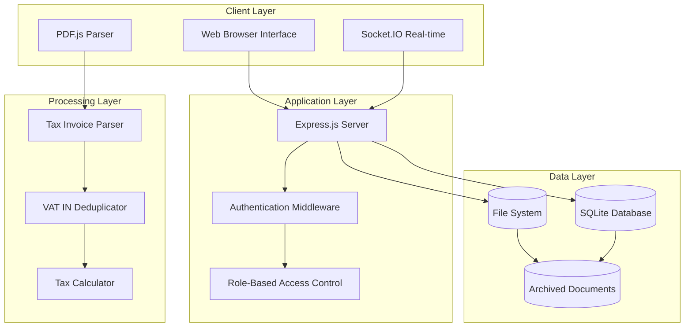
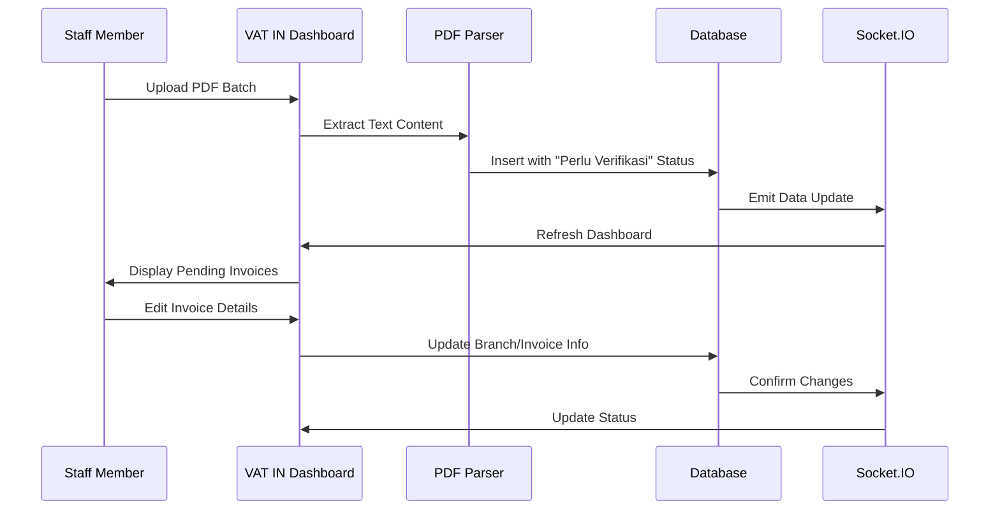
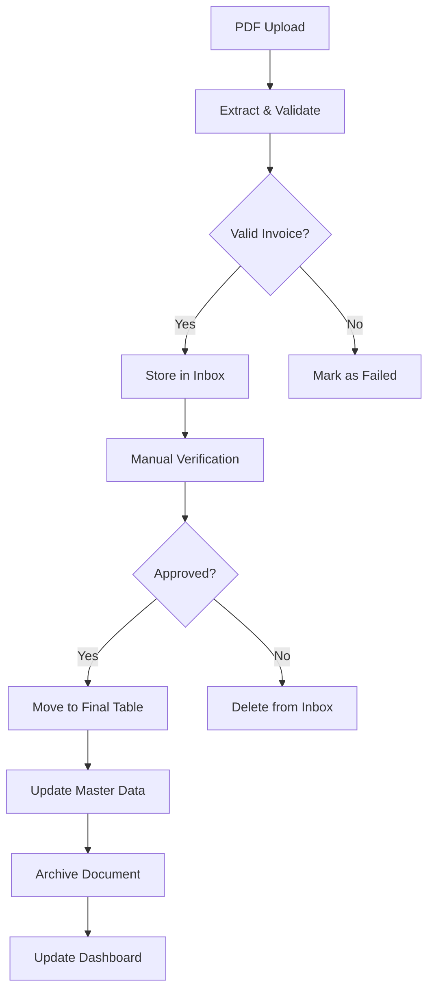
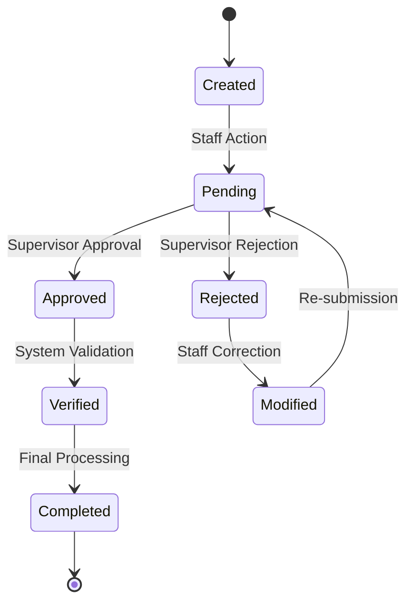
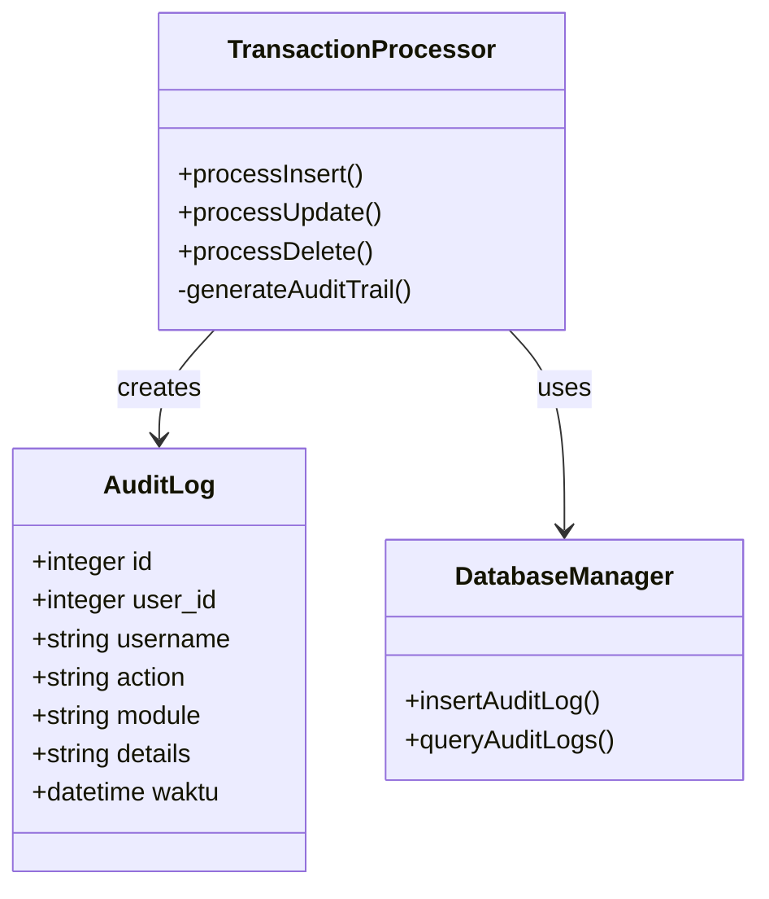
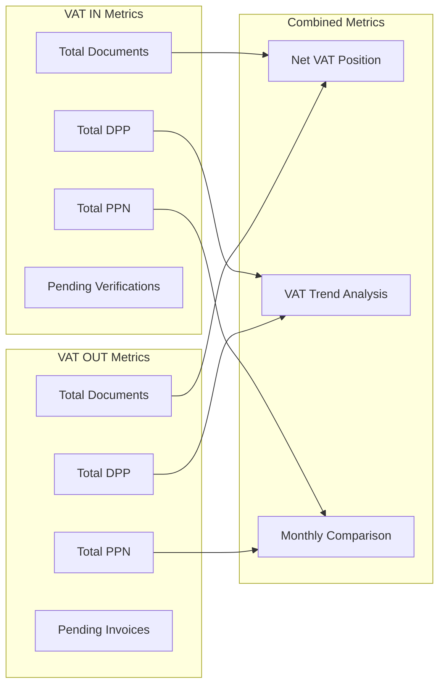
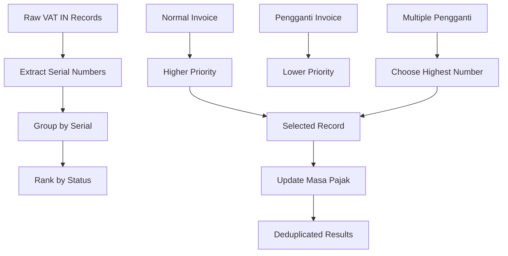
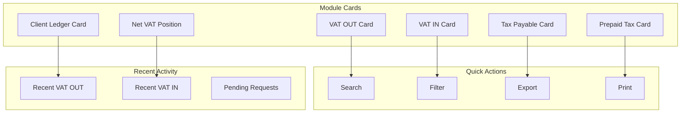
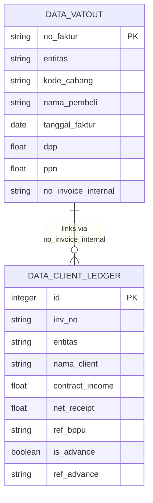

# VAT Management System

<cite>
**Referenced Files in This Document**
- [PRD_Tax_Database_System.md](file://PRD_Tax_Database_System.md)
- [app.js](file://app.js)
- [dashboard_utama.html](file://dashboard_utama.html)
- [sidebar.html](file://sidebar.html)
- [vat_in/dashboard_vatin.html](file://vat_in/dashboard_vatin.html)
- [vat_in/summary_vatin.html](file://vat_in/summary_vatin.html)
- [vat_in/audit_vatin.html](file://vat_in/audit_vatin.html)
- [vat_out/dashboard_vatout.html](file://vat_out/dashboard_vatout.html)
- [vat_out/summary_vatout.html](file://vat_out/summary_vatout.html)
</cite>

## Table of Contents
1. [Introduction](#introduction)
2. [System Architecture](#system-architecture)
3. [VAT Input (VAT IN) Module](#vat-input-vat-in-module)
4. [VAT Output (VAT OUT) Module](#vat-output-vat-out-module)
5. [Transaction Management Workflows](#transaction-management-workflows)
6. [Audit Trail Functionality](#audit-trail-functionality)
7. [Summary Reporting Capabilities](#summary-reporting-capabilities)
8. [VAT Calculation Methodologies](#vat-calculation-methodologies)
9. [User Interfaces](#user-interfaces)
10. [System Configuration](#system-configuration)
11. [Integration with Accounting Modules](#integration-with-accounting-modules)
12. [Practical Examples](#practical-examples)
13. [Troubleshooting Guide](#troubleshooting-guide)
14. [Conclusion](#conclusion)

## Introduction

The VAT Management System (TDS) is a comprehensive web-based tax management solution designed for corporate tax operations. Built with Node.js and Express.js, this system serves as a "Single Source of Truth" for managing tax data across multiple entities and operational contexts. The system focuses on digitalizing the entire tax lifecycle, from automated PDF extraction of tax invoices to real-time dashboard analytics and compliance reporting.

The system handles two primary tax modules: VAT Input (VAT IN) for purchase transactions and VAT Output (VAT OUT) for sales transactions. It incorporates advanced features including real-time batch processing, intelligent duplicate detection, automated tax calculation, comprehensive audit trails, and sophisticated reporting capabilities.

## System Architecture

The VAT Management System follows a modular architecture built on modern web technologies:



**Diagram sources**
- [app.js:16-16](file://app.js#L16-L16)
- [app.js:55-55](file://app.js#L55-L55)

The architecture emphasizes scalability and performance through several key design decisions:

- **Server-Side Rendering**: All major pages use server-side rendering for optimal performance with large datasets
- **Real-Time Processing**: Socket.IO enables real-time batch upload processing and instant UI updates
- **Modular Design**: Separate modules for VAT IN, VAT OUT, and supporting functions maintain clean separation of concerns
- **File-Based Storage**: SQLite database with file-based document storage ensures portability and reliability

**Section sources**
- [PRD_Tax_Database_System.md:10-17](file://PRD_Tax_Database_System.md#L10-L17)
- [app.js:16-16](file://app.js#L16-L16)

## VAT Input (VAT IN) Module

The VAT Input module manages purchase transactions and tax invoices received from suppliers. This module implements a sophisticated direct-to-dashboard workflow that bypasses traditional staging areas.

### Direct-to-Dashboard Workflow

The VAT IN module operates on a unique workflow that immediately displays uploaded invoices in the dashboard with a "Need Verification" status:



**Diagram sources**
- [app.js:1717-1846](file://app.js#L1717-L1846)
- [vat_in/dashboard_vatin.html:532-565](file://vat_in/dashboard_vatin.html#L532-L565)

### Key Features

**Smart Duplicate Detection**: The system implements intelligent duplicate checking across both final and staging tables to prevent data redundancy.

**Format Compatibility**: Supports both legacy (2022-2024) and modern (2025+) tax invoice formats with automatic detection mechanisms.

**Master Data Integration**: Automatically updates vendor master data with format type and last update tracking to maintain data integrity.

**Section sources**
- [app.js:1736-1737](file://app.js#L1736-L1737)
- [app.js:1788-1790](file://app.js#L1788-L1790)

## VAT Output (VAT OUT) Module

The VAT Output module manages sales transactions and tax invoices issued to customers. Unlike VAT IN, this module maintains a traditional staging area (inbox) for verification before final processing.

### Staged Processing Workflow



**Diagram sources**
- [app.js:1917-2037](file://app.js#L1917-L2037)
- [app.js:2039-2084](file://app.js#L2039-L2084)

### Advanced Features

**Multi-Year Support**: The module supports filtering invoices by specific financial years, enabling historical analysis and compliance reporting.

**VO Integration**: Seamless integration with Variation Order (VO) system for project-based billing tracking.

**Client Master Updates**: Automatic client master data maintenance with format compatibility tracking.

**Section sources**
- [app.js:198-203](file://app.js#L198-L203)
- [app.js:2040-2084](file://app.js#L2040-L2084)

## Transaction Management Workflows

The system implements comprehensive transaction management through a combination of automated processing and manual approval workflows.

### Approval Workflow System



**Diagram sources**
- [app.js:1647-1715](file://app.js#L1647-L1715)
- [app.js:1676-1714](file://app.js#L1676-L1714)

### Batch Processing Architecture

The system utilizes Socket.IO for real-time batch processing of tax documents:

- **Chunked Processing**: PDF files are processed in configurable chunks (default: 5 files per chunk)
- **Progress Tracking**: Real-time progress updates with success, duplicate, and failure counts
- **Asynchronous Operations**: Non-blocking processing allows concurrent uploads without UI freezing
- **Error Recovery**: Automatic retry mechanisms for failed processing attempts

**Section sources**
- [app.js:1615-1629](file://app.js#L1615-L1629)
- [vat_in/dashboard_vatin.html:532-565](file://vat_in/dashboard_vatin.html#L532-L565)

## Audit Trail Functionality

The system maintains comprehensive audit trails for all data modifications, serving as an immutable record of all tax-related activities.

### Audit Log Structure

Each audit entry captures essential information for compliance and traceability:

| Field | Description | Example |
|-------|-------------|---------|
| `user_id` | Unique identifier of the user who performed the action | 123 |
| `username` | Username of the acting user | john.doe |
| `action` | Type of operation performed | INSERT/UPDATE/DELETE |
| `module` | Tax module affected | VAT IN, VAT OUT |
| `details` | JSON representation of changed data | {"old": {...}, "new": {...}} |
| `waktu` | Timestamp of the action | 2024-01-15 14:30:00 |

### Audit Implementation



**Diagram sources**
- [app.js:364-368](file://app.js#L364-L368)
- [app.js:1647-1715](file://app.js#L1647-L1715)

**Section sources**
- [app.js:364-368](file://app.js#L364-L368)
- [app.js:1647-1715](file://app.js#L1647-L1715)

## Summary Reporting Capabilities

The system provides comprehensive reporting capabilities through multiple dashboard interfaces and analytical tools.

### Dashboard Analytics

The main dashboard presents key metrics for all tax modules:



**Diagram sources**
- [dashboard_utama.html:613-797](file://dashboard_utama.html#L613-L797)
- [app.js:1284-1343](file://app.js#L1284-L1343)

### VAT IN Summary Reports

The VAT IN summary module provides detailed comparative analysis:

- **Trend Analysis**: Monthly PPN trends based on invoice dates vs. exchange dates
- **Comparative Reporting**: Side-by-side comparison of realization timing
- **Anomaly Detection**: Automated identification of invoice replacement anomalies
- **Visual Analytics**: Interactive charts for period-over-period analysis

**Section sources**
- [vat_in/summary_vatin.html:34-71](file://vat_in/summary_vatin.html#L34-L71)
- [app.js:1284-1343](file://app.js#L1284-L1343)

## VAT Calculation Methodologies

The system implements precise VAT calculation methodologies aligned with Indonesian tax regulations.

### Standard VAT Calculation

For both VAT IN and VAT OUT, the system calculates taxes using the standard 11% rate:

```
PPN = DPP × 11%
DPP = PPN ÷ 11%
```

Where:
- **DPP** = Dasar Pengenaan Pajak (Taxable Amount)
- **PPN** = Pajak Pertambahan Nilai (Value Added Tax)

### VAT IN Deduplication Logic

The system employs sophisticated deduplication for VAT IN transactions to prevent double counting:



**Diagram sources**
- [app.js:162-209](file://app.js#L162-L209)
- [app.js:1345-1437](file://app.js#L1345-L1437)

### Replacement Invoice Handling

The system intelligently handles tax invoice replacements:

- **Status Classification**: Automatic detection of normal vs. replacement invoices
- **Serial Number Matching**: Uses invoice serial numbers to link related documents
- **Masa Pajak Synchronization**: Ensures replacement invoices inherit proper tax periods
- **Double-Count Prevention**: Eliminates risk of counting both normal and replacement invoices

**Section sources**
- [app.js:115-142](file://app.js#L115-L142)
- [app.js:162-209](file://app.js#L162-L209)

## User Interfaces

The system provides intuitive, role-based user interfaces optimized for different operational needs.

### Main Dashboard Interface

The central dashboard offers comprehensive visibility across all tax modules:



**Diagram sources**
- [dashboard_utama.html:613-797](file://dashboard_utama.html#L613-L797)
- [sidebar.html:17-63](file://sidebar.html#L17-L63)

### VAT IN Interface Features

The VAT IN interface emphasizes quick verification and editing:

- **Batch Upload**: Drag-and-drop PDF upload with real-time processing feedback
- **Smart Filtering**: Column-specific search with date range support
- **One-Click Editing**: Quick edit modal for branch assignment and invoice linking
- **Item Detail View**: Modal-based item breakdown for invoice verification
- **Pending Status Tracking**: Dedicated counter for unverified invoices

### VAT OUT Interface Features

The VAT OUT interface provides comprehensive invoice management:

- **Staging Area**: Dedicated inbox for verification before final processing
- **VO Integration**: Automatic VO suggestion based on branch selection
- **Approval Workflow**: Clear indication of pending verification status
- **Advanced Search**: Multi-column filtering with empty value detection
- **Bulk Operations**: Export and print capabilities for efficient reporting

**Section sources**
- [vat_in/dashboard_vatin.html:78-158](file://vat_in/dashboard_vatin.html#L78-L158)
- [vat_out/dashboard_vatout.html:38-124](file://vat_out/dashboard_vatout.html#L38-L124)

## System Configuration

The system requires minimal configuration while offering extensive customization options.

### Database Schema Configuration

The system automatically initializes database tables with appropriate indexing for optimal performance:

| Table | Purpose | Key Columns |
|-------|---------|-------------|
| `data_vatin` | VAT IN transaction records | `no_faktur`, `entitas`, `kode_cabang` |
| `data_vatout` | VAT OUT transaction records | `no_faktur`, `entitas`, `kode_cabang` |
| `item_vatin` | VAT IN line items | `no_faktur` (FK) |
| `item_vatout` | VAT OUT line items | `no_faktur` (FK) |
| `master_cabang` | Branch/project reference | `kode_cabang` (PK) |
| `master_vendor` | Supplier master data | `npwp` (PK) |
| `master_client` | Customer master data | `npwp` (PK) |

### Security Configuration

The system implements multiple security layers:

- **Session Management**: Secure HTTP-only sessions with strict SameSite policy
- **Rate Limiting**: Anti-brute force protection for login attempts
- **Input Validation**: Comprehensive sanitization for all user inputs
- **Access Control**: Role-based permissions for administrative functions
- **Audit Logging**: Complete activity tracking for compliance

**Section sources**
- [app.js:55-55](file://app.js#L55-L55)
- [app.js:16-21](file://app.js#L16-L21)

## Integration with Accounting Modules

The VAT Management System seamlessly integrates with broader accounting and project management systems.

### Client Ledger Integration



**Diagram sources**
- [app.js:769-813](file://app.js#L769-L813)
- [app.js:824-899](file://app.js#L824-L899)

### Project Management Integration

The system integrates with project management through:

- **Branch Mapping**: Direct correlation between tax branches and project codes
- **VO Tracking**: Variation Order integration for project-based billing
- **Contract Income**: Automatic project revenue tracking
- **Margin Analysis**: DPP OUT minus DPP IN calculations for profitability

**Section sources**
- [app.js:730-754](file://app.js#L730-L754)
- [app.js:824-899](file://app.js#L824-L899)

## Practical Examples

### Example 1: VAT IN Invoice Processing

**Scenario**: Company receives a supplier invoice via PDF

**Step-by-Step Process**:
1. Staff uploads PDF through VAT IN interface
2. System extracts text using PDF.js parser
3. Invoice validated against format requirements
4. Duplicate check prevents data redundancy
5. Invoice automatically inserted with "Perlu Verifikasi" status
6. Dashboard immediately shows pending verification
7. Staff assigns branch and invoice number
8. System updates status to verified and moves to final table

**Expected Outcome**: Invoice appears in VAT IN reports with proper DPP/PPN values and branch assignment.

### Example 2: VAT OUT Invoice Verification

**Scenario**: Company issues customer invoice requiring approval

**Step-by-Step Process**:
1. Staff uploads VAT OUT PDF to staging area
2. System validates invoice format and content
3. Invoice stored in inbox for verification
4. Supervisor reviews invoice details
5. Supervisor approves or rejects invoice
6. Approved invoices moved to final processing
7. System updates client master data if needed

**Expected Outcome**: Approved invoices appear in VAT OUT reports with proper client information and tax calculations.

### Example 3: VAT Replacement Handling

**Scenario**: Company receives replacement invoice for previously issued invoice

**Processing Logic**:
1. System detects replacement invoice status
2. Links replacement to original invoice via serial number
3. Updates masa pajak to match original invoice period
4. Removes original invoice from reporting
5. Includes replacement in current period reporting

**Expected Outcome**: Accurate tax reporting without double-counting the same transaction.

## Troubleshooting Guide

### Common Issues and Solutions

**Issue**: PDF upload fails during processing
- **Cause**: Invalid PDF format or corrupted file
- **Solution**: Verify PDF integrity and re-upload with supported format
- **Prevention**: Ensure PDFs are scanned properly and not password-protected

**Issue**: Duplicate invoice detected during upload
- **Cause**: Exact duplicate of existing invoice
- **Solution**: Check existing records before re-uploading
- **Prevention**: Use unique invoice numbers and proper numbering sequences

**Issue**: VAT IN invoice shows "Perlu Verifikasi" status indefinitely
- **Cause**: Missing branch assignment or invoice number
- **Solution**: Assign proper branch and invoice number in edit modal
- **Prevention**: Complete all required fields during initial upload

**Issue**: VAT OUT invoice not appearing in reports
- **Cause**: Invoice still in staging area awaiting verification
- **Solution**: Approve invoice in inbox or contact supervisor for approval
- **Prevention**: Establish clear approval workflows and timelines

**Issue**: Audit logs not showing recent activities
- **Cause**: Audit logging temporarily disabled or database corruption
- **Solution**: Check system logs and restart service if necessary
- **Prevention**: Regular database maintenance and backup procedures

### Performance Optimization Tips

**Database Optimization**:
- Regular database vacuum operations for optimal performance
- Monitor table sizes and consider archiving old records
- Ensure adequate disk space for document storage

**System Monitoring**:
- Monitor Socket.IO connection health for real-time features
- Track upload processing queue length during peak hours
- Monitor database query performance and optimize slow queries

**Section sources**
- [app.js:1615-1629](file://app.js#L1615-L1629)
- [app.js:1647-1715](file://app.js#L1647-L1715)

## Conclusion

The VAT Management System represents a comprehensive solution for modern tax management operations. Its innovative direct-to-dashboard approach for VAT IN processing, combined with robust staging and verification workflows for VAT OUT, provides optimal user experience while maintaining strict compliance requirements.

Key strengths of the system include:

- **Real-time Processing**: Instant feedback and updates through Socket.IO integration
- **Intelligent Automation**: Smart duplicate detection and format compatibility handling
- **Comprehensive Auditing**: Complete activity tracking for regulatory compliance
- **Scalable Architecture**: Designed to handle large volumes of tax documents efficiently
- **User-Friendly Interface**: Role-based dashboards optimized for different operational needs

The system successfully addresses the challenges of modern tax management through automation, transparency, and compliance-focused design. Its modular architecture ensures maintainability and extensibility for future enhancements.

For optimal deployment, organizations should establish clear approval workflows, implement regular maintenance procedures, and provide comprehensive training to ensure effective utilization of all system capabilities.