# VAT Output (VAT OUT)

<cite>
**Referenced Files in This Document**
- [app.js](file://app.js)
- [PRD_Tax_Database_System.md](file://PRD_Tax_Database_System.md)
- [dashboard_vatout.html](file://vat_out/dashboard_vatout.html)
- [inbox_vatout.html](file://vat_out/inbox_vatout.html)
- [summary_vatout.html](file://vat_out/summary_vatout.html)
- [master_cabang.html](file://master_cabang.html)
- [master_kontak.html](file://master_kontak.html)
- [client_ledger.html](file://accounting/client_ledger.html)
- [audit_logs.html](file://audit_logs.html)
- [taxprojectreport.html](file://taxprojectreport.html)
</cite>

## Update Summary
**Changes Made**
- Added comprehensive invoice cancellation system with `tgl_batal` column for audit trail preservation
- Enhanced JO member allocation tracking via dedicated `porsi_vatout` table with real-time percentage calculations
- Upgraded project summary API to handle JO projects differently by fetching VAT out income portions from porsi_vatout table
- Integrated comprehensive audit trail system with user request workflow for cancellations and reactivations
- Implemented visual indicators for cancelled invoices with reduced opacity and status badges
- Enhanced validation mechanisms for JO portion allocations with automatic warnings when totals don't match

## Table of Contents
1. [Introduction](#introduction)
2. [Project Structure](#project-structure)
3. [Core Components](#core-components)
4. [Architecture Overview](#architecture-overview)
5. [Detailed Component Analysis](#detailed-component-analysis)
6. [Dependency Analysis](#dependency-analysis)
7. [Performance Considerations](#performance-considerations)
8. [Troubleshooting Guide](#troubleshooting-guide)
9. [Conclusion](#conclusion)

## Introduction
This document provides comprehensive documentation for the VAT Output (VAT OUT) management module. It covers transaction management workflows for invoice generation, customer billing, and tax calculation; inbox processing for managing incoming VAT output requests, approvals, and status tracking; summary reporting for VAT output analysis, compliance reporting, and financial reconciliation; and user interface components for VAT output processing, customer management integration, and transaction monitoring. It also explains VAT liability calculations, output tax handling, regulatory compliance requirements, practical processing examples, integration scenarios with customer management, and troubleshooting guidance for VAT output-related issues.

**Updated** The system now features comprehensive invoice cancellation capabilities with mandatory audit trails, enhanced JO member allocation system with precise portion tracking, and improved project summary API for accurate revenue attribution in joint venture scenarios. The complete invoice lifecycle is supported including cancellation, reactivation, and detailed audit logging while maintaining data integrity across all reporting modules.

## Project Structure
The VAT OUT module consists of three primary HTML pages under the vat_out directory and supporting backend endpoints in the application server. The backend integrates with database tables for VAT OUT transactions, manages PDF attachments, and exposes APIs for dashboards and summaries. Customer and branch master data are integrated via dedicated pages for contact and branch management. The system includes specialized support for JO (Joint Venture) internal distribution tracking and comprehensive invoice cancellation functionality with audit trail support.

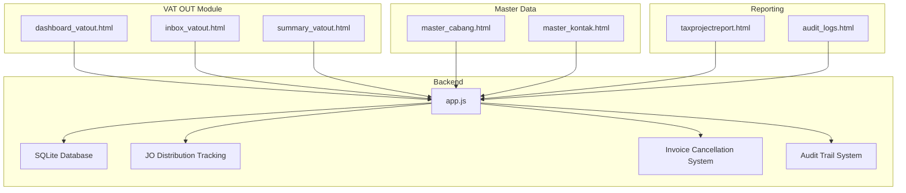

**Diagram sources**
- [app.js:355-503](file://app.js#L355-L503)
- [dashboard_vatout.html:213-225](file://vat_out/dashboard_vatout.html#L213-L225)
- [inbox_vatout.html:174-186](file://vat_out/inbox_vatout.html#L174-L186)
- [summary_vatout.html:73-88](file://vat_out/summary_vatout.html#L73-L88)

## Core Components
- **Enhanced Invoice Management with Cancellation Support**
  - The VAT OUT module uses a header table for transaction records with comprehensive cancellation tracking via `tgl_batal` column. Fields include invoice number, entity, branch code, project ID, vendor/customer identifiers, invoice date, amounts (DPP and PPN), references, issuing location, signatory, internal invoice number, exchange date, format type, PDF link, input user, timestamp, and cancellation date. These fields support complete invoice lifecycle management including cancellation, reactivation, and detailed audit trails.
- **Advanced JO Internal Distribution Tracking**
  - **Enhanced**: Dedicated `porsi_vatout` table tracks portion allocations per JO member (BBS/BMP) for joint venture invoices with fields: `no_faktur`, `anggota` (member identifier), `dpp_porsi` (portion of taxable value), `ppn_porsi` (portion of output tax). This enables precise attribution of VAT output income to specific JV partners while maintaining the original invoice structure.
  - Supports real-time percentage calculations and validation during editing with automatic warnings when allocated portions don't match invoice totals.
  - Integrates with project reporting to show member-specific income portions with clear indicators.
- **Comprehensive Invoice Cancellation System**
  - **New**: Complete cancellation functionality allowing users to cancel invoices with mandatory cancellation dates and audit trail preservation.
  - Supports invoice reactivation through approval workflow with proper status updates.
  - Automatically excludes cancelled invoices from all statistical calculations, trend analysis, and reporting.
  - Maintains audit trail by preserving cancelled invoices with visual indicators in the UI.
- **Enhanced Audit Trail Integration**
  - **New**: Comprehensive audit logging system that records all cancellation and reactivation activities with timestamps, user information, and action details.
  - Real-time audit log viewing through dedicated audit logs page with filtering and search capabilities.
  - Integration with user request system for approval workflow management.
- **Backend Endpoints**
  - Status Migration Endpoint: Automated processing of missing status fields including status_faktur, masa_pajak, and no_faktur_normal through `/api/migrate-vatout-status`.
  - Enhanced Project Summary Endpoint: Handles JO projects differently by fetching VAT out income portions from porsi_vatout table instead of full branch amounts.
  - Available VAT OUT Endpoint: Retrieves available VAT OUT records filtered by entity and optionally by client name and mode, excluding cancelled invoices.
  - PDF Attachment Management: Handles saving, renaming, and cleanup of PDF attachments associated with VAT OUT records.
  - Invoice Action Processing: Socket-based processing for cancellation, reactivation, and edit requests with approval workflow.
- **UI Pages**
  - Dashboard: Provides overview metrics and navigation for VAT OUT operations with JO portion editing capabilities and cancellation controls.
  - Inbox: Manages incoming VAT OUT requests, approvals, and status tracking with enhanced filtering and search capabilities.
  - Summary: Delivers analytical reports for VAT output analysis, compliance, and reconciliation with cancelled invoice exclusion.

**Updated** Enhanced with comprehensive invoice cancellation capabilities, improved JO internal distribution tracking system, automated status migration capabilities, and integrated audit trail system.

**Section sources**
- [PRD_Tax_Database_System.md:34-49](file://PRD_Tax_Database_System.md#L34-L49)
- [app.js:355-503](file://app.js#L355-L503)
- [app.js:838-895](file://app.js#L838-L895)

## Architecture Overview
The VAT OUT module follows a client-server architecture with HTML-based UI pages and a Node.js backend. The backend connects to a local SQLite database, exposes REST-like endpoints for dashboards and summaries, and manages file attachments for invoices. Master data for branches and contacts supports customer management integration. The system includes specialized JO distribution tracking for joint venture operations and comprehensive invoice cancellation functionality with audit trail support.

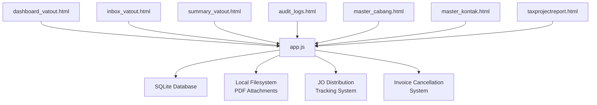

**Diagram sources**
- [app.js:355-503](file://app.js#L355-L503)
- [dashboard_vatout.html:213-225](file://vat_out/dashboard_vatout.html#L213-L225)
- [inbox_vatout.html:174-186](file://vat_out/inbox_vatout.html#L174-L186)
- [summary_vatout.html:73-88](file://vat_out/summary_vatout.html#L73-L88)
- [audit_logs.html:148-156](file://audit_logs.html#L148-L156)

## Detailed Component Analysis

### Enhanced Invoice Cancellation and Reactivation System
- **Database Schema Enhancement**
  - New `tgl_batal` column in `data_vatout` table stores cancellation dates for audit trail purposes with DATE data type.
  - Visual indicators in UI show cancelled invoices with reduced opacity (0.55) and status badges for easy identification.
  - All queries automatically exclude cancelled invoices using `(d.tgl_batal IS NULL OR d.tgl_batal = '')` conditions throughout the system.
- **Cancellation Workflow**
  - Users can cancel invoices through dashboard with mandatory cancellation date entry via modal interface.
  - Non-supervisor users submit cancellation requests requiring supervisor approval through user_requests system.
  - Supervisor users can directly cancel or reactivate invoices with immediate effect and audit logging.
  - Audit logs record all cancellation and reactivation actions with timestamps, user information, and action details.
- **Reactivation Process**
  - Cancelled invoices can be reactivated through approval workflow with proper status propagation.
  - Reactivation removes the cancellation date, restoring invoice to active status across all modules.
  - Proper status propagation ensures consistency across all reporting and statistical calculations.
- **Visual Indicators and User Experience**
  - Cancelled invoices display with reduced opacity (0.55) for easy identification in all views.
  - Status badges clearly indicate cancellation status with formatted dates and hover tooltips.
  - Action buttons dynamically change between "Cancel" and "Reactivate" based on current invoice status.
  - Confirmation dialogs provide clear warnings about the impact of cancellation on reporting.

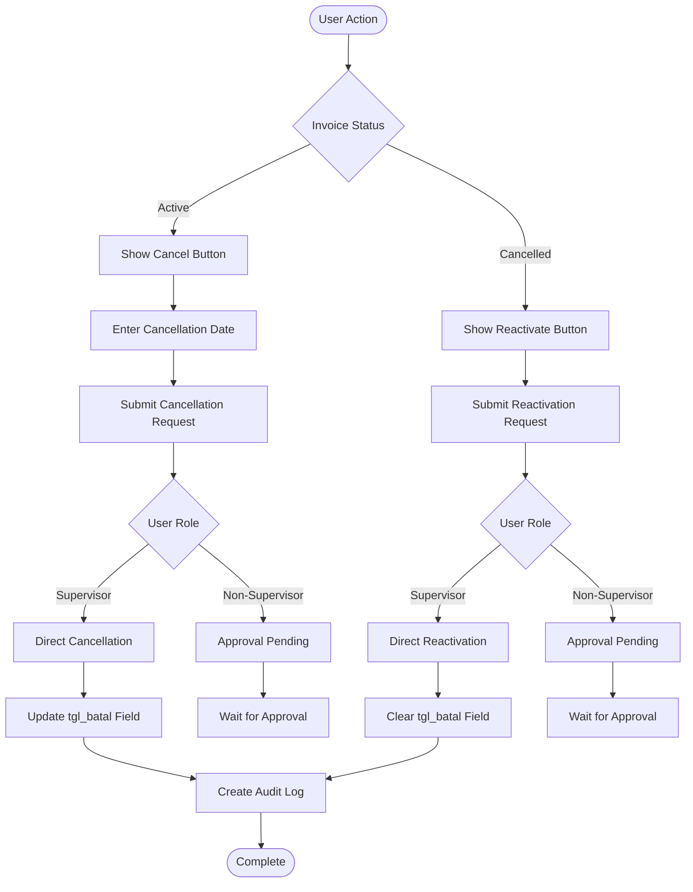

**Diagram sources**
- [dashboard_vatout.html:213-225](file://vat_out/dashboard_vatout.html#L213-L225)
- [dashboard_vatout.html:561-582](file://vat_out/dashboard_vatout.html#L561-L582)
- [app.js:664-743](file://app.js#L664-L743)

**Section sources**
- [dashboard_vatout.html:213-225](file://vat_out/dashboard_vatout.html#L213-L225)
- [dashboard_vatout.html:561-582](file://vat_out/dashboard_vatout.html#L561-L582)
- [app.js:664-743](file://app.js#L664-L743)

### Enhanced JO Internal Distribution Tracking System
- **Database Schema**
  - Dedicated `porsi_vatout` table stores portion allocations with fields: `no_faktur`, `anggota` (member identifier), `dpp_porsi` (portion of taxable value), `ppn_porsi` (portion of output tax).
  - Primary key ensures unique allocation per invoice and member combination with composite indexing.
  - Supports BBS and BMP as standard JO member identifiers with validation and sanitization.
- **Real-time Editing Interface**
  - Dashboard edit modal includes dedicated section for JO portion allocation when entity is 'JO'.
  - Automatic percentage calculation based on total DPP and PPN values with live updates and color-coded feedback.
  - Validation warnings when allocated portions don't match invoice totals with visual indicators.
  - Input sanitization prevents invalid member identifiers and numeric overflow with error handling.
- **Enhanced Project Summary API**
  - Detects JO projects by checking `entitas = 'JO'` in master_cabang table.
  - For JO projects, queries `data_vatout` joined with `porsi_vatout` using specific member filter.
  - Returns both full invoice amounts (`dpp_full`, `ppn_full`) and member-specific portions (`dpp`, `ppn`).
  - Includes `porsi_anggota` field indicating which member's portion is being displayed.
  - Automatically excludes cancelled invoices from JO project reporting with proper WHERE clauses.

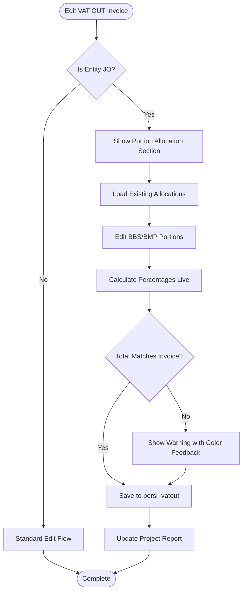

**Diagram sources**
- [dashboard_vatout.html:166-203](file://vat_out/dashboard_vatout.html#L166-L203)
- [app.js:838-895](file://app.js#L838-L895)

**Section sources**
- [app.js:359-365](file://app.js#L359-L365)
- [app.js:838-895](file://app.js#L838-L895)
- [app.js:897-919](file://app.js#L897-L919)
- [dashboard_vatout.html:166-203](file://vat_out/dashboard_vatout.html#L166-L203)
- [dashboard_vatout.html:534-557](file://vat_out/dashboard_vatout.html#L534-L557)

### VAT Liability and Tax Calculation Workflow
- **Data Model Alignment**
  - The header table stores DPP (Taxable Value) and PPN (Output Tax) amounts per invoice. These fields enable straightforward VAT liability computation and tax reporting.
  - JO distribution tracking maintains separate allocation records without modifying original invoice data.
  - Cancelled invoices are automatically excluded from all tax calculations and reporting through consistent WHERE clauses.
- **Invoice Generation and Customer Billing**
  - The available VAT OUT endpoint retrieves invoice records with buyer details and amounts, enabling downstream billing and reconciliation processes.
  - For JO projects, billing can be calculated based on member-specific portions rather than full invoice amounts.
  - Invoice cancellation properly handles billing adjustments and refund processing with audit trail preservation.
- **Trend and Branch Reporting**
  - The backend aggregates monthly trends and branch-level totals for invoice counts and tax amounts, supporting financial reconciliation and compliance reporting.
  - JO projects now report member-specific tax amounts instead of full branch totals with clear indicators.
  - All reporting modules automatically exclude cancelled invoices from statistical calculations with optimized queries.

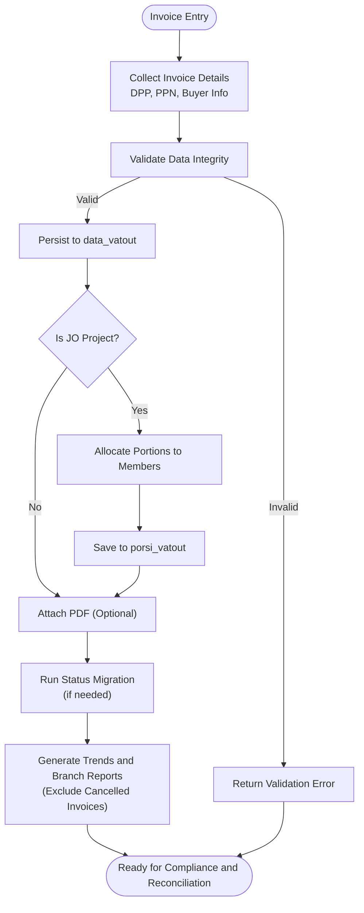

**Updated** Added invoice cancellation handling and JO portion allocation steps for joint venture invoices with comprehensive audit trail support.

**Diagram sources**
- [app.js:355-503](file://app.js#L355-L503)
- [PRD_Tax_Database_System.md:34-49](file://PRD_Tax_Database_System.md#L34-L49)

**Section sources**
- [PRD_Tax_Database_System.md:34-49](file://PRD_Tax_Database_System.md#L34-L49)
- [app.js:355-503](file://app.js#L355-L503)

### Enhanced Deduplication Function
- **Comprehensive Deduplication Logic**
  - The `deduplicateFakturData` function provides robust deduplication capabilities for VAT IN and VAT OUT data.
  - Groups records by serial number (ignoring first 4 digits: transaction code & status).
  - Selects highest priority record from each group based on status ranking.
  - Priority order: Pengganti N > ... > Pengganti 2 > Pengganti 1 > Normal.
  - Synchronizes masa pajak between replacement and normal invoices.
  - Uses time_input as tiebreaker when status is equal.
  - **Enhanced**: Automatically excludes cancelled invoices from aggregation when the highest-priority invoice in a group has been cancelled.

- **Enhanced Features**:
  - Cross-module applicability for both VAT IN and VAT OUT processing.
  - Automatic synchronization of tax periods between related invoices.
  - Improved error handling and performance optimization.
  - Integration with invoice cancellation system for complete lifecycle management.

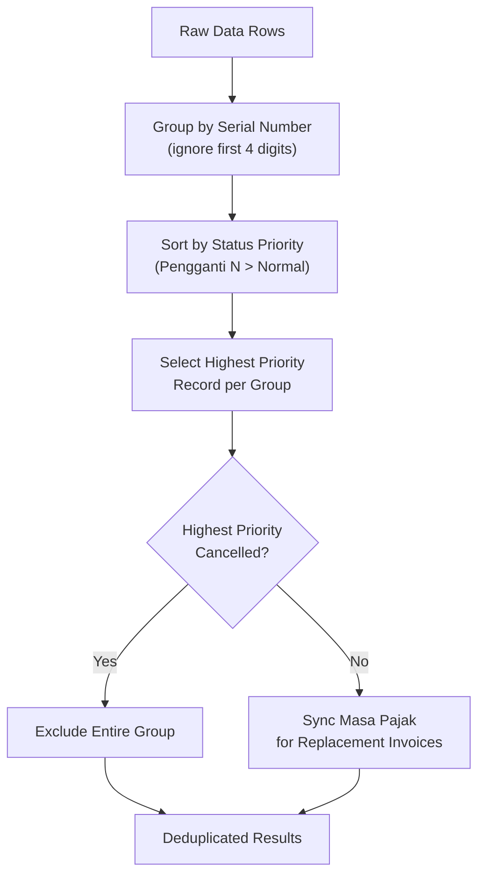

**Diagram sources**
- [app.js:172-223](file://app.js#L172-L223)

**Section sources**
- [app.js:172-223](file://app.js#L172-L223)

### Status Migration and Data Consistency
- **Automated Status Migration Endpoint**
  - The `/api/migrate-vatout-status` endpoint automatically processes missing status fields for existing VAT OUT records.
  - Extracts status_faktur from invoice number digits 3-4 (00 = Normal, 01+ = Pengganti N).
  - Calculates masa_pajak from tanggal_faktur in YYYY-MM format.
  - Derives no_faktur_normal for replacement invoices by replacing digits 3-4 with '00'.
  - Processes records where status_faktur is NULL, empty, or incorrectly set to 'Normal'.
- **Migration Process**:
  - Queries all VAT OUT records with missing or incorrect status fields.
  - Iterates through each record to extract and calculate required fields.
  - Updates database records with proper status information.
  - Returns detailed statistics including total, updated, and failed counts.
- **Standalone Migration Tool**:
  - Separate JavaScript script for batch processing with direct database access.
  - Progress logging and error handling for large datasets.
  - Optimized for high-volume migrations with transaction safety.

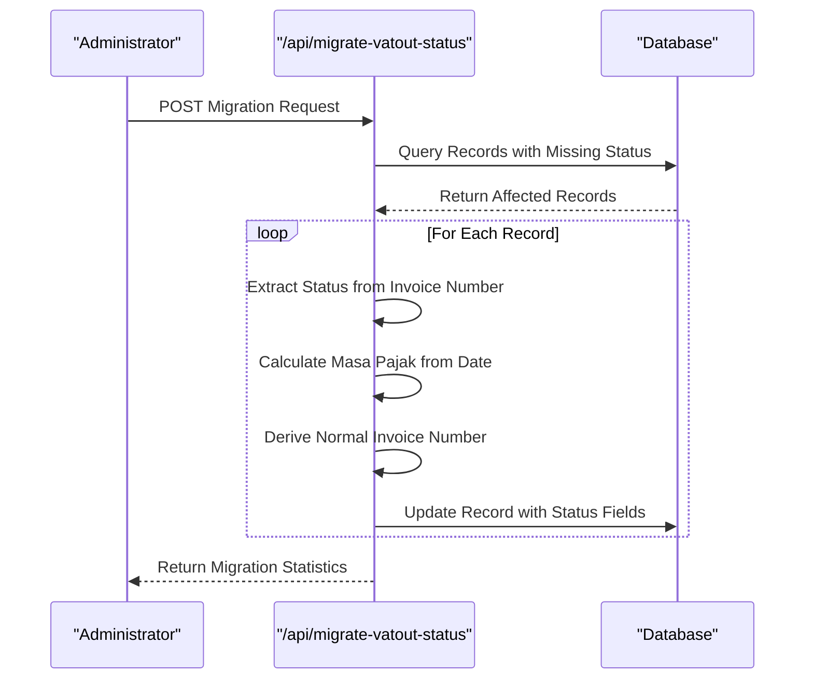

**Diagram sources**
- [app.js:664-743](file://app.js#L664-L743)

**Section sources**
- [app.js:664-743](file://app.js#L664-L743)

### Inbox Processing and Approval Workflows
- **Request Management**
  - The inbox page displays incoming VAT OUT requests with buyer details, invoice dates, and amounts. Users can review, approve, or reject requests.
  - Enhanced filtering capabilities for searching by various criteria including invoice numbers, client names, and amounts.
  - Support for batch PDF upload with progress tracking and error handling.
- **Status Tracking**
  - Status updates propagate through the backend to reflect approval outcomes and maintain audit trails.
  - Real-time updates via Socket.IO for immediate UI refresh upon request processing.
  - Integration with user request system for approval workflow management.
- **PDF Attachment Handling**
  - The backend saves uploaded PDFs locally, renames them consistently, and cleans up previous attachments upon updates.
  - Support for multiple file uploads with chunked processing for large batches.
  - Automatic text extraction and item parsing from PDF documents.

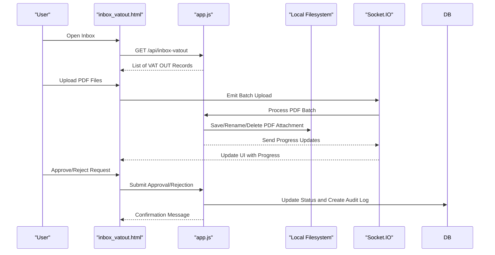

**Diagram sources**
- [inbox_vatout.html:174-186](file://vat_out/inbox_vatout.html#L174-L186)
- [app.js:355-503](file://app.js#L355-L503)

**Section sources**
- [inbox_vatout.html:174-186](file://vat_out/inbox_vatout.html#L174-L186)
- [app.js:355-503](file://app.js#L355-L503)

### Summary Reporting Capabilities
- **Trend Analysis**
  - Monthly trends are computed by grouping invoices by period, counting records, and aggregating DPP and PPN totals.
  - Automatically excludes cancelled invoices from all statistical calculations using proper WHERE clauses.
  - Month-over-month comparison with percentage change indicators.
- **Branch-Level Reporting**
  - Branch-level summaries count invoices and aggregate tax totals, aiding regional compliance and reconciliation.
  - Visual charts showing distribution patterns across different branches.
  - Export capabilities for further analysis in external tools.
- **JO Member-Specific Reporting**
  - For JO projects, reports show member-specific portions instead of full branch amounts.
  - Displays clear indicators showing which member's portion is being viewed.
  - Integration with project reporting for accurate profit margin calculations.
- **Compliance and Financial Reconciliation**
  - Summaries provide the basis for tax returns, reconciliations, and audit support.
  - Comprehensive audit trail for all cancelled and modified invoices.
  - Support for regulatory reporting requirements with proper data segregation.

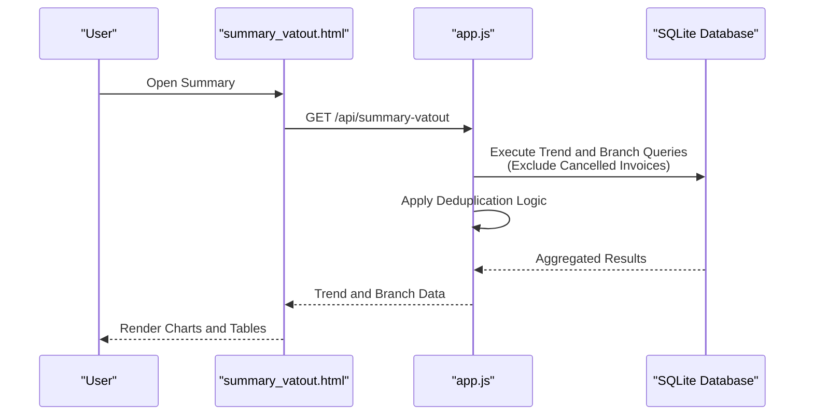

**Updated** Enhanced with JO member-specific reporting, deduplication logic for accurate reporting, and comprehensive cancelled invoice exclusion.

**Diagram sources**
- [summary_vatout.html:115-138](file://vat_out/summary_vatout.html#L115-L138)
- [app.js:355-503](file://app.js#L355-L503)

**Section sources**
- [summary_vatout.html:115-138](file://vat_out/summary_vatout.html#L115-L138)
- [app.js:355-503](file://app.js#L355-L503)

### User Interface Components and Integrations
- **Dashboard**
  - Provides overview metrics and navigation links to inbox and summary views.
  - Enhanced with JO portion allocation editing interface for joint venture invoices.
  - Comprehensive invoice cancellation and reactivation controls with visual status indicators.
  - Real-time statistics updates and month-over-month comparisons.
- **Inbox**
  - Supports request review, approval/rejection actions, and status updates.
  - Enhanced filtering and search capabilities for efficient workflow management.
  - Batch PDF upload with progress tracking and error handling.
- **Summary**
  - Presents charts and tables for trend and branch-level analysis.
  - Export capabilities for further analysis and reporting.
  - Responsive design for mobile and desktop viewing.
- **Customer and Branch Integration**
  - Master data pages supply branch and contact information used in VAT OUT records.
  - Dynamic branch selection with automatic VO loading based on selected branch.
  - Integration with client ledger for comprehensive financial tracking.
- **Project Reporting Integration**
  - Tax project report displays member-specific portions for JO projects with clear labeling.
  - Enhanced project summary API providing accurate revenue attribution for JO projects.
  - Integration with cancellation system for complete project lifecycle management.

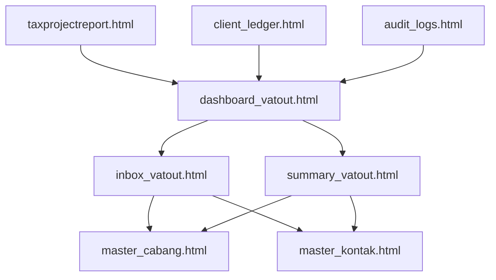

**Diagram sources**
- [dashboard_vatout.html:213-225](file://vat_out/dashboard_vatout.html#L213-L225)
- [inbox_vatout.html:174-186](file://vat_out/inbox_vatout.html#L174-L186)
- [summary_vatout.html:73-88](file://vat_out/summary_vatout.html#L73-L88)
- [audit_logs.html:148-156](file://audit_logs.html#L148-L156)

**Section sources**
- [dashboard_vatout.html:213-225](file://vat_out/dashboard_vatout.html#L213-L225)
- [inbox_vatout.html:174-186](file://vat_out/inbox_vatout.html#L174-L186)
- [summary_vatout.html:73-88](file://vat_out/summary_vatout.html#L73-L88)
- [audit_logs.html:148-156](file://audit_logs.html#L148-L156)

### Practical Examples and Integration Scenarios
- **Example: Generating a VAT OUT Invoice**
  - Use the available VAT OUT endpoint to fetch buyer and amount details, then create an invoice record with DPP and PPN fields aligned to the header table schema.
  - For JO projects, allocate portions to BBS and BMP members using the enhanced allocation interface.
- **Example: Managing Incoming Requests**
  - Review requests in the inbox, approve or reject based on validation rules, and update statuses accordingly.
  - Handle batch PDF uploads with progress tracking and error recovery.
- **Example: Invoice Cancellation Workflow**
  - Navigate to dashboard and select invoice to cancel.
  - Enter mandatory cancellation date and submit request.
  - For non-supervisors, wait for supervisor approval through user_requests system.
  - Supervisors can directly cancel or reactivate invoices with immediate effect.
  - Verify cancellation through audit logs and visual indicators.
- **Example: JO Portion Allocation**
  - For joint venture invoices, use the edit interface to allocate portions to BBS and BMP members.
  - System automatically calculates percentages and validates that allocations sum to invoice totals.
  - View member-specific portions in project reports with clear indicators.
- **Example: Compliance Reporting**
  - Generate monthly trends and branch-level summaries to support tax filings and reconciliations.
  - All reports automatically exclude cancelled invoices from statistical calculations.
  - Export data for external analysis and regulatory reporting.
- **Example: Data Migration**
  - Run the status migration endpoint to populate missing status fields for existing records.
  - Verify migration results using the verification endpoint for comprehensive reporting.
- **Integration with Customer Management**
  - Link buyer information to master contact records and branch information to master branch records for accurate invoicing and reporting.
  - Integration with client ledger for comprehensive financial tracking and reconciliation.

**Updated** Added comprehensive examples for invoice cancellation workflow, JO portion allocation, and member-specific reporting with enhanced validation and audit trail support.

**Section sources**
- [app.js:355-503](file://app.js#L355-L503)
- [PRD_Tax_Database_System.md:34-49](file://PRD_Tax_Database_System.md#L34-L49)
- [dashboard_vatout.html:213-225](file://vat_out/dashboard_vatout.html#L213-L225)

## Dependency Analysis
- **Internal Dependencies**
  - UI pages depend on backend endpoints for data retrieval and updates.
  - PDF attachment management depends on filesystem operations coordinated by the backend.
  - Deduplication function is shared across multiple endpoints for consistent data processing.
  - JO distribution tracking depends on master_cabang table for entity identification.
  - Invoice cancellation system integrates with audit logging and user request management.
- **External Dependencies**
  - The backend interacts with a local SQLite database and filesystem for storage and retrieval.
  - Migration tools operate independently with direct database access.
  - Socket.IO for real-time communication between frontend and backend.
  - Chart.js for visualization in summary reports.
- **Master Data Dependencies**
  - VAT OUT records reference branch and contact master data, ensuring accurate customer and branch identification.
  - JO distribution tracking relies on master_cabang for identifying joint venture entities and members.
  - Client ledger integration provides comprehensive financial tracking capabilities.

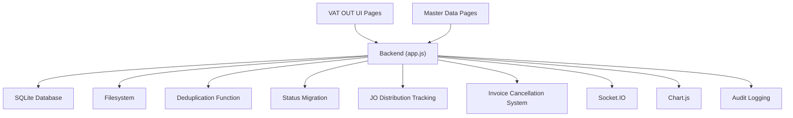

**Updated** Added invoice cancellation system, Socket.IO integration, Chart.js dependencies, and comprehensive audit logging system.

**Diagram sources**
- [app.js:355-503](file://app.js#L355-L503)
- [dashboard_vatout.html:213-225](file://vat_out/dashboard_vatout.html#L213-L225)
- [inbox_vatout.html:174-186](file://vat_out/inbox_vatout.html#L174-L186)
- [summary_vatout.html:73-88](file://vat_out/summary_vatout.html#L73-L88)
- [audit_logs.html:148-156](file://audit_logs.html#L148-L156)

**Section sources**
- [app.js:355-503](file://app.js#L355-L503)
- [PRD_Tax_Database_System.md:34-49](file://PRD_Tax_Database_System.md#L34-L49)

## Performance Considerations
- **Query Efficiency**
  - Use indexed columns (entity, invoice date) in queries to optimize trend and branch aggregation.
  - Deduplication function optimizes data processing by grouping and sorting efficiently.
  - JO distribution queries use LEFT JOIN for optimal performance when member portions are not present.
  - **Enhanced**: All queries automatically exclude cancelled invoices using optimized WHERE clauses with proper indexing.
- **Attachment Management**
  - Minimize unnecessary file operations by consolidating save/rename/cleanup steps during updates.
  - Support for batch PDF processing with chunked uploads for improved performance.
- **UI Responsiveness**
  - Paginate large datasets in the inbox and limit report scopes to reduce rendering overhead.
  - Real-time percentage calculations in JO portion editing are optimized for immediate feedback.
  - Socket.IO integration provides instant UI updates without full page reloads.
- **Migration Performance**
  - Batch processing for status migration handles large datasets efficiently with progress tracking.
  - Standalone migration script provides optimal performance for bulk operations.
- **JO Distribution Performance**
  - Efficient LEFT JOIN queries ensure minimal impact when portions are not yet allocated.
  - Indexed primary keys on porsi_vatout table optimize allocation lookups.
- **Cancellation System Performance**
  - Optimized query patterns for cancelled invoice exclusion across all reporting modules.
  - Minimal performance impact on existing queries through strategic WHERE clause placement.
  - Efficient audit log creation with background processing for non-critical operations.

**Updated** Added performance considerations for invoice cancellation system, batch PDF processing, real-time Socket.IO communication, and optimized audit logging.

## Troubleshooting Guide
- **PDF Attachment Issues**
  - Verify that PDF files are saved with consistent naming and that cleanup routines remove outdated attachments after updates.
  - Check batch upload progress and error handling for large file collections.
- **Data Retrieval Problems**
  - Confirm that the available VAT OUT endpoint filters by entity and applies proper ordering for timely retrieval.
  - Verify that cancelled invoice exclusion is working correctly in all reporting modules.
- **Trend and Branch Report Errors**
  - Ensure that aggregation queries group by period and branch codes correctly and handle missing data gracefully.
  - Check that cancelled invoices are properly excluded from statistical calculations.
- **Audit and Reconciliation Discrepancies**
  - Cross-check invoice counts and totals against the header table fields and confirm that master data links are intact.
  - Verify audit logs for cancellation and reactivation activities through the audit logs page.
- **Status Migration Issues**
  - Check if records have valid invoice numbers and dates for status extraction.
  - Verify database permissions for write operations during migration.
  - Monitor migration logs for individual record processing errors.
- **Deduplication Problems**
  - Ensure invoice numbers follow the expected format for proper grouping.
  - Verify that status fields are correctly populated before running deduplication.
  - Check that cancelled invoices are properly handled in deduplication logic.
- **JO Distribution Issues**
  - Verify that master_cabang entries have correct `entitas = 'JO'` designation for joint venture projects.
  - Check that portion allocations sum correctly to invoice totals when editing.
  - Ensure project reports display member-specific portions for JO projects.
  - Validate that porsi_vatout table has proper indexes for efficient querying.
- **Invoice Cancellation Issues**
  - Verify that cancellation dates are properly recorded in the `tgl_batal` field.
  - Check that cancelled invoices are excluded from all statistical calculations and reporting.
  - Ensure audit logs are created for all cancellation and reactivation activities.
  - Verify that visual indicators properly reflect cancellation status in the UI.
  - Check approval workflow for non-supervisor users attempting cancellations.
  - Monitor user_requests table for pending approval items.

**Updated** Added troubleshooting guidance for invoice cancellation system, batch PDF processing, enhanced validation mechanisms, and audit trail verification.

**Section sources**
- [app.js:355-503](file://app.js#L355-L503)

## Conclusion
The VAT Output (VAT OUT) module provides a structured framework for invoice generation, customer billing, tax calculation, inbox processing, and summary reporting. Its integration with master data ensures accurate customer and branch identification, while backend endpoints and filesystem management support efficient operations. By leveraging trend and branch-level summaries, organizations can meet compliance requirements and streamline financial reconciliation processes.

**Updated** The addition of comprehensive invoice cancellation capabilities significantly enhances the system's ability to manage complete invoice lifecycles with proper audit trails and approval workflows. The improved JO member allocation system with porsi_vatout table integration enables precise attribution of VAT output income to specific JV members while maintaining data integrity. The enhanced project summary API provides accurate revenue reporting for complex joint venture structures. The integrated audit trail system ensures complete traceability of all invoice modifications and status changes. Together, these enhancements create a robust, compliant, and user-friendly VAT output management system that supports sophisticated business operations while maintaining regulatory compliance and financial accuracy.