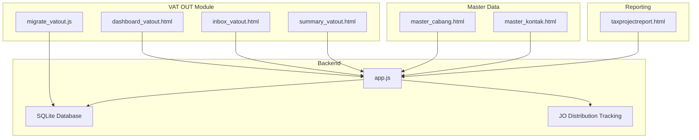
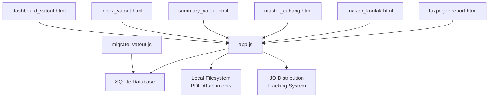
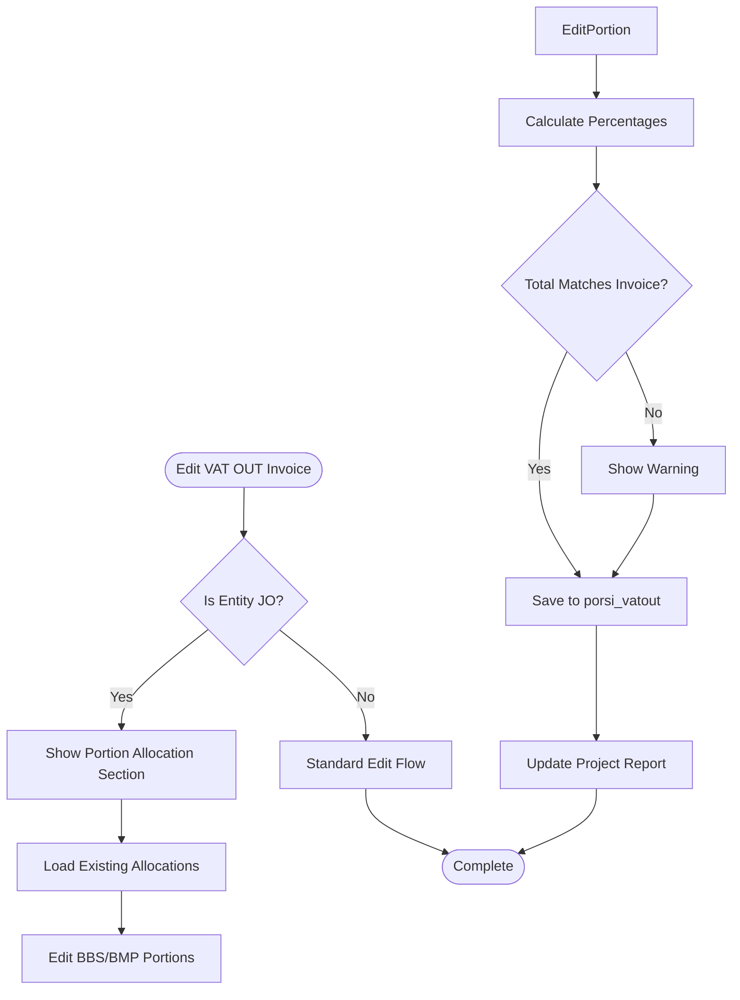
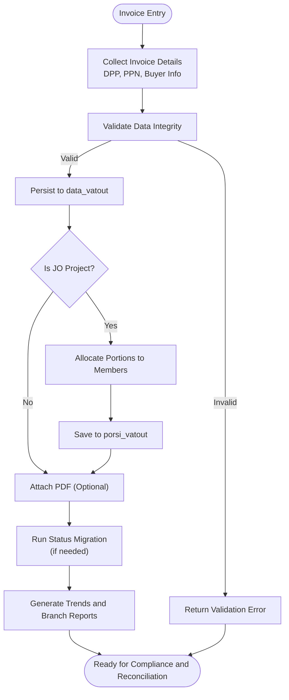
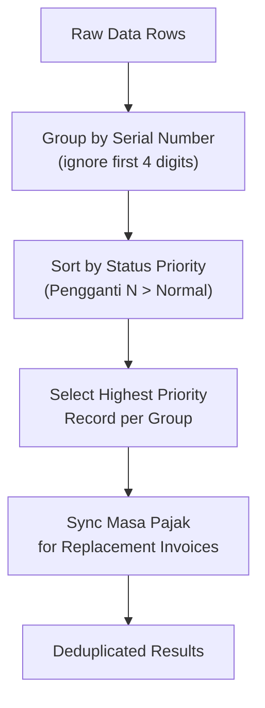
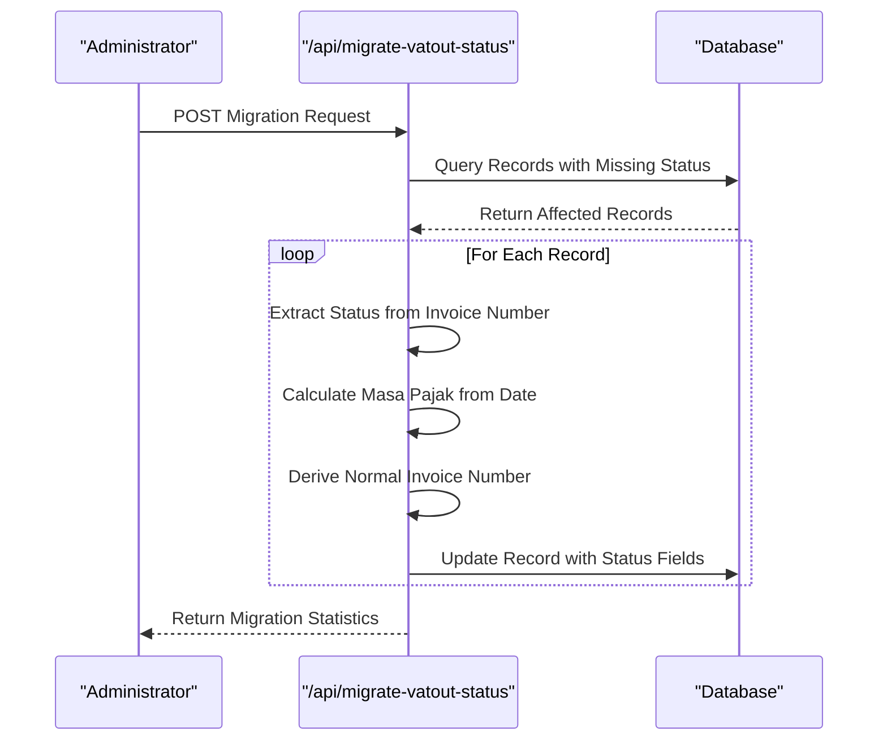
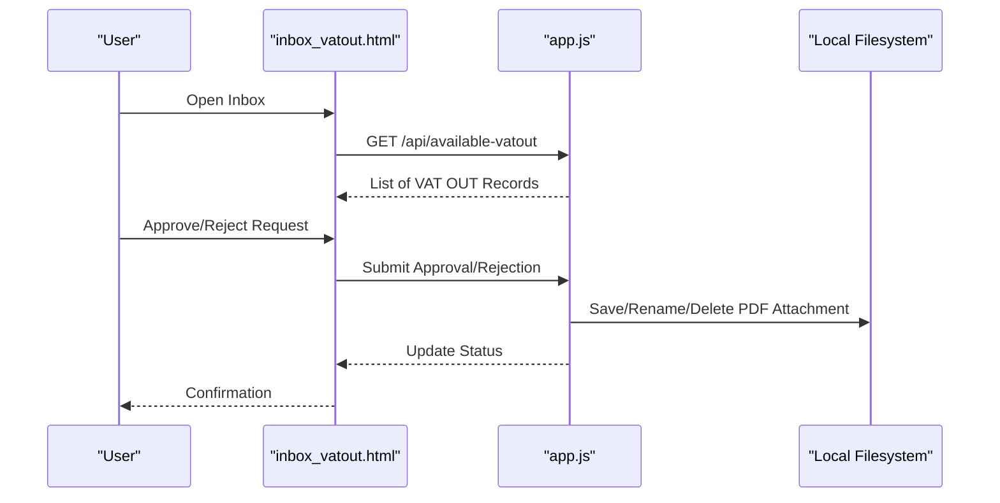
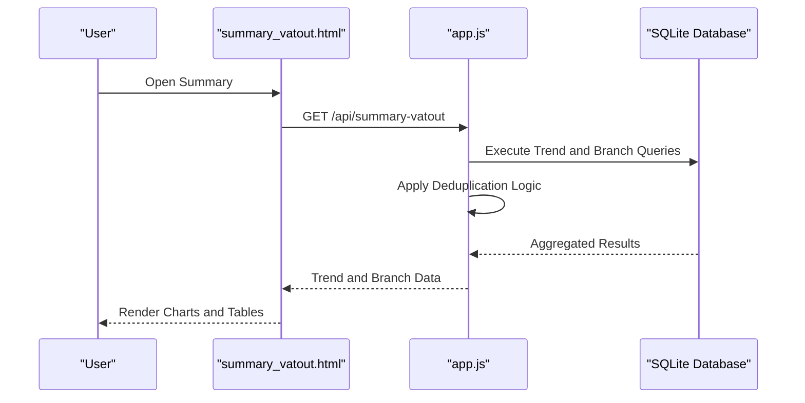
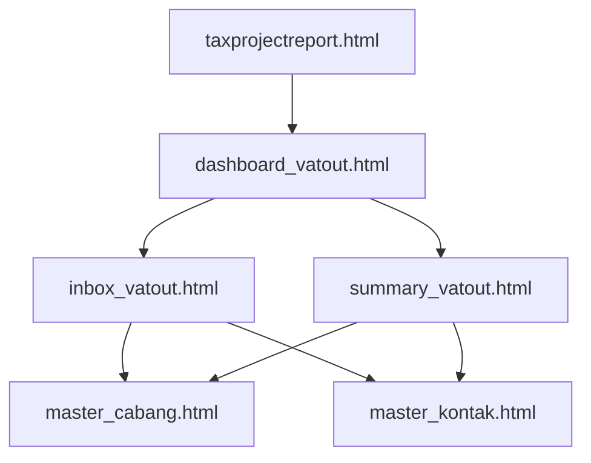
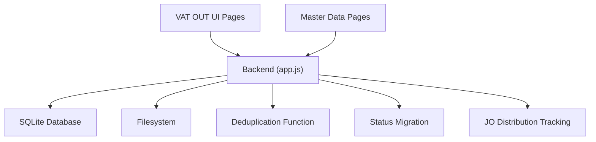

# VAT Output (VAT OUT)

<cite>
**Referenced Files in This Document**
- [app.js](file://app.js)
- [PRD_Tax_Database_System.md](file://PRD_Tax_Database_System.md)
- [dashboard_vatout.html](file://vat_out/dashboard_vatout.html)
- [inbox_vatout.html](file://vat_out/inbox_vatout.html)
- [summary_vatout.html](file://vat_out/summary_vatout.html)
- [master_cabang.html](file://master_cabang.html)
- [master_kontak.html](file://master_kontak.html)
- [client_ledger.html](file://accounting/client_ledger.html)
- [migrate_vatout.js](file://migrate_vatout.js)
- [taxprojectreport.html](file://taxprojectreport.html)
</cite>

## Update Summary
**Changes Made**
- Added comprehensive JO internal distribution tracking system with new porsi_vatout table for recording portion allocations per JO member (BBS/BMP)
- Enhanced project summary API to handle JO projects differently by fetching VAT out income portions from porsi_vatout table instead of full branch amounts
- Updated dashboard and inbox interfaces to support JO portion allocation editing and display
- Integrated JO distribution tracking into tax project reporting for accurate profit margin calculations

## Table of Contents
1. [Introduction](#introduction)
2. [Project Structure](#project-structure)
3. [Core Components](#core-components)
4. [Architecture Overview](#architecture-overview)
5. [Detailed Component Analysis](#detailed-component-analysis)
6. [Dependency Analysis](#dependency-analysis)
7. [Performance Considerations](#performance-considerations)
8. [Troubleshooting Guide](#troubleshooting-guide)
9. [Conclusion](#conclusion)

## Introduction
This document provides comprehensive documentation for the VAT Output (VAT OUT) management module. It covers transaction management workflows for invoice generation, customer billing, and tax calculation; inbox processing for managing incoming VAT output requests, approvals, and status tracking; summary reporting for VAT output analysis, compliance reporting, and financial reconciliation; and user interface components for VAT output processing, customer management integration, and transaction monitoring. It also explains VAT liability calculations, output tax handling, regulatory compliance requirements, practical processing examples, integration scenarios with customer management, and troubleshooting guidance for VAT output-related issues.

**Updated** Added comprehensive JO internal distribution tracking system that enables precise allocation of VAT output income portions to Joint Venture members (BBS/BMP), enhancing financial reporting accuracy for joint venture operations.

## Project Structure
The VAT OUT module consists of three primary HTML pages under the vat_out directory and supporting backend endpoints in the application server. The backend integrates with database tables for VAT OUT transactions, manages PDF attachments, and exposes APIs for dashboards and summaries. Customer and branch master data are integrated via dedicated pages for contact and branch management. The system now includes specialized support for JO (Joint Venture) internal distribution tracking.

**Diagram sources**
- [app.js](file://app.js)
- [dashboard_vatout.html](file://vat_out/dashboard_vatout.html)
- [inbox_vatout.html](file://vat_out/inbox_vatout.html)
- [summary_vatout.html](file://vat_out/summary_vatout.html)
- [master_cabang.html](file://master_cabang.html)
- [master_kontak.html](file://master_kontak.html)
- [migrate_vatout.js](file://migrate_vatout.js)
- [taxprojectreport.html](file://taxprojectreport.html)

**Section sources**
- [app.js](file://app.js)
- [PRD_Tax_Database_System.md](file://PRD_Tax_Database_System.md)

## Core Components
- **VAT OUT Transaction Tables and Keys**
  - The VAT OUT module uses a header table for transaction records and related detail items. The header table includes keys such as invoice number, entity, branch code, project ID, vendor/customer identifiers, invoice date, amounts (DPP and PPN), references, issuing location, signatory, internal invoice number, exchange date, format type, PDF link, input user, and timestamp. These fields support invoice generation, customer billing, and tax calculation workflows.
- **JO Internal Distribution Tracking**
  - **New**: Dedicated `porsi_vatout` table tracks portion allocations per JO member (BBS/BMP) for joint venture invoices. This enables precise attribution of VAT output income to specific JV partners while maintaining the original invoice structure.
  - Supports real-time percentage calculations and validation during editing.
  - Integrates with project reporting to show member-specific income portions.
- **Backend Endpoints**
  - Status Migration Endpoint: Automated processing of missing status fields including status_faktur, masa_pajak, and no_faktur_normal through `/api/migrate-vatout-status`.
  - Enhanced Project Summary Endpoint: Handles JO projects differently by fetching VAT out income portions from porsi_vatout table instead of full branch amounts.
  - Available VAT OUT Endpoint: Retrieves available VAT OUT records filtered by entity and optionally by client name and mode.
  - PDF Attachment Management: Handles saving, renaming, and cleanup of PDF attachments associated with VAT OUT records.
- **UI Pages**
  - Dashboard: Provides overview metrics and navigation for VAT OUT operations with JO portion editing capabilities.
  - Inbox: Manages incoming VAT OUT requests, approvals, and status tracking.
  - Summary: Delivers analytical reports for VAT output analysis, compliance, and reconciliation.
- **Data Migration Tools**
  - Standalone migration script for batch processing of VAT OUT records with automatic status field population.

**Updated** Enhanced with comprehensive JO internal distribution tracking system and automated status migration capabilities.

**Section sources**
- [PRD_Tax_Database_System.md](file://PRD_Tax_Database_System.md)
- [app.js](file://app.js)
- [migrate_vatout.js](file://migrate_vatout.js)

## Architecture Overview
The VAT OUT module follows a client-server architecture with HTML-based UI pages and a Node.js backend. The backend connects to a local SQLite database, exposes REST-like endpoints for dashboards and summaries, and manages file attachments for invoices. Master data for branches and contacts supports customer management integration. The system now includes specialized JO distribution tracking for joint venture operations.

**Diagram sources**
- [app.js](file://app.js)
- [dashboard_vatout.html](file://vat_out/dashboard_vatout.html)
- [inbox_vatout.html](file://vat_out/inbox_vatout.html)
- [summary_vatout.html](file://vat_out/summary_vatout.html)
- [master_cabang.html](file://master_cabang.html)
- [master_kontak.html](file://master_kontak.html)
- [migrate_vatout.js](file://migrate_vatout.js)
- [taxprojectreport.html](file://taxprojectreport.html)

## Detailed Component Analysis

### JO Internal Distribution Tracking System
- **Database Schema**
  - New `porsi_vatout` table stores portion allocations with fields: `no_faktur`, `anggota` (member identifier), `dpp_porsi` (portion of taxable value), `ppn_porsi` (portion of output tax).
  - Primary key ensures unique allocation per invoice and member combination.
  - Supports BBS and BMP as standard JO member identifiers.
- **Real-time Editing Interface**
  - Dashboard edit modal includes dedicated section for JO portion allocation when entity is 'JO'.
  - Automatic percentage calculation based on total DPP and PPN values.
  - Validation warnings when allocated portions don't match invoice totals.
- **Enhanced Project Summary API**
  - Detects JO projects by checking `entitas = 'JO'` in master_cabang table.
  - For JO projects, queries `data_vatout` joined with `porsi_vatout` using specific member filter.
  - Returns both full invoice amounts (`dpp_full`, `ppn_full`) and member-specific portions (`dpp`, `ppn`).
  - Includes `porsi_anggota` field indicating which member's portion is being displayed.

**Diagram sources**
- [dashboard_vatout.html](file://vat_out/dashboard_vatout.html)
- [app.js](file://app.js)

**Section sources**
- [app.js:359-361](file://app.js#L359-L361)
- [app.js:838-873](file://app.js#L838-L873)
- [dashboard_vatout.html:166-203](file://vat_out/dashboard_vatout.html#L166-L203)

### VAT Liability and Tax Calculation Workflow
- **Data Model Alignment**
  - The header table stores DPP (Taxable Value) and PPN (Output Tax) amounts per invoice. These fields enable straightforward VAT liability computation and tax reporting.
  - JO distribution tracking maintains separate allocation records without modifying original invoice data.
- **Invoice Generation and Customer Billing**
  - The available VAT OUT endpoint retrieves invoice records with buyer details and amounts, enabling downstream billing and reconciliation processes.
  - For JO projects, billing can be calculated based on member-specific portions rather than full invoice amounts.
- **Trend and Branch Reporting**
  - The backend aggregates monthly trends and branch-level totals for invoice counts and tax amounts, supporting financial reconciliation and compliance reporting.
  - JO projects now report member-specific tax amounts instead of full branch totals.

**Updated** Added JO portion allocation step for joint venture invoices.

**Diagram sources**
- [app.js](file://app.js)
- [PRD_Tax_Database_System.md](file://PRD_Tax_Database_System.md)

**Section sources**
- [PRD_Tax_Database_System.md](file://PRD_Tax_Database_System.md)
- [app.js](file://app.js)

### Enhanced Deduplication Function
- **Comprehensive Deduplication Logic**
  - The `deduplicateFakturData` function provides robust deduplication capabilities for VAT IN and VAT OUT data.
  - Groups records by serial number (ignoring first 4 digits: transaction code & status).
  - Selects highest priority record from each group based on status ranking.
  - Priority order: Pengganti N > ... > Pengganti 2 > Pengganti 1 > Normal.
  - Synchronizes masa pajak between replacement and normal invoices.
  - Uses time_input as tiebreaker when status is equal.

- **Enhanced Features**:
  - Cross-module applicability for both VAT IN and VAT OUT processing.
  - Automatic synchronization of tax periods between related invoices.
  - Improved error handling and performance optimization.

**Diagram sources**
- [app.js](file://app.js)

**Section sources**
- [app.js](file://app.js)

### Status Migration and Data Consistency
- **Automated Status Migration Endpoint**
  - The `/api/migrate-vatout-status` endpoint automatically processes missing status fields for existing VAT OUT records.
  - Extracts status_faktur from invoice number digits 3-4 (00 = Normal, 01+ = Pengganti N).
  - Calculates masa_pajak from tanggal_faktur in YYYY-MM format.
  - Derives no_faktur_normal for replacement invoices by replacing digits 3-4 with '00'.
  - Processes records where status_faktur is NULL, empty, or incorrectly set to 'Normal'.

- **Migration Process**:
  - Queries all VAT OUT records with missing or incorrect status fields.
  - Iterates through each record to extract and calculate required fields.
  - Updates database records with proper status information.
  - Returns detailed statistics including total, updated, and failed counts.

- **Standalone Migration Tool**:
  - Separate JavaScript script (`migrate_vatout.js`) for batch processing.
  - Direct database connection for high-volume migrations.
  - Progress logging and error handling for large datasets.

**Diagram sources**
- [app.js](file://app.js)
- [migrate_vatout.js](file://migrate_vatout.js)

**Section sources**
- [app.js](file://app.js)
- [migrate_vatout.js](file://migrate_vatout.js)

### Inbox Processing and Approval Workflows
- **Request Management**
  - The inbox page displays incoming VAT OUT requests with buyer details, invoice dates, and amounts. Users can review, approve, or reject requests.
- **Status Tracking**
  - Status updates propagate through the backend to reflect approval outcomes and maintain audit trails.
- **PDF Attachment Handling**
  - The backend saves uploaded PDFs locally, renames them consistently, and cleans up previous attachments upon updates.

**Diagram sources**
- [inbox_vatout.html](file://vat_out/inbox_vatout.html)
- [app.js](file://app.js)

**Section sources**
- [inbox_vatout.html](file://vat_out/inbox_vatout.html)
- [app.js](file://app.js)

### Summary Reporting Capabilities
- **Trend Analysis**
  - Monthly trends are computed by grouping invoices by period, counting records, and aggregating DPP and PPN totals.
- **Branch-Level Reporting**
  - Branch-level summaries count invoices and aggregate tax totals, aiding regional compliance and reconciliation.
- **JO Member-Specific Reporting**
  - For JO projects, reports show member-specific portions instead of full branch amounts.
  - Displays clear indicators showing which member's portion is being viewed.
- **Compliance and Financial Reconciliation**
  - Summaries provide the basis for tax returns, reconciliations, and audit support.

**Updated** Enhanced with JO member-specific reporting and deduplication logic for accurate reporting.

**Diagram sources**
- [summary_vatout.html](file://vat_out/summary_vatout.html)
- [app.js](file://app.js)

**Section sources**
- [summary_vatout.html](file://vat_out/summary_vatout.html)
- [app.js](file://app.js)

### User Interface Components and Integrations
- **Dashboard**
  - Provides overview metrics and navigation links to inbox and summary views.
  - Enhanced with JO portion allocation editing interface for joint venture invoices.
- **Inbox**
  - Supports request review, approval/rejection actions, and status updates.
- **Summary**
  - Presents charts and tables for trend and branch-level analysis.
- **Customer and Branch Integration**
  - Master data pages supply branch and contact information used in VAT OUT records.
- **Project Reporting Integration**
  - Tax project report displays member-specific portions for JO projects with clear labeling.

**Diagram sources**
- [dashboard_vatout.html](file://vat_out/dashboard_vatout.html)
- [inbox_vatout.html](file://vat_out/inbox_vatout.html)
- [summary_vatout.html](file://vat_out/summary_vatout.html)
- [master_cabang.html](file://master_cabang.html)
- [master_kontak.html](file://master_kontak.html)
- [taxprojectreport.html](file://taxprojectreport.html)

**Section sources**
- [dashboard_vatout.html](file://vat_out/dashboard_vatout.html)
- [inbox_vatout.html](file://vat_out/inbox_vatout.html)
- [summary_vatout.html](file://vat_out/summary_vatout.html)
- [master_cabang.html](file://master_cabang.html)
- [master_kontak.html](file://master_kontak.html)
- [taxprojectreport.html](file://taxprojectreport.html)

### Practical Examples and Integration Scenarios
- **Example: Generating a VAT OUT Invoice**
  - Use the available VAT OUT endpoint to fetch buyer and amount details, then create an invoice record with DPP and PPN fields aligned to the header table schema.
- **Example: Managing Incoming Requests**
  - Review requests in the inbox, approve or reject based on validation rules, and update statuses accordingly.
- **Example: JO Portion Allocation**
  - For joint venture invoices, use the edit interface to allocate portions to BBS and BMP members.
  - System automatically calculates percentages and validates that allocations sum to invoice totals.
- **Example: Compliance Reporting**
  - Generate monthly trends and branch-level summaries to support tax filings and reconciliations.
  - For JO projects, view member-specific portions in project reports.
- **Example: Data Migration**
  - Run the status migration endpoint to populate missing status fields for existing records.
- **Integration with Customer Management**
  - Link buyer information to master contact records and branch information to master branch records for accurate invoicing and reporting.

**Updated** Added comprehensive examples for JO portion allocation and member-specific reporting.

**Section sources**
- [app.js](file://app.js)
- [PRD_Tax_Database_System.md](file://PRD_Tax_Database_System.md)
- [master_kontak.html](file://master_kontak.html)
- [master_cabang.html](file://master_cabang.html)
- [dashboard_vatout.html](file://vat_out/dashboard_vatout.html)

## Dependency Analysis
- **Internal Dependencies**
  - UI pages depend on backend endpoints for data retrieval and updates.
  - PDF attachment management depends on filesystem operations coordinated by the backend.
  - Deduplication function is shared across multiple endpoints for consistent data processing.
  - JO distribution tracking depends on master_cabang table for entity identification.
- **External Dependencies**
  - The backend interacts with a local SQLite database and filesystem for storage and retrieval.
  - Migration tools operate independently with direct database access.
- **Master Data Dependencies**
  - VAT OUT records reference branch and contact master data, ensuring accurate customer and branch identification.
  - JO distribution tracking relies on master_cabang for identifying joint venture entities and members.

**Updated** Added JO distribution tracking dependency.

**Diagram sources**
- [app.js](file://app.js)
- [dashboard_vatout.html](file://vat_out/dashboard_vatout.html)
- [inbox_vatout.html](file://vat_out/inbox_vatout.html)
- [summary_vatout.html](file://vat_out/summary_vatout.html)
- [master_cabang.html](file://master_cabang.html)
- [master_kontak.html](file://master_kontak.html)

**Section sources**
- [app.js](file://app.js)
- [PRD_Tax_Database_System.md](file://PRD_Tax_Database_System.md)

## Performance Considerations
- **Query Efficiency**
  - Use indexed columns (entity, invoice date) in queries to optimize trend and branch aggregation.
  - Deduplication function optimizes data processing by grouping and sorting efficiently.
  - JO distribution queries use LEFT JOIN for optimal performance when member portions are not present.
- **Attachment Management**
  - Minimize unnecessary file operations by consolidating save/rename/cleanup steps during updates.
- **UI Responsiveness**
  - Paginate large datasets in the inbox and limit report scopes to reduce rendering overhead.
  - Real-time percentage calculations in JO portion editing are optimized for immediate feedback.
- **Migration Performance**
  - Batch processing for status migration handles large datasets efficiently with progress tracking.
  - Standalone migration script provides optimal performance for bulk operations.
- **JO Distribution Performance**
  - Efficient LEFT JOIN queries ensure minimal impact when portions are not yet allocated.
  - Indexed primary keys on porsi_vatout table optimize allocation lookups.

**Updated** Added performance considerations for JO distribution tracking features.

## Troubleshooting Guide
- **PDF Attachment Issues**
  - Verify that PDF files are saved with consistent naming and that cleanup routines remove outdated attachments after updates.
- **Data Retrieval Problems**
  - Confirm that the available VAT OUT endpoint filters by entity and applies proper ordering for timely retrieval.
- **Trend and Branch Report Errors**
  - Ensure that aggregation queries group by period and branch codes correctly and handle missing data gracefully.
- **Audit and Reconciliation Discrepancies**
  - Cross-check invoice counts and totals against the header table fields and confirm that master data links are intact.
- **Status Migration Issues**
  - Check if records have valid invoice numbers and dates for status extraction.
  - Verify database permissions for write operations during migration.
  - Monitor migration logs for individual record processing errors.
- **Deduplication Problems**
  - Ensure invoice numbers follow the expected format for proper grouping.
  - Verify that status fields are correctly populated before running deduplication.
- **JO Distribution Issues**
  - Verify that master_cabang entries have correct `entitas = 'JO'` designation for joint venture projects.
  - Check that portion allocations sum correctly to invoice totals when editing.
  - Ensure project reports display member-specific portions for JO projects.
  - Validate that porsi_vatout table has proper indexes for efficient querying.

**Updated** Added troubleshooting guidance for JO distribution tracking features.

**Section sources**
- [app.js](file://app.js)

## Conclusion
The VAT Output (VAT OUT) module provides a structured framework for invoice generation, customer billing, tax calculation, inbox processing, and summary reporting. Its integration with master data ensures accurate customer and branch identification, while backend endpoints and filesystem management support efficient operations. By leveraging trend and branch-level summaries, organizations can meet compliance requirements and streamline financial reconciliation processes.

**Updated** The addition of comprehensive JO internal distribution tracking significantly enhances the system's capability to handle joint venture operations, enabling precise allocation of VAT output income to specific JV members while maintaining data integrity and providing accurate financial reporting for complex business structures.