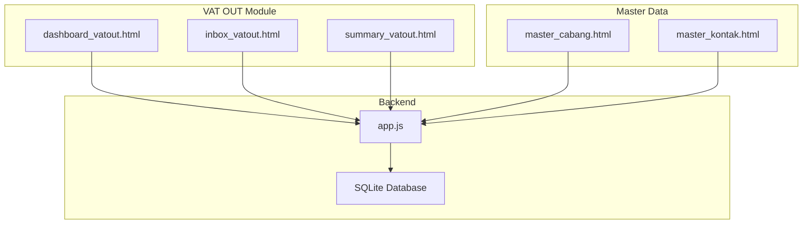
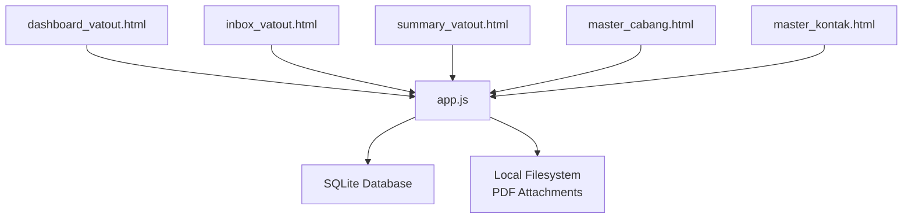
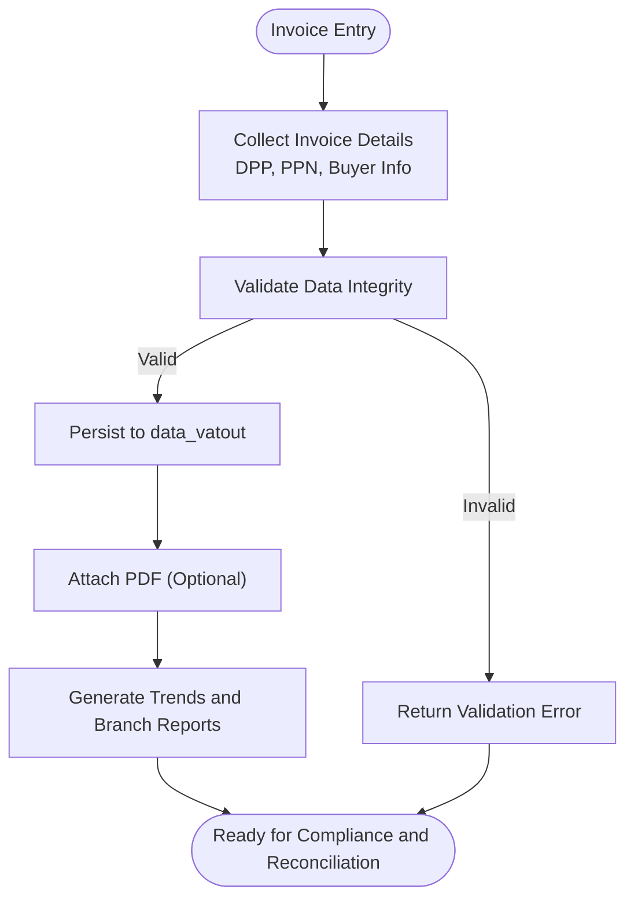
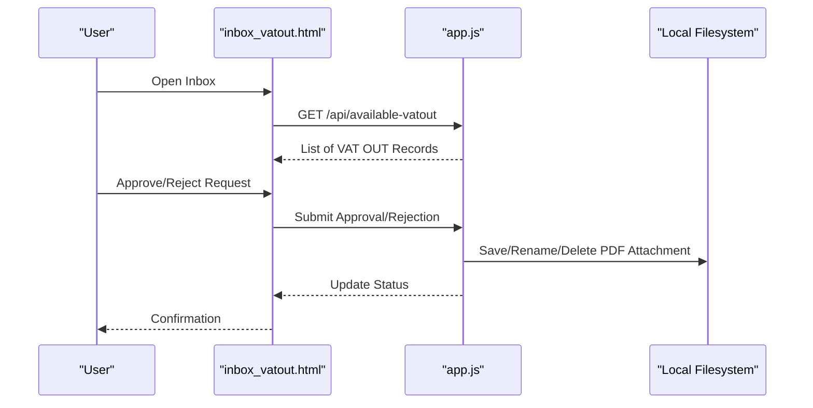
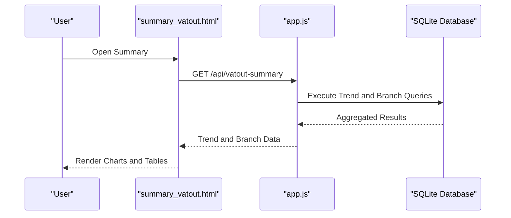
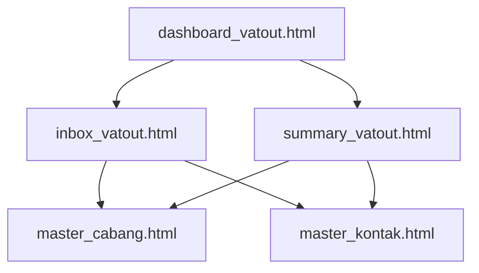
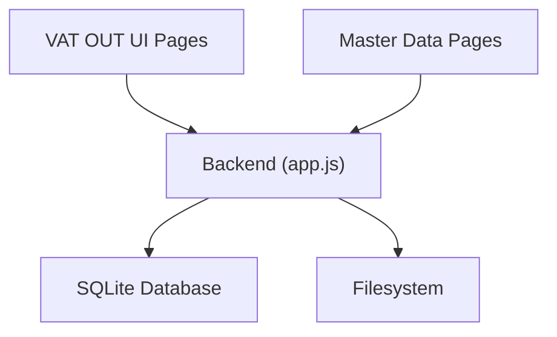

# VAT Output (VAT OUT)

<cite>
**Referenced Files in This Document**
- [app.js](file://app.js)
- [PRD_Tax_Database_System.md](file://PRD_Tax_Database_System.md)
- [dashboard_vatout.html](file://vat_out/dashboard_vatout.html)
- [inbox_vatout.html](file://vat_out/inbox_vatout.html)
- [summary_vatout.html](file://vat_out/summary_vatout.html)
- [master_cabang.html](file://master_cabang.html)
- [master_kontak.html](file://master_kontak.html)
- [client_ledger.html](file://accounting/client_ledger.html)
</cite>

## Table of Contents
1. [Introduction](#introduction)
2. [Project Structure](#project-structure)
3. [Core Components](#core-components)
4. [Architecture Overview](#architecture-overview)
5. [Detailed Component Analysis](#detailed-component-analysis)
6. [Dependency Analysis](#dependency-analysis)
7. [Performance Considerations](#performance-considerations)
8. [Troubleshooting Guide](#troubleshooting-guide)
9. [Conclusion](#conclusion)

## Introduction
This document provides comprehensive documentation for the VAT Output (VAT OUT) management module. It covers transaction management workflows for invoice generation, customer billing, and tax calculation; inbox processing for managing incoming VAT output requests, approvals, and status tracking; summary reporting for VAT output analysis, compliance reporting, and financial reconciliation; and user interface components for VAT output processing, customer management integration, and transaction monitoring. It also explains VAT liability calculations, output tax handling, regulatory compliance requirements, practical processing examples, integration scenarios with customer management, and troubleshooting guidance for VAT output-related issues.

## Project Structure
The VAT OUT module consists of three primary HTML pages under the vat_out directory and supporting backend endpoints in the application server. The backend integrates with database tables for VAT OUT transactions, manages PDF attachments, and exposes APIs for dashboards and summaries. Customer and branch master data are integrated via dedicated pages for contact and branch management.

**Diagram sources**
- [app.js](file://app.js)
- [dashboard_vatout.html](file://vat_out/dashboard_vatout.html)
- [inbox_vatout.html](file://vat_out/inbox_vatout.html)
- [summary_vatout.html](file://vat_out/summary_vatout.html)
- [master_cabang.html](file://master_cabang.html)
- [master_kontak.html](file://master_kontak.html)

**Section sources**
- [app.js](file://app.js)
- [PRD_Tax_Database_System.md](file://PRD_Tax_Database_System.md)

## Core Components
- VAT OUT Transaction Tables and Keys
  - The VAT OUT module uses a header table for transaction records and related detail items. The header table includes keys such as invoice number, entity, branch code, project ID, vendor/customer identifiers, invoice date, amounts (DPP and PPN), references, issuing location, signatory, internal invoice number, exchange date, format type, PDF link, input user, and timestamp. These fields support invoice generation, customer billing, and tax calculation workflows.
- Backend Endpoints
  - Trend and Branch Summary Endpoint: Aggregates monthly trends and branch-level totals for invoices and taxes.
  - Available VAT OUT Endpoint: Retrieves available VAT OUT records filtered by entity and optionally by client name and mode.
  - PDF Attachment Management: Handles saving, renaming, and cleanup of PDF attachments associated with VAT OUT records.
- UI Pages
  - Dashboard: Provides overview metrics and navigation for VAT OUT operations.
  - Inbox: Manages incoming VAT OUT requests, approvals, and status tracking.
  - Summary: Delivers analytical reports for VAT output analysis, compliance, and reconciliation.

**Section sources**
- [PRD_Tax_Database_System.md](file://PRD_Tax_Database_System.md)
- [app.js](file://app.js)

## Architecture Overview
The VAT OUT module follows a client-server architecture with HTML-based UI pages and a Node.js backend. The backend connects to a local SQLite database, exposes REST-like endpoints for dashboards and summaries, and manages file attachments for invoices. Master data for branches and contacts supports customer management integration.

**Diagram sources**
- [app.js](file://app.js)
- [dashboard_vatout.html](file://vat_out/dashboard_vatout.html)
- [inbox_vatout.html](file://vat_out/inbox_vatout.html)
- [summary_vatout.html](file://vat_out/summary_vatout.html)
- [master_cabang.html](file://master_cabang.html)
- [master_kontak.html](file://master_kontak.html)

## Detailed Component Analysis

### VAT Liability and Tax Calculation Workflow
- Data Model Alignment
  - The header table stores DPP (Taxable Value) and PPN (Output Tax) amounts per invoice. These fields enable straightforward VAT liability computation and tax reporting.
- Invoice Generation and Customer Billing
  - The available VAT OUT endpoint retrieves invoice records with buyer details and amounts, enabling downstream billing and reconciliation processes.
- Trend and Branch Reporting
  - The backend aggregates monthly trends and branch-level totals for invoice counts and tax amounts, supporting financial reconciliation and compliance reporting.

**Diagram sources**
- [app.js](file://app.js)
- [PRD_Tax_Database_System.md](file://PRD_Tax_Database_System.md)

**Section sources**
- [PRD_Tax_Database_System.md](file://PRD_Tax_Database_System.md)
- [app.js](file://app.js)

### Inbox Processing and Approval Workflows
- Request Management
  - The inbox page displays incoming VAT OUT requests with buyer details, invoice dates, and amounts. Users can review, approve, or reject requests.
- Status Tracking
  - Status updates propagate through the backend to reflect approval outcomes and maintain audit trails.
- PDF Attachment Handling
  - The backend saves uploaded PDFs locally, renames them consistently, and cleans up previous attachments upon updates.

**Diagram sources**
- [inbox_vatout.html](file://vat_out/inbox_vatout.html)
- [app.js](file://app.js)

**Section sources**
- [inbox_vatout.html](file://vat_out/inbox_vatout.html)
- [app.js](file://app.js)

### Summary Reporting Capabilities
- Trend Analysis
  - Monthly trends are computed by grouping invoices by period, counting records, and aggregating DPP and PPN totals.
- Branch-Level Reporting
  - Branch-level summaries count invoices and aggregate tax totals, aiding regional compliance and reconciliation.
- Compliance and Financial Reconciliation
  - Summaries provide the basis for tax returns, reconciliations, and audit support.

**Diagram sources**
- [summary_vatout.html](file://vat_out/summary_vatout.html)
- [app.js](file://app.js)

**Section sources**
- [summary_vatout.html](file://vat_out/summary_vatout.html)
- [app.js](file://app.js)

### User Interface Components and Integrations
- Dashboard
  - Provides overview metrics and navigation links to inbox and summary views.
- Inbox
  - Supports request review, approval/rejection actions, and status updates.
- Summary
  - Presents charts and tables for trend and branch-level analysis.
- Customer and Branch Integration
  - Master data pages supply branch and contact information used in VAT OUT records.

**Diagram sources**
- [dashboard_vatout.html](file://vat_out/dashboard_vatout.html)
- [inbox_vatout.html](file://vat_out/inbox_vatout.html)
- [summary_vatout.html](file://vat_out/summary_vatout.html)
- [master_cabang.html](file://master_cabang.html)
- [master_kontak.html](file://master_kontak.html)

**Section sources**
- [dashboard_vatout.html](file://vat_out/dashboard_vatout.html)
- [inbox_vatout.html](file://vat_out/inbox_vatout.html)
- [summary_vatout.html](file://vat_out/summary_vatout.html)
- [master_cabang.html](file://master_cabang.html)
- [master_kontak.html](file://master_kontak.html)

### Practical Examples and Integration Scenarios
- Example: Generating a VAT OUT Invoice
  - Use the available VAT OUT endpoint to fetch buyer and amount details, then create an invoice record with DPP and PPN fields aligned to the header table schema.
- Example: Managing Incoming Requests
  - Review requests in the inbox, approve or reject based on validation rules, and update statuses accordingly.
- Example: Compliance Reporting
  - Generate monthly trends and branch-level summaries to support tax filings and reconciliations.
- Integration with Customer Management
  - Link buyer information to master contact records and branch information to master branch records for accurate invoicing and reporting.

**Section sources**
- [app.js](file://app.js)
- [PRD_Tax_Database_System.md](file://PRD_Tax_Database_System.md)
- [master_kontak.html](file://master_kontak.html)
- [master_cabang.html](file://master_cabang.html)

## Dependency Analysis
- Internal Dependencies
  - UI pages depend on backend endpoints for data retrieval and updates.
  - PDF attachment management depends on filesystem operations coordinated by the backend.
- External Dependencies
  - The backend interacts with a local SQLite database and filesystem for storage and retrieval.
- Master Data Dependencies
  - VAT OUT records reference branch and contact master data, ensuring accurate customer and branch identification.

**Diagram sources**
- [app.js](file://app.js)
- [dashboard_vatout.html](file://vat_out/dashboard_vatout.html)
- [inbox_vatout.html](file://vat_out/inbox_vatout.html)
- [summary_vatout.html](file://vat_out/summary_vatout.html)
- [master_cabang.html](file://master_cabang.html)
- [master_kontak.html](file://master_kontak.html)

**Section sources**
- [app.js](file://app.js)
- [PRD_Tax_Database_System.md](file://PRD_Tax_Database_System.md)

## Performance Considerations
- Query Efficiency
  - Use indexed columns (entity, invoice date) in queries to optimize trend and branch aggregation.
- Attachment Management
  - Minimize unnecessary file operations by consolidating save/rename/cleanup steps during updates.
- UI Responsiveness
  - Paginate large datasets in the inbox and limit report scopes to reduce rendering overhead.

## Troubleshooting Guide
- PDF Attachment Issues
  - Verify that PDF files are saved with consistent naming and that cleanup routines remove outdated attachments after updates.
- Data Retrieval Problems
  - Confirm that the available VAT OUT endpoint filters by entity and applies proper ordering for timely retrieval.
- Trend and Branch Report Errors
  - Ensure that aggregation queries group by period and branch codes correctly and handle missing data gracefully.
- Audit and Reconciliation Discrepancies
  - Cross-check invoice counts and totals against the header table fields and confirm that master data links are intact.

**Section sources**
- [app.js](file://app.js)

## Conclusion
The VAT Output (VAT OUT) module provides a structured framework for invoice generation, customer billing, tax calculation, inbox processing, and summary reporting. Its integration with master data ensures accurate customer and branch identification, while backend endpoints and filesystem management support efficient operations. By leveraging trend and branch-level summaries, organizations can meet compliance requirements and streamline financial reconciliation processes.