# Architecture & Sequence Diagram - Tax Database System (TDS)

Dokumen ini memuat arsitektur interaksi dan alur logika menyeluruh (*System-wide Sequence Diagram*) dari aplikasi TDS. Karena sistem ini sangat kompleks dan melibatkan berbagai modul (VAT IN, VAT OUT, PPh, Akuntansi/Client Ledger, dan Tax Project Report), diagram ini dibagi menjadi fase-fase eksekusi fungsional utama.

```mermaid
sequenceDiagram
    autonumber
    
    actor User as Staff / SPV / Admin
    participant Client as Browser (UI / PDF.js)
    participant Auth as Auth Middleware
    participant API as API Express & Socket.io
    participant DB as Database (SQLite3)
    participant Master as Master Data (Vendor/Cabang)

    %% ==========================================
    %% FASE 1: AUTHENTICATION & SESSION
    %% ==========================================
    rect rgb(230, 240, 255)
    Note over User, Master: FASE 1: AUTHENTICATION & ROLE-BASED SESSION
    User->>Client: Buka `/login` & Input Kredensial
    Client->>API: POST `/login` (username, password)
    API->>DB: Cek Hash Bcrypt di tabel `users`
    DB-->>API: Return (id, role: staff/supervisor/admin)
    API->>Auth: Set Session (req.session.user)
    API-->>Client: Redirect ke `/dashboard-utama`
    Client->>API: Request UI & API Lanjutan
    API->>Auth: Validasi Middleware `cekAuth` & `cekRoleAPI`
    Auth-->>API: Terotorisasi (Pass)
    end

    %% ==========================================
    %% FASE 2: BATCH INGESTION (VAT IN, VAT OUT, BPPU)
    %% ==========================================
    rect rgb(240, 255, 240)
    Note over User, Master: FASE 2: BATCH UPLOAD → STAGING/FINAL INSERT + AUTO-EXTRACTION

    %% ---------- VAT IN (Direct-to-data_vatin) ----------
    User->>Client: Upload batch PDF (VAT IN)
    Client->>Client: PDF.js parse teks + items
    Client->>API: Socket emit `upload-pdf-vatin-batch` (payload chunks)

    API->>DB: Deduplikasi (cek `no_faktur`)
    DB-->>API: duplikat?/ok

    alt Duplikat
        API->>API: Skip (increment duplikat/gagal)
    else Normal / Pengganti
        API->>API: Parse status_faktur dari digit no_faktur
        API->>API: Hitung `no_faktur_normal` (jika Pengganti)
        API->>DB: INSERT `data_vatin` dengan `kode_cabang='Perlu Verifikasi'`
        API->>DB: INSERT `item_vatin`
    end

    API->>Master: INSERT/UPDATE `master_vendor` (NPWP→nama/alamat)
    API->>Master: INSERT/UPDATE `master_client`
    API-->>Client: emit `upload-batch-selesai`

    %% ---------- VAT OUT (Inbox → data_vatout) ----------
    User->>Client: Upload batch PDF (VAT OUT)
    Client->>Client: PDF.js parse teks
    Client->>API: Socket emit `upload-pdf-vatout-batch`

    API->>DB: Deduplikasi (cek `no_faktur`)
    DB-->>API: duplikat?/ok

    alt Duplikat
        API->>API: Skip
    else Baru
        API->>DB: INSERT `inbox_vatout` (staging)
        API-->>Client: emit `upload-batch-selesai`
    end

    User->>Client: (di UI) Klik proses verifikasi → Simpan Final
    Client->>API: Socket event `simpan-final-vatout` (payload branch/no internal)
    API->>DB: BEGIN TX
    API->>DB: INSERT `data_vatout` + `item_vatout`
    API->>DB: DELETE `inbox_vatout` (id_link)
    API-->>Client: emit `data-baru-vatout`

    %% ---------- BPPU PAYABLE / PREPAID (Inbox → data_payable/prepaid) ----------
    User->>Client: Upload batch PDF (Tax Payable / Prepaid)
    Client->>Client: PDF.js parse teks
    Client->>API: Socket emit `upload-pdf-payable-batch` / `upload-pdf-prepaid-batch`

    API->>DB: Deduplikasi (cek `no_bppu`)
    alt Duplikat
        API->>API: Skip
    else Baru
        API->>DB: INSERT `inbox_payable` atau `inbox_prepaid` (staging)
    end

    User->>Client: Klik `Simpan Final` di modal verifikasi inbox
    Client->>API: Socket `simpan-final-payable` / `simpan-final-prepaid`
    API->>DB: INSERT `data_payable` / `data_prepaid` + DELETE inbox

    API-->>Client: update event `data-baru-*` / `update-tabel-*`
    end


    %% ==========================================
    %% FASE 3: VERIFIKASI & PENYELARASAN RELASI
    %% ==========================================
    rect rgb(255, 250, 240)
    Note over User, DB: FASE 3: DATA VERIFICATION & BRANCH ASSIGNMENT
    User->>Client: Buka Menu (Filter "Perlu Verifikasi")
    Client->>API: GET `/api/data-vatin` (Pagination & Debounce SQL Logic)
    API-->>Client: Return Data + Pagination
    
    User->>Client: Klik "Edit", Input Cabang & No. Invoice Internal
    Client->>API: Request SIMPAN VERIFIKASI
    API->>DB: UPDATE `data_vatin` (kode_cabang terisi)
    API->>DB: INSERT `audit_logs` (Verifikasi Sukses)
    API-->>Client: Return Sukses
    end

    %% ==========================================
    %% FASE 4: CROSS-MODULE ANALYTICS (REPORTING)
    %% ==========================================
    rect rgb(253, 245, 230)
    Note over User, DB: FASE 4: CROSS-MODULE ANALYTICS (PROJECT PROFITABILITY)
    User->>Client: Buka `/tax-project-report` (Laba/Rugi Pajak)
    Client->>API: GET `/api/projects` (Ambil list proyek dari Master Cabang)
    API-->>Client: Return List Proyek
    
    User->>Client: Pilih 1 Proyek Tertentu (Misal: Cabang PUSAT)
    Client->>API: GET `/api/project-summary/:id`
    
    %% Agregasi Lintas Tabel
    API->>DB: SELECT `data_vatout` (PPN Keluaran berdasarkan Project ID)
    API->>DB: SELECT `data_vatin` (PPN Masukan berdasarkan Project ID)
    API->>DB: SELECT `data_client_ledger` (Tagihan & Kontrak Akuntansi)
    DB-->>API: Return Aggregate Array
    
    API->>API: Komparasi Relasional & Kalkulasi Financial
    API-->>Client: Return JSON Gabungan
    Client-->>User: Render Grafik PPN (Lebih/Kurang Bayar) & Laba Bersih
    end

    %% ==========================================
    %% FASE 5: RESTRICTED MUTATION (RBAC APPROVAL)
    %% ==========================================
    rect rgb(255, 240, 245)
    Note over User, DB: FASE 5: SECURE MUTATION (SUPERVISOR APPROVAL)
    User->>Client: Klik "Hapus" pada data yang sudah Diverifikasi (Role=Staff)
    Client->>API: Emit / Request DELETE
    
    Note over API, Auth: Middleware `cekRoleAPI` mengecek kewenangan
    API->>DB: Karena Staff -> INSERT ke `user_requests` (Status='Pending')
    API-->>Client: Notifikasi "Butuh Approval SPV"
    
    User(SPV)->>Client: Login sebagai Supervisor
    Client->>API: GET Request Pending
    API-->>Client: Tampilkan antrean `user_requests`
    
    User(SPV)->>Client: Klik "APPROVE"
    Client->>API: POST Eksekusi Persetujuan
    API->>DB: UPDATE `user_requests` (Status='Approved')
    API->>DB: DELETE / UPDATE Actual Data di `data_vatin`
    API->>DB: INSERT `audit_logs` (SPV Approved)
    API-->>Client: Data termutasi secara permanen
    end

    %% ==========================================
    %% FASE 6: REPORTING & DATA EXPORT
    %% ==========================================
    rect rgb(235, 245, 255)
    Note over User, DB: FASE 6: BATCH EXPORT & REPORT GENERATION
    User->>Client: Klik Tombol "Export Excel/CSV" dengan Filter Tanggal/Masa Pajak
    Client->>API: GET `/api/export/...` (Parameter Filter)
    API->>DB: SELECT Data Terfilter & JOIN Relasi Master Data
    DB-->>API: Return Array Objek Data
    API->>API: Konversi Data ke format Workbook (XLSX/CSV)
    API-->>Client: Stream file biner (Download Attachment)
    Client-->>User: File laporan tersimpan di perangkat lokal
    end
```

## Penjelasan Mendalam Tiap Fase (Deep Dive)

### FASE 1: Authentication & Role-Based Session
TDS tidak mengizinkan akses ilegal. Seluruh *endpoints* API maupun *routes* HTML dilindungi oleh sistem Autentikasi berbasis *Session* (Middleware `cekAuth`). Di dalam rute sensitif (seperti Modul Admin, Mutasi Master Data, atau Ekspor Laporan), Middleware `cekRoleAPI` bertugas menolak *request* secara spesifik apabila tingkatan wewenang peran (Admin/SPV/Staff) tidak memenuhi syarat, menghasilkan status HTTP `403 Forbidden`.

### FASE 2: Dynamic Batch Ingestion (Auto-Extraction)
Kecepatan sistem TDS bersumber dari teknik pemrosesan asinkron *hybrid*:
1. **Client-side Vector Parsing**: Komponen PDF.js di peramban pengguna mendekomposisi *binary PDF* menjadi struktur data berwujud teks. Langkah ini membebaskan *server backend* dari beban komputasi dokumen yang ekstensif.
2. **Chunking & Socket.io**: Data mentah hasil ekstraksi tidak dikirimkan sekaligus secara konvensional, melainkan di-*stream* dalam *batch* potongan kecil (Chunks) melalui WebSocket `socket.io`. Strategi ini menjamin antarmuka browser tidak *freeze* atau meledak memorinya meskipun *user* mengunggah ratusan fail PDF sekaligus.
3. **Data Hydration & Master Indexing**: Sewaktu sistem mendeteksi kehadiran transaksi faktur baru, *Backend* TDS tidak sekadar mengarsipkan entri ke tabel operasional pajak (`data_vatin`/`data_vatout`), ia pun secara heuristik memperbarui kamus data induk (`master_vendor` atau `master_client`) tanpa intervensi penyalinan klerikal dari manusia.

### FASE 3: Verification & Branch Alignment
TDS memutus siklus duplikasi melalui proses karantina data baru. Fail-fail yang disuntikkan secara otomatis masuk ke dalam sistem belum berkontribusi ke profil anggaran (*Project ID / Kode Cabang*) suatu proyek yang bersangkutan. UI secara dinamis melabelinya dengan status visual peringatan *"Perlu Verifikasi"*. Ritual verifikasi oleh Staf Pajak adalah jembatan fungsional yang mensinergikan Dokumen Fiskal Eksternal dengan terminologi pembebanan Biaya Internal (*No. Invoice Internal & Cabang*).

### FASE 4: Cross-Module Analytics (Intelligence)
Di area `Tax Project Report`, TDS berevolusi menunaikan tugas kapabilitas komputasi setingkat *Micro-ERP*:
- Mengeksekusi rutinitas *Reverse-Query* dengan jalan menghimpun data keluaran `data_vatout` dan menyandingkannya dengan data pengurang/masukan `data_vatin`.
- Menyelaraskan sirkulasi penelusuran nomor internal dan mempertautkan *Prepaid Tax* (Bukti Potong) sebagai bantalan pelacakan transaksi.
- Melukiskan agregat finansial margin defisit/surplus (Profitabilitas Proyek) melalui piringan indikator visual untuk pengambilan keputusan manajerial yang lebih efisien.

### FASE 5: Secure Mutation (RBAC & Audit Trail)
Integritas finansial memegang peranan hakiki dalam sistem TDS. Di kala seberkas dokumen perpajakan berstatus sah dimohonkan penghapusan/modifikasi dari pihak operator, alurnya secara sengaja disabotase oleh lapisan sekuriti dan didesain agar mengkristal di antrean tabel `user_requests`. Keputusan vonis akhir berada di telunjuk figur berkapasitas otoritas *Supervisor/Administrator*. Apapun corak mutasinya (ditolak/diakomodir), entitas `audit_logs` merekamnya laksana *Immutable Trail*: stempel waktu kejadian, sidik jari *user*, modifikasi atribut data asal-usulnya, dan *trigger* presisi di baliknya.

### FASE 6: Reporting & Data Export
Sistem secara integratif memfasilitasi kebutuhan rekonsiliasi data perpajakan menuju format konsolidasi akuntansi utama perusahaan. Pengguna diberikan hak eksklusif memanen keluaran *database* ke dalam wujud fail *spreadsheet* (.xlsx / .csv) siap pakai, untuk diteruskan pelaporannya ke badan pajak kenegaraan atau dikanalisasikan ke dalam sistem korporasi perangkat lunak ERP (*Enterprise Resource Planning*) milik induk perusahaan.
